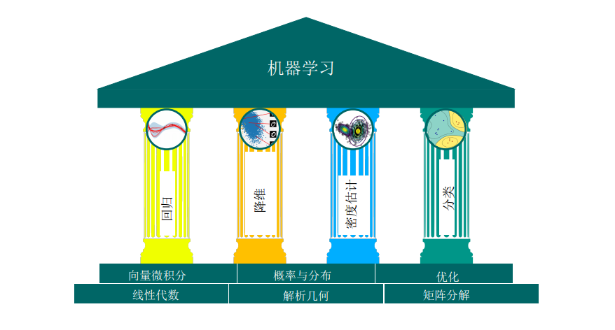

# 第 1 章 介绍和动机（Introduction and Motivation）

## 本章导学

**学习目标**：建立对机器学习的整体认识——它的三个核心概念（数据、模型、学习）、它与数学的关系，以及本书"四大支柱"（回归、降维、密度估计、分类）的路线图。

**预备知识**：无。本章是全书的入口，不含数学推导。

---

## 1.1 什么是机器学习

**机器学习**是关于设计**自动从数据中提取有价值信息的算法**。重点是"自动"：关注可应用于许多数据集的通用方法，同时产生有意义的结果。机器学习的核心是三个概念：

- **数据（data）**：机器学习本质上是数据驱动的。目标是设计通用方法，从数据中提取有价值的模式，理想情况下不需要太多特定领域的专业知识。（例：给定大量文档，自动发现跨文档共享的相关主题——Hoffman et al., 2010。）本书假设数据已被转换为数字表示，**将数据视为向量**。
- **模型（model）**：描述生成数据的过程的简化版本——"类似手工加数据"。好模型能预测现实世界会发生什么，而无需做真实世界的实验。回归场景中的模型就是把输入映射到实值输出的函数。套用 Mitchell (1997) 的定义：**如果在考虑数据后模型在给定任务上的性能有所提高，则称该模型从数据中学习**。我们的目标是找**对未见过数据也表现良好**的模型——只在训练数据上表现好可能只是"记住了数据"（这是全书反复强调的泛化主题）。
- **学习（learning）**：通过**优化模型参数**，自动发现数据中模式和结构的方式。

**为什么需要数学基础？** 软件可以很容易地设计和训练机器学习系统，但数学基础对于理解构建更复杂系统的原理很重要：帮助创建新方案、理解和调试现有方法、了解方法的固有假设和局限性。

## 1.2 为直觉寻找词语

机器学习中的概念和词语往往不明确——同一个词在不同上下文含义不同。典型例子："机器学习算法"至少有两种含义：

1. **预测器（predictor）**：基于输入数据进行预测的系统；
2. **训练（training）**：调整预测器内部参数、使其在未来不可见数据上表现良好的系统。

本书不解决歧义问题，但会让上下文足够清晰。关于"向量"一词也有（至少）三种观点：**数字数组**（计算机科学）、**有方向和大小的箭头**（物理学）、**服从加法和缩放的对象**（数学）——本书主要用第三种，借用第一种来实现算法。

**训练 = 爬山**。大多数训练方法类似爬山：山峰峰值对应某些性能度量的最大值；我们真正关心的是模型在**没见过**的数据上的表现（泛化），而不仅仅是训练数据上的拟合。

**本书的主要概念小结**：

- 数据表示为向量；
- 用概率或优化的观点选择合适的模型；
- 用数值优化方法从数据中学习，目标是在未用于训练的数据上表现良好。

## 1.3 两种阅读本书的方式

两种理解策略：

- **自下而上**（数学领域的首选）：从基础到高级，随时能依赖已学概念；缺点是基础概念本身不够有趣，缺乏动力时定义很快被遗忘。
- **自上而下**（目标导向）：从实际需求深入基本原理，始终知道"为什么要学"；缺点是基础不牢，要先记住一堆不懂的术语。

本书采用**模块化**写法，两部分可分离：

- **Part I（数学基础，第 2–7 章）**：章节主要前后依赖，必要时可跳章往后学；
- **Part II（机器学习，第 8–12 章）**：四大支柱章节松散耦合，可按任意顺序读。

两部分之间有大量互相引用，把数学概念与机器学习算法联系起来。当然，实际阅读通常是两种策略的结合。

   
   <b>图 1.1 机器学习的基础和四大支柱</b> 

### Part I：数学基础与四大支柱的对应

| 支柱需要的概念 | 数学工具 | 章节 |
| --- | --- | --- |
| 数据表示为向量、表格数据表示为矩阵 | 线性代数 | 第 2 章 |
| 度量向量间的相似性/距离 | 解析几何 | 第 3 章 |
| 对数据做有效解释和学习的矩阵操作 | 矩阵分解 | 第 4 章 |
| 量化"噪声"与预测的不确定性 | 概率论 | 第 6 章 |
| 寻找搜索方向（梯度）、求函数最大/最小值 | 向量微积分 + 优化 | 第 5、7 章 |

（注意阅读顺序的提示：第 5 章微积分在第 6 章概率之前讲，因为优化与梯度是第 7 章的直接前置；概率第 6 章随后展开。）

### Part II：四大支柱（按难度递增）

1. **第 8 章**：数学化重申数据、模型、参数估计三要素 + 实验设置指南（防止对系统的过于乐观的评估）；
2. **第 9 章 回归（regression）**：输入 $\boldsymbol x \in \mathbb{R}^D$ → 实值标签 $y \in \mathbb{R}$；最大似然/最大后验/贝叶斯线性回归（对参数积分而非优化）；
3. **第 10 章 降维（dimensionality reduction）**：PCA；找高维数据的紧凑低维表示——只有数据 $\boldsymbol x$，没有标签；
4. **第 11 章 密度估计（density estimation）**：高斯混合模型 + 迭代参数估计（EM）；目标是描述数据的概率分布——同样无标签，但不做降维，而是建模密度；
5. **第 12 章 分类（classification）**：支持向量机；与回归类似有输入和标签，但标签是整数（类别），需要特殊处理。

## 1.4 练习和反馈

第一部分配有纸笔练习（即各章的 Exercises.md）；第二部分配有 Jupyter notebook 编程教程。本书可在 https://mml-book.com 免费下载（含教程、勘误表），错误与反馈也可通过该网址提交。

---

## 本章小结

| 要点 | 内容 |
| --- | --- |
| 三要素 | 数据（向量）、模型（生成过程的简化）、学习（参数优化） |
| 关键区分 | 预测器 vs 训练；训练误差 vs 泛化误差 |
| 阅读方式 | Part I 打基础（2→7 章），Part II 四大支柱（8→12 章，可跳读） |
| 下一步 | 第 2 章线性代数——把数据变成可以运算的对象 |

**与其他章节的关系**：本章是路线图；第 8 章会用数学语言重新精确表述"数据、模型、学习"三要素。
