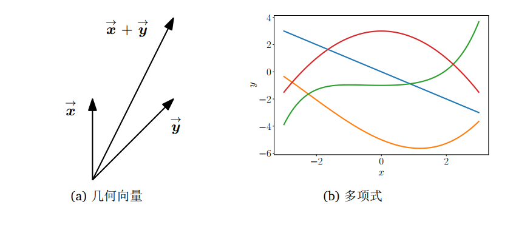
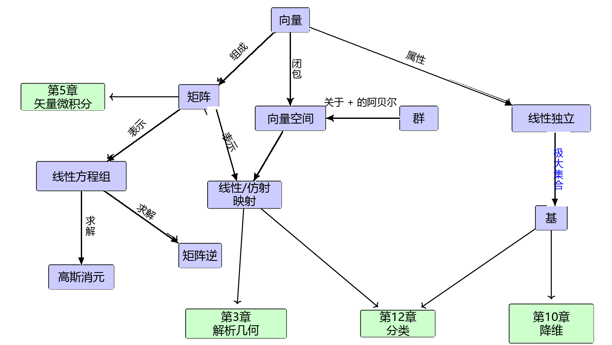

# 第 2 章 线性代数（Linear Algebra）

## 本章导学

**学习目标**

1. 说清楚"向量"在数学上的一般定义——它远不止"带箭头的线段"；
2. 了解几何向量、多项式、音频信号、$n$ 元实数组为什么都算向量；
3. 理解"封闭性（closure）"这一贯穿全章的核心思想，知道本章各节之间的逻辑路线。

**预备知识**：高中数学中的向量基本概念（方向、大小）即可。本章从最基本的概念重新出发，不假设任何线性代数基础。

**符号速查表**：

| 符号 | 读法 | 含义 |
| --- | --- | --- |
| $\boldsymbol x$（粗体字母） | 向量 x | 本书表示向量的统一记号 |
| $\vec{x}$（字母上方小箭头） | 向量 x | 高中几何向量的传统记号，本书基本不用 |
| $\mathbb{R}$ | "R" | 全体实数构成的集合 |
| $\mathbb{R}^n$ | "R n 次" | 所有 $n$ 元实数组构成的空间，如 $\mathbb{R}^3$ 是三元数组的空间 |
| $\in$ | 属于 | $\boldsymbol a \in \mathbb{R}^3$ 表示"a 是一个三元实数组" |
| $\lambda$ | lambda | 希腊字母，常用来表示一个实数（标量） |
| $\begin{bmatrix} 1 \\ 2 \\ 3 \end{bmatrix}$ | 列向量 | 竖着写的向量，三个数从上到下依次是第 1、2、3 个分量 |

---

## 2.0.1 什么是代数？什么是线性代数？

在形式化一个直观概念时，数学中一种常见的方法是：构造**一组对象（符号）**和**一组操作这些对象的规则**，这被称为**代数（algebra）**。

线性代数研究的对象是**向量**，规则是"相加"和"乘以标量（数）"这两种运算，以及由它们衍生出的一切。这一章（以及第 3 章）将为机器学习中的绝大多数算法打下语言基础。

**一个提醒**：很多人在学校学过的向量是"几何向量"——画在纸上的、带小箭头的有向线段，常写作 $\vec{x}$。本书讨论更一般的向量概念，统一用粗体字母表示，例如 $\boldsymbol x$ 和 $\boldsymbol y$。几何向量只是众多向量中的一种。

## 2.0.2 什么样的事物算是向量？

从抽象的数学角度看，向量就是满足以下两个性质的对象：

1. 可以**相加**，结果仍是同类型的对象；
2. 可以**乘以标量（一个实数）**，结果仍是同类型的对象。

听上去简单，但满足这两条的对象多得出人意料：

**1. 几何向量（geometric vectors）**

高中数学和物理中熟悉的对象，参见图 2.1(a)。几何向量是平面或空间中的有向线段，可以用箭头画出：

- 两个几何向量可以相加：$\vec{x} + \vec{y} = \vec{z}$，按平行四边形法则画出来是另一个几何向量；
- 乘以标量 $\lambda \in \mathbb{R}$：$\lambda \vec{x}$ 是沿原方向（$\lambda > 0$）或反方向（$\lambda < 0$）把原向量缩放 $\lambda$ 倍得到的新向量。

所以几何向量符合向量的定义。把向量解释为几何向量，最大的好处是可以利用我们对**方向**和**大小**的直觉来理解各种运算。

**2. 多项式（polynomials）**

两个多项式相加得到另一个多项式；多项式乘以一个实数，结果仍是多项式。例如 $p(t) = 1 + 2t$、$q(t) = 3 - t$，则

$$
p(t) + q(t) = 4 + t, \qquad 5 \cdot p(t) = 5 + 10t
$$

都是多项式。因此多项式也是向量——虽然它和几何向量长得完全不同：一个是纸上的箭头，一个是抽象的数学表达式。这正是"向量"一般定义的力量：**外表不重要，运算规则才重要**。

**3. 音频信号（audio signals）**

一段数字音频可以表示为一串数字（采样值）。两段音频信号可以叠加（混音），结果是一段新音频；音频乘以一个实数，相当于调节音量，结果仍是音频信号。所以音频信号也是向量。

**4. $n$ 个实数构成的元组（$\mathbb{R}^n$ 的元素）**

这是本书最关注的向量类型。例如

$$
\boldsymbol a = \begin{bmatrix} 1 \\ 2 \\ 3 \\ \end{bmatrix} \in \mathbb{R}^3 \tag{2.1}
$$

就是一个三元实数组（三个实数排成一列）。它的运算规则非常直接：

- **按分量相加**：$\boldsymbol a + \boldsymbol b = \boldsymbol c \in \mathbb{R}^n$，即每个位置上的数分别相加。例如

$$
\begin{bmatrix} 1 \\ 2 \\ 3 \end{bmatrix} + \begin{bmatrix} 4 \\ 5 \\ 6 \end{bmatrix} = \begin{bmatrix} 1+4 \\ 2+5 \\ 3+6 \end{bmatrix} = \begin{bmatrix} 5 \\ 7 \\ 9 \end{bmatrix}
$$

- **按分量数乘**：$\lambda \boldsymbol a$ 把每个分量都乘 $\lambda$。例如 $10 \cdot \boldsymbol a = [10, 20, 30]^\top$。

$\mathbb{R}^n$ 型向量还有一个额外的好处：它几乎就是计算机上的**实数数组**。许多编程语言直接支持数组的加法和数乘，这让涉及向量的算法可以方便地落地为代码。

   
  <b>图 2.1 不同类型的向量。向量可以是令人惊讶的对象，包括 (a) 几何向量和 (b) 多项式。</b> 

## 2.0.3 线性代数关心什么？

线性代数侧重于以上各种向量概念之间的**相似性**：不管向量长什么样，它们都可以相加、可以数乘，而且运算规则高度一致。

本书主要研究 $\mathbb{R}^n$ 中的向量，因为线性代数中的大多数算法都是在 $\mathbb{R}^n$ 中表述的（第 8 章会看到，机器学习中的数据通常都表示成 $\mathbb{R}^n$ 中的向量）。对于有限维向量空间，任何类型的向量都和 $\mathbb{R}^n$ 中的某个数组存在一一对应关系——所以研究 $\mathbb{R}^n$ 并不损失一般性。方便的时候，我们会借用几何向量的直觉；写算法的时候，我们会用数组的观点。

数学中有一个贯穿本章的思想：**闭包（closure）**——"我允许的操作，会产生什么样的结果？"对向量而言，这个问题是：从一个小向量集出发，不断把它们相加、缩放，最终能得到什么样的向量集合？（答案就是 2.6 节要讲的"张成空间"和"基"。）

本章的概念路线图见图 2.2。

   
   <b>图 2.2 本章介绍的概念的思维导图，以及它们在本书其他部分中的使用位置。</b> 

## 2.0.4 本章内容的来源与去向

本章主要基于 Drumm 和 Weil (2001)、Strang (2003)、Hogben (2013)、Liesen 和 Mehrmann (2015) 的讲义和书籍，以及 Pavel Grinfeld 的线性代数系列。其他优秀资源包括 Gilbert Strang 在麻省理工学院的线性代数课程和 3Blue1Brown 的线性代数系列。

线性代数在机器学习和数学中都扮演着核心角色，本章的概念会不断重现：

- 第 3 章：把本章的代数概念扩展为几何概念（长度、角度、正交性）；
- 第 5 章：向量微积分，矩阵运算是必备工具；
- 第 10 章：用投影（3.8 节）通过主成分分析（PCA）做数据降维；
- 第 9 章：线性回归，线性代数在求解最小二乘问题中起核心作用。

---

## 本节小结

| 要点 | 内容 |
| --- | --- |
| 向量的一般定义 | 可以相加、可以数乘，且运算结果仍是同类型对象的事物 |
| 向量的例子 | 几何向量、多项式、音频信号、$\mathbb{R}^n$ 中的 $n$ 元实数组 |
| 本书的主战场 | $\mathbb{R}^n$（它几乎就是编程语言里的实数数组） |
| 核心思想 | 闭包：允许的操作会产生什么结果？→ 通向张成空间、基、秩 |

**与其他章节的关系**：本节是第 2 章的导言。接下来 2.1 节从"解方程组"这一最古老的问题出发引入线性代数，2.2 节介绍操作向量的工具——矩阵。
