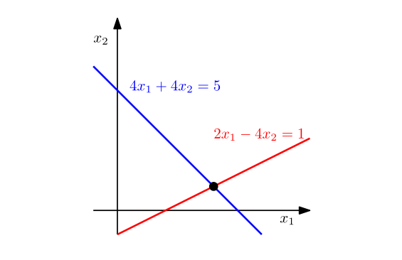

# 2.1 线性方程组（Systems of Linear Equations）

## 本节导学

**学习目标**

1. 知道什么是线性方程组，能写出它的一般形式；
2. 理解线性方程组的解只有三种可能：无解、唯一解、无穷多解，并能解释原因；
3. 能从几何上理解二元线性方程组的解（直线的交点）；
4. 理解"把方程组写成矩阵形式"的动机和写法，为 2.2 节的矩阵运算做准备。

**预备知识**：2.0 节的向量基本概念；初中的一元一次方程和二元一次方程组。

**符号速查表**：

| 符号 | 读法 | 含义 |
| --- | --- | --- |
| $x_1, x_2, \ldots, x_n$ | "x 下标 1…" | 未知数（待求的数） |
| $a_{ij}$ | "a i j" | 已知系数：第 $i$ 个方程中 $x_j$ 前面的数。双下标中 $i$ 是"第几个方程"，$j$ 是"第几个未知数" |
| $b_i$ | "b i" | 第 $i$ 个方程等号右边的已知数 |
| $\in \mathbb{R}$ | 属于实数 | 是一个实数 |
| $(x_1, \ldots, x_n) \in \mathbb{R}^n$ | n 元组 | 一个由 $n$ 个实数组成的有序数组，即方程组的一组"候选解" |
| $\vdots$ | 竖省略号 | "依此类推"，表示中间还有同类方程 |
| $\iff$ | 当且仅当 / 等价于 | 左右两边可以互相推出，含义完全相同 |

---

## 2.1.1 线性方程组从哪里来？

线性方程组是线性代数的核心。许多实际问题都可以表述为线性方程组，而线性代数提供的就是求解它们的系统工具。

**例 2.1（生产计划问题）**

一家公司用原材料 $R_1, \ldots, R_m$ 生产产品 $N_1, \ldots, N_n$。已知：

- 生产 1 单位产品 $N_j$ 需要消耗 $a_{ij}$ 单位的原材料 $R_i$；
- 原材料 $R_i$ 的总库存是 $b_i$ 单位。

**问题**：应该各生产多少单位 $x_j$ 的产品 $N_j$，才能恰好（理想情况下）用完所有原材料？

**分析**：如果我们生产 $x_1, \ldots, x_n$ 个单位的产品，那么对原材料 $R_i$ 的**总消耗量**是

$$
a_{i1}x_1 + \cdots + a_{in}x_n \tag{2.2}
$$

（每个产品 $N_j$ 消耗 $a_{ij}$ 单位，生产 $x_j$ 单位就消耗 $a_{ij} x_j$ 单位，把所有产品加起来。）要恰好用完库存，就需要总消耗 = 库存：

$$
\begin{array}{clr}
  a_{11}x_1 + \cdots + a_{1n}x_n & = b_1 \\
        & \vdots \\
  a_{m1}x_1 +  \cdots + a_{mn}x_n & = b_m \tag{2.3}
\end{array}
$$

这就是一个**线性方程组**（system of linear equations）：

- 每个方程都是**线性**的——未知数只以一次项出现，没有 $x_1^2$、$x_1 x_2$、$\sin x_1$ 之类；
- $x_1, \ldots, x_n$ 是**未知数**（要解出的数）；
- $a_{ij} \in \mathbb{R}$ 和 $b_i \in \mathbb{R}$ 是**已知常数**；
- 满足全部方程的一个 $n$ 元组 $(x_1, \ldots, x_n) \in \mathbb{R}^n$ 称为方程组的一个**解**。

机器学习中的线性回归（第 9 章）就是这类问题的一个变体：当方程组无解（现实数据几乎总是如此）时，找一个"尽可能接近"的解。

## 2.1.2 解的三种情况

**例 2.2（三个方程组，三种命运）**

第一个方程组：

$$
\begin{array}{clr}
  x_1 + x_2 + x_3 & = 3 &(1)\\
  x_1 - x_2 + 2x_3 & = 2 &(2)\\
  2x_1 + 3x_3 & = 1 &(3) \tag{2.4}
\end{array}
$$

**没有解**。理由：把方程 (1) 和 (2) 相加（等号左边加左边，右边加右边），左边 $x_2$ 消掉了，得到 $2x_1 + 3x_3 = 5$；但方程 (3) 说 $2x_1 + 3x_3 = 1$。同一个式子既要等于 5 又要等于 1，矛盾。所以没有任何 $(x_1, x_2, x_3)$ 能同时满足三个方程。

第二个方程组：

$$
\begin{array}{clr}
  x_1 + x_2 + x_3 & = 3 &(1)\\
  x_1 - x_2 + 2x_3 & = 2 &(2)\\
  x_2 + x_3 & = 2 &(3)\tag{2.5}
\end{array}
$$

有**唯一解** $(1, 1, 1)$。推导过程（注意每一步的技巧——用方程之间的加减消去未知数）：

- 由 (1) − (3)：$(x_1 + x_2 + x_3) - (x_2 + x_3) = 3 - 2$，即 $x_1 = 1$；
- (1) + (2)：$2x_1 + 3x_3 = 5$。代入 $x_1 = 1$，得 $2 + 3x_3 = 5$，即 $x_3 = 1$；
- 由 (3)：$x_2 = 2 - x_3 = 1$。

把 $(1,1,1)$ 代回三个方程逐一验证：$1+1+1=3$ ✓，$1-1+2=2$ ✓，$1+1=2$ ✓。确实唯一可能且确实是解。

第三个方程组：

$$
\begin{array}{clr}
  x_1 + x_2 + x_3 & = 3 &(1)\\
  x_1 - x_2 + 2x_3 & = 2 &(2)\\
  2x_1 + 3x_3 & = 5 &(3)\tag{2.6}
\end{array}
$$

有**无穷多个解**。注意 (1) + (2) 恰好等于 (3) 的左边和右边——方程 (3) 是**冗余**的，不提供任何新信息，可以删掉。剩下的两个方程、三个未知数无法把每个变量都唯一确定下来。由 (1) 和 (2)：

- (1) + (2)：$2x_1 + 3x_3 = 5$，解出 $x_1 = \frac{5}{2} - \frac{3}{2} x_3$；
- (1) − (2)：$2x_2 - x_3 = 1$，解出 $x_2 = \frac{1}{2} + \frac{1}{2} x_3$。

$x_3$ 没有被任何方程约束——它可以取**任意实数**。把 $x_3$ 记作自由参数 $a \in \mathbb{R}$，则所有解的集合是

$$
\left( \frac{5}{2} - \frac{3}{2}a, \ \frac{1}{2} + \frac{1}{2}a, \ a \right), \quad a \in \mathbb{R} \tag{2.7}
$$

例如取 $a = 1$ 得 $(1,1,1)$（恰好是第二个方程组的解），取 $a = 3$ 得 $(-2, 2, 3)$，代回验证：$-2+2+3=3$ ✓，$-2-2+6=2$ ✓，$2 \times (-2) + 3 \times 3 = 5$ ✓。

> **一般结论**：实系数线性方程组的解只有三种可能——**无解**、**唯一解**、**无穷多解**。（不存在"恰有两个解"之类的情况：如果两组不同的数都满足全部方程，那么它们的差会产生一整条解直线，从而有无穷多解。这个论证会在 2.3 节用"特解 + 齐次解"的语言严格化。）

## 2.1.3 几何解释：解就是"交点"

**备注**（线性方程组的几何解释）。对两个未知数的情形，每个线性方程在 $x_1 x_2$ 平面上定义**一条直线**（如 $x_1 + x_2 = 3$ 是斜率为 $-1$ 的直线）。方程组的解必须同时落在所有直线上，所以解集 = 这些直线的**交集**：

- 两条直线**相交于一点** → 唯一解；
- 两条直线**重合** → 同一条约束说了两遍 → 无穷多解（交线即直线本身）；
- 两条直线**平行** → 没有交点 → 无解。

图 2.3 画的是方程组

$$
\begin{array}{clr}
  4x_1 + 4x_2 & = 5 \\
  2x_1 - 4x_2 & = 1 \tag{2.8}
\end{array}
$$

它的解是两条直线的交点 $(x_1, x_2) = (1, \frac{1}{4})$。我们亲手验证一下：两式相加得 $6x_1 = 6$，即 $x_1 = 1$；代入第二式：$2 - 4x_2 = 1$，即 $x_2 = \frac{1}{4}$ ✓。

类似地，三个未知数时，每个线性方程定义三维空间中的**一个平面**，解集是这些平面的公共交集——可能是一个平面、一条直线、一个点，或者空集（平面互相平行无公共交点）。

   
   <b>图 2.3 具有两个变量的两个线性方程组的解空间可以在几何上解释为两条线的交点。每个线性方程代表一条线。</b> 

## 2.1.4 紧凑记号：向矩阵形式迈进

例 2.2 中我们反复做了"方程相加、消元"的手工操作。对于两三个方程还行，但对于成百上千个变量的实际问题，我们需要**系统的算法**（2.3 节的高斯消元法）和**紧凑的记号**（矩阵）。先来体会这个记号。

把一般形式 (2.3) 的方程组按列重新组织——把每个未知数 $x_j$ 的系数抽出来看成一个**列**：

$$
 \begin{bmatrix} a_{11} \\ \vdots \\ a_{m1} \end{bmatrix}x_1 +
 \begin{bmatrix} a_{12} \\ \vdots \\ a_{m2} \end{bmatrix}x_2 +
 \cdots +
 \begin{bmatrix} a_{1n} \\ \vdots \\ a_{mn} \end{bmatrix}x_n =
 \begin{bmatrix} b_1 \\ \vdots \\ b_m \end{bmatrix} \tag{2.9}
$$

**逐列解读**：整个方程组等价于一个向量方程——"未知数 $x_1$ 乘上第一列系数向量，加上 $x_2$ 乘第二列系数向量……等于右边的 $\boldsymbol b$"。这个视角非常重要，它告诉我们：解方程组就是在问"$\boldsymbol b$ 能否由这些系数列向量**缩放后相加**（线性组合）得到"。这正是 2.5、2.6 节的主线。

把 (2.9) 中的列向量按左右顺序排成一个矩形阵列（即**矩阵**），记法进一步压缩为

$$
\Longleftrightarrow
\begin{bmatrix} a_{11} & \cdots & a_{1n} \\ \vdots \\ a_{m1} & \cdots & a_{mn} \end{bmatrix}
\begin{bmatrix} x_1 \\ \vdots \\ x_n \end{bmatrix} =
\begin{bmatrix} b_1 \\ \vdots \\ b_m \end{bmatrix} \tag{2.10}
$$

左边的矩形阵列叫做**系数矩阵**，竖着的 $[x_1, \ldots, x_n]^\top$ 是**未知数向量**。这里矩阵和向量的乘积按定义恰好展开就是 (2.9)，所以两者严格等价（$\iff$）。这个乘法的精确定义（每行乘以列再求和）就是 2.2 节的主题。

> **小结一下**：(2.9) 是"列的线性组合"视角，(2.10) 是"矩阵乘法"视角，(2.3) 是原始的方程组视角——三者是同一件事的三种写法。

---

## 本节小结

| 要点 | 内容 |
| --- | --- |
| 线性方程组 | 若干"未知数一次项"方程的联立；解是同时满足全部方程的 $n$ 元实数组 |
| 解的三种情况 | 无解（约束矛盾）、唯一解、无穷多解（存在自由变量） |
| 几何图景 | 二元：直线的交点；三元：平面的交点 |
| 三种等价写法 | 方程组 (2.3) = 列向量的线性组合 (2.9) = 矩阵形式 $\boldsymbol{Ax} = \boldsymbol b$ (2.10) |

**与其他章节的关系**：2.2 节正式定义矩阵及其运算规则（届时 (2.10) 的乘法就有严格意义了）；2.3 节给出求解线性方程组的系统算法——高斯消元法。
