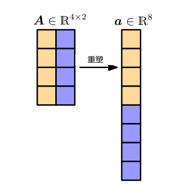
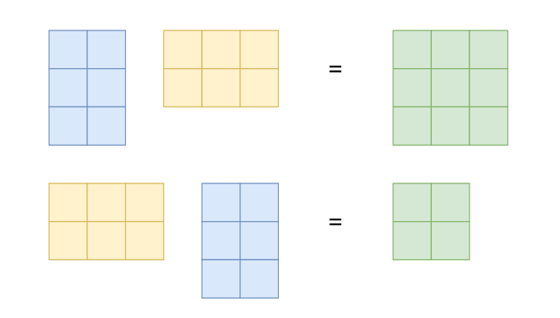

# 2.2 矩阵（Matrices）

## 本节导学

**学习目标**

1. 知道矩阵是什么，会读双下标 $a_{ij}$，分清行、列、行向量、列向量；
2. 掌握矩阵加法、矩阵乘法（尤其是"行乘列求和"规则）和数乘，知道维度不匹配时乘法的限制；
3. 理解单位矩阵、逆矩阵、转置、对称矩阵的定义和运算性质；
4. 能把线性方程组写成紧凑的矩阵形式 $\boldsymbol{Ax} = \boldsymbol b$。

**预备知识**：2.1 节的线性方程组及其"列向量线性组合"写法 (2.9)。

**符号速查表**：

| 符号 | 读法 | 含义 |
| --- | --- | --- |
| $\mathbb{R}^{m \times n}$ | "R m 乘 n" | 所有 $m$ 行 $n$ 列实矩阵构成的集合 |
| $a_{ij}$ | "a i j" | 矩阵第 $i$ 行第 $j$ 列的元素（行号在前，列号在后） |
| $\sum_{l=1}^{n} a_{il} b_{lj}$ | 求和 | $a_{i1}b_{1j} + a_{i2}b_{2j} + \cdots + a_{in}b_{nj}$ |
| $\boldsymbol I_n$ | 单位矩阵 | $n \times n$ 对角线上全为 1、其余全为 0 的方阵 |
| $\boldsymbol A^{-1}$ | "A 逆" | $\boldsymbol A$ 的逆矩阵 |
| $\boldsymbol A^\top$ | "A 转置" | 把 $\boldsymbol A$ 的行和列互换 |
| $\forall$ | 对所有的 | 例如 $\forall \boldsymbol A$ 表示"对任意矩阵 A" |
| $:=$ | 定义为 | 左边是右边定义出来的新记号 |

---

## 2.2.1 什么是矩阵

矩阵在线性代数中起着核心作用：它们既能**紧凑地表示线性方程组**（2.1 节末尾已见雏形），又能表示**线性函数（线性映射）**（2.7 节）。本节先回答两个问题：矩阵是什么？能对矩阵做什么运算？

**定义 2.1**（矩阵）。对于 $m, n \in \mathbb{N}$，实值 $(m, n)$**矩阵（matrix）** $\boldsymbol A$ 是 $m \cdot n$ 个数 $a_{ij}$（$i = 1, \ldots, m$，$j = 1, \ldots, n$）排成的矩形阵列，共 $m$ 行 $n$ 列：

$$
\boldsymbol A = \begin{bmatrix} a_{11} & a_{12} & \cdots & a_{1n} \\ a_{21} & a_{22} & \cdots & a_{2n} \\ \vdots & \vdots & & \vdots \\ a_{m1} & a_{m2} & \cdots & a_{mn} \end{bmatrix}, \quad a_{ij} \in \mathbb{R}. \tag{2.11}
$$

**读双下标**：$a_{ij}$ 是"第 $i$ 行、第 $j$ 列"的元素。例如 $a_{32}$ 读作"三二"，是第 3 行第 2 列的数。口诀：**先行后列**。

**特例**：$(1, n)$ 矩阵（一行）称为**行向量**，$(m, 1)$ 矩阵（一列）称为**列向量**。

$\mathbb{R}^{m \times n}$ 表示所有 $m \times n$ 实矩阵的集合，$\boldsymbol A \in \mathbb{R}^{m \times n}$ 表示"$\boldsymbol A$ 是一个 $m$ 行 $n$ 列的实矩阵"。一个矩阵还可以把它的 $n$ 列首尾相接堆叠成一个长向量 $\boldsymbol a \in \mathbb{R}^{mn}$（图 2.4）——这提醒我们矩阵和向量没有本质区别，只是排列方式不同。

   
   <b>图 2.4 通过堆叠其列，矩阵 A 可以表示为一个长向量 a。</b> 

### 矩阵加法

两个**同样大小**的矩阵 $\boldsymbol A, \boldsymbol B \in \mathbb{R}^{m \times n}$ 相加，定义为**对应位置元素相加**：

$$
 \boldsymbol A + \boldsymbol B := \begin{bmatrix} a_{11} + b_{11} & \cdots & a_{1n} + b_{1n} \\ \vdots \\ a_{m1} + b_{m1} & \cdots & a_{mn} + b_{mn} \end{bmatrix} \in \mathbb{R}^{m \times n} \tag{2.12}
$$

（大小不同的矩阵不能相加，正如不同长度的向量不能相加。）

### 矩阵乘法

对于 $\boldsymbol A \in \mathbb{R}^{m \times n}$，$\boldsymbol B \in \mathbb{R}^{n \times k}$，乘积 $\boldsymbol C = \boldsymbol{AB} \in \mathbb{R}^{m \times k}$ 的每个元素定义为

$$
c_{ij} = \sum_{l=1}^{n} a_{il} b_{lj}, \quad i = 1, \ldots, m, \ j = 1, \ldots, k \tag{2.13}
$$

**一句话记住这个公式**：$c_{ij}$ = **$\boldsymbol A$ 的第 $i$ 行**与 **$\boldsymbol B$ 的第 $j$ 列**对应元素相乘再求和（这就是 3.2 节将正式介绍的"点积"）。

> **动手算一遍**（例 2.3 中 $c_{11}$ 的计算）：
>
> $$
> \boldsymbol A = \begin{bmatrix} 1 & 2 & 3 \\ 3 & 2 & 1 \end{bmatrix} \in \mathbb{R}^{2 \times 3}, \quad \boldsymbol B = \begin{bmatrix} 0 & 2 \\ 1 & -1 \\ 0 & 1 \end{bmatrix} \in \mathbb{R}^{3 \times 2}
> $$
>
> $c_{11}$ = $\boldsymbol A$ 第 1 行 $(1, 2, 3)$ 与 $\boldsymbol B$ 第 1 列 $(0, 1, 0)$ 的点积：$1 \times 0 + 2 \times 1 + 3 \times 0 = 2$。
> $c_{12}$ = 第 1 行 $(1,2,3)$ 与第 2 列 $(2, -1, 1)$：$1 \times 2 + 2 \times (-1) + 3 \times 1 = 2 - 2 + 3 = 3$。
> $c_{21}$ = 第 2 行 $(3,2,1)$ 与第 1 列：$3 \times 0 + 2 \times 1 + 1 \times 0 = 2$。
> $c_{22}$ = 第 2 行 $(3,2,1)$ 与第 2 列：$3 \times 2 + 2 \times (-1) + 1 \times 1 = 6 - 2 + 1 = 5$。

> 用 Python 的 `einsum('il,lj', A, B)` 可以直接按公式 (2.13) 计算这个乘积。

**维度必须匹配**：$\boldsymbol A$ 有 $n$ 列、$\boldsymbol B$ 有 $n$ 行，才能逐对相乘 $a_{il} b_{lj}$。一般地：

$$
\underbrace{\boldsymbol A}_{n \times k} \ \underbrace{\boldsymbol B}_{k \times m} = \underbrace{\boldsymbol C}_{n \times m} \tag{2.14}
$$

**只能左乘**：$\boldsymbol A$ 可以从左侧乘 $\boldsymbol B$，但如果 $m \neq n$，$\boldsymbol{BA}$ 根本没有定义（相邻维度 $k$ 和 $n$ 对不上）。即使 $\boldsymbol{BA}$ 也有定义，一般 $\boldsymbol{AB} \neq \boldsymbol{BA}$——矩阵乘法**不可交换**。

**矩阵乘法不是逐元素相乘**：$c_{ij} \neq a_{ij} b_{ij}$。编程语言中数组的逐元素乘法叫**哈达玛乘积（Hadamard product）**，是另一个运算，不要混淆。

**例 2.3**（完整计算）

对上面的 $\boldsymbol A$ 和 $\boldsymbol B$：

$$
\boldsymbol{AB} = \begin{bmatrix} 1 & 2 & 3 \\ 3 & 2 & 1 \end{bmatrix} \begin{bmatrix} 0 & 2 \\ 1 & -1 \\ 0 & 1 \end{bmatrix} = \begin{bmatrix} 2 & 3 \\ 2 & 5 \end{bmatrix} \in \mathbb{R}^{2 \times 2} \tag{2.15}
$$

（$c_{22} = 5$ 已按上面逐元素验证；此处修正了原中文版的一处排版笔误，原书印作 $-5$。）

而交换顺序：

$$
\boldsymbol{BA} = \begin{bmatrix} 0 & 2 \\ 1 & -1 \\ 0 & 1 \end{bmatrix} \begin{bmatrix} 1 & 2 & 3 \\ 3 & 2 & 1 \end{bmatrix} = \begin{bmatrix} 6 & 4 & 2 \\ -2 & 0 & 2 \\ 3 & 2 & 1 \end{bmatrix} \in \mathbb{R}^{3 \times 3} \tag{2.16}
$$

抽查 $c_{22}$：$\boldsymbol B$ 第 2 行 $(1, -1)$ 与 $\boldsymbol A$ 第 2 列 $(2, 2)$：$1 \times 2 + (-1) \times 2 = 0$ ✓。

两个结果不仅数值不同，连**大小都不同**（$2 \times 2$ 对 $3 \times 3$，图 2.5）——矩阵乘法不可交换，这从定义上就显而易见。

   
  <b>图 2.5 即使矩阵乘法 AB 和 BA 有意义，结果的维度也可能不同。</b> 

### 单位矩阵与运算性质

**定义 2.2**（单位矩阵）。$n \times n$ **单位矩阵（identity matrix）**是对角线上为 1、其余位置全为 0 的方阵：

$$
\boldsymbol I_n :=  \begin{bmatrix} 1 & 0 & \cdots & 0 \\ 0 & 1 & \cdots & 0 \\ \vdots & \vdots & \ddots & \vdots \\ 0 & 0 & \cdots & 1 \end{bmatrix} \in \mathbb{R}^{n \times n} \tag{2.17}
$$

（矩阵的**主对角线**指全体 $a_{ij}$ 中 $i = j$ 的那些元素，即从左上到右下的那条线。）

它的作用类似于数的乘法中的 1：乘上它等于什么都没做。已定义了加法、乘法和单位矩阵，下面三条性质值得逐条理解：

- **结合律**：$\forall \boldsymbol A \in \mathbb{R}^{m \times n}, \boldsymbol B \in \mathbb{R}^{n \times p}, \boldsymbol C \in \mathbb{R}^{p \times q}$：

$$
(\boldsymbol{AB})\boldsymbol C = \boldsymbol A (\boldsymbol{BC}) \tag{2.18}
$$

（和数的乘法一样，括号怎么加都行，连乘可以按任意顺序结合。）

- **分配律**：$\forall \boldsymbol{A, B} \in \mathbb{R}^{m \times n}, \boldsymbol{C, D} \in \mathbb{R}^{n \times p}$：

$$
(\boldsymbol A + \boldsymbol B)\boldsymbol C = \boldsymbol{AC} + \boldsymbol{BC} \tag{2.19a}
$$

$$
\boldsymbol A (\boldsymbol C + \boldsymbol D) = \boldsymbol{AC} + \boldsymbol{AD} \tag{2.19b}
$$

（矩阵乘法对加法满足分配律——但要注意左右位置不能乱换。）

- **与单位矩阵相乘**：$\forall \boldsymbol A \in \mathbb{R}^{m \times n}$：

$$
\boldsymbol {I_m A} = \boldsymbol {A I_n} = \boldsymbol A \tag{2.20}
$$

注意当 $m \neq n$ 时左乘的是 $\boldsymbol I_m$（$m \times m$）、右乘的是 $\boldsymbol I_n$（$n \times n$），两者大小不同、不是同一个矩阵。

## 2.2.2 逆和转置

**定义 2.3**（逆）。对于一个**方阵** $\boldsymbol A \in \mathbb{R}^{n \times n}$，如果存在矩阵 $\boldsymbol B \in \mathbb{R}^{n \times n}$ 使得

$$
\boldsymbol{AB} = \boldsymbol I_n = \boldsymbol{BA},
$$

则称 $\boldsymbol B$ 为 $\boldsymbol A$ 的**逆（inverse）**，记作 $\boldsymbol A^{-1}$。

（方阵 = 行数和列数相同的矩阵。逆只对定义。）

遗憾的是，**并非每个矩阵都有逆**。有逆的矩阵称为**正则 / 可逆 / 非奇异（regular / invertible / nonsingular）**，否则称为**奇异 / 不可逆（singular / noninvertible）**。两个重要事实（本书直接使用）：

1. 逆若存在则**唯一**。（证明思路：若 $\boldsymbol B$ 和 $\boldsymbol C$ 都是逆，则 $\boldsymbol B = \boldsymbol B \boldsymbol I = \boldsymbol B (\boldsymbol{AC}) = (\boldsymbol{BA})\boldsymbol C = \boldsymbol{IC} = \boldsymbol C$。）
2. 2.3 节将给出通过解线性方程组计算逆矩阵的系统方法。

**$2 \times 2$ 矩阵的逆：推导一遍**。考虑

$$
\boldsymbol A := \begin{bmatrix} a_{11} & a_{12} \\ a_{21} & a_{22} \end{bmatrix} \in \mathbb{R}^{2 \times 2} \tag{2.21}
$$

尝试把它乘以

$$
\boldsymbol A' := \begin{bmatrix} a_{22} & -a_{12} \\ -a_{21} & a_{11} \end{bmatrix} \tag{2.22}
$$

（口诀：主对角线两数交换位置，副对角线两数变号。）逐项计算 $\boldsymbol{AA'}$：

- 第 1 行第 1 列：$a_{11} a_{22} + a_{12}(-a_{21}) = a_{11}a_{22} - a_{12}a_{21}$；
- 第 1 行第 2 列：$a_{11}(-a_{12}) + a_{12} a_{11} = 0$；
- 第 2 行第 1 列：$a_{21} a_{22} + a_{22}(-a_{21}) = 0$；
- 第 2 行第 2 列：$a_{21}(-a_{12}) + a_{22} a_{11} = a_{11}a_{22} - a_{12}a_{21}$。

所以

$$
\boldsymbol{AA'} = \begin{bmatrix} a_{11}a_{22} - a_{12}a_{21} & 0 \\ 0 & a_{11}a_{22} - a_{12}a_{21} \end{bmatrix} = (a_{11}a_{22} - a_{12}a_{21})\, \boldsymbol I_2 \tag{2.23}
$$

（原中文版此式误印为 $a_{11}a_{22}\boldsymbol I$，已按逐项计算修正。）只要那个标量 $a_{11}a_{22} - a_{12}a_{21} \neq 0$，两边除以它，就得到显式公式：

$$
\boldsymbol A^{-1} =  \frac{1}{a_{11}a_{22} - a_{12}a_{21}}\begin{bmatrix} a_{22} & -a_{12} \\ -a_{21} & a_{11} \end{bmatrix} \tag{2.24}
$$

也就是说，$2 \times 2$ 矩阵可逆**当且仅当** $a_{11}a_{22} - a_{12}a_{21} \neq 0$。第 4.1 节会看到这个数有个名字——**行列式（determinant）**，它是判断任意方阵是否可逆的一般工具。

**例 2.4（逆矩阵）**。矩阵

$$
\boldsymbol A = \begin{bmatrix} 1 & 2 & 1 \\ 4 & 4 & 5 \\ 6 & 7 & 7 \end{bmatrix}, \quad \boldsymbol B = \begin{bmatrix} -7 & -7 & 6 \\ 2 & 1 & -1 \\ 4 & 5 & -4 \end{bmatrix} \tag{2.25}
$$

互为逆矩阵，因为 $\boldsymbol{AB} = \boldsymbol I = \boldsymbol{BA}$。我们亲手验算 $\boldsymbol{AB}$ 的第一行：

- $(1,1)$：$1 \times (-7) + 2 \times 2 + 1 \times 4 = -7 + 4 + 4 = 1$ ✓
- $(1,2)$：$1 \times (-7) + 2 \times 1 + 1 \times 5 = -7 + 2 + 5 = 0$ ✓
- $(1,3)$：$1 \times 6 + 2 \times (-1) + 1 \times (-4) = 6 - 2 - 4 = 0$ ✓

其余 6 个元素请按同样方法自行验证（都是 0 或 1）。

**定义 2.4**（转置）。对于 $\boldsymbol A \in \mathbb{R}^{m \times n}$，把行列互换得到的矩阵 $\boldsymbol B \in \mathbb{R}^{n \times m}$（$b_{ij} = a_{ji}$）称为 $\boldsymbol A$ 的**转置（transpose）**，记作 $\boldsymbol B = \boldsymbol A^{\top}$。

直观地说：把 $\boldsymbol A$ 沿主对角线"翻折"一下，第 1 列变成第 1 行，第 2 列变成第 2 行，依此类推。

逆和转置的重要性质（每条都值得停下来理解）：

$$
\boldsymbol {AA^{-1}} = \boldsymbol I = \boldsymbol {A^{-1}A}  \tag{2.26}
$$

$$
\boldsymbol {(AB)^{-1}} = \boldsymbol {B^{-1}A^{-1}} \tag{2.27}
$$

$$
\boldsymbol {(A + B)^{-1}} \neq \boldsymbol {A^{-1} + B^{-1}}  \tag{2.28}
$$

$$
(\boldsymbol {A^{\top})^{\top}} = \boldsymbol A \tag{2.29}
$$

$$
\boldsymbol {(A + B)^{\top}} = \boldsymbol {A^{\top} + B^{\top}} \tag{2.30}
$$

$$
\boldsymbol {(AB)^{\top}} = \boldsymbol {B^{\top}A^{\top}} \tag{2.31}
$$

**逐条解读**：

- (2.26) 就是逆的定义本身。
- (2.27) **顺序颠倒**了！验证：$(\boldsymbol{AB})(\boldsymbol{B^{-1}A^{-1}}) = \boldsymbol{A}(\boldsymbol{BB^{-1}})\boldsymbol{A^{-1}} = \boldsymbol{A}\boldsymbol{I}\boldsymbol{A^{-1}} = \boldsymbol{AA^{-1}} = \boldsymbol I$ ✓。想想穿脱衣服：先穿毛衣再穿外套，脱的时候先脱外套——乘积的逆按相反顺序取。
- (2.28) **和的逆不等于逆的和**。标量情形就能看出：$\frac{1}{2+4} = \frac{1}{6} \neq \frac{1}{2} + \frac{1}{4}$。这条等式不成立是初学者最常见的错误之一。
- (2.29) 转置两次回到原矩阵，显然。
- (2.30) 转置保持加法，可逐项验证。
- (2.31) 又是一次**顺序颠倒**：$(\boldsymbol{AB})^\top = \boldsymbol{B}^\top \boldsymbol{A}^\top$。验证思路：$(\boldsymbol{AB})^\top$ 的第 $i$ 行第 $j$ 列是 $\boldsymbol{AB}$ 的第 $j$ 行第 $i$ 列 $= \sum_l a_{jl} b_{li}$，而这正是 $\boldsymbol B^\top$ 的第 $i$ 行与 $\boldsymbol A^\top$ 的第 $j$ 列的点积，即 $(\boldsymbol B^\top \boldsymbol A^\top)_{ij}$。✓ 这条性质在机器学习中非常常用。

**定义 2.5**（对称矩阵）。如果 $\boldsymbol A = \boldsymbol A^{\top}$，则方阵 $\boldsymbol A \in \mathbb{R}^{n \times n}$ 称为**对称矩阵（symmetric matrix）**。

直观地说：对称矩阵关于主对角线"照镜子"，上下元素对应相等（$a_{ij} = a_{ji}$）。只有方阵才谈得上对称。

此外，如果 $\boldsymbol A$ 可逆，那么 $\boldsymbol A^{\top}$ 也可逆，且 $(\boldsymbol A^{-1})^{\top} = (\boldsymbol A^{\top})^{-1}$（两者都记作 $\boldsymbol A^{-\top}$）。

**备注**（对称矩阵的和与乘积）。两个对称矩阵 $\boldsymbol{A, B} \in \mathbb{R}^{n \times n}$ 的**和**总是对称的（逐项验证：$(\boldsymbol A + \boldsymbol B)^\top = \boldsymbol A^\top + \boldsymbol B^\top = \boldsymbol A + \boldsymbol B$）。但它们的**乘积**一般**不是**对称的：

$$
\begin{bmatrix} 1 & 0 \\ 0 & 0 \end{bmatrix} \begin{bmatrix} 1 & 1 \\ 1 & 1 \end{bmatrix} = \begin{bmatrix} 1 & 1 \\ 0 & 0 \end{bmatrix} \tag{2.32}
$$

左边两个矩阵各自对称，乘积 $\begin{bmatrix} 1 & 1 \\ 0 & 0 \end{bmatrix}$ 却不满足"上下对应相等"（$1 \neq 0$），不对称 ✓。（计算验证：第 1 行 $= 1 \times (1,1) + 0 \times (1,1) = (1,1)$，第 2 行 $= 0 \times (1,1) + 0 \times (1,1) = (0,0)$。）

## 2.2.3 乘以标量

矩阵 $\boldsymbol A \in \mathbb{R}^{m \times n}$ 乘以标量 $\lambda \in \mathbb{R}$：把**每个元素**都乘 $\lambda$，即 $\lambda \boldsymbol A = \boldsymbol K$，$k_{ij} = \lambda a_{ij}$。对 $\lambda, \psi \in \mathbb{R}$，以下性质成立：

- **结合律**：$(\lambda \psi)\boldsymbol C = \lambda(\psi \boldsymbol C)$，$\boldsymbol C \in \mathbb{R}^{m \times n}$；
- **标量可以自由移动**：$\lambda (\boldsymbol {BC}) = (\lambda \boldsymbol B) \boldsymbol C = \boldsymbol B (\lambda \boldsymbol C) = (\boldsymbol {BC}) \lambda$，$\boldsymbol B \in \mathbb{R}^{m \times n}$，$\boldsymbol C \in \mathbb{R}^{n \times k}$——标量放在乘积的哪个位置都行；
- **转置与标量**：$(\lambda \boldsymbol C)^{\top} = \lambda \boldsymbol C^{\top}$（一个数的转置仍是它自己）；
- **分配律**：$(\lambda + \psi) \boldsymbol C = \lambda \boldsymbol C + \psi \boldsymbol C$ 以及 $\lambda (\boldsymbol B + \boldsymbol C) = \lambda \boldsymbol B + \lambda \boldsymbol C$。

**例 2.5（分配律）**。定义

$$
\boldsymbol C := \begin{bmatrix} 1 & 2 \\ 3 & 4 \end{bmatrix} \tag{2.33}
$$

对任意 $\lambda, \psi \in \mathbb{R}$：

$$
(\lambda + \psi)\boldsymbol C = \begin{bmatrix} (\lambda + \psi) \cdot 1 & (\lambda + \psi) \cdot 2 \\ (\lambda + \psi) \cdot 3 & (\lambda + \psi) \cdot 4 \end{bmatrix} = \begin{bmatrix} \lambda + \psi & 2\lambda + 2\psi \\ 3\lambda + 3\psi & 4\lambda + 4\psi \end{bmatrix} \tag{2.34a}
$$

$$
= \begin{bmatrix} \lambda & 2\lambda \\ 3\lambda & 4\lambda \end{bmatrix} + \begin{bmatrix} \psi & 2\psi \\ 3\psi & 4\psi \end{bmatrix} = \lambda \boldsymbol C + \psi \boldsymbol C \tag{2.34b}
$$

（第一步是标量乘法的定义，中间只是把乘法对加法分配开，最后一步重新读出两个标量乘矩阵。整个链条就是"分配律"在矩阵上的样子。）

## 2.2.4 线性方程组的紧凑表示

现在回到 2.1 节的线性方程组。考虑

$$
2x_1 + 3x_2 + 5x_3 = 1 \\
4x_1 - 2x_2 - 7x_3 = 8 \\
9x_1 + 5x_2 - 3x_3 = 2 \tag{2.35}
$$

利用矩阵乘法的规则 (2.13)，可以把它写成一个紧凑的矩阵等式：

$$
\begin{bmatrix} 2 & 3 & 5 \\ 4 & -2 & -7 \\ 9 & 5 & -3 \end{bmatrix} \begin{bmatrix} x_1 \\ x_2 \\ x_3 \end{bmatrix} = \begin{bmatrix} 1 \\ 8 \\ 2 \end{bmatrix} \tag{2.36}
$$

**验证等价性**：按 (2.13) 展开左边乘积的第 1 个分量：第 1 行 $(2, 3, 5)$ 与列 $(x_1, x_2, x_3)$ 的点积 $= 2x_1 + 3x_2 + 5x_3$，恰好等于右边的第 1 个分量 $1$——正是原方程组的方程 1。第 2、3 个分量同理。所以一个方程组 $\Longleftrightarrow$ 一个矩阵等式。

**两种读法**（都重要）：

- **按行读**（上面的验证）：每一行是一个方程；
- **按列读**：$\boldsymbol{Ax} = x_1 \cdot (\text{第 1 列}) + x_2 \cdot (\text{第 2 列}) + x_3 \cdot (\text{第 3 列})$——未知数 $x_j$ 在"缩放第 $j$ 列"。也就是说，**解方程组 = 找一组系数，使系数矩阵的各列组合出 $\boldsymbol b$**。这是 2.5–2.6 节"线性组合 / 基"观点的雏形。

一般地，任何线性方程组都可写成 $\boldsymbol{Ax} = \boldsymbol b$ 的矩阵形式（见 (2.10)）。

---

## 本节小结

| 运算 | 规则一句话 | 注意 |
| --- | --- | --- |
| 加法 | 对应元素相加 | 大小必须相同 |
| 乘法 $\boldsymbol{AB}$ | $\boldsymbol A$ 的行点乘 $\boldsymbol B$ 的列 | 内邻维度必须匹配；不可交换 |
| 数乘 $\lambda \boldsymbol A$ | 每个元素乘 $\lambda$ | 标量可在乘积中自由移动 |
| 逆 $\boldsymbol A^{-1}$ | $\boldsymbol{AA}^{-1} = \boldsymbol I$ | 只有可逆方阵有逆；(2.27) 顺序颠倒，(2.28) 一般不成立 |
| 转置 $\boldsymbol A^\top$ | 行列互换 | $(\boldsymbol{AB})^\top = \boldsymbol B^\top \boldsymbol A^\top$，顺序颠倒 |
| 对称矩阵 | $\boldsymbol A = \boldsymbol A^\top$ | 和保持对称，积不保持 |

**核心技能**：给两个矩阵，会按"行乘列求和"手算乘积的每个元素；给一个方程组，会写出它的 $\boldsymbol{Ax} = \boldsymbol b$ 形式并按行、按列两种视角解读。

**与其他章节的关系**：2.3 节用矩阵记号给出求解 $\boldsymbol{Ax} = \boldsymbol b$ 的系统算法（高斯消元法），并回答"逆矩阵怎么算"；矩阵乘法的"行乘列"规则就是 3.2 节点积的雏形。
