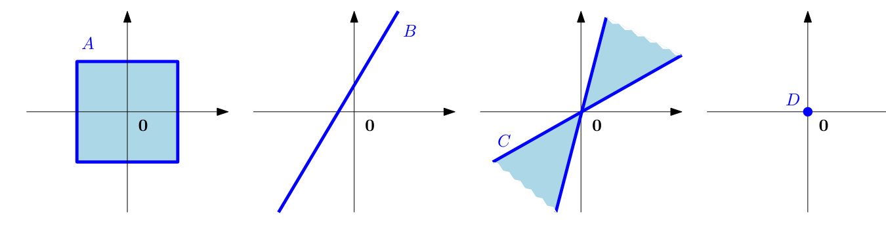

# 2.4 向量空间（Vector Spaces）

## 本节导学

**学习目标**

1. 掌握群（group）的四个公理，会判断常见的"集合 + 运算"是否成群；
2. 理解向量空间的定义——它不过是在群的基础上再加一种"外部运算"（数乘）；
3. 掌握子空间的判定方法（三条检查清单），能判断常见集合是否为子空间；
4. 理解"齐次方程组的解集是子空间，非齐次的不是"这一重要事实。

**预备知识**：2.0 节（向量的直觉）、2.2 节（矩阵运算）。本节定义较抽象，每个定义后都配有大量具体例子，建议对照着读。

**符号速查表**：

| 符号 | 读法 | 含义 |
| --- | --- | --- |
| $G := (G, \otimes)$ | 群 | 集合 $G$ 配上运算 $\otimes$ 构成的代数结构 |
| $\otimes$ | 圈乘 | 一个抽象的二元运算符号（可以是加法、乘法或任何自定义运算） |
| $G \times G \to G$ | 从 G×G 到 G 的映射 | 取 $G$ 中两个元素，运算结果仍是 $G$ 中一个元素（输入两个、输出一个） |
| $\forall$ | 对所有 | 全称量词，"任意取都满足" |
| $\exists$ | 存在 | 存在量词，"至少能找到一个" |
| $e$ | 单位元 | 运算中的"不动点"：任何元素与它运算都不变 |
| $x^{-1}$ | x 的逆元 | 与 $x$ 运算后得到单位元的那个元素（对加法而言就是 $-x$） |
| $\mathbb{N}$ / $\mathbb{N}_0$ | 自然数 / 非负整数 | $\mathbb{N} = \{1, 2, 3, \ldots\}$；$\mathbb{N}_0 = \mathbb{N} \cup \{0\}$ |
| $\mathbb{Z}$ | 整数 | $\{\ldots, -2, -1, 0, 1, 2, \ldots\}$ |
| $\mathbb{C}$ | 复数 | 形如 $a + bi$（$i^2 = -1$）的数 |
| $\mathbb{R} \setminus \{0\}$ | R 去掉 0 | 所有非零实数 |
| $GL(n, \mathbb{R})$ | 一般线性群 | 所有 $n \times n$ 可逆实矩阵构成的群 |
| $V = (V, +, \cdot)$ | 向量空间 | 集合 $V$ 配上加法与数乘两种运算 |

---

## 2.4.1 直观引入：把"能加能乘"说精确

到目前为止，我们一直非正式地说：向量是"可以相加、可以乘以数"的对象。数学家不满足于这种描述——究竟哪些规则必须成立？本节把 2.0 节的直觉**公理化**。

路线是循序渐进的：先定义要求最少的结构——**群**（只有一种运算）；再定义**向量空间**（群 + 数乘）；最后定义**子空间**（空间里"自我封闭"的子集）。

## 2.4.2 群（Group）

群在计算机科学中非常重要：它是集合上运算的基础框架，也广泛用于密码学、编码理论和计算机图形学。

**定义 2.7**（群）。考虑集合 $G$ 及定义在 $G$ 上的运算 $\otimes: G \times G \to G$。如果满足以下四条，则 $G := (G, \otimes)$ 称为一个**群（group）**：

1. **封闭性（closure）**：$\forall x, y \in G: x \otimes y \in G$。两个元素运算后不能跑出集合；
2. **结合律（associativity）**：$\forall x, y, z \in G: (x \otimes y) \otimes z = x \otimes (y \otimes z)$。括号不影响结果，可以随便加；
3. **单位元（neutral element）**：$\exists e \in G, \forall x \in G: x \otimes e = x$ 且 $e \otimes x = x$。存在一个"什么都不做"的元素；
4. **逆元（inverse element）**：$\forall x \in G, \exists y \in G: x \otimes y = e$ 且 $y \otimes x = e$。每个元素都能被"撤销"，$y$ 记作 $x^{-1}$。

**逐条对照直觉**：这四条恰好对应"运算自由进出、怎么加括号都行、有零操作、有撤销键"。任何一条不满足，结构就会"露馅"。

> **注意**：逆元是**相对于运算 $\otimes$** 定义的，不必然意味着 $\frac{1}{x}$。如果 $\otimes$ 是加法，"逆元"就是相反数（$x^{-1} = -x$），因为 $x + (-x) = 0$（加法的单位元是 0）。

如果还满足**交换律**：$\forall x, y \in G: x \otimes y = y \otimes x$，则称为**阿贝尔群（Abelian group）**（交换群）。

**例 2.10（群：逐个体检）**

| 候选 | 是群吗 | 逐条体检 |
| --- | --- | --- |
| $(\mathbb{Z}, +)$（整数加法） | ✓ 是 | ① 整数加整数仍是整数 ✓；② 加法结合律 ✓；③ 单位元 $0$ ✓；④ $x$ 的逆元是 $-x$ ✓。还是阿贝尔群（加法交换）✓ |
| $(\mathbb{N}_0, +)$（非负整数加法） | ✗ 否 | ①②③ 都 ✓（单位元 0），但 ④：$3$ 的逆元应该是 $-3$，而 $-3 \notin \mathbb{N}_0$。缺逆元 |
| $(\mathbb{Z}, \cdot)$（整数乘法） | ✗ 否 | ①②③ ✓（单位元 1），但 ④：$2$ 的逆元应是 $\frac{1}{2}$，不是整数 ✗ |
| $(\mathbb{R}, \cdot)$（实数乘法） | ✗ 否 | 几乎全对，但 $0$ 没有逆元（不存在实数乘 0 得 1）✗ |
| $(\mathbb{R} \setminus \{0\}, \cdot)$（非零实数乘法） | ✓ 是，阿贝尔群 | 把捣乱的 $0$ 踢掉后，每个 $x$ 都有逆元 $\frac{1}{x}$ ✓，乘法可交换 ✓ |
| $(\mathbb{R}^n, +)$（$n$ 元数组按分量相加） | ✓ 是，阿贝尔群 | ① 逐分量相加仍在 $\mathbb{R}^n$；② 结合律逐分量成立；③ 单位元 $\boldsymbol e = (0, \ldots, 0)$；④ 逆元 $(x_1, \ldots, x_n)^{-1} := (-x_1, \ldots, -x_n)$ |
| $(\mathbb{Z}^n, +)$ | ✓ 是，阿贝尔群 | 同上，整数分量相加仍是整数 |
| $(\mathbb{R}^{m \times n}, +)$（矩阵加法） | ✓ 是，阿贝尔群 | ① 同尺寸矩阵相加仍同尺寸；②③④ 逐元素看就是实数加法 |

最后考察 $(\mathbb{R}^{n \times n}, \cdot)$（$n \times n$ 矩阵乘法）：

- 封闭性 ✓、结合律 ✓（2.2 节的 (2.18)）、单位元 $\boldsymbol I_n$ ✓；
- **逆元** ✗ 不总存在——奇异矩阵没有逆！

但是！如果只看**可逆矩阵**的集合，四条就全满足了。由此得到重要的：

**定义 2.8**（一般线性群）。所有正则（可逆）矩阵 $\boldsymbol A \in \mathbb{R}^{n \times n}$ 的集合，关于矩阵乘法构成一个群，称为**一般线性群（general linear group）** $GL(n, \mathbb{R})$。由于矩阵乘法不可交换（例 2.3），它不是阿贝尔群。

（练习：自己验证 $GL(n, \mathbb{R})$ 的封闭性——两个可逆矩阵的乘积仍可逆，逆为 $\boldsymbol B^{-1} \boldsymbol A^{-1}$，见 (2.27)。）

## 2.4.3 向量空间

讨论群时，运算 $\otimes$ 是**内部运算（inner operation）**：输入输出都在 $G$ 内。现在给集合再配一种**外部运算（outer operation）** $\cdot: \mathbb{R} \times V \to V$：一个实数（标量）乘一个向量，结果仍是向量。可以把它理解成"加法"（内部）和"缩放"（外部）两种基本操作。

（提醒：这里的"内部/外部运算"与第 3 章的"内积/外积"毫无关系，只是中文翻译撞词。）

**定义 2.9**（向量空间）。一个实数向量空间 $V = (V, +, \cdot)$ 是配备两种运算的集合 $V$：

$$
+ : V \times V \to V \tag{2.62}
$$

$$
\cdot : \mathbb{R} \times V \to V \tag{2.63}
$$

满足：

1. $(V, +)$ 是一个**阿贝尔群**（即加法封闭、结合、有零向量、有负向量、可交换——群的全部要求）；
2. **分配律**：
   - $\forall \lambda \in \mathbb{R}, \boldsymbol x, \boldsymbol y \in V: \lambda \cdot (\boldsymbol x + \boldsymbol y) = \lambda \cdot \boldsymbol x + \lambda \cdot \boldsymbol y$（数对"和"分配）；
   - $\forall \lambda, \psi \in \mathbb{R}, \boldsymbol x \in V: (\lambda + \psi) \cdot \boldsymbol x = \lambda \cdot \boldsymbol x + \psi \cdot \boldsymbol x$（和对"数"分配）；
3. **结合律（外部）**：$\forall \lambda, \psi \in \mathbb{R}, \boldsymbol x \in V: \lambda \cdot (\psi \cdot \boldsymbol x) = (\lambda \psi) \cdot \boldsymbol x$；
4. **外部运算的单位元**：$\forall \boldsymbol x \in V: 1 \cdot \boldsymbol x = \boldsymbol x$（乘以 1 什么都不做）。

**术语对照**：$V$ 中元素 $\boldsymbol x$ 叫**向量**；$(V, +)$ 的单位元叫**零向量** $\boldsymbol 0 = [0, \ldots, 0]^\top$；实数 $\lambda$ 叫**标量（scalar）**。注意"标量积"（内积）是另一回事（3.2 节）。

**例 2.11（向量空间：三个重要实例）**

- **$V = \mathbb{R}^n$**：加法按分量 $(x_1, \ldots, x_n) + (y_1, \ldots, y_n) = (x_1 + y_1, \ldots, x_n + y_n)$；数乘按分量 $\lambda (x_1, \ldots, x_n) = (\lambda x_1, \ldots, \lambda x_n)$。八条公理逐条成立，因为每条都"逐分量"归结为实数的性质。（建议读者挑两条亲手验证。）
- **$V = \mathbb{R}^{m \times n}$（矩阵空间）**：加法、数乘都按 2.2 节逐元素定义。矩阵空间本质上就是 $\mathbb{R}^{mn}$（把列堆叠成长向量），所以它也是向量空间。
- **$V = \mathbb{C}$**（复数集）：按复数的标准加法与实数乘法，是实数域上的向量空间。

**备注**（两种向量乘法）。两个向量之间的"乘法" $\boldsymbol a \boldsymbol b$（$\boldsymbol a, \boldsymbol b \in \mathbb{R}^n$）**没有定义**。编程语言里常见的逐元素乘法是"数组乘法"，在标准矩阵乘法规则下没有地位：把向量看成 $n \times 1$ 矩阵后，$\boldsymbol a \boldsymbol b$ 的维度对不上（$n \times 1$ 乘 $n \times 1$ 不合法，见 (2.14)）。对向量**有定义**的乘法只有两种：

- **外积（outer product）**：$\boldsymbol a \boldsymbol b^\top \in \mathbb{R}^{n \times n}$（列向量乘行向量，结果是矩阵）；
- **内积 / 标量积 / 点积（inner/scalar/dot product）**：$\boldsymbol a^\top \boldsymbol b \in \mathbb{R}$（行向量乘列向量，结果是一个数）。

**小例子**（$n = 2$，$\boldsymbol a = (1, 2)^\top$，$\boldsymbol b = (3, 4)^\top$）：

$$
\boldsymbol a^\top \boldsymbol b = 1 \times 3 + 2 \times 4 = 11 \in \mathbb{R}, \qquad
\boldsymbol a \boldsymbol b^\top = \begin{bmatrix} 1 \\ 2 \end{bmatrix} \begin{bmatrix} 3 & 4 \end{bmatrix} = \begin{bmatrix} 3 & 4 \\ 6 & 8 \end{bmatrix} \in \mathbb{R}^{2 \times 2}
$$

注意维度的区别：内积"中间维度相消"($1 \times n$ 乘 $n \times 1$ 得 $1 \times 1$)，外积"中间维度相乘"($n \times 1$ 乘 $1 \times n$ 得 $n \times n$)。

**备注**（记号简化）。当 $+$ 和 $\cdot$ 是标准的向量加法与数乘时，我们把 $(V, +, \cdot)$ 简记为 $V$，用 $\boldsymbol x \in V$ 表示"$V$ 中的向量"。

**备注**（列向量约定）。$\mathbb{R}^n$、$\mathbb{R}^{n \times 1}$、$\mathbb{R}^{1 \times n}$ 只是书写方式不同。下文不区分 $\mathbb{R}^n$ 和 $\mathbb{R}^{n \times 1}$，默认把向量写成**列向量**：

$$
\boldsymbol x = \begin{bmatrix} x_1 \\ \vdots \\ x_n \end{bmatrix} \tag{2.64}
$$

而行向量写成 $\boldsymbol x^\top$（列向量的转置）。但 $\mathbb{R}^{n \times 1}$（列）和 $\mathbb{R}^{1 \times n}$（行）必须区分——否则与矩阵乘法混淆（见上一条备注）。

## 2.4.4 向量子空间

**子空间**是机器学习中的核心概念（第 10 章 PCA 降维就是找数据的低维子空间）。直觉地说：子空间是母空间中"自我封闭"的子集——在子空间内做任何向量运算，结果都不会跑出这个子空间。

**定义 2.10**（向量子空间）。设 $V = (V, +, \cdot)$ 是一个向量空间，$U \subseteq V$ 且 $U \neq \emptyset$。如果 $U$ 在 $V$ 的运算（限制在 $U$ 上）下本身也是一个向量空间，则称 $U$ 为 $V$ 的**向量子空间（vector subspace）**（或**线性子空间（linear subspace）**），记作 $U \subseteq V$。

**好消息：判定子空间只需查三条**。定义要求 $U$ 满足向量空间的全部公理，但绝大多数公理会自动继承——阿贝尔群性质、分配律、结合律对 $V$ 中所有元素成立，特别地对所有 $\boldsymbol x \in U \subseteq V$ 也成立。真正需要验证的只有：

1. $U \neq \emptyset$——特别地，**零向量必须在 $U$ 里**（$\boldsymbol 0 \in U$）；
2. 对数乘封闭：$\forall \lambda \in \mathbb{R}, \boldsymbol x \in U: \lambda \boldsymbol x \in U$；
3. 对加法封闭：$\forall \boldsymbol x, \boldsymbol y \in U: \boldsymbol x + \boldsymbol y \in U$。

**为什么 $\boldsymbol 0 \in U$ 足以保证非空？** 因为向量空间的加法必须有单位元，而 $\boldsymbol 0$ 是唯一候选；又由封闭性，取 $\lambda = 0$ 有 $0 \boldsymbol x = \boldsymbol 0 \in U$（或用 $\boldsymbol x + (-\boldsymbol x)$）。

**例 2.12（子空间判定实例）**

- **平凡子空间**：任何 $V$ 都有两个显然的子空间——$V$ 本身和**零子空间** $\{\boldsymbol 0\}$（只含零向量）。验证 $\{\boldsymbol 0\}$：$\boldsymbol 0$ 在里面 ✓；数乘 $\lambda \boldsymbol 0 = \boldsymbol 0$ 仍在 ✓；$\boldsymbol 0 + \boldsymbol 0 = \boldsymbol 0$ ✓。
- **图 2.6 的例子**：在 $\mathbb{R}^2$ 中，只有 D（过原点的一条直线）是子空间。A 和 C 违背封闭性（直线上两点相加可能跑出直线）；B 不过原点，不含 $\boldsymbol 0$。
- **齐次方程组 $\boldsymbol{Ax} = \boldsymbol 0$ 的解集是 $\mathbb{R}^n$ 的子空间**。（重要！）验证三条：① $\boldsymbol A \boldsymbol 0 = \boldsymbol 0$，零向量是解 ✓；② 若 $\boldsymbol{Ax} = \boldsymbol 0$，则 $\boldsymbol A(\lambda \boldsymbol x) = \lambda \boldsymbol{Ax} = \boldsymbol 0$，数乘封闭 ✓；③ 若 $\boldsymbol{Ax} = \boldsymbol 0$、$\boldsymbol{Ay} = \boldsymbol 0$，则 $\boldsymbol A(\boldsymbol x + \boldsymbol y) = \boldsymbol{Ax} + \boldsymbol{Ay} = \boldsymbol 0$，加法封闭 ✓。
- **非齐次方程组 $\boldsymbol{Ax} = \boldsymbol b \neq \boldsymbol 0$ 的解集不是子空间**：它连第一条都不满足——$\boldsymbol A \boldsymbol 0 = \boldsymbol 0 \neq \boldsymbol b$，零向量不是解。（这也是 (2.43) 的通解必须写成"特解 + 齐次解"而不是直接写成一个子空间的原因。）
- **任意多个子空间的交集仍是子空间**。（简要证明：设 $\boldsymbol x, \boldsymbol y \in \bigcap_i U_i$。每个 $U_i$ 都是子空间，所以 $\boldsymbol 0 \in U_i$（故 $\boldsymbol 0 \in$ 交集），$\lambda \boldsymbol x \in U_i$（故 $\lambda \boldsymbol x \in$ 交集），$\boldsymbol x + \boldsymbol y \in U_i$（故 $\boldsymbol x + \boldsymbol y \in$ 交集）。三条全过 ✓。）注意：**并集**一般不是子空间。

   
  <b>图 2.6 并非 R² 的所有子集都是子空间。在 A 和 C 中，违背了封闭性；B 不包含 0。只有 D 是子空间。</b> 

**备注**（子空间 = 齐次方程组的解空间）。$\mathbb{R}^n$ 的每个子空间 $U$ 都恰好是某个齐次线性方程组 $\boldsymbol{Ax} = \boldsymbol 0$ 的解空间。（直观理解：$U$ 中有 $k = \operatorname{dim}(U)$ 个"自由方向"，剩下的 $n - k$ 个方向被 $n - k$ 个独立的线性约束"钉死"，这些约束就是 $\boldsymbol A$ 的行。2.6 节讲了维度和秩之后，这个备注会更容易理解。）

---

## 本节小结

| 结构 | 定义一句话 | 关键判定 |
| --- | --- | --- |
| 群 $(G, \otimes)$ | 一种运算 + 封闭、结合、单位元、逆元四条 | 四条逐条体检 |
| 阿贝尔群 | 再满足交换律的群 | |
| 向量空间 $(V, +, \cdot)$ | 阿贝尔群 + 数乘，满足分配律、结合律、1·x = x | 常见实例：$\mathbb{R}^n$、$\mathbb{R}^{m \times n}$ |
| 子空间 $U \subseteq V$ | 自身也是向量空间的子集 | 只查三条：含 $\boldsymbol 0$、数乘封闭、加法封闭 |

**核心技能**：拿到"集合 + 运算"，会按四条公理判断是否成群；拿到 $\mathbb{R}^n$ 的子集，会用三条清单判断是否子空间（先查 $\boldsymbol 0$ 最省事）。

**与其他章节的关系**：2.5 节在线性空间中讨论"线性无关"，2.6 节讨论子空间的"基与维度"，2.7 节研究子空间之间的映射；子空间是第 10 章 PCA 降维的理论载体。
