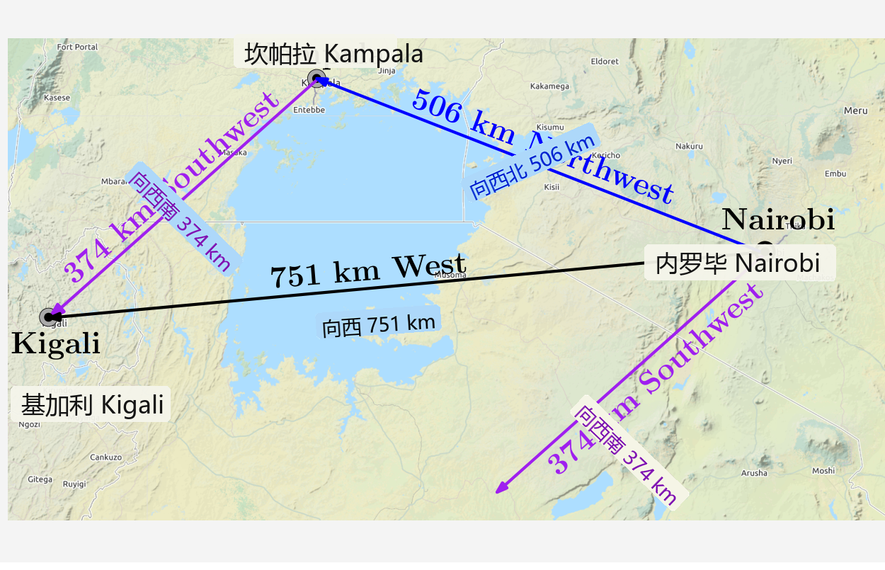

# 2.5 线性无关（Linear Independence）

## 本节导学

**学习目标**

1. 准确说出线性组合、线性相关、线性无关的定义，分清"平凡组合"与"非平凡组合"；
2. 会用定义和高斯消元法（主元列判别法）判断一组向量是否线性无关；
3. 掌握几条常用判别性质（含零向量必相关、可互相表出 ⟺ 相关、$m > k$ 个组合必相关等）；
4. 会用"坐标化"技巧（例 2.15 的方法）判断一组线性组合是否无关。

**预备知识**：2.3 节（高斯消元、主元、行阶梯形）、2.4 节（向量空间）。

**符号速查表**：

| 符号 | 读法 | 含义 |
| --- | --- | --- |
| $\sum_{i=1}^k \lambda_i \boldsymbol x_i$ | 求和 | $\lambda_1 \boldsymbol x_1 + \cdots + \lambda_k \boldsymbol x_k$，即线性组合 |
| 平凡组合 | trivial | 所有系数 $\lambda_i = 0$ 的组合（它永远等于 $\boldsymbol 0$） |
| 非平凡组合 | non-trivial | 至少一个系数不为 0 的组合 |
| $\boldsymbol B = [\boldsymbol b_1, \ldots, \boldsymbol b_k]$ | 以 b 为列的矩阵 | 把向量按列拼成的矩阵 |
| $\boldsymbol \lambda_j$ | lambda j | 坐标向量：第 $j$ 个线性组合中各 $\boldsymbol b_i$ 的系数排成的列向量 |

---

## 2.5.1 线性组合

在向量空间里，我们能对向量做的操作只有两种：相加、数乘。反复使用这两种操作能得到的所有结果，统称**线性组合**。

**定义 2.11**（线性组合）。考虑向量空间 $V$ 中的有限个向量 $\boldsymbol x_1, \ldots, \boldsymbol x_k \in V$。形如

$$
\boldsymbol v = \lambda_1 \boldsymbol x_1 + \cdots + \lambda_k \boldsymbol x_k = \sum_{i=1}^k \lambda_i \boldsymbol x_i \in V \tag{2.65}
$$

（其中 $\lambda_1, \ldots, \lambda_k \in \mathbb{R}$）的任意向量 $\boldsymbol v$，称为 $\boldsymbol x_1, \ldots, \boldsymbol x_k$ 的**线性组合（linear combination）**。

**例**：在 $\mathbb{R}^2$ 中，$(3, 5) = 3(1, 0) + 5(0, 1)$ 是 $(1,0)$ 和 $(0,1)$ 的线性组合；$(3,5)$ 也是 $(1,1)$ 和 $(1,-1)$ 的线性组合，因为解 $a(1,1) + b(1,-1) = (3,5)$ 得 $a = 4, b = -1$，即 $(3,5) = 4(1,1) - (1,-1)$。同一个向量可以由不同的向量组组合出来——这正是下面要深挖的现象。

**平凡与非平凡**。零向量永远可以"平凡地"组合出来：$\boldsymbol 0 = \sum_{i=1}^k 0 \cdot \boldsymbol x_i$（所有系数取 0）。这个组合没有信息量。我们真正关心的是：**能不能用不全为零的系数（非平凡组合）也得到 $\boldsymbol 0$？** 这引出了线性代数中最重要的概念。

## 2.5.2 线性相关与线性无关

**定义 2.12**（线性相关与线性无关）。考虑向量空间 $V$ 中的向量 $\boldsymbol x_1, \ldots, \boldsymbol x_k \in V$。

- 如果存在**非平凡**组合使

$$
\boldsymbol 0 = \sum_{i=1}^k \lambda_i \boldsymbol x_i
$$

即至少有一个 $\lambda_i \neq 0$，则称这组向量**线性相关（linearly dependent）**；

- 如果只有当 $\lambda_1 = \ldots = \lambda_k = 0$ 时上式才成立（只有平凡解），则称这组向量**线性无关（linearly independent）**。

**几何直觉**（二维情形最容易记住）：

- 两个向量线性相关 ⟺ 它们**共线**（一个是另一个的倍数，含零向量情形）；
- 三个向量线性相关 ⟺ 它们**共面**（其中一个在另两个张成的平面里）；
- 一组向量线性无关 = 每个向量都指向一个"独立的新方向"，谁也替代不了谁。

**为什么说线性无关"没有冗余"？** 因为若 $\lambda_1 \boldsymbol x_1 + \cdots + \lambda_k \boldsymbol x_k = \boldsymbol 0$ 且某个 $\lambda_j \neq 0$，就可以解出

$$
\boldsymbol x_j = -\frac{1}{\lambda_j} \sum_{i \neq j} \lambda_i \boldsymbol x_i,
$$

即 $\boldsymbol x_j$ 能被其余向量表示——它携带的信息完全是"多余的"。反之，若组合只能平凡地得到 $\boldsymbol 0$，则任何向量都无法由其余的表示，删掉任何一个都会损失表达能力。

**例 2.13（地理直觉）**。在肯尼亚内罗毕，有人这样描述卢旺达基加利的位置（图 2.7）："先向西北走 506 公里到乌干达坎帕拉，再向西南走 374 公里就到基加利。"这两段位移（西北 506 公里、西南 374 公里）是**线性无关**的——它们指向不同的方向，谁也不能代替谁，两个信息缺一不可（地理坐标是二维的）。

他还可能补充："其实它就在正西 751 公里处。"这句话虽然也对，但在已知前两条信息的情况下是**多余的**——"向正西 751 公里"这个位移恰好是前两个位移的线性组合。三个向量凑在一起就**线性相关**了：知道任意两个就能推算出第三个。

   
  <b>图 2.7 二维空间（平面）中线性相关向量的地理示例（粗略近似主要方位基向）。</b> 

## 2.5.3 判别线性无关的常用性质

**备注**（常用性质）。以下性质在判断时非常好用：

1. **非此即彼**：$k$ 个向量要么线性相关，要么线性无关，没有第三种情况。（定义已经穷尽了所有可能。）
2. **含零向量必相关**：若 $\boldsymbol x_1, \ldots, \boldsymbol x_k$ 中有零向量，比如 $\boldsymbol x_1 = \boldsymbol 0$，则取 $\lambda_1 = 1$、其余 $\lambda_i = 0$，就得到一个非平凡的零组合 $\boldsymbol 0 = 1 \cdot \boldsymbol 0 + 0 \boldsymbol x_2 + \cdots$。同理，若有两个向量完全相同，也必相关（系数取 $1, -1$）。
3. **"能互相表出" ⟺ 相关**：$\{\boldsymbol x_1, \ldots, \boldsymbol x_k\}$（$k \geqslant 2$，均非零）线性相关的**充要条件**是：其中至少有一个向量可以表示为其余向量的线性组合。特别地，若某向量是另一个的倍数（$\boldsymbol x_i = \lambda \boldsymbol x_j$），则必相关。
   - 证明要点：上面"几何直觉"一段已证"相关 ⇒ 可表出"；反过来，若 $\boldsymbol x_j = \sum_{i \neq j} \mu_i \boldsymbol x_i$，移项即得一个系数不全为零的零组合（$\boldsymbol x_j$ 的系数是 $-1 \neq 0$）。$\blacksquare$

## 2.5.4 用高斯消元判断线性无关

**实用判别法**：把 $\boldsymbol x_1, \ldots, \boldsymbol x_k$ 作为**列**拼成矩阵 $\boldsymbol A$，做高斯消元化为行阶梯形（不必化到简化行阶梯形）：

- **主元列**（pivot columns，各非零行首个非零元所在的列）表示与它**左侧**所有向量线性无关的向量（列的排列顺序重要！）；
- **非主元列**可以表示为它左侧主元列的线性组合。例如行阶梯形

$$
\begin{bmatrix} 1 & 3 & 0 \\ 0 & 0 & 2 \end{bmatrix} \tag{2.66}
$$

中第 1、3 列是主元列；第 2 列不是，因为它是第 1 列的 3 倍（第 2 列 $(3, 0)^\top = 3 \times (1, 0)^\top$）。

- **结论**：所有列都是主元列 ⟺ 所有向量线性无关；只要有一个非主元列，就线性相关。

**原理**（呼应 2.3.2 的"关键事实"）：行变换不改变列之间的线性关系，而"是否存在非平凡零组合"恰是 $\boldsymbol{Ax} = \boldsymbol 0$ 是否有非零解的问题——行阶梯形中，每个自由变量（非主元列）都对应一族非平凡解。

**例 2.14**（完整求解，含每一步消元）

考虑 $\mathbb{R}^4$ 中的三个向量：

$$
\boldsymbol x_1 = \begin{bmatrix} 1 \\ 2 \\ -3 \\ 4 \end{bmatrix}, \quad \boldsymbol x_2 = \begin{bmatrix} 1 \\ 1 \\ 0 \\ 2 \end{bmatrix}, \quad \boldsymbol x_3 = \begin{bmatrix} -1 \\ -2 \\ 1 \\ 1 \end{bmatrix} \tag{2.67}
$$

按定义，检验它们是否线性相关就是求解齐次方程（未知数是系数 $\lambda_1, \lambda_2, \lambda_3$）：

$$
\lambda_1 \boldsymbol x_1 + \lambda_2 \boldsymbol x_2 + \lambda_3 \boldsymbol x_3 = \lambda_1 \begin{bmatrix} 1 \\ 2 \\ -3 \\ 4 \end{bmatrix} + \lambda_2 \begin{bmatrix} 1 \\ 1 \\ 0 \\ 2 \end{bmatrix} + \lambda_3 \begin{bmatrix} -1 \\ -2 \\ 1 \\ 1 \end{bmatrix} = \boldsymbol 0 \tag{2.68}
$$

把三个向量按列拼成矩阵并消元（原书此处一步跳过，我们补全每一步）：

**第 1 步：消第 1 列主元下方的元素**——$R_2 \leftarrow R_2 - 2R_1$：$[0, -1, 0]$；$R_3 \leftarrow R_3 + 3R_1$：$[0, 3, -2]$；$R_4 \leftarrow R_4 - 4R_1$：$[0, -2, 5]$：

$$
\begin{bmatrix} 1 & 1 & -1 \\ 0 & -1 & 0 \\ 0 & 3 & -2 \\ 0 & -2 & 5 \end{bmatrix}
$$

**第 2 步：处理第 2 列。** $R_2 \leftarrow -R_2$ 使主元为 1：$[0, 1, 0]$；$R_3 \leftarrow R_3 - 3R_2$：$[0, 0, -2]$；$R_4 \leftarrow R_4 + 2R_2$：$[0, 0, 5]$：

$$
\begin{bmatrix} 1 & 1 & -1 \\ 0 & 1 & 0 \\ 0 & 0 & -2 \\ 0 & 0 & 5 \end{bmatrix}
$$

**第 3 步：处理第 3 列。** $R_3 \leftarrow -\frac{1}{2} R_3$：$[0, 0, 1]$；$R_4 \leftarrow R_4 - 5R_3$：$[0, 0, 0]$：

$$
\leadsto \begin{bmatrix} 1 & 1 & -1 \\ 0 & 1 & 0 \\ 0 & 0 & 1 \\ 0 & 0 & 0 \end{bmatrix} \tag{2.69}
$$

**第 4 步：读结论。** 每一列都是主元列（第 1、2、3 列各有主元），没有自由变量 → 齐次方程组只有平凡解 $\lambda_1 = \lambda_2 = \lambda_3 = 0$ → $\boldsymbol x_1, \boldsymbol x_2, \boldsymbol x_3$ **线性无关**。

**顺带回代验证**（确认消元没错）：阶梯形对应方程组 $\lambda_1 + \lambda_2 - \lambda_3 = 0$，$\lambda_2 = 0$，$\lambda_3 = 0$（第 4 行 $0 = 0$ 无信息）。从下到上：$\lambda_3 = 0 \Rightarrow \lambda_2 = 0 \Rightarrow \lambda_1 = 0$ ✓。

## 2.5.5 坐标化技巧：判断"一组线性组合"是否无关

实际中常遇到这样的问题：已知 $\boldsymbol b_1, \ldots, \boldsymbol b_k$ 线性无关，用它们造出 $m$ 个新的向量

$$
\begin{aligned}
  \boldsymbol x_1 &= \sum_{i=1}^k \lambda_{i1} \boldsymbol b_i \\
  &\ \ \vdots \\
  \boldsymbol x_m &= \sum_{i=1}^k \lambda_{im} \boldsymbol b_i
\end{aligned} \tag{2.70}
$$

问：$\boldsymbol x_1, \ldots, \boldsymbol x_m$ 是否线性无关？如果 $\boldsymbol b_i$ 本身很复杂（比如函数、多项式），直接对 $\boldsymbol x_j$ 消元会很痛苦。有一个漂亮的办法——**只看系数**。

把 $\boldsymbol B = [\boldsymbol b_1, \ldots, \boldsymbol b_k]$（以 $\boldsymbol b_i$ 为列的矩阵），则 (2.70) 可以紧凑地写成

$$
\boldsymbol x_j = \boldsymbol B \boldsymbol \lambda_j, \quad \boldsymbol \lambda_j = \begin{bmatrix} \lambda_{1j} \\ \vdots \\ \lambda_{kj} \end{bmatrix}, \quad j = 1, \ldots, m \tag{2.71}
$$

（按矩阵乘法的"列视角"：$\boldsymbol B \boldsymbol \lambda_j$ 就是 $\boldsymbol B$ 的各列以 $\lambda_{1j}, \ldots, \lambda_{kj}$ 为系数的线性组合，正好就是 $\boldsymbol x_j$ 的定义。）

**关键推导**：检验 $\boldsymbol x_1, \ldots, \boldsymbol x_m$ 的线性无关性，就是问什么时候 $\sum_{j=1}^m \psi_j \boldsymbol x_j = \boldsymbol 0$。代入 (2.71)：

$$
\sum_{j=1}^m \psi_j \boldsymbol x_j = \sum_{j=1}^m \psi_j \boldsymbol B \boldsymbol \lambda_j = \boldsymbol B \sum_{j=1}^m \psi_j \boldsymbol \lambda_j \tag{2.72}
$$

最后一步用了矩阵乘法的线性性质（分配律 + 标量可提）。由于 $\boldsymbol b_1, \ldots, \boldsymbol b_k$ 线性无关，$\boldsymbol B$ 的列之间没有冗余，所以 $\boldsymbol B \boldsymbol z = \boldsymbol 0$ 当且仅当 $\boldsymbol z = \boldsymbol 0$。于是

$$
\sum_j \psi_j \boldsymbol x_j = \boldsymbol 0 \iff \sum_j \psi_j \boldsymbol \lambda_j = \boldsymbol 0.
$$

**结论**：$\{\boldsymbol x_1, \ldots, \boldsymbol x_m\}$ 线性无关 ⟺ **系数向量**集合 $\{\boldsymbol \lambda_1, \ldots, \boldsymbol \lambda_m\}$ 线性无关。问题被"降维"成对 $k$ 维系数向量做消元，与 $\boldsymbol b_i$ 的具体长相无关！

**推论**（一个重要的事实）：$k$ 个无关向量的 $m$ 个线性组合，当 $m > k$ 时**必定线性相关**。（直觉：系数向量 $\boldsymbol \lambda_j$ 生活在 $k$ 维空间 $\mathbb{R}^k$ 里，$m > k$ 个 $k$ 维向量必有冗余——这是 2.6 节"维度"概念的预告：$k$ 维空间里放不下 $k + 1$ 个互不相关的方向。严格的证明在 2.6.1 节之后水到渠成。）

**例 2.15**（坐标化技巧的实战）

设 $\boldsymbol b_1, \boldsymbol b_2, \boldsymbol b_3, \boldsymbol b_4 \in \mathbb{R}^n$ 线性无关，以及

$$
\begin{aligned}
  \boldsymbol x_1 &= \boldsymbol b_1 - 2\boldsymbol b_2 + \boldsymbol b_3 - \boldsymbol b_4 \\
  \boldsymbol x_2 &= -4\boldsymbol b_1 - 2\boldsymbol b_2 + 4\boldsymbol b_4 \\
  \boldsymbol x_3 &= 2\boldsymbol b_1 + 3\boldsymbol b_2 - \boldsymbol b_3 - 3\boldsymbol b_4 \\
  \boldsymbol x_4 &= 17\boldsymbol b_1 - 10\boldsymbol b_2 + 11\boldsymbol b_3 + \boldsymbol b_4
\end{aligned} \tag{2.73}
$$

问：$\boldsymbol x_1, \ldots, \boldsymbol x_4$ 是否线性无关？（这里 $m = 4 > k = 4$？不，$m = k = 4$——正好是临界情形，必须实际计算。）

**第 1 步：抽出系数向量**（每个 $\boldsymbol x_j$ 的系数按 $\boldsymbol b_1, \ldots, \boldsymbol b_4$ 的顺序排成列）：

$$
\left\{ \begin{bmatrix} 1 \\ -2 \\ 1 \\ -1 \end{bmatrix}, \begin{bmatrix} -4 \\ -2 \\ 0 \\ 4 \end{bmatrix}, \begin{bmatrix} 2 \\ 3 \\ -1 \\ -3 \end{bmatrix}, \begin{bmatrix} 17 \\ -10 \\ 11 \\ 1 \end{bmatrix} \right\} \tag{2.74}
$$

对应系数矩阵（按列拼好）：

$$
\boldsymbol A = \begin{bmatrix} 1 & -4 & 2 & 17 \\ -2 & -2 & 3 & -10 \\ 1 & 0 & -1 & 11 \\ -1 & 4 & -3 & 1 \end{bmatrix} \tag{2.75}
$$

**第 2 步：消元**（求行阶梯形；此处展示关键步骤）：

- $R_2 \leftarrow R_2 + 2R_1$：$[0, -10, 7, 24]$；$R_3 \leftarrow R_3 - R_1$：$[0, 4, -3, -6]$；$R_4 \leftarrow R_4 + R_1$：$[0, 0, -1, 18]$；
- 继续消第 2、3 列（细节留给读者），最终得简化行阶梯形：

$$
\leadsto \begin{bmatrix} 1 & 0 & 0 & -7 \\ 0 & 1 & 0 & -15 \\ 0 & 0 & 1 & -18 \\ 0 & 0 & 0 & 0 \end{bmatrix} \tag{2.76}
$$

**第 3 步：读结论。** 第 4 列不是主元列 → 系数向量线性相关 → $\boldsymbol x_1, \ldots, \boldsymbol x_4$ **线性相关**。RREF 的最后一列直接给出了关系：$\boldsymbol \lambda_4 = -7\boldsymbol \lambda_1 - 15\boldsymbol \lambda_2 - 18\boldsymbol \lambda_3$，即

$$
\boldsymbol x_4 = -7\boldsymbol x_1 - 15\boldsymbol x_2 - 18\boldsymbol x_3.
$$

**第 4 步：验证**（把 (2.73) 代回，检查每一行）：只看 $\boldsymbol b_1$ 的系数：$-7 \times 1 + (-15) \times (-4) + (-18) \times 2 = -7 + 60 - 36 = 17$ ✓（正是 $\boldsymbol x_4$ 中 $\boldsymbol b_1$ 的系数 17）。$\boldsymbol b_2$：$-7 \times (-2) + (-15)(-2) + (-18)(3) = 14 + 30 - 54 = -10$ ✓。$\boldsymbol b_3$：$-7 \times 1 + 0 + (-18)(-1) = -7 + 18 = 11$ ✓。$\boldsymbol b_4$：$-7 \times (-1) + (-15)(4) + (-18)(-3) = 7 - 60 + 54 = 1$ ✓。四个分量全部吻合，结论可靠。

---

## 本节小结

| 要点 | 内容 |
| --- | --- |
| 线性组合 | $\sum_i \lambda_i \boldsymbol x_i$：向量经加法、数乘能得到的所有结果 |
| 线性相关 | 存在系数不全为零的组合等于 $\boldsymbol 0$ ⟺ 至少一个向量可由其余表出 |
| 线性无关 | 只有全零系数才能得到 $\boldsymbol 0$；每个向量都提供独立的新方向 |
| 判别法 | 按列拼矩阵 → 行阶梯形 → 全为主元列 ⟺ 无关 |
| 坐标化技巧 | 判断线性组合的无关性，只需判断**系数列向量**的无关性 |

**核心技能**：给一组具体向量，会写齐次方程、拼矩阵、逐步消元、按主元列下结论；给"基向量的线性组合"，会抽出系数矩阵用同样的流程判断。

**与其他章节的关系**：线性无关是 2.6 节"基"（线性无关的生成集）和"秩"（矩阵无关列的个数）的地基；判断系数矩阵是否可逆（2.2 节）本质上也是判断列向量是否线性无关。
