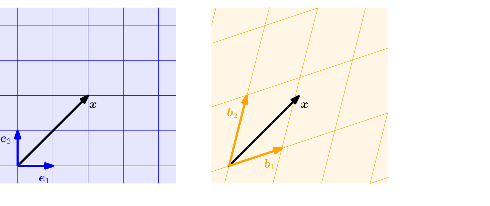
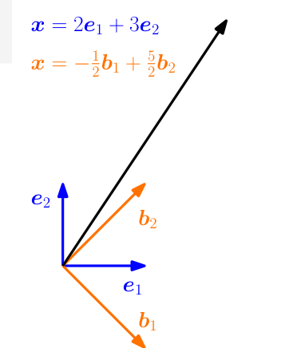
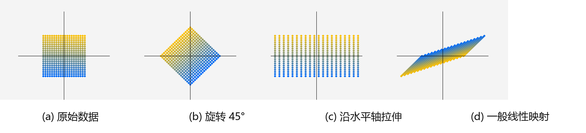
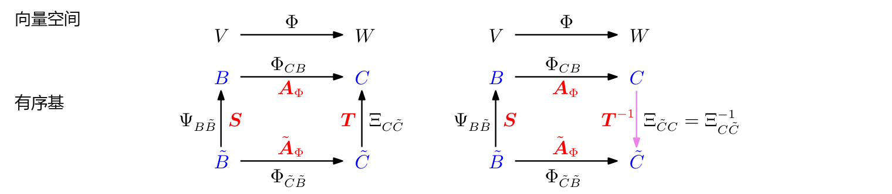
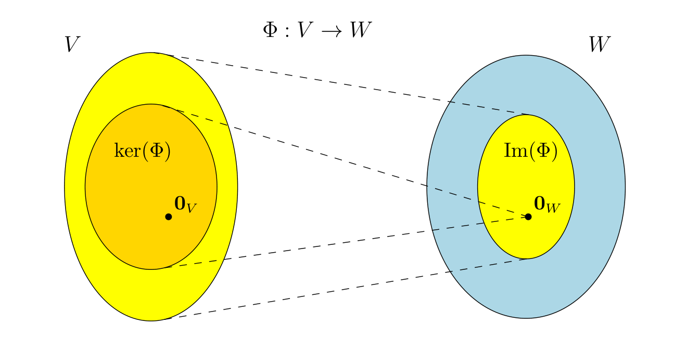

# 2.7 线性映射（Linear Mappings）

## 本节导学

**学习目标**

1. 说出线性映射的定义（保持加法与数乘），会验证一个映射是否线性；
2. 分清单射、满射、双射、同构、自同态、自同构这些概念；
3. 理解"坐标"的概念：同一向量在不同基下有不同的坐标表示；
4. 掌握变换矩阵的构造方法（$\Phi(\boldsymbol b_j)$ 的坐标按列排放），会做基变换（定理 2.20）；
5. 会求线性映射的像与核，并会用秩-零化度定理 $\dim V = \dim \ker + \dim \operatorname{Im}$ 检验结果。

**预备知识**：2.4 节（向量空间）、2.5 节（线性无关）、2.6 节（基与秩）。本节是前述所有概念的综合运用。

**符号速查表**：

| 符号 | 读法 | 含义 |
| --- | --- | --- |
| $\Phi : V \to W$ | "从 V 到 W 的映射 Phi" | 给每个 $V$ 中向量指派一个 $W$ 中向量的规则 |
| $\boldsymbol x \mapsto \boldsymbol y$ | "x 映射到 y" | 描述映射具体做了什么 |
| $\Psi \circ \Phi$ | "Psi 复合 Phi" | 先执行 $\Phi$ 再执行 $\Psi$：$(\Psi \circ \Phi)(\boldsymbol x) = \Psi(\Phi(\boldsymbol x))$ |
| $\operatorname{id}_V$ | 恒等映射 | $\boldsymbol x \mapsto \boldsymbol x$，把每个向量映射到自身 |
| $\Phi^{-1}(\boldsymbol 0_W)$ | 原像 | "所有被 $\Phi$ 映到 $\boldsymbol 0_W$ 的向量组成的集合"。注意这不是逆映射（逆可能不存在） |
| $\operatorname{ker}(\Phi)$ | 核 / 零空间 | $\{\boldsymbol v \in V : \Phi(\boldsymbol v) = \boldsymbol 0_W\}$ |
| $\operatorname{Im}(\Phi)$ | 像 / 值域 | $\{\Phi(\boldsymbol v) : \boldsymbol v \in V\}$，即所有"能到达"的输出 |
| $B = (\boldsymbol b_1, \ldots, \boldsymbol b_n)$ | 有序基 | 基向量**有顺序**（圆括号）；对比：花括号是无序集合，方括号是以向量为列的矩阵 |
| $\boldsymbol \alpha$ | 坐标向量 | 向量 $\boldsymbol x$ 关于某有序基的系数排成的列向量 |

---

## 2.7.1 线性映射：保持向量空间结构的映射

本章开头说：向量是可以相加、可以数乘的对象，运算结果仍是向量。一个"好"的映射应该**保持**这个结构——把 $V$ 中两个向量的和映到 $W$ 中对应输出的和，把缩放映到同样倍数的缩放：

$$
\Phi(\boldsymbol x + \boldsymbol y) = \Phi(\boldsymbol x) + \Phi(\boldsymbol y) \tag{2.85}
$$

$$
\Phi(\lambda \boldsymbol x) = \lambda \Phi(\boldsymbol x) \tag{2.86}
$$

对所有 $\boldsymbol x, \boldsymbol y \in V$、$\lambda \in \mathbb{R}$ 成立。

**定义 2.15**（线性映射）。对于向量空间 $V, W$，映射 $\Phi : V \to W$ 如果满足

$$
\forall \boldsymbol x, \boldsymbol y \in V \ \forall \lambda, \psi \in \mathbb{R} : \Phi(\lambda \boldsymbol x + \psi \boldsymbol y) = \lambda \Phi(\boldsymbol x) + \psi \Phi(\boldsymbol y) \tag{2.87}
$$

则称为**线性映射（linear mapping）**（或**向量空间同态（homomorphism）**、**线性变换（linear transformation）**）。

**两条与一条的关系**：(2.87) 把 (2.85) 和 (2.86) 合成了一条。反过来，取 $\lambda = \psi = 1$ 得 (2.85)，取 $\psi = 0$ 得 (2.86)——所以"一条组合式"与"两条分开的式子"完全等价。实际验证时，可以分开验，也可以直接验组合式。

> **一个重要的提醒**（本书反复强调）：矩阵可以表示两样东西——线性映射，或一组被收集在一起的向量。处理矩阵时必须先想清楚它扮演哪个角色。本节讨论的是前者；第 4 章会看到更多关于线性映射的内容。

### 单射、满射、双射

**定义 2.16**（单射、满射、双射）。考虑映射 $\Phi : V \to W$（$V, W$ 任意集合）：

- **单射（injective，一对一）**：$\forall \boldsymbol x, \boldsymbol y \in V: \Phi(\boldsymbol x) = \Phi(\boldsymbol y) \implies \boldsymbol x = \boldsymbol y$。不同的输入一定得到不同的输出；
- **满射（surjective，映上）**：$\Phi(V) = W$。$W$ 中每个元素都能被"到达"；
- **双射（bijective）**：既是单射又是满射。

**直观例子**（$V = W = \mathbb{R}$）：$x \mapsto 2x$ 是双射（既单又满）；$x \mapsto x^2$ 既不单（$2$ 和 $-2$ 都映到 $4$）也不满（负数到不了）；$x \mapsto e^x$ 单但不满（到不了 $0$ 和负数）。

双射映射可以"撤销"：存在映射 $\Psi : W \to V$ 满足 $\Psi \circ \Phi(\boldsymbol x) = \boldsymbol x$（先映射再撤销，回到原样）。这个 $\Psi$ 称为 $\Phi$ 的**逆映射**，记作 $\Phi^{-1}$。

### 线性映射的特殊类型

- **同构（isomorphism）**：$\Phi : V \to W$ 线性且双射。两个空间之间若存在同构，它们就是"同一类事物"的两种化身；
- **自同态（endomorphism）**：$\Phi : V \to V$ 线性（从空间到自身）；
- **自同构（automorphism）**：$\Phi : V \to V$ 线性且双射；
- **恒等映射（identity mapping）**：$\operatorname{id}_V : V \to V, \boldsymbol x \mapsto \boldsymbol x$。

**例 2.19（同态验证）**。映射 $\Phi : \mathbb{R}^2 \to \mathbb{C}$（实平面映到复数），$\Phi(\boldsymbol x) = x_1 + i x_2$。逐条验证：

$$
\Phi\left( \begin{bmatrix} x_1 \\ x_2 \end{bmatrix} + \begin{bmatrix} y_1 \\ y_2 \end{bmatrix} \right) = (x_1 + y_1) + i(x_2 + y_2) = \underbrace{x_1 + i x_2}_{\Phi(\boldsymbol x)} + \underbrace{y_1 + i y_2}_{\Phi(\boldsymbol y)}
$$

$$
\Phi\left( \lambda \begin{bmatrix} x_1 \\ x_2 \end{bmatrix} \right) = \lambda x_1 + \lambda i x_2 = \lambda (x_1 + i x_2) = \lambda \Phi\left( \begin{bmatrix} x_1 \\ x_2 \end{bmatrix} \right) \tag{2.88}
$$

两步都只用到复数加法和数乘的定义——线性性质成立。（双射性也成立：每个复数 $a + bi$ 恰好对应 $(a, b)$，本书略去验证。）

这个例子的深意：**复数为什么能表示成二元实数组？** 因为存在一个双射线性映射，把 $\mathbb{R}^2$ 的按分量加法忠实地翻译成了复数加法。结构完全一样，只是换了身衣服。

**定理 2.17**（有限维空间同构定理）。有限维向量空间 $V$ 与 $W$ 同构，**当且仅当** $\operatorname{dim}(V) = \operatorname{dim}(W)$。

**怎么理解**：

- "当且仅当"有两半：同构 ⟹ 维度相等（直观：双射线性映射把 $V$ 的基映成 $W$ 的基，基向量个数必然相同）；
- 维度相等 ⟹ 同构（把 $V$ 的基向量逐一对应到 $W$ 的基向量，再线性延拓，就造出了一个同构）。

推论：**同维数的向量空间本质上是"同一类事物"**，可以在无信息损失的情况下互相转换。这也为"$\mathbb{R}^{m \times n}$ 与 $\mathbb{R}^{mn}$ 可以视为等同"提供了理论依据——两者维度都是 $mn$，存在互逆的线性双射（把矩阵的列堆叠成长向量，或反之）。

**备注**（线性映射的运算封闭性）。设 $V, W, X$ 为向量空间：

- $\Phi : V \to W$ 与 $\Psi : W \to X$ 都线性 ⟹ 复合 $\Psi \circ \Phi : V \to X$ 也线性。
  （验证：$(\Psi \circ \Phi)(\lambda \boldsymbol x + \psi \boldsymbol y) = \Psi(\lambda \Phi(\boldsymbol x) + \psi \Phi(\boldsymbol y)) = \lambda (\Psi \circ \Phi)(\boldsymbol x) + \psi (\Psi \circ \Phi)(\boldsymbol y)$，两步分别用了 $\Phi$ 和 $\Psi$ 的线性。）
- $\Phi$ 是同构 ⟹ $\Phi^{-1}$ 也是同构（同构的逆仍是线性双射）。
- $\Phi, \Psi : V \to W$ 线性 ⟹ $\Phi + \Psi$（逐点相加）与 $\lambda \Phi$ 也线性。

## 2.7.2 坐标与变换矩阵

由定理 2.17，任何 $n$ 维向量空间都和 $\mathbb{R}^n$ 同构——"坐标"就是这个同构的具体化。取 $n$ 维空间 $V$ 的一组基，**基向量的顺序**很重要，所以写成有序 $n$ 元组：

$$
B = (\boldsymbol b_1, \ldots, \boldsymbol b_n) \tag{2.89}
$$

称为 $V$ 的一组**有序基（ordered basis）**。

> **三种记号务必分清**：
> - $B = (\boldsymbol b_1, \ldots, \boldsymbol b_n)$：有序基（圆括号，有顺序）；
> - $B = \{\boldsymbol b_1, \ldots, \boldsymbol b_n\}$：基作为无序集合（花括号）；
> - $\boldsymbol B = [\boldsymbol b_1, \ldots, \boldsymbol b_n]$：以基向量为**列**拼成的矩阵（粗体、方括号）。

**定义 2.18**（坐标）。设 $B = (\boldsymbol b_1, \ldots, \boldsymbol b_n)$ 是 $V$ 的有序基。由 2.6 节基的等价刻画（表示唯一性），任意 $\boldsymbol x \in V$ 都有**唯一**的表示

$$
\boldsymbol x = \alpha_1 \boldsymbol b_1 + \cdots + \alpha_n \boldsymbol b_n \tag{2.90}
$$

系数 $\alpha_1, \ldots, \alpha_n$ 称为 $\boldsymbol x$ 关于 $B$ 的**坐标（coordinates）**，而列向量

$$
\boldsymbol \alpha = \begin{bmatrix} \alpha_1 \\ \vdots \\ \alpha_n \end{bmatrix} \in \mathbb{R}^n \tag{2.91}
$$

称为 $\boldsymbol x$ 关于 $B$ 的**坐标向量（coordinate vector）**。

**坐标就是"在基这个坐标系里的地址"**。我们熟悉的笛卡尔坐标系由标准基 $\boldsymbol e_1, \boldsymbol e_2$ 张成；但 $\mathbb{R}^2$ 的**任何一组基**都定义一个合法的坐标系，同一个向量在不同基下的坐标一般不同。图 2.8 中，向量 $\boldsymbol x$ 关于标准基的坐标是 $[2, 2]^\top$，关于基 $(\boldsymbol b_1, \boldsymbol b_2)$ 的坐标却是 $[1.09, 0.72]^\top$——**变的是坐标，不是向量本身**。

   
  <b>图 2.8 根据基的不同选择，向量 x 的两种不同坐标表示。</b> 

**例 2.20（亲手算坐标）**。设 $\boldsymbol x \in \mathbb{R}^2$ 关于标准基 $(\boldsymbol e_1, \boldsymbol e_2)$ 的坐标为 $[2, 3]^\top$，即 $\boldsymbol x = 2\boldsymbol e_1 + 3\boldsymbol e_2 = (2, 3)$。换用基 $\boldsymbol b_1 = [1, -1]^\top$、$\boldsymbol b_2 = [1, 1]^\top$，坐标 $(\alpha_1, \alpha_2)$ 满足

$$
\alpha_1 \begin{bmatrix} 1 \\ -1 \end{bmatrix} + \alpha_2 \begin{bmatrix} 1 \\ 1 \end{bmatrix} = \begin{bmatrix} 2 \\ 3 \end{bmatrix}
\quad \Longleftrightarrow \quad
\begin{cases} \alpha_1 + \alpha_2 = 2 \\ -\alpha_1 + \alpha_2 = 3 \end{cases}
$$

两式相加：$2\alpha_2 = 5 \Rightarrow \alpha_2 = \frac{5}{2}$；代回：$\alpha_1 = 2 - \frac{5}{2} = -\frac{1}{2}$。

$$
\boldsymbol x = -\frac{1}{2} \boldsymbol b_1 + \frac{5}{2} \boldsymbol b_2, \quad \text{坐标} = \frac{1}{2}\begin{bmatrix} -1 \\ 5 \end{bmatrix}
$$

与原书结论一致（图 2.9）。注意"求坐标"本质上就是解一个线性方程组——2.1 节的老朋友又出现了。

   
  <b>图 2.9 向量 x 随基的选择而产生的不同坐标表示。</b> 

**备注**（基给出同构）。固定有序基 $B$ 后，映射 $\Phi : \mathbb{R}^n \to V$，$\Phi(\boldsymbol e_i) = \boldsymbol b_i$（$i = 1, \ldots, n$，$\boldsymbol e_i$ 是 $\mathbb{R}^n$ 的标准基）是线性的，且由定理 2.17 是同构。它就是"坐标向量 → 实际向量"的翻译器。

### 变换矩阵：线性映射的"数值化身"

**定义 2.19**（变换矩阵）。设 $V, W$ 分别有有序基 $B = (\boldsymbol b_1, \ldots, \boldsymbol b_n)$ 和 $C = (\boldsymbol c_1, \ldots, \boldsymbol c_m)$，$\Phi : V \to W$ 线性。对每个 $j = 1, \ldots, n$，把 $\Phi(\boldsymbol b_j)$ 用基 $C$ **唯一**表示（表示的唯一性来自 2.6 节）：

$$
\Phi(\boldsymbol b_j) = \alpha_{1j}\boldsymbol c_1 + \cdots + \alpha_{mj}\boldsymbol c_m = \sum_{i=1}^m \alpha_{ij}\boldsymbol c_i \tag{2.92}
$$

则以 $\alpha_{ij}$ 为元素的 $m \times n$ 矩阵

$$
\boldsymbol A_\Phi(i, j) = \alpha_{ij} \tag{2.93}
$$

称为 $\Phi$ 关于有序基 $B$ 与 $C$ 的**变换矩阵（transformation matrix）**。

**一句话构造法**：$\boldsymbol A_\Phi$ 的第 $j$ 列 = $\Phi(\boldsymbol b_j)$ 在基 $C$ 下的**坐标向量**。"把每个基向量送过去，记下坐标，按列排好。"

**为什么这样就能表示整个映射？** 因为线性映射由它在基上的取值唯一决定：任意 $\boldsymbol x = \sum_j \hat{x}_j \boldsymbol b_j$ 有 $\Phi(\boldsymbol x) = \sum_j \hat{x}_j \Phi(\boldsymbol b_j)$（线性性），而每个 $\Phi(\boldsymbol b_j)$ 又由坐标 $\boldsymbol \alpha_j$ 记录。把 $\hat{\boldsymbol x}$（$\boldsymbol x$ 关于 $B$ 的坐标向量）和 $\hat{\boldsymbol y}$（$\boldsymbol y = \Phi(\boldsymbol x)$ 关于 $C$ 的坐标向量）代入整理，恰好得到

$$
\hat{\boldsymbol y} = \boldsymbol A_\Phi \hat{\boldsymbol x} \tag{2.94}
$$

也就是说：**变换矩阵把"$V$ 中基 $B$ 的坐标"翻译成"$W$ 中基 $C$ 的坐标"**。至此，抽象的线性映射完全等价于具体的矩阵乘法——这是线性代数中最核心的对应关系。

**例 2.21（变换矩阵）**。已知 $\Phi : V \to W$（$\dim V = 3$，$\dim W = 4$）满足

$$
\begin{aligned}
  \Phi(\boldsymbol b_1) &= \boldsymbol c_1 - \boldsymbol c_2 + 3\boldsymbol c_3 - \boldsymbol c_4 \\
  \Phi(\boldsymbol b_2) &= 2\boldsymbol c_1 + \boldsymbol c_2 + 7\boldsymbol c_3 + 2\boldsymbol c_4 \\
  \Phi(\boldsymbol b_3) &= 3\boldsymbol c_2 + \boldsymbol c_3 + 4\boldsymbol c_4
\end{aligned} \tag{2.95}
$$

三个右端关于 $C$ 的坐标分别是 $(1, -1, 3, -1)^\top$、$(2, 1, 7, 2)^\top$、$(0, 3, 1, 4)^\top$（第三个不含 $\boldsymbol c_1$，所以第 1 个坐标是 0）。按列排放：

$$
\boldsymbol A_\Phi = [\boldsymbol \alpha_1, \boldsymbol \alpha_2, \boldsymbol \alpha_3] = \begin{bmatrix} 1 & 2 & 0 \\ -1 & 1 & 3 \\ 3 & 7 & 1 \\ -1 & 2 & 4 \end{bmatrix} \tag{2.96}
$$

**例 2.22（向量的线性变换）**。对 $\mathbb{R}^2$ 中一批向量（排成正方形的 400 个点）分别施加三个线性变换（图 2.10）：

$$
\boldsymbol A_1 = \begin{bmatrix} \cos(\frac{\pi}{4}) & -\sin(\frac{\pi}{4}) \\ \sin(\frac{\pi}{4}) & \cos(\frac{\pi}{4}) \end{bmatrix}, \quad \boldsymbol A_2 = \begin{bmatrix} 2 & 0 \\ 0 & 1 \end{bmatrix}, \quad \boldsymbol A_3 = \frac{1}{2}\begin{bmatrix} 3 & -1 \\ 1 & -1 \end{bmatrix} \tag{2.97}
$$

- $\boldsymbol A_1$：把正方形**旋转** $45^\circ$（$\frac{\pi}{4}$ 弧度）。图 2.10(b)；
- $\boldsymbol A_2$：把每个向量的 $x_1$ 坐标拉伸 2 倍（$x_2$ 不变），正方形变成长方形。图 2.10(c)；
- $\boldsymbol A_3$：反射、旋转和拉伸的**复合**效果。图 2.10(d)。

这正是"矩阵 = 线性变换"的几何意义：单位正方形（由 $\boldsymbol e_1, \boldsymbol e_2$ 张成）被映成了以矩阵两列为边的平行四边形。

   
  <b>图 2.10 一组向量线性变换的三个示例。</b> 

## 2.7.3 基变换：换坐标系后矩阵怎么变

换基后，**映射本身没变，但坐标变了**，变换矩阵随之改变。问题：新旧矩阵之间是什么关系？

设 $V$ 有两组有序基 $B, \tilde{B}$（(2.103)），$W$ 有两组有序基 $C, \tilde{C}$（(2.104)）。$\boldsymbol A_\Phi$ 是 $\Phi$ 关于 $B, C$ 的变换矩阵，$\tilde{\boldsymbol A}_\Phi$ 是关于 $\tilde{B}, \tilde{C}$ 的变换矩阵。

**备注**（这其实是恒等映射的重新表示）。基变换不改变向量 $\boldsymbol x$ 本身，只改变它的坐标——相当于图 2.9 中"从 $(\boldsymbol e_1, \boldsymbol e_2)$ 坐标换算到 $(\boldsymbol b_1, \boldsymbol b_2)$ 坐标"。换个好基，变换矩阵可能变得极其简单（比如对角矩阵），计算量大减。这正是特征分解（第 4.4 节）和 PCA（第 10 章）的思想源头。

**例 2.23（基变换的收益）**。$\mathbb{R}^2$ 上的变换矩阵（标准基下）

$$
\boldsymbol A = \begin{bmatrix} 2 & 1 \\ 1 & 2 \end{bmatrix} \tag{2.100}
$$

改用新基

$$
B = \left( \begin{bmatrix} 1 \\ 1 \end{bmatrix}, \begin{bmatrix} 1 \\ -1 \end{bmatrix} \right) \tag{2.101}
$$

由于定义域和到达域是同一个空间、用同一组新基，$\boldsymbol S = \boldsymbol T = \begin{bmatrix} 1 & 1 \\ 1 & -1 \end{bmatrix}$（新基向量按列排放），$\tilde{\boldsymbol A} = \boldsymbol S^{-1} \boldsymbol A \boldsymbol S$。逐个计算：

- $\boldsymbol S^{-1} = \frac{1}{\det \boldsymbol S}\begin{bmatrix} -1 & -1 \\ -1 & 1 \end{bmatrix} = \frac{1}{-2}\begin{bmatrix} -1 & -1 \\ -1 & 1 \end{bmatrix} = \begin{bmatrix} \frac{1}{2} & \frac{1}{2} \\ \frac{1}{2} & -\frac{1}{2} \end{bmatrix}$（用了 2.2 节的 $2 \times 2$ 逆矩阵公式 (2.24)）；
- $\boldsymbol{AS} = \begin{bmatrix} 2 & 1 \\ 1 & 2 \end{bmatrix}\begin{bmatrix} 1 & 1 \\ 1 & -1 \end{bmatrix} = \begin{bmatrix} 3 & 1 \\ 3 & -1 \end{bmatrix}$；
- $\tilde{\boldsymbol A} = \boldsymbol S^{-1}(\boldsymbol{AS}) = \begin{bmatrix} \frac{1}{2} & \frac{1}{2} \\ \frac{1}{2} & -\frac{1}{2} \end{bmatrix}\begin{bmatrix} 3 & 1 \\ 3 & -1 \end{bmatrix} = \begin{bmatrix} 3 & 0 \\ 0 & 1 \end{bmatrix} \tag{2.102}$

对角矩阵！分析和计算都容易得多。**为什么会这样？** 观察：$\boldsymbol A(1,1)^\top = (3,3)^\top = 3(1,1)^\top$，$\boldsymbol A(1,-1)^\top = (1,-1)^\top$——新基恰好由 $\boldsymbol A$ 的"只被缩放、不被旋转"的向量（特征向量，第 4.2 节）组成，所以在新基下 $\boldsymbol A$ 退化为纯缩放。这不是巧合，而是第 4.4 节对角化主题的预告。

**定理 2.20**（基变换）。记号如上，则

$$
\tilde{\boldsymbol A}_\Phi = \boldsymbol T^{-1} \boldsymbol A_\Phi \boldsymbol S \tag{2.105}
$$

其中 $\boldsymbol S \in \mathbb{R}^{n \times n}$ 是恒等映射 $\operatorname{id}_V$（把 $\tilde{B}$ 坐标映到 $B$ 坐标）的变换矩阵，$\boldsymbol T \in \mathbb{R}^{m \times m}$ 是恒等映射 $\operatorname{id}_W$（把 $\tilde{C}$ 坐标映到 $C$ 坐标）的变换矩阵。

**证明**（逐行看懂）。证明的核心思想是：**用两种方式表达 $\Phi(\tilde{\boldsymbol b}_j)$，比较系数**。

第 1 步：把新基向量用旧基展开（这总是办得到的，因为 $B, C$ 是基）：

$$
\tilde{\boldsymbol b}_j = \sum_{i=1}^n s_{ij}\boldsymbol b_i, \quad j = 1, \ldots, n \tag{2.106}
$$

$$
\tilde{\boldsymbol c}_k = \sum_{l=1}^m t_{lk}\boldsymbol c_l, \quad k = 1, \ldots, m \tag{2.107}
$$

按定义，$\boldsymbol S = ((s_{ij}))$ 的第 $j$ 列就是 $\tilde{\boldsymbol b}_j$ 关于 $B$ 的坐标；$\boldsymbol T = ((t_{lk}))$ 的第 $k$ 列是 $\tilde{\boldsymbol c}_k$ 关于 $C$ 的坐标。两者都是可逆方阵（坐标变换永远可逆）。

第 2 步：第一种视角——直接用 $\tilde{\boldsymbol A}_\Phi$ 的定义展开 $\Phi(\tilde{\boldsymbol b}_j)$，并把 $\tilde{\boldsymbol c}_k$ 换成 (2.107)：

$$
\Phi(\tilde{\boldsymbol b}_j) = \sum_{k=1}^m \tilde{a}_{kj} \tilde{\boldsymbol c}_k = \sum_{k=1}^m \tilde{a}_{kj} \sum_{l=1}^m t_{lk}\boldsymbol c_l = \sum_{l=1}^m \left( \sum_{k=1}^m t_{lk} \tilde{a}_{kj} \right) \boldsymbol c_l \tag{2.108}
$$

（最后一步只是交换了两个求和号的顺序：每个 $\boldsymbol c_l$ 前面的系数是所有含 $t_{lk}$ 的项加起来。）

第 3 步：第二种视角——先用 (2.106) 把 $\tilde{\boldsymbol b}_j$ 拆成旧基，再用 $\Phi$ 的线性和 $\boldsymbol A_\Phi$ 的定义：

$$
\Phi(\tilde{\boldsymbol b}_j) = \Phi\left( \sum_{i=1}^n s_{ij}\boldsymbol b_i \right) = \sum_{i=1}^n s_{ij} \Phi(\boldsymbol b_i) = \sum_{i=1}^n s_{ij} \sum_{l=1}^m a_{li}\boldsymbol c_l \tag{2.109a}
$$

$$
= \sum_{l=1}^m \left( \sum_{i=1}^n a_{li} s_{ij} \right) \boldsymbol c_l \tag{2.109b}
$$

第 4 步：比较。两个式子都是"用旧基 $C$ 表示同一个向量 $\Phi(\tilde{\boldsymbol b}_j)$"，而基表示**唯一**（2.6 节），所以每个 $\boldsymbol c_l$ 的系数必须相等：

$$
\sum_{k=1}^m t_{lk} \tilde{a}_{kj} = \sum_{i=1}^n a_{li} s_{ij}, \quad \forall j, l \tag{2.110}
$$

左端正是矩阵乘积 $\boldsymbol T \tilde{\boldsymbol A}_\Phi$ 的 $(l, j)$ 元素，右端是 $\boldsymbol A_\Phi \boldsymbol S$ 的 $(l, j)$ 元素，即

$$
\boldsymbol T \tilde{\boldsymbol A}_\Phi = \boldsymbol A_\Phi \boldsymbol S \tag{2.111}
$$

两边左乘 $\boldsymbol T^{-1}$：

$$
\tilde{\boldsymbol A}_\Phi = \boldsymbol T^{-1} \boldsymbol A_\Phi \boldsymbol S \tag{2.112}
$$

证毕。$\blacksquare$

**图 2.11 的交换图视角**。新基下的映射可以"绕道"旧基完成（图 2.11），分三步：

1. $\boldsymbol S$：把 $\tilde{B}$ 坐标翻译成 $B$ 坐标（$\Psi_{B\tilde{B}} = \operatorname{id}_V$，向量不动，只换坐标）；
2. $\boldsymbol A_\Phi$：在旧基下施加映射；
3. $\boldsymbol T^{-1}$：把 $C$ 坐标翻译回 $\tilde{C}$ 坐标（$\Xi_{\tilde{C}C} = \operatorname{id}_W$）。

复合起来就是 $\Phi_{\tilde{C}\tilde{B}} = \Xi_{C\tilde{C}}^{-1} \circ \Phi_{CB} \circ \Psi_{B\tilde{B}}$（(2.114)）。用箭头写更直观：

$$
\tilde{B} \to \tilde{C} = \tilde{B} \to B \to C \to \tilde{C} \tag{2.115}
$$

注意矩阵乘法从右往左执行：$\boldsymbol x \mapsto \boldsymbol S \boldsymbol x \mapsto \boldsymbol A_\Phi(\boldsymbol S \boldsymbol x) \mapsto \boldsymbol T^{-1}\boldsymbol A_\Phi \boldsymbol S \boldsymbol x$。

   
  <b>图 2.11 线性映射的基变换交换图解。</b> 

**定义 2.21**（等价）。若存在可逆矩阵 $\boldsymbol S \in \mathbb{R}^{n \times n}$、$\boldsymbol T \in \mathbb{R}^{m \times m}$ 使 $\tilde{\boldsymbol A} = \boldsymbol T^{-1} \boldsymbol A \boldsymbol S$，则称 $\boldsymbol A, \tilde{\boldsymbol A} \in \mathbb{R}^{m \times n}$ **等价（equivalent）**。

**定义 2.22**（相似）。若存在可逆矩阵 $\boldsymbol S \in \mathbb{R}^{n \times n}$ 使 $\tilde{\boldsymbol A} = \boldsymbol S^{-1} \boldsymbol A \boldsymbol S$，则称方阵 $\boldsymbol A, \tilde{\boldsymbol A} \in \mathbb{R}^{n \times n}$ **相似（similar）**。

**关系**：相似的矩阵必等价（取 $\boldsymbol T = \boldsymbol S$ 即可）；等价的矩阵未必相似（相似要求同一个 $\boldsymbol S 左右夹攻$，条件更强）。相似矩阵代表的是**同一个自同态**在不同基下的矩阵；等价矩阵代表的甚至可以不是同一个映射（定义域、到达域的基可以独立地换）。

**备注**（复合映射的矩阵 = 矩阵的乘积）。$\Phi : V \to W$、$\Psi : W \to X$ 线性，复合 $\Psi \circ \Phi$ 的变换矩阵是 $\boldsymbol A_{\Psi \circ \Phi} = \boldsymbol A_\Psi \boldsymbol A_\Phi$（顺序与复合顺序一致）。用"箭头记法"：$B \to C \to D$ 的复合矩阵就是两步矩阵相乘。

**例 2.24（基变换计算，完整过程）**。$\Phi : \mathbb{R}^3 \to \mathbb{R}^4$ 关于标准基 $B, C$（(2.118)）的变换矩阵为

$$
\boldsymbol A_\Phi = \begin{bmatrix} 1 & 2 & 0 \\ -1 & 1 & 3 \\ 3 & 7 & 1 \\ -1 & 2 & 4 \end{bmatrix} \tag{2.117}
$$

（它与例 2.21 的 (2.96) 相同。）求关于新基的变换矩阵，新基为

$$
\tilde{B} = \left( \begin{bmatrix} 1 \\ 1 \\ 0 \end{bmatrix}, \begin{bmatrix} 0 \\ 1 \\ 1 \end{bmatrix}, \begin{bmatrix} 1 \\ 0 \\ 1 \end{bmatrix} \right), \quad \tilde{C} = \left( \begin{bmatrix} 1 \\ 1 \\ 0 \\ 0 \end{bmatrix}, \begin{bmatrix} 1 \\ 0 \\ 1 \\ 0 \end{bmatrix}, \begin{bmatrix} 0 \\ 1 \\ 1 \\ 0 \end{bmatrix}, \begin{bmatrix} 1 \\ 0 \\ 0 \\ 1 \end{bmatrix} \right) \tag{2.119}
$$

**第 1 步：构造 $\boldsymbol S$ 和 $\boldsymbol T$**（新基向量按列排放）：

$$
\boldsymbol S = \begin{bmatrix} 1 & 0 & 1 \\ 1 & 1 & 0 \\ 0 & 1 & 1 \end{bmatrix}, \quad \boldsymbol T = \begin{bmatrix} 1 & 1 & 0 & 1 \\ 1 & 0 & 1 & 0 \\ 0 & 1 & 1 & 0 \\ 0 & 0 & 0 & 1 \end{bmatrix} \tag{2.120}
$$

由于 $B, C$ 是标准基，新基向量"关于旧基的坐标"直接就是它们的分量，可以读出。若旧基不是标准基，则要解方程组 $\sum_i \lambda_i \boldsymbol b_i = \tilde{\boldsymbol b}_j$ 求坐标（例 2.20 的方法）。

**第 2 步：计算 $\boldsymbol T^{-1}$**（用 2.3.3 的 $[\boldsymbol T \mid \boldsymbol I]$ 方法，关键步骤）：

$$
[\boldsymbol T \mid \boldsymbol I_4] \leadsto \cdots \leadsto \left[ \begin{array}{cccc|cccc} 1 & 0 & 0 & 0 & \frac{1}{2} & \frac{1}{2} & -\frac{1}{2} & -\frac{1}{2} \\ 0 & 1 & 0 & 0 & \frac{1}{2} & -\frac{1}{2} & \frac{1}{2} & -\frac{1}{2} \\ 0 & 0 & 1 & 0 & -\frac{1}{2} & \frac{1}{2} & \frac{1}{2} & \frac{1}{2} \\ 0 & 0 & 0 & 1 & 0 & 0 & 0 & 1 \end{array} \right]
$$

即

$$
\boldsymbol T^{-1} = \frac{1}{2} \begin{bmatrix} 1 & 1 & -1 & -1 \\ 1 & -1 & 1 & -1 \\ -1 & 1 & 1 & 1 \\ 0 & 0 & 0 & 2 \end{bmatrix}
$$

**第 3 步：先算 $\boldsymbol A_\Phi \boldsymbol S$**（4×3 乘 3×3，逐元素"行乘列"）：

$$
\boldsymbol A_\Phi \boldsymbol S = \begin{bmatrix} 3 & 2 & 1 \\ 0 & 4 & 2 \\ 10 & 8 & 4 \\ 1 & 6 & 3 \end{bmatrix}
$$

抽查第 3 行第 1 列：$(3, 7, 1) \cdot (1, 1, 0) = 3 + 7 + 0 = 10$ ✓。

**第 4 步：左乘 $\boldsymbol T^{-1}$**（抽查第 1 行第 1 列：$\frac{1}{2}(1, 1, -1, -1) \cdot (3, 0, 10, 1) = \frac{1}{2}(3 + 0 - 10 - 1) = -4$ ✓）：

$$
\tilde{\boldsymbol A}_\Phi = \boldsymbol T^{-1} \boldsymbol A_\Phi \boldsymbol S = \frac{1}{2} \begin{bmatrix} 1 & 1 & -1 & -1 \\ 1 & -1 & 1 & -1 \\ -1 & 1 & 1 & 1 \\ 0 & 0 & 0 & 2 \end{bmatrix} \begin{bmatrix} 3 & 2 & 1 \\ 0 & 4 & 2 \\ 10 & 8 & 4 \\ 1 & 6 & 3 \end{bmatrix} = \begin{bmatrix} -4 & -4 & -2 \\ 6 & 0 & 0 \\ 4 & 8 & 4 \\ 1 & 6 & 3 \end{bmatrix} \tag{2.121}
$$

**验证**（直接按定义抽查一列）：$\tilde{\boldsymbol A}_\Phi$ 的第 1 列应该是 $\Phi(\tilde{\boldsymbol b}_1)$ 关于 $\tilde{C}$ 的坐标，即 $(-4, 6, 4, 1)^\top$。用旧基验算：$\Phi(\tilde{\boldsymbol b}_1) = \boldsymbol A_\Phi (1, 1, 0)^\top = (3, 0, 10, 1)^\top$（关于 $C$）。另一方面 $-4\tilde{\boldsymbol c}_1 + 6\tilde{\boldsymbol c}_2 + 4\tilde{\boldsymbol c}_3 + \tilde{\boldsymbol c}_4 = -4(1,1,0,0) + 6(1,0,1,0) + 4(0,1,1,0) + (1,0,0,1) = (-4+6+0+1,\ -4+0+4+0,\ 0+6+4+0,\ 0+0+0+1) = (3, 0, 10, 1)$ ✓。两个基下是同一个向量，计算无误。

> **基变换的用途预告**：第 4.4 节将用基变换寻找特殊基，使自同态的矩阵变成对角形；第 10 章（PCA）将寻找"便于压缩"的基，使数据投影后的损失最小。$\tilde{\boldsymbol A} = \boldsymbol S^{-1} \boldsymbol A \boldsymbol S$ 这条公式会贯穿这两章。

## 2.7.4 像与核

**定义 2.23**（像与核）。对线性映射 $\Phi : V \to W$，定义

$$
\operatorname{ker}(\Phi) := \Phi^{-1}(\boldsymbol 0_W) = \{\boldsymbol v \in V : \Phi(\boldsymbol v) = \boldsymbol 0_W\} \tag{2.122}
$$

（**核（kernel）**，或**零空间（null space）**）

$$
\operatorname{Im}(\Phi) := \Phi(V) = \{\boldsymbol w \in W \mid \exists \boldsymbol v \in V : \Phi(\boldsymbol v) = \boldsymbol w\} \tag{2.123}
$$

（**像（image）**，或**值域（range）**）。$V$ 与 $W$ 分别称为 $\Phi$ 的**定义域（domain）**与**到达域（codomain）**。

**注意记号**：$\Phi^{-1}(\boldsymbol 0_W)$ 读作"$\boldsymbol 0_W$ 的**原像**"——被映到 $\boldsymbol 0_W$ 的所有输入的集合。它不是逆映射（逆可能根本不存在）。

**直观**：核是"$V$ 中被 $\Phi$ 抹成零"的向量全体；像是"$W$ 中能被到达"的向量全体。图 2.12 是示意图。

   
  <b>图 2.12 线性映射的核与像。</b> 

**备注**（三条基本性质，附理由）。设 $\Phi : V \to W$ 线性：

1. **$\Phi(\boldsymbol 0_V) = \boldsymbol 0_W$ 恒成立**，所以 $\boldsymbol 0_V \in \operatorname{ker}(\Phi)$，核永远非空。
   （理由：$\Phi(\boldsymbol 0_V) = \Phi(0 \cdot \boldsymbol 0_V) = 0 \cdot \Phi(\boldsymbol 0_V) = \boldsymbol 0_W$，用了 (2.86)。）这条还顺便说明：**线性映射必过原点**——"不过原点的直线映射"一定不是线性映射（它是下一节的仿射映射）。
2. **$\operatorname{Im}(\Phi) \subseteq W$ 和 $\operatorname{ker}(\Phi) \subseteq V$ 都是子空间**。
   （验证 $\ker$：① 由上条 $\boldsymbol 0_V \in \ker$；② 若 $\Phi(\boldsymbol u) = \boldsymbol 0$，则 $\Phi(\lambda \boldsymbol u) = \lambda \Phi(\boldsymbol u) = \boldsymbol 0$，数乘封闭；③ 若 $\Phi(\boldsymbol u) = \Phi(\boldsymbol v) = \boldsymbol 0$，则 $\Phi(\boldsymbol u + \boldsymbol v) = \boldsymbol 0$，加法封闭。$\operatorname{Im}$ 同理可验。）
3. **$\Phi$ 是单射 ⟺ $\operatorname{ker}(\Phi) = \{\boldsymbol 0\}$**。
   （证明：⟹ 设单射且 $\boldsymbol v \in \ker$，则 $\Phi(\boldsymbol v) = \boldsymbol 0_W = \Phi(\boldsymbol 0_V)$，单射给出 $\boldsymbol v = \boldsymbol 0_V$。⟸ 设核平凡且 $\Phi(\boldsymbol x) = \Phi(\boldsymbol y)$，则 $\Phi(\boldsymbol x - \boldsymbol y) = \boldsymbol 0$，即 $\boldsymbol x - \boldsymbol y \in \ker = \{\boldsymbol 0\}$，故 $\boldsymbol x = \boldsymbol y$。$\blacksquare$）
   **直觉**：核里的向量是"信息被抹掉的部分"。核越胖，丢的信息越多；核只剩零向量时，没有任何信息丢失，映射自然是一对一的。

**备注**（矩阵的零空间与列空间）。设 $\boldsymbol A \in \mathbb{R}^{m \times n}$，$\Phi : \mathbb{R}^n \to \mathbb{R}^m$，$\boldsymbol x \mapsto \boldsymbol{Ax}$。把 $\boldsymbol A = [\boldsymbol a_1, \ldots, \boldsymbol a_n]$ 按列拆开：

$$
\operatorname{Im}(\Phi) = \{\boldsymbol A \boldsymbol x : \boldsymbol x \in \mathbb{R}^n\} = \left\{ \sum_{i=1}^n x_i \boldsymbol a_i : x_1, \ldots, x_n \in \mathbb{R} \right\} = \operatorname{span}[\boldsymbol a_1, \ldots, \boldsymbol a_n] \subseteq \mathbb{R}^m \tag{2.124}
$$

即：**像 = $\boldsymbol A$ 的列张成的空间（列空间，column space）**，是 $\mathbb{R}^m$ 的子空间（$m$ = 行数 = 高度）。于是

$$
\operatorname{rk}(\boldsymbol A) = \operatorname{dim}(\operatorname{Im}(\Phi))
$$

——秩就是"像的维度"，2.6.2 节秩的性质第 2 条在这里得到了解释。

而**核 = 齐次方程组 $\boldsymbol{Ax} = \boldsymbol 0$ 的解空间**（2.3.1 节通解里的齐次部分），是 $\mathbb{R}^n$ 的子空间（$n$ = 列数 = 宽度）。核刻画了列之间的线性关系：核向量 $\boldsymbol x$ 给出的正是"哪些列、以什么系数组合能得到 $\boldsymbol 0$"——这正是 2.5 节"用高斯消元判断线性相关"的另一种说法。

**例 2.25（像与核的完整求解）**

$$
\Phi : \mathbb{R}^4 \to \mathbb{R}^2, \quad \begin{bmatrix} x_1 \\ x_2 \\ x_3 \\ x_4 \end{bmatrix} \mapsto \begin{bmatrix} 1 & 2 & -1 & 0 \\ 1 & 0 & 0 & 1 \end{bmatrix} \begin{bmatrix} x_1 \\ x_2 \\ x_3 \\ x_4 \end{bmatrix} = \begin{bmatrix} x_1 + 2x_2 - x_3 \\ x_1 + x_4 \end{bmatrix} \tag{2.125a}
$$

$$
= x_1 \begin{bmatrix} 1 \\ 1 \end{bmatrix} + x_2 \begin{bmatrix} 2 \\ 0 \end{bmatrix} + x_3 \begin{bmatrix} -1 \\ 0 \end{bmatrix} + x_4 \begin{bmatrix} 0 \\ 1 \end{bmatrix} \tag{2.125b}
$$

（线性性由矩阵乘法保证，(2.125b) 是"按列读"视角。）

**求像**：$\operatorname{Im}(\Phi) = \operatorname{span}\left[(1,1)^\top, (2,0)^\top, (-1,0)^\top, (0,1)^\top\right]$（(2.126)）。进一步：$(2,0)$ 与 $(-1,0)$ 共线，只需留一个；而 $(1,1)$ 和 $(0,1)$ 显然线性无关（不共线），所以

$$
\operatorname{Im}(\Phi) = \operatorname{span}\left[ \begin{bmatrix} 1 \\ 1 \end{bmatrix}, \begin{bmatrix} 0 \\ 1 \end{bmatrix} \right] = \mathbb{R}^2, \qquad \operatorname{dim}(\operatorname{Im}(\Phi)) = 2 = \operatorname{rk}(\boldsymbol A).
$$

（两个无关向量张满了整个 $\mathbb{R}^2$，像就是全空间——$\Phi$ 是满射。）

**求核**：解 $\boldsymbol{Ax} = \boldsymbol 0$，即

$$
\begin{cases} x_1 + 2x_2 - x_3 = 0 \\ x_1 + x_4 = 0 \end{cases}
$$

高斯消元（补全被跳过的步骤）：交换两行，$R_2 \leftarrow R_2 - R_1$：

$$
\begin{bmatrix} 1 & 2 & -1 & 0 \\ 1 & 0 & 0 & 1 \end{bmatrix} \leadsto \begin{bmatrix} 1 & 0 & 0 & 1 \\ 0 & 2 & -1 & -1 \end{bmatrix} \leadsto \begin{bmatrix} 1 & 0 & 0 & 1 \\ 0 & 1 & -\frac{1}{2} & -\frac{1}{2} \end{bmatrix} \tag{2.127}
$$

（最后一步是第 2 行乘 $\frac{1}{2}$。）已是 RREF：主元在第 1、2 列，自由变量 $x_3, x_4$。

**方法 A（减 1 技巧，2.3.3 节）**：补两行 $-1$ 得 $\tilde{\boldsymbol A}$，对角线为 $-1$ 的是第 3、4 列，直接读出核的基。

**方法 B（回代，亲手算一遍）**：方程组等价于

$$
x_1 = -x_4, \qquad x_2 = \tfrac{1}{2} x_3 + \tfrac{1}{2} x_4
$$

- 令 $x_3 = 1, x_4 = 0$：得 $(0, \frac{1}{2}, 1, 0)^\top$；
- 令 $x_3 = 0, x_4 = 1$：得 $(-1, \frac{1}{2}, 0, 1)^\top$。

于是

$$
\operatorname{ker}(\Phi) = \operatorname{span}\left[ \begin{bmatrix} 0 \\ \frac{1}{2} \\ 1 \\ 0 \end{bmatrix}, \begin{bmatrix} -1 \\ \frac{1}{2} \\ 0 \\ 1 \end{bmatrix} \right], \qquad \operatorname{dim}(\ker(\Phi)) = 2 \tag{2.128}
$$

**验证**：把第一个基向量代入 $\boldsymbol{Ax}$：$0 \cdot \boldsymbol a_1 + \frac{1}{2}\boldsymbol a_2 + \boldsymbol a_3 = \frac{1}{2}(2,0) + (-1, 0) = (0, 0)$ ✓；第二个：$-\boldsymbol a_1 + \frac{1}{2}\boldsymbol a_2 + \boldsymbol a_4 = -(1,1) + (1, 0) + (0, 1) = (0, 0)$ ✓。

**定理 2.24**（秩-零化度定理 / 线性映射基本定理）。对线性映射 $\Phi : V \to W$（$V$ 有限维），恒有

$$
\operatorname{dim}(\operatorname{ker}(\Phi)) + \operatorname{dim}(\operatorname{Im}(\Phi)) = \operatorname{dim}(V) \tag{2.129}
$$

**直觉**：$\dim V$ 个"输入方向"中，一部分被核"吞掉"（$\dim \ker$ 个方向全部映成零），剩下的全部进入像（$\dim \operatorname{Im}$ 个独立输出方向）。输入维度 = 丢失的 + 保留下来的。

**用例 2.25 检验**：$\dim \ker = 2$，$\dim \operatorname{Im} = 2$，$2 + 2 = 4 = \dim \mathbb{R}^4$ ✓。

**直接推论**：

- 若 $\dim(\operatorname{Im}(\Phi)) < \dim(V)$，则核必然非平凡（$\dim \ker \geqslant 1$）——像装不下整个定义域，必有信息丢失；
- 此时齐次方程组 $\boldsymbol A_\Phi \boldsymbol x = \boldsymbol 0$ 有无穷多解（核里有非零向量，其所有倍数都是解）；
- 若 $\dim(V) = \dim(W)$（如自同态），则 **单射 ⟺ 满射 ⟺ 双射** 三者等价。（理由：$\dim \ker = 0 \iff \dim \operatorname{Im} = \dim V = \dim W \iff \operatorname{Im} = W$。）方阵可逆的三种等价说法——列线性无关（单射）、列张满全空间（满射）、$\operatorname{rk} = n$——在这里统一了起来。

---

## 本节小结

| 概念 | 一句话 |
| --- | --- |
| 线性映射 | 保持加法与数乘：$\Phi(\lambda \boldsymbol x + \psi \boldsymbol y) = \lambda\Phi(\boldsymbol x) + \psi\Phi(\boldsymbol y)$ |
| 单射 / 满射 / 双射 | 一对一 / 映满全到达域 / 两者兼备（可逆） |
| 同构 | 线性双射；同维空间必同构（定理 2.17） |
| 坐标 | 向量关于有序基的系数；换基则坐标变、向量不变 |
| 变换矩阵 | 第 $j$ 列 = $\Phi(\boldsymbol b_j)$ 在 $C$ 下的坐标；$\hat{\boldsymbol y} = \boldsymbol A_\Phi \hat{\boldsymbol x}$ |
| 基变换 | $\tilde{\boldsymbol A}_\Phi = \boldsymbol T^{-1} \boldsymbol A_\Phi \boldsymbol S$（相似是 $\boldsymbol S = \boldsymbol T$ 的特例） |
| 核 / 像 | 被映成零的输入 / 能到达的输出；都是子空间 |
| 秩-零化度 | $\dim V = \dim \ker + \dim \operatorname{Im}$ |

**核心技能**：给 $\Phi(\boldsymbol b_j)$ 的表达式，会写变换矩阵；给两组基，会用 $\boldsymbol S$、$\boldsymbol T$ 做基变换；给矩阵 $\boldsymbol A$，会求像（列空间）与核（$\boldsymbol{Ax} = \boldsymbol 0$ 的解空间），并用秩-零化度定理自检。

**与其他章节的关系**：基变换 $\boldsymbol S^{-1} \boldsymbol A \boldsymbol S$ 是第 4.4 节特征分解与对角化的主角；核与像将分别在第 9 章（最小二乘）和第 10 章（PCA）中反复出现；2.8 节的仿射映射是"不过原点的线性映射"，是神经网络中"线性层 + 偏置"的数学原型。
