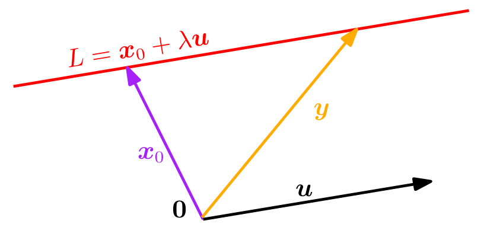

# 2.8 仿射空间（Affine Spaces）

## 本节导学

**学习目标**

1. 知道什么是仿射子空间（"平移过的子空间"），分清它与向量子空间的区别；
2. 会写直线、平面、超平面的参数方程；
3. 理解"非齐次线性方程组的解集是仿射子空间"这一事实（2.3 节通解的正式表述）；
4. 知道仿射映射 = 线性映射 + 平移，及其基本性质。

**预备知识**：2.4 节（子空间）、2.3 节（特解与通解）、2.7 节（线性映射）。

**符号速查表**：

| 符号 | 读法 | 含义 |
| --- | --- | --- |
| $L = \boldsymbol x_0 + U$ | "x0 加 U" | 把子空间 $U$ 整体平移 $\boldsymbol x_0$ 得到的仿射子空间 |
| $\boldsymbol x_0$ | 支撑点 | 仿射子空间"锚定"的那个点（可以理解为一个特解） |
| $U$ | 方向（空间） | 仿射子空间背后的向量子空间，决定它的朝向和维度 |
| $\lambda_1, \ldots, \lambda_k$ | 参数 | 参数方程中自由取值的系数 |

---

> **备注**（术语混用提醒）。在机器学习文献中，"线性（linear）"与"仿射（affine）"经常混用——很多文献把仿射空间/仿射映射直接叫成线性空间/线性映射。阅读文献时要注意区分。♦

## 2.8.1 仿射子空间

**定义 2.25**（仿射子空间）。设 $V$ 为向量空间，$\boldsymbol x_0 \in V$，$U \subseteq V$ 为子空间。则子集

$$
L = \boldsymbol x_0 + U := \{\boldsymbol x_0 + \boldsymbol u : \boldsymbol u \in U\} \tag{2.130a}
$$

$$
= \{\boldsymbol v \in V \mid \exists \boldsymbol u \in U : \boldsymbol v = \boldsymbol x_0 + \boldsymbol u\} \subseteq V \tag{2.130b}
$$

称为 $V$ 的**仿射子空间（affine subspace）**或**线性流形（linear manifold）**。$U$ 称为**方向（空间）（direction space）**，$\boldsymbol x_0$ 称为**支撑点（support point）**。在第 12 章中，此类子空间会被称为**超平面（hyperplane）**的一种情形。

**直观**：向量子空间是"过原点"的平面/直线；仿射子空间是把它**整体搬离原点**——形状、朝向、维度都不变，只是不再包含原点。

**一个重要细节**：若 $\boldsymbol x_0 \notin U$，则 $\boldsymbol 0 \notin L$（因为 $\boldsymbol v = \boldsymbol 0$ 要求 $\boldsymbol u = -\boldsymbol x_0 \in U$，即 $\boldsymbol x_0 \in U$，矛盾）。所以偏离原点的仿射子空间**不是**向量子空间——它连 2.4 节子空间判定清单的第一条（含 $\boldsymbol 0$）都过不去。这正是需要新概念的原因：第 2.3 节中非齐次方程组的解集（通解 = 特解 + 齐次解）就是典型的"不过原点"的集合。

**例子**：$\mathbb{R}^3$ 中不过原点的点、直线、平面都是仿射子空间；过原点的那些既是仿射子空间也是向量子空间。

**备注**（两个仿射子空间的包含关系）。设 $L = \boldsymbol x_0 + U$，$\tilde{L} = \tilde{\boldsymbol x}_0 + \tilde{U}$，则

$$
L \subseteq \tilde{L} \iff U \subseteq \tilde{U} \ \text{且} \ \boldsymbol x_0 - \tilde{\boldsymbol x}_0 \in \tilde{U}.
$$

（方向必须更小，且支撑点的差要落在对方的方向空间里。）

**参数方程**。若 $\dim U = k$，取 $U$ 的一组有序基 $(\boldsymbol b_1, \ldots, \boldsymbol b_k)$，则 $L$ 中每个元素 $\boldsymbol x$ 都能**唯一**表示为

$$
\boldsymbol x = \boldsymbol x_0 + \lambda_1 \boldsymbol b_1 + \cdots + \lambda_k \boldsymbol b_k \tag{2.131}
$$

其中 $\lambda_1, \ldots, \lambda_k \in \mathbb{R}$。这称为 $L$ 的**参数方程（parametric equation）**：$\boldsymbol b_1, \ldots, \boldsymbol b_k$ 是**方向向量**，$\lambda_i$ 是**参数**。（唯一性来自基表示的唯一性，见 2.6 节。）

**例 2.26（仿射子空间的三个等级）**

- **直线（line）**：$\mathbb{R}^n$ 中的一维仿射子空间，$\boldsymbol y = \boldsymbol x_0 + \lambda \boldsymbol x_1$（$\lambda \in \mathbb{R}$，$\boldsymbol x_1 \neq \boldsymbol 0$）。一条直线由**一个支撑点 + 一个方向向量**决定（图 2.13）。
- **平面（plane）**：二维仿射子空间，$\boldsymbol y = \boldsymbol x_0 + \lambda_1 \boldsymbol x_1 + \lambda_2 \boldsymbol x_2$，其中 $\boldsymbol x_1, \boldsymbol x_2$ 线性无关（张成二维方向空间）。由**一个支撑点 + 两个不共线的方向向量**决定。
- **超平面（hyperplane）**：$(n - 1)$ 维仿射子空间，$\boldsymbol y = \boldsymbol x_0 + \sum_{i=1}^{n-1} \lambda_i \boldsymbol x_i$，$\boldsymbol x_1, \ldots, \boldsymbol x_{n-1}$ 线性无关。由**一个支撑点 + $n - 1$ 个方向向量**决定。特例：$\mathbb{R}^2$ 中的超平面就是直线，$\mathbb{R}^3$ 中的超平面就是平面。

   
  <b>图 2.13 直线上的向量 y 位于以 x₀ 为支撑点、以 u 为方向的仿射子空间 L 中。</b> 

**备注**（非齐次线性方程组 ⟺ 仿射子空间）。这是把 2.3 节的结论用新语言重新表述，请对照 (2.43) 阅读：

- 对 $\boldsymbol A \in \mathbb{R}^{m \times n}$、$\boldsymbol b \in \mathbb{R}^m$，方程组 $\boldsymbol{Ax} = \boldsymbol b$ 的解集要么**为空**，要么是 $\mathbb{R}^n$ 中维度为 $n - \operatorname{rk}(\boldsymbol A)$ 的**仿射子空间**。（2.3.1 节的"特解 + 齐次解"结构正是 $\boldsymbol x_0 + U$：特解是支撑点，齐次解空间是方向。）
- 特别地，单个线性方程 $\lambda_1 x_1 + \cdots + \lambda_n x_n = b$（系数不全为零）的解是一个**超平面**。
- 反过来，$\mathbb{R}^n$ 中每个 $k$ 维仿射子空间都是某个非齐次方程组 $\boldsymbol{Ax} = \boldsymbol b$ 的解集，其中 $\operatorname{rk}(\boldsymbol A) = n - k$（$n - k$ 个独立约束恰好"钉死" $n - k$ 个方向）。
- 齐次方程组 $\boldsymbol{Ax} = \boldsymbol 0$ 的解是向量子空间，可以看作支撑点为 $\boldsymbol x_0 = \boldsymbol 0$ 的特殊仿射子空间。♦

**小例子**（把 2.3 节例 2.6 翻译过来）：例 2.6 在 $a = -1$ 时的解集是 $\mathbb{R}^5$ 中以 $\boldsymbol x_p = (2, 0, -1, 1, 0)^\top$ 为支撑点、以 $\operatorname{span}[(2,1,0,0,0)^\top, (2,0,-1,2,1)^\top]$ 为方向的二维仿射子空间——维度 $5 - \operatorname{rk}(\boldsymbol A) = 5 - 3 = 2$ ✓。

## 2.8.2 仿射映射

**定义 2.26**（仿射映射）。设 $V, W$ 为向量空间，$\Phi : V \to W$ 线性，$\boldsymbol a \in W$。映射

$$
\phi : V \to W, \qquad \boldsymbol x \mapsto \boldsymbol a + \Phi(\boldsymbol x) \tag{2.132, 2.133}
$$

称为从 $V$ 到 $W$ 的**仿射映射（affine mapping）**，$\boldsymbol a$ 称为**平移向量（translation vector）**。

**结构**：每个仿射映射都是"**先线性、后平移**"两步的复合 $\phi = \tau \circ \Phi$，其中平移 $\tau : W \to W$，$\boldsymbol w \mapsto \boldsymbol w + \boldsymbol a$。线性部分 $\Phi$ 与平移 $\tau$ 由 $\phi$ **唯一**确定（例如 $\phi(\boldsymbol 0) = \boldsymbol a$ 直接给出平移向量）。

**与线性映射的关键区别**：$\phi(\boldsymbol 0) = \boldsymbol a$，一般不为零——仿射映射**不过原点**。2.7.4 节备注 1 说过"线性映射必过原点"，所以凡不过原点的映射都不是线性的，而是仿射的（在 $\Phi$ 线性的前提下）。

**例子**：$\phi(x) = 2x + 3$（一元仿射映射，即直线方程）；"线性回归"模型 $y = \boldsymbol w^\top \boldsymbol x + b$ 中的 $b$ 正是平移向量（偏置项），所以严格说回归模型是**仿射**模型——这就是文献中"线性/仿射混用"的日常场景。

**性质**（从线性映射继承而来）：

- 仿射映射的复合仍是仿射的：$\phi' \circ \phi$ 的线性部分是 $\Phi' \Phi$，平移向量是 $\Phi'(\boldsymbol a) + \boldsymbol a'$。
- 仿射映射保持**几何结构**：直线映成直线、平面映成平面；保持**维度**（不塌缩的前提下）和**平行性**（平行的直线映后仍平行）。这些性质是计算机图形学中几何变换（旋转、缩放、平移及其复合）都用仿射映射来描述的原因。

---

## 本节小结

| 概念 | 一句话 |
| --- | --- |
| 仿射子空间 $\boldsymbol x_0 + U$ | 向量子空间 $U$ 平移支撑点 $\boldsymbol x_0$；$\boldsymbol x_0 \notin U$ 时不过原点、不是子空间 |
| 参数方程 | $\boldsymbol x = \boldsymbol x_0 + \sum \lambda_i \boldsymbol b_i$：支撑点 + 方向向量组 |
| 直线 / 平面 / 超平面 | 1 维 / 2 维 / $(n-1)$ 维仿射子空间 |
| 解集的几何 | $\boldsymbol{Ax} = \boldsymbol b$ 的解 = 空集或 $n - \operatorname{rk}(\boldsymbol A)$ 维仿射子空间 |
| 仿射映射 | 线性映射 + 平移；$\phi(\boldsymbol 0) = \boldsymbol a$ 是平移向量 |

**与其他章节的关系**：仿射映射是神经网络"线性层 + 偏置"的数学原型；超平面将在第 12 章（支持向量机）中作为决策边界反复出现；参数方程的观点在 3.8 节投影和第 9 章回归中都会用到。
