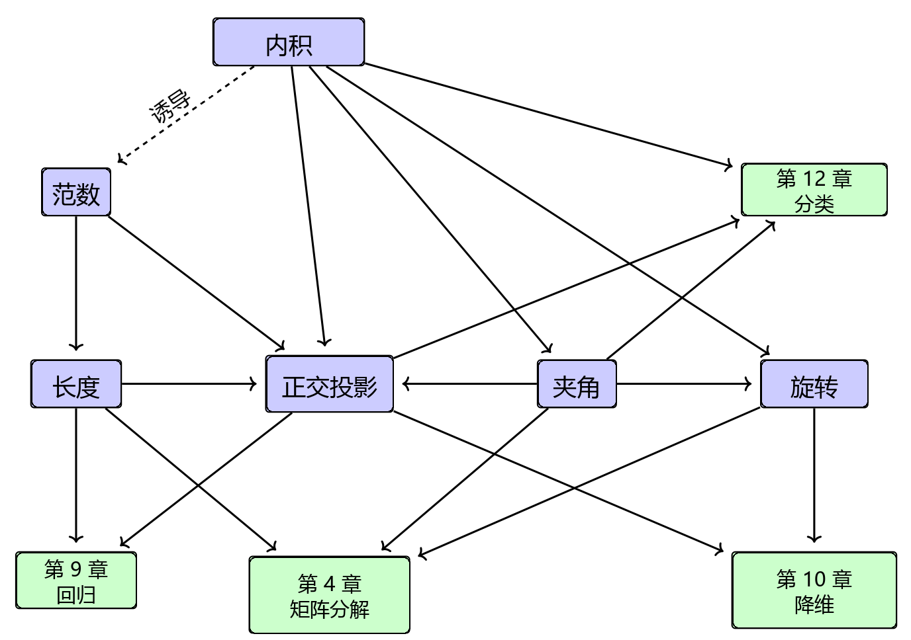

# 第 3 章 解析几何（Analytic Geometry）

## 本章导学

**学习目标**：知道本章要解决的问题——第 2 章的向量、向量空间、线性映射都是**代数**概念，本章要给它们配上**几何**直觉：长度、距离、夹角、正交性、投影、旋转。

**本章的逻辑主线**：

1. **内积（3.2 节）**是本章的发动机：一旦给向量空间装上内积，就能诱导出**范数（3.1 节）**→ 长度与距离（3.3 节）→ 夹角与正交性（3.4 节）；
2. 有了正交性，就能挑出最好的基——**标准正交基（3.5 节）**，并讨论子空间的**正交补（3.6 节）**；
3. 内积不止能作用于有限维向量，还能作用于**函数（3.7 节）**——这会通向傅里叶级数；
4. 本章的 climax 是**正交投影（3.8 节）**：把高维数据"影子"投到低维子空间上，是 PCA（第 10 章）、线性回归（第 9 章）、支持向量机（第 12 章）的共同基石；
5. 最后以**旋转（3.9 节）**收尾——保持长度与角度不变的另一类重要线性变换。

**预备知识**：第 2 章全部内容，尤其是 2.4（向量空间）、2.6（基与维数）、2.7（线性映射与变换矩阵）。

本章概念与后续章节的联系见图 3.1。

   
  <b>图 3.1 本章介绍的概念的思维导图，以及它们在本书其他部分中的应用场景。</b> 

