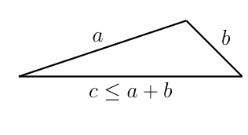
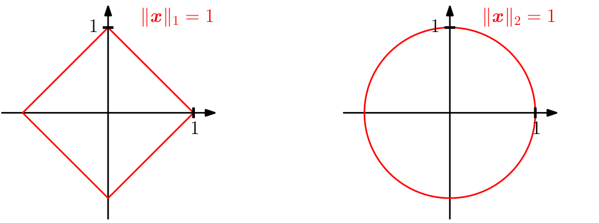

# 3.1 范数（Norms）

## 本节导学

**学习目标**

1. 记住范数的三条公理（绝对齐次、三角不等式、正定），并能判断一个函数是否是范数；
2. 掌握两种最重要的范数：曼哈顿范数 $\|\cdot\|_1$ 和欧几里得范数 $\|\cdot\|_2$；
3. 会从几何上理解"范数为 1 的向量集合"长什么样。

**预备知识**：2.4 节向量空间的概念；绝对值 $|a|$ 的含义（数轴上 $a$ 到 0 的距离）。

**符号速查表**：

| 符号 | 读法 | 含义 |
| --- | --- | --- |
| $\|\cdot\|$ | 范数 | "为向量分配长度"的函数，$\|\boldsymbol x\|$ 读作"x 的范数" |
| $\|\boldsymbol x\|_1$ | 1 范数 / 曼哈顿范数 | 各分量绝对值之和 |
| $\|\boldsymbol x\|_2$ | 2 范数 / 欧几里得范数 | 各分量平方和的平方根，即通常意义的长度 |
| $\ell_1$ / $\ell_2$ norm | "ell 1 / ell 2" | 曼哈顿范数 / 欧几里得范数的另一名称 |
| $\|x_i\|$ | 绝对值 | 实数 $x_i$ 到 0 的距离 |

---

## 3.1.1 从"长度"到范数

把几何向量看成从原点出发的有向线段时，"长度"就是线段端点到原点的距离。但"长度"这个词太口语化——哪些规则是必须遵守的？数学家把长度抽象为**范数（norm）**。

**定义 3.1**（范数）。向量空间 $V$ 上的范数是一个函数

$$
\|\cdot\| : V \to \mathbb{R}, \qquad \boldsymbol x \mapsto \|\boldsymbol x\| \tag{3.1, 3.2}
$$

为每个向量分配一个实数（它的"长度"），满足对所有 $\lambda \in \mathbb{R}$ 和 $\boldsymbol x, \boldsymbol y \in V$：

1. **绝对齐次性（absolutely homogeneous）**：$\|\lambda \boldsymbol x\| = |\lambda| \|\boldsymbol x\|$。把向量放大 $\lambda$ 倍，长度也放大 $|\lambda|$ 倍；
2. **三角不等式（triangle inequality）**：$\|\boldsymbol x + \boldsymbol y\| \leqslant \|\boldsymbol x\| + \|\boldsymbol y\|$。两边之和大于等于第三边；
3. **正定性（positive definite）**：$\|\boldsymbol x\| \geqslant 0$，且 $\|\boldsymbol x\| = 0 \iff \boldsymbol x = \boldsymbol 0$。长度非负，只有零向量长度为 0。

   
  <b>图 3.2 三角不等式。</b> 

三角不等式的几何含义见图 3.2：任意三角形中，两边长度之和必大于等于第三边——"两点之间直线最短"的数学表达。

定义 3.1 对任意向量空间 $V$ 给出，但本书主要考虑 $\mathbb{R}^n$，并用下标记分量：$\boldsymbol x$ 的第 $i$ 个分量是 $x_i$。

## 3.1.2 两个最重要的范数

**例 3.1（曼哈顿范数）**

$$
\|\boldsymbol x\|_1 := \sum_{i=1}^n |x_i| \tag{3.3}
$$

即各分量**绝对值之和**。直觉：在棋盘式街道网（曼哈顿街区）里从一个路口到另一个路口，只能沿街道走，路程正好是横纵坐标差之和——所以叫"曼哈顿范数"。

图 3.3 左图画出了 $\mathbb{R}^2$ 中所有满足 $\|\boldsymbol x\|_1 = 1$ 的向量——是一个**旋转 45° 的正方形**（菱形），顶点在 $(\pm 1, 0)$、$(0, \pm 1)$。曼哈顿范数也叫 $\ell_1$ 范数。

**例 3.2（欧几里得范数）**

$$
\|\boldsymbol x\|_2 := \sqrt{\sum_{i=1}^n x_i^2} = \sqrt{\boldsymbol x^\top \boldsymbol x} \tag{3.4}
$$

即通常意义下的长度——勾股定理的推广（$n = 2$ 时就是 $\sqrt{x_1^2 + x_2^2}$）。它计算 $\boldsymbol x$ 到原点的**欧几里得距离**。矩阵形式 $\sqrt{\boldsymbol x^\top \boldsymbol x}$ 请对照 2.4 节内积 $\boldsymbol x^\top \boldsymbol y$ 回忆：范数 = 向量与自身内积的平方根。

图 3.3 右图画出了 $\|\boldsymbol x\|_2 = 1$ 的向量集合——**单位圆**。欧几里得范数也叫 $\ell_2$ 范数。

   
  <b>图 3.3 对于不同范数，红线表示范数为 1 的向量集合。左图：曼哈顿范数；右图：欧几里得距离。</b> 

**验证范数公理（以欧几里得范数为例，$n = 2$）**：

1. $\|\lambda \boldsymbol x\|_2 = \sqrt{\lambda^2 x_1^2 + \lambda^2 x_2^2} = |\lambda| \sqrt{x_1^2 + x_2^2} = |\lambda| \|\boldsymbol x\|_2$ ✓；
2. 三角不等式 $\sqrt{(x_1+y_1)^2 + (x_2+y_2)^2} \leqslant \sqrt{x_1^2+x_2^2} + \sqrt{y_1^2+y_2^2}$ 成立，但证明需要柯西-施瓦茨不等式（3.3 节给出），此处从略；
3. 平方和显然非负，且平方和为 0 当且仅当每个分量都是 0 ✓。

> **备注**：本书通篇若无特殊说明，默认使用欧几里得范数 (3.4)。♦

---

## 本节小结

| 范数 | 公式 | 范数 = 1 的几何形状（$\mathbb{R}^2$） |
| --- | --- | --- |
| 曼哈顿范数 $\|\cdot\|_1$ | 各分量绝对值之和 | 菱形（正方形） |
| 欧几里得范数 $\|\cdot\|_2$（默认） | 各分量平方和的平方根 | 单位圆 |

**与其他章节的关系**：范数是距离（3.3 节）和收敛性（第 7 章优化）的基础；$\ell_1$ 范数在机器学习中对应" Lasso 正则化"（第 9 章），会诱导稀疏解。
