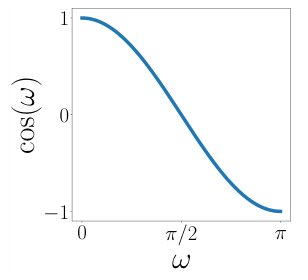
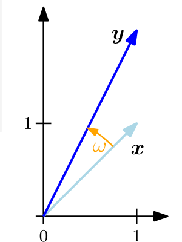
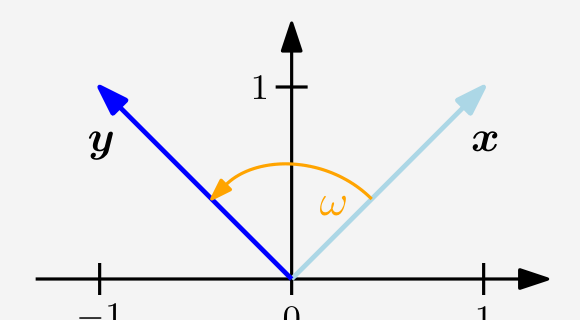

# 3.4 夹角与正交性（Angles and Orthogonality）

## 本节导学

**学习目标**

1. 会用柯西-施瓦茨不等式定义两向量的夹角并会计算；
2. 掌握正交与标准正交的定义，理解"正交是相对于内积而言的"；
3. 掌握正交矩阵的定义与性质（保长、保角、逆 = 转置）。

**预备知识**：3.2 节（内积）、3.3 节（诱导范数、柯西-施瓦茨不等式）、2.2 节（逆与转置）。

**符号速查表**：

| 符号 | 读法 | 含义 |
| --- | --- | --- |
| $\omega$ | omega | 两向量间的夹角 |
| $\cos \omega$ | 余弦 | 邻边/斜边；这里定义为内积除以长度乘积 |
| $\arccos$ / $\cos^{-1}$ | 反余弦 | 由余弦值求角度（值域 $[0, \pi]$） |
| $\boldsymbol x \perp \boldsymbol y$ | "x 垂直于 y" | $\langle \boldsymbol x, \boldsymbol y \rangle = 0$（正交） |
| $\boldsymbol A \boldsymbol A^\top = \boldsymbol I$ | 正交条件 | 正交矩阵的判定式 |

---

## 3.4.1 用内积定义夹角

内积除了长度和距离，还能定义**夹角**——这正是内积比范数"多出来"的能力。设 $\boldsymbol x \neq \boldsymbol 0, \boldsymbol y \neq \boldsymbol 0$。由柯西-施瓦茨不等式 (3.17)：

$$
|\langle \boldsymbol x, \boldsymbol y \rangle| \leqslant \|\boldsymbol x\| \|\boldsymbol y\|
\quad \Longrightarrow \quad
-1 \leqslant \frac{\langle \boldsymbol x, \boldsymbol y \rangle}{\|\boldsymbol x\| \|\boldsymbol y\|} \leqslant 1 \tag{3.24}
$$

分母是正的（非零向量），除过去不等式方向不变；绝对值不超过 1，即这个比值落在 $[-1, 1]$ 里。而余弦函数恰好把 $[0, \pi]$ 一一对应地映到 $[-1, 1]$ 上（图 3.4），所以存在**唯一**的 $\omega \in [0, \pi]$ 使

$$
\cos \omega = \frac{\langle \boldsymbol x, \boldsymbol y \rangle}{\|\boldsymbol x\| \|\boldsymbol y\|} \tag{3.25}
$$

这个 $\omega$ 就是 $\boldsymbol x$ 与 $\boldsymbol y$ 之间的**夹角（angle）**。直觉：夹角反映方向有多相似——$\boldsymbol y = 4\boldsymbol x$（同向缩放）时 $\omega = 0$。

   
  <b>图 3.4 当限制在 [0, π] 上时，f(ω) = cos(ω) 在区间 [−1, 1] 内返回一个唯一的值。</b> 

**例 3.6（夹角计算）**。计算 $\boldsymbol x = [1, 1]^\top$ 与 $\boldsymbol y = [1, 2]^\top$ 之间的夹角（点积，图 3.5）：

$$
\cos \omega = \frac{\langle \boldsymbol x, \boldsymbol y \rangle}{\sqrt{\langle \boldsymbol x, \boldsymbol x \rangle \langle \boldsymbol y, \boldsymbol y \rangle}} = \frac{\boldsymbol x^\top \boldsymbol y}{\sqrt{\boldsymbol x^\top \boldsymbol x \cdot \boldsymbol y^\top \boldsymbol y}} = \frac{1 \times 1 + 1 \times 2}{\sqrt{2 \times 5}} = \frac{3}{\sqrt{10}} \tag{3.26}
$$

逐步核对分子分母：$\boldsymbol x^\top \boldsymbol y = 3$；$\boldsymbol x^\top \boldsymbol x = 2$；$\boldsymbol y^\top \boldsymbol y = 1 + 4 = 5$。于是 $\omega = \arccos\left(\frac{3}{\sqrt{10}}\right) \approx \arccos(0.949) \approx 0.32\text{ rad} \approx 18^\circ$。

   
  <b>图 3.5 两个向量 x, y 之间的夹角 ω 是通过内积计算的。</b> 

## 3.4.2 正交与标准正交

**定义 3.7**（正交性）。两个向量 $\boldsymbol x$ 和 $\boldsymbol y$ **正交（orthogonal）**，记作 $\boldsymbol x \perp \boldsymbol y$，当且仅当

$$
\langle \boldsymbol x, \boldsymbol y \rangle = 0.
$$

若此外还有 $\|\boldsymbol x\| = 1 = \|\boldsymbol y\|$（都是单位向量），则称它们**标准正交（orthonormal）**。

**正交 = 垂直的推广**：当内积是点积时，(3.25) 给出 $\cos \omega = 0 \Rightarrow \omega = 90^\circ$——正是初等几何的垂直。对一般内积，"垂直"不再依赖画图，而由 $\langle \cdot, \cdot \rangle = 0$ 代数地定义。一个推论：零向量与**每个**向量正交（$\langle \boldsymbol 0, \boldsymbol y \rangle = 0$ 恒成立）。

**例 3.7（正交与否取决于内积）**。取 $\boldsymbol x = [1, 1]^\top$、$\boldsymbol y = [-1, 1]^\top$（图 3.6）。

**内积 1（点积）**：$\boldsymbol x^\top \boldsymbol y = -1 + 1 = 0$，所以 $\boldsymbol x \perp \boldsymbol y$，夹角 $90^\circ$。

**内积 2**：$\langle \boldsymbol x, \boldsymbol y \rangle = \boldsymbol x^\top \begin{bmatrix} 2 & 0 \\ 0 & 1 \end{bmatrix} \boldsymbol y$（(3.27)，由正定矩阵定义的内积）。逐项计算：

$$
\langle \boldsymbol x, \boldsymbol y \rangle = 2 \times 1 \times (-1) + 1 \times 1 \times 1 = -1, \qquad
\|\boldsymbol x\|^2 = \langle \boldsymbol x, \boldsymbol x \rangle = 2 + 1 = 3, \qquad
\|\boldsymbol y\|^2 = 2 + 1 = 3
$$

$$
\cos \omega = \frac{-1}{\sqrt{3} \cdot \sqrt{3}} = -\frac{1}{3} \implies \omega \approx 1.91\text{ rad} \approx 109.5^\circ \tag{3.28}
$$

不再正交！**"关于某种内积正交"的向量，换一种内积未必正交**——正交性总是相对于所选内积而言的。图 3.6 画出了两种内积下夹角的几何差异。

   
  <b>图 3.6 两个向量 x, y 之间的夹角 ω 会根据所选内积的不同而发生改变。</b> 

## 3.4.3 正交矩阵：保长保角的变换

**定义 3.8**（正交矩阵）。方阵 $\boldsymbol A \in \mathbb{R}^{n \times n}$ 是**正交矩阵（orthogonal matrix）**，当且仅当它的列向量**标准正交**，等价于

$$
\boldsymbol A \boldsymbol A^\top = \boldsymbol I = \boldsymbol A^\top \boldsymbol A \tag{3.29}
$$

**为什么 (3.29) 等价于"列标准正交"？** 看 $\boldsymbol A^\top \boldsymbol A$ 的 $(i, j)$ 元素：它是 $\boldsymbol A$ 的第 $i$ 列 $\boldsymbol a_i$ 与第 $j$ 列 $\boldsymbol a_j$ 的点积 $(\boldsymbol A^\top \boldsymbol A)_{ij} = \boldsymbol a_i^\top \boldsymbol a_j$。"列标准正交"正是 $\boldsymbol a_i^\top \boldsymbol a_j = \delta_{ij}$（$i = j$ 时为 1，否则为 0），拼起来就是 $\boldsymbol A^\top \boldsymbol A = \boldsymbol I$。

(3.29) 直接给出一条极其便利的性质：

$$
\boldsymbol A^{-1} = \boldsymbol A^\top \tag{3.30}
$$

正交矩阵的逆就是转置——计算成本几乎为零。（习惯上叫"正交矩阵"，更精确的叫法应是"标准正交矩阵"。）

**正交变换保长度**。用正交矩阵变换向量，长度不变：

$$
\|\boldsymbol A \boldsymbol x\|^2 = (\boldsymbol A \boldsymbol x)^\top (\boldsymbol A \boldsymbol x) = \boldsymbol x^\top \underbrace{\boldsymbol A^\top \boldsymbol A}_{=\,\boldsymbol I} \boldsymbol x = \boldsymbol x^\top \boldsymbol x = \|\boldsymbol x\|^2 \tag{3.31}
$$

（第一步是范数定义，中间用 (3.29)，最后回到范数定义。）

**正交变换保夹角**。对任意 $\boldsymbol x, \boldsymbol y$，像 $\boldsymbol{Ax}$ 与 $\boldsymbol{Ay}$ 的夹角满足

$$
\cos \omega = \frac{(\boldsymbol A \boldsymbol x)^\top (\boldsymbol A \boldsymbol y)}{\|\boldsymbol A \boldsymbol x\| \|\boldsymbol A \boldsymbol y\|} = \frac{\boldsymbol x^\top \boldsymbol A^\top \boldsymbol A \boldsymbol y}{\sqrt{\boldsymbol x^\top \boldsymbol A^\top \boldsymbol A \boldsymbol x \cdot \boldsymbol y^\top \boldsymbol A^\top \boldsymbol A \boldsymbol y}} = \frac{\boldsymbol x^\top \boldsymbol y}{\|\boldsymbol x\| \|\boldsymbol y\|} \tag{3.32}
$$

分母用保长性、分子用 (3.29)，最后恰是 $\boldsymbol x$ 与 $\boldsymbol y$ 的夹角。

**结论**：正交矩阵定义的变换**保持距离和夹角不变**——几何上，这类变换正是**旋转**（可能伴随镜像翻转）。3.9 节将专门讨论旋转。

---

## 本节小结

| 概念 | 一句话 |
| --- | --- |
| 夹角 | $\cos \omega = \langle \boldsymbol x, \boldsymbol y \rangle / (\|\boldsymbol x\| \|\boldsymbol y\|)$，柯西-施瓦茨保证可定义 |
| 正交 | $\langle \boldsymbol x, \boldsymbol y \rangle = 0$；相对于内积而言 |
| 正交矩阵 | 列标准正交 ⟺ $\boldsymbol A^\top \boldsymbol A = \boldsymbol I$ ⟺ $\boldsymbol A^{-1} = \boldsymbol A^\top$ |
| 正交变换 | 保长、保角 ⟹ 是旋转（或带翻转的旋转） |

**与其他章节的关系**：正交矩阵在特征分解（4.4 节）和 SVD（4.5 节）中扮演核心角色；正交性是 3.5 节标准正交基、3.6 节正交补、3.8 节正交投影的共同基石。
