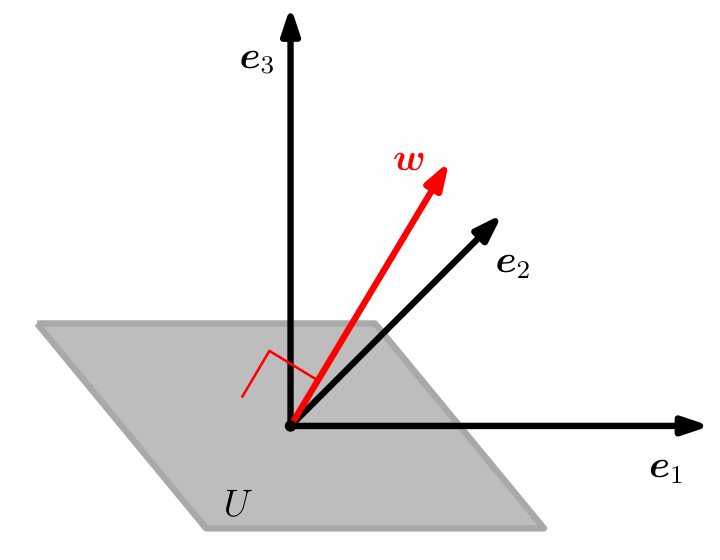

# 3.6 正交补（Orthogonal Complement）

## 本节导学

**学习目标**

1. 说出正交补 $U^\perp$ 的定义和三条关键性质（子空间、维度 $D - M$、交为 $\{\boldsymbol 0\}$）；
2. 理解"任意向量可唯一分解为 $U$ 分量 + $U^\perp$ 分量"——这是正交投影（3.8 节）的理论基础；
3. 会用法向量描述平面/超平面。

**预备知识**：2.4 节（子空间）、2.6 节（基与维数）、3.4 节（正交性）。

**符号速查表**：

| 符号 | 读法 | 含义 |
| --- | --- | --- |
| $U^\perp$ | "U 正交补" / "U 垂" | $V$ 中与 $U$ 的每个向量都正交的向量全体 |
| $\boldsymbol w$ | 法向量 | 与平面/超平面垂直的单位向量 |
| $D$, $M$ | 维度 | $V$ 是 $D$ 维，子空间 $U$ 是 $M$ 维 |

---

## 3.6.1 定义与分解定理

**定义**（正交补）。设 $V$ 是 $D$ 维向量空间，$U \subseteq V$ 是其 $M$ 维子空间。$U$ 的**正交补（orthogonal complement）** $U^\perp$ 是 $V$ 的子集：

$$
U^\perp := \{\boldsymbol v \in V : \langle \boldsymbol v, \boldsymbol u \rangle = 0, \ \forall \boldsymbol u \in U\}
$$

——与 $U$ 中**每一个**向量都正交的向量全体。

**三条关键性质**（本书直接采用）：

1. $U^\perp$ 是 $V$ 的**子空间**（对加法、数乘封闭，且 $\boldsymbol 0 \in U^\perp$），维数为 $D - M$；
2. $U \cap U^\perp = \{\boldsymbol 0\}$（既在 $U$ 里又与整个 $U$ 正交的向量，只有自己与自己正交的零向量）；
3. **正交分解**：任取 $U$ 的基 $(\boldsymbol b_1, \ldots, \boldsymbol b_M)$ 和 $U^\perp$ 的基 $(\boldsymbol b_1^\perp, \ldots, \boldsymbol b_{D-M}^\perp)$，则任意 $\boldsymbol x \in V$ 都能**唯一**分解为

$$
\boldsymbol x = \underbrace{\sum_{m=1}^M \lambda_m \boldsymbol b_m}_{\in \, U} + \underbrace{\sum_{j=1}^{D-M} \psi_j \boldsymbol b_j^\perp}_{\in \, U^\perp}, \quad \lambda_m, \psi_j \in \mathbb{R} \tag{3.36}
$$

（唯一性由 $U \cap U^\perp = \{\boldsymbol 0\}$ 保证：两种分解相减会得到一个同时在 $U$ 和 $U^\perp$ 里的向量，只能是零向量。）

**直观**：$U$ 和 $U^\perp$ 是 $V$ 的一对"正交坐标轴"。在 $\mathbb{R}^3$ 中：若 $U$ 是过原点的平面（$M = 2$），$U^\perp$ 就是该平面的法线（$D - M = 1$）；任何空间向量都唯一地拆成"平面内的部分 + 沿法线的部分"——这正是 3.8 节投影要做的事。

## 3.6.2 法向量与超平面

**三维中的平面**：设 $U \subseteq \mathbb{R}^3$ 是过原点的平面（二维子空间）。满足 $\|\boldsymbol w\| = 1$ 且与 $U$ 正交的向量 $\boldsymbol w$ 是 $U^\perp$ 的基向量，称为 $U$ 的**法向量（normal vector）**。反过来，所有与 $\boldsymbol w$ 正交的向量必然落在平面 $U$ 内——所以**一个平面可以等价地由它的法向量描述**（图 3.7）。

$$
U = \{\boldsymbol v \in \mathbb{R}^3 : \boldsymbol w^\top \boldsymbol v = 0\}, \qquad U^\perp = \operatorname{span}[\boldsymbol w]
$$

**一般化**：在 $n$ 维空间中，$(n - 1)$ 维子空间（超平面）的正交补是一维的，由单个法向量张成；仿射超平面（2.8 节）则写成 $\{\boldsymbol v : \boldsymbol w^\top \boldsymbol v = b\}$。这种"法向量形式"在第 12 章支持向量机中将成为**决策边界**的标准表达。

   
  <b>图 3.7 三维向量空间中的平面 U 可以通过其法向量来描述，该法向量张成了其正交补空间 U⊥。</b> 

---

## 本节小结

| 要点 | 内容 |
| --- | --- |
| 正交补 $U^\perp$ | 与 $U$ 全空间正交的向量集合；子空间；$\dim U^\perp = D - M$ |
| 正交分解 | $\boldsymbol x$ = $U$ 中分量 + $U^\perp$ 中分量，唯一 |
| 法向量 | $U^\perp$ 的单位基向量；可反过来刻画 $U$（及超平面） |

**与其他章节的关系**：正交补是 3.8 节正交投影的理论框架（投影到 $U$ 等价于丢弃 $U^\perp$ 分量）；法向量形式的超平面是第 12 章 SVM 的几何语言。
