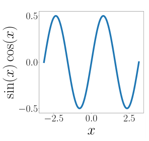

# 3.7 函数的内积（Inner Product of Functions）

## 本节导学

**学习目标**

1. 理解内积概念从"有限维向量"到"函数"的推广：求和变积分；
2. 会验证两个简单函数在给定区间上是否正交；
3. 知道正交函数族与傅里叶级数的联系。

**预备知识**：3.2 节（内积三公理）、定积分的基本计算、奇偶函数的性质。

**符号速查表**：

| 符号 | 读法 | 含义 |
| --- | --- | --- |
| $\int_a^b u(x) v(x)\, \mathrm{d}x$ | 定积分 | 曲线下的（带符号）面积；这里是内积 |
| $\mathrm{d}x$ | 微分元 | 积分的"无穷小宽度"记号 |
| $u \perp v$（函数） | 正交 | 内积（积分）等于 0 |

---

## 3.7.1 从"分量求和"到"积分"

前几节的内积都作用于**有限维向量**。换个视角：向量 $\boldsymbol x \in \mathbb{R}^n$ 可以看成"定义在 $n$ 个点上的函数"（每个分量是一个函数值）。内积的概念可以沿两个方向推广：

- **可数无穷**：分量个数是无限但可数的（序列）；
- **不可数无穷**：自变量连续取值，"向量"就是函数 $u : \mathbb{R} \to \mathbb{R}$。

无论哪个方向，内积中"对各分量求和"的操作都要升级为**积分**：

$$
\langle u, v \rangle := \int_a^b u(x) v(x) \, \mathrm{d}x \tag{3.37}
$$

其中积分上下限有限（$a, b < \infty$）。与通常的内积一样，可以由此定义范数（$\|u\| = \sqrt{\langle u, u \rangle}$）和正交性（$\langle u, v \rangle = 0$ 则 $u \perp v$）。

**技术上的注**（了解即可）：要让 (3.37) 在数学上严格，需要测度论与勒贝格积分的语言，这引出**希尔伯特空间（Hilbert space）**的概念。另外函数内积可能**发散**（积分值为无穷），并非任意函数对都有定义。这些属于实分析/泛函分析的内容，本书不展开。

**例 3.9（正弦与余弦正交）**。取 $u = \sin(x)$，$v = \cos(x)$，积分区间 $[a, b] = [-\pi, \pi]$。

被积函数 $f(x) = u(x)v(x) = \sin(x)\cos(x)$ 是**奇函数**：

$$
f(-x) = \sin(-x)\cos(-x) = (-\sin x)(\cos x) = -f(x)
$$

奇函数在关于原点对称的区间上积分必为 0（图 3.8：左半区间负面积与右半区间正面积恰好抵消）。所以

$$
\langle \sin, \cos \rangle = \int_{-\pi}^{\pi} \sin(x)\cos(x)\,\mathrm{d}x = 0
$$

即 $\sin \perp \cos$。♦（也可用恒等式 $\sin x \cos x = \frac{1}{2}\sin 2x$ 直接求原函数 $-\frac{1}{4}\cos 2x$，代入上下限得 0——两种算法相互印证。）

   
  <b>图 3.8 奇函数 f(x) = sin(x)cos(x)。</b> 

**备注**（一族正交函数）。同样的区间上，函数族

$$
\{1, \cos(x), \cos(2x), \cos(3x), \ldots\} \tag{3.38}
$$

两两正交：任意两个不同的函数之积在 $[-\pi, \pi]$ 上积分为 0（例如 $\int_{-\pi}^{\pi} \cos(mx)\cos(nx)\,\mathrm{d}x = 0$ 当 $m \neq n$，可用积化和差公式验证）。这个函数族张成了 $[-\pi, \pi)$ 上偶周期函数的一个巨大子空间；把函数**投影**到这个子空间，正是**傅里叶级数（Fourier series）**的基本思想——把复杂函数分解成一堆简单正交基函数的线性组合，与向量投影完全同构。♦

第 6.4.6 节将考察第二类"非常规"内积：随机变量的内积。

---

## 本节小结

| 要点 | 内容 |
| --- | --- |
| 函数内积 | $\langle u, v \rangle = \int_a^b u v \, \mathrm{d}x$，求和的连续版 |
| 函数正交 | 积分为 0，如 $\sin \perp \cos$（在 $[-\pi, \pi]$ 上） |
| 正交函数族 | 余弦族 (3.38) 两两正交 → 傅里叶级数 |

**与其他章节的关系**：随机变量的"协方差内积"将在 6.4.6 节出现；核方法（12.4 节）把内积推广到更一般的空间；傅里叶视角是信号处理和卷积神经网络的理论源头。
