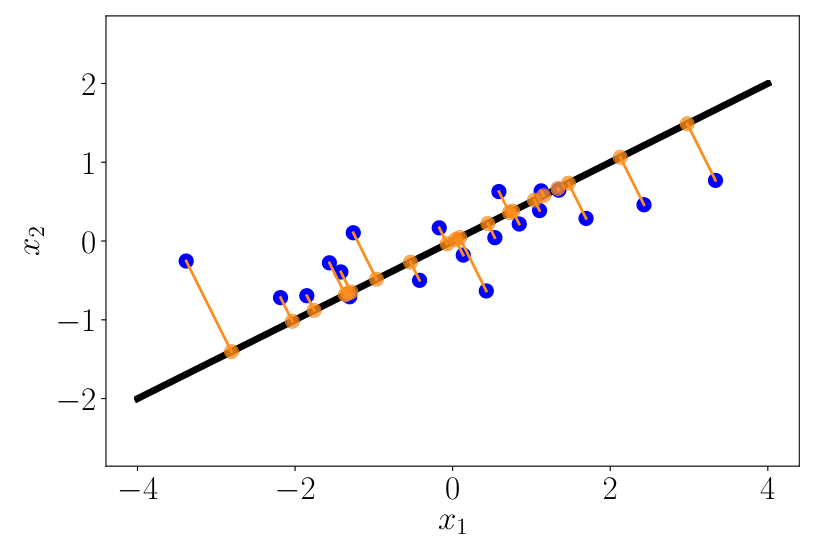
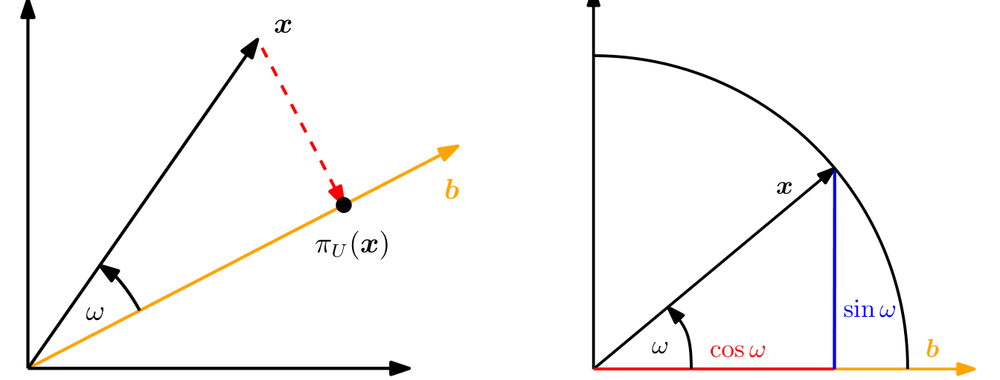
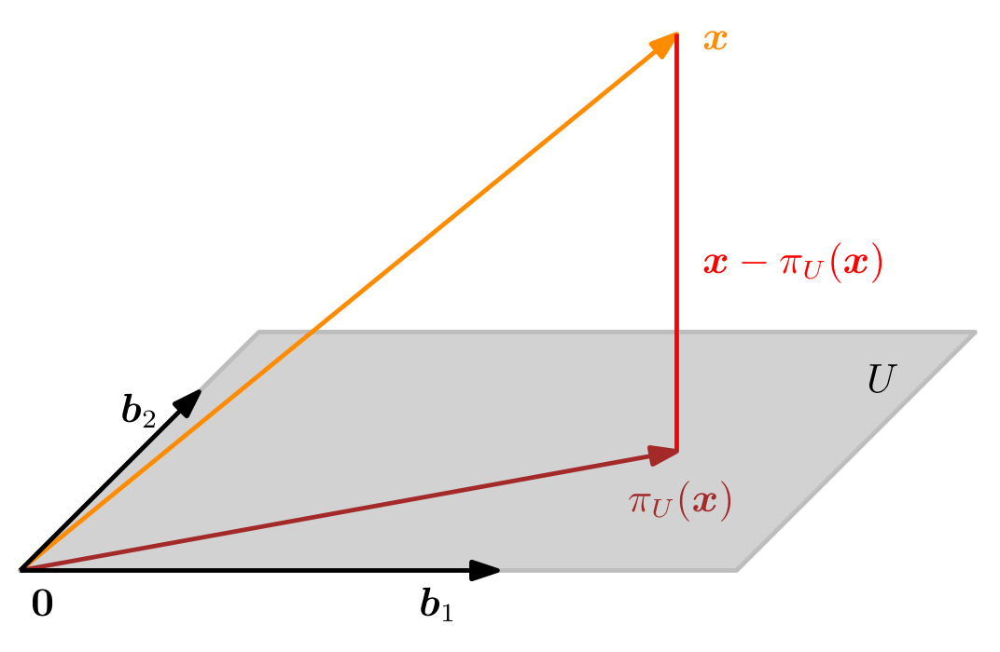
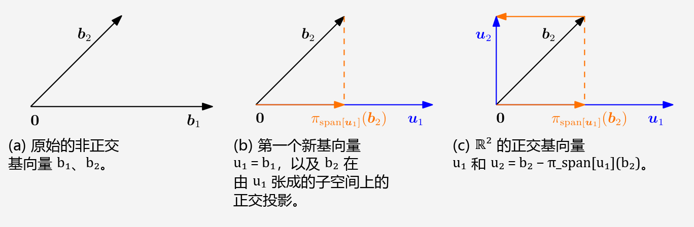
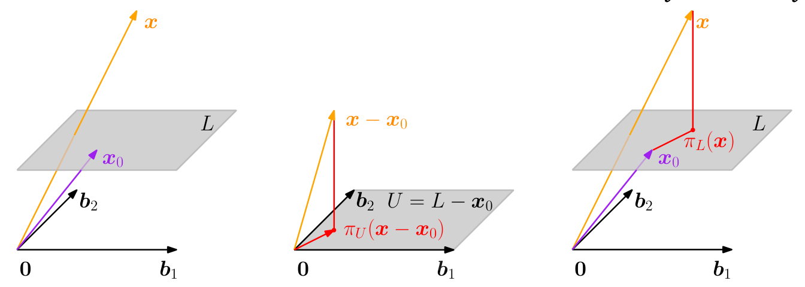

# 3.8 正交投影（Orthogonal Projections）

## 本节导学

**学习目标**

1. 知道投影的定义（幂等线性映射 $\pi^2 = \pi$）；
2. 掌握"正交条件 → 解出投影"的三步法，会推导一维子空间（直线）上的投影公式；
3. 掌握一般子空间的投影：正规方程 $\boldsymbol B^\top \boldsymbol B \boldsymbol \lambda = \boldsymbol B^\top \boldsymbol x$，并会完整计算一个投影实例；
4. 会用格拉姆-施密特方法构造正交基；
5. 会把投影推广到仿射子空间（平移支撑点）。

**预备知识**：3.2–3.6 节全部内容（内积、正交、ONB、正交补）、2.3 节（解线性方程组）、2.8 节（仿射子空间）。

**符号速查表**：

| 符号 | 读法 | 含义 |
| --- | --- | --- |
| $\pi$ | 投影映射 | 把向量映到子空间上的线性映射 |
| $\pi^2 = \pi$ | 幂等 | 投影两次等于投影一次（投完之后还在原地） |
| $\pi_U(\boldsymbol x)$ | "x 投影到 U" | $\boldsymbol x$ 在子空间 $U$ 上的正交投影 |
| $\boldsymbol P_\pi$ | 投影矩阵 | 实现 $\pi_U(\boldsymbol x) = \boldsymbol P_\pi \boldsymbol x$ 的矩阵 |
| $\boldsymbol B$ | 以基为列的矩阵 | $\boldsymbol B = [\boldsymbol b_1, \ldots, \boldsymbol b_m] \in \mathbb{R}^{n \times m}$ |
| $\boldsymbol \lambda$ | 坐标 | 投影关于 $U$ 的基的系数 |
| 正规方程 | normal equation | $\boldsymbol B^\top \boldsymbol B \boldsymbol \lambda = \boldsymbol B^\top \boldsymbol x$ |

---

## 3.8.0 为什么需要投影

投影是一类重要的线性变换（与旋转、翻转并列），在图形学、编码理论、统计学和机器学习中无处不在。机器学习里我们常面对**高维数据**：维数高难以分析和可视化，但往往只有少数几个维度携带了大部分信息。压缩或可视化时必须丢信息，我们自然希望**丢得尽量少**——即把数据投影到"信息量最丰富"的低维子空间上（图 3.9）。

PCA（第 10 章）、线性回归（第 9 章）、支持向量机（第 12 章）都是这个思想的不同形态。本节先解决几何问题：给定子空间 $U$，如何把向量 $\boldsymbol x$ **正交地**投到 $U$ 上，使误差最小？

   
  <b>图 3.9 二维数据集（蓝色圆点）到一维子空间（直线）的正交投影（橙色圆点）。</b> 

**定义 3.10**（投影）。设 $V$ 为向量空间，$U \subseteq V$ 为子空间。若线性映射 $\pi : V \to U$ 满足

$$
\pi^2 = \pi \circ \pi = \pi \quad (\text{幂等性})
$$

则称 $\pi$ 为**投影（projection）**。

**幂等性的含义**：投一次落在 $U$ 里；对 $U$ 中的向量再投一次，它原地不动。线性映射可用变换矩阵表示（2.7 节），所以**投影矩阵** $\boldsymbol P_\pi$ 的特征性质是

$$
\boldsymbol P_\pi^2 = \boldsymbol P_\pi.
$$

下面在 $(\mathbb{R}^n, \langle \cdot, \cdot \rangle)$ 中推导正交投影。除特别说明外，默认内积为点积 $\langle \boldsymbol x, \boldsymbol y \rangle = \boldsymbol x^\top \boldsymbol y$。

## 3.8.1 投影到一维子空间（直线）

设 $U = \operatorname{span}[\boldsymbol b]$ 是 $\mathbb{R}^n$ 中过原点、基向量为 $\boldsymbol b$ 的直线。要找 $\pi_U(\boldsymbol x) \in U$：$U$ 中**距离 $\boldsymbol x$ 最近**的向量。

**几何分析**（图 3.10(a)）给出两条刻画：

1. **正交条件**：最近点处误差向量与 $U$ 垂直：$\langle \pi_U(\boldsymbol x) - \boldsymbol x, \boldsymbol b \rangle = 0$；
2. **投影在 $U$ 中**：$\pi_U(\boldsymbol x)$ 是 $\boldsymbol b$ 的倍数：$\pi_U(\boldsymbol x) = \lambda \boldsymbol b$（$\lambda$ 是投影关于 $\boldsymbol b$ 的坐标）。

   
  <b>图 3.10 投影到一维子空间的示例。(a) 将 x ∈ ℝ² 投影到具有基向量 b 的子空间 U 上；(b) 将 ∥x∥ = 1 的二维向量 x 投影到由 b 张成的一维子空间上。</b> 

**三步推导**：

**第 1 步：求坐标 $\lambda$。** 把 $\pi_U(\boldsymbol x) = \lambda \boldsymbol b$ 代入正交条件，并用双线性展开：

$$
\langle \boldsymbol x - \lambda \boldsymbol b, \boldsymbol b \rangle = 0
\iff \langle \boldsymbol x, \boldsymbol b \rangle - \lambda \langle \boldsymbol b, \boldsymbol b \rangle = 0
\iff \lambda = \frac{\langle \boldsymbol x, \boldsymbol b \rangle}{\langle \boldsymbol b, \boldsymbol b \rangle} = \frac{\langle \boldsymbol b, \boldsymbol x \rangle}{\|\boldsymbol b\|^2} \tag{3.39, 3.40}
$$

（展开只用了内积的双线性；最后一步用了对称性。）对点积：

$$
\lambda = \frac{\boldsymbol b^\top \boldsymbol x}{\boldsymbol b^\top \boldsymbol b} = \frac{\boldsymbol b^\top \boldsymbol x}{\|\boldsymbol b\|^2} \tag{3.41}
$$

特别地，若 $\|\boldsymbol b\| = 1$（$\boldsymbol b$ 是单位向量），则 $\lambda = \boldsymbol b^\top \boldsymbol x$——**投影坐标就是一个点积**。

**第 2 步：求投影点。** $\pi_U(\boldsymbol x) = \lambda \boldsymbol b$，即

$$
\pi_U(\boldsymbol x) = \frac{\langle \boldsymbol x, \boldsymbol b \rangle}{\|\boldsymbol b\|^2} \boldsymbol b = \frac{\boldsymbol b^\top \boldsymbol x}{\|\boldsymbol b\|^2}\, \boldsymbol b \tag{3.42}
$$

其长度 $\|\pi_U(\boldsymbol x)\| = |\lambda| \|\boldsymbol b\|$（(3.43)，用绝对齐次性）。对点积进一步用夹角公式 (3.25)：

$$
\|\pi_U(\boldsymbol x)\| = \frac{|\boldsymbol b^\top \boldsymbol x|}{\|\boldsymbol b\|^2} \|\boldsymbol b\| = \frac{|\cos \omega|\, \|\boldsymbol x\| \|\boldsymbol b\|}{\|\boldsymbol b\|} = |\cos \omega|\, \|\boldsymbol x\| \tag{3.44}
$$

这正是三角学的"邻边 = 斜边 × 余弦"：$\|\boldsymbol x\| = 1$ 时投影长度就是 $|\cos \omega|$（图 3.10(b)）。代数学与几何在此处会合。

**第 3 步：求投影矩阵。** 投影是线性映射，存在矩阵 $\boldsymbol P_\pi$ 使 $\pi_U(\boldsymbol x) = \boldsymbol P_\pi \boldsymbol x$。把 (3.42) 改写：

$$
\pi_U(\boldsymbol x) = \frac{\boldsymbol b \boldsymbol b^\top}{\|\boldsymbol b\|^2}\, \boldsymbol x \quad \Longrightarrow \quad \boldsymbol P_\pi = \frac{\boldsymbol b \boldsymbol b^\top}{\|\boldsymbol b\|^2} \tag{3.45, 3.46}
$$

（$\boldsymbol b \boldsymbol b^\top$ 是 $n \times n$ 的外积矩阵——2.4 节备注中的"外积"在此登场；$\|\boldsymbol b\|^2$ 是标量。）

**验证 $\boldsymbol P_\pi^2 = \boldsymbol P_\pi$**（应成立，因为投影幂等）：

$$
\boldsymbol P_\pi^2 = \frac{\boldsymbol b \boldsymbol b^\top \boldsymbol b \boldsymbol b^\top}{\|\boldsymbol b\|^4} = \frac{\boldsymbol b (\boldsymbol b^\top \boldsymbol b) \boldsymbol b^\top}{\|\boldsymbol b\|^4} = \frac{\|\boldsymbol b\|^2 \, \boldsymbol b \boldsymbol b^\top}{\|\boldsymbol b\|^4} = \boldsymbol P_\pi \ \checkmark
$$

（关键是 $\boldsymbol b^\top \boldsymbol b = \|\boldsymbol b\|^2$ 是标量，可以提到前面约分。）

> **备注**：投影 $\pi_U(\boldsymbol x)$ 仍是 $\mathbb{R}^n$ 中的向量（不是标量）；但若只用基向量 $\boldsymbol b$ 表示它，就只需要**一个坐标** $\lambda$。♦

**例 3.10（投影到直线）**。求 $\boldsymbol b = [1, 2, 2]^\top$ 张成的直线上的投影矩阵。

先算 $\|\boldsymbol b\|^2 = 1 + 4 + 4 = 9$，再由 (3.46)：

$$
\boldsymbol P_\pi = \frac{1}{9} \begin{bmatrix} 1 \\ 2 \\ 2 \end{bmatrix} \begin{bmatrix} 1 & 2 & 2 \end{bmatrix} = \frac{1}{9} \begin{bmatrix} 1 & 2 & 2 \\ 2 & 4 & 4 \\ 2 & 4 & 4 \end{bmatrix} \tag{3.47}
$$

（外积 $\boldsymbol b \boldsymbol b^\top$：第 $(i,j)$ 元素是 $b_i b_j$。）

对 $\boldsymbol x = [1, 1, 1]^\top$：

$$
\pi_U(\boldsymbol x) = \boldsymbol P_\pi \boldsymbol x = \frac{1}{9} \begin{bmatrix} 1+2+2 \\ 2+4+4 \\ 2+4+4 \end{bmatrix} = \frac{1}{9} \begin{bmatrix} 5 \\ 10 \\ 10 \end{bmatrix} \in \operatorname{span}\left[\begin{bmatrix} 1 \\ 2 \\ 2 \end{bmatrix}\right] \tag{3.48}
$$

（$\frac{1}{9}(5,10,10) = \frac{5}{9}(1,2,2)$ 确实是 $\boldsymbol b$ 的倍数 ✓。）

再投一次不变：$\boldsymbol P_\pi \pi_U(\boldsymbol x) = \pi_U(\boldsymbol x)$——由幂等性保证，也可直接验证。♦（第 4 章会进一步证明：$\pi_U(\boldsymbol x)$ 是 $\boldsymbol P_\pi$ 的特征值为 1 的特征向量。）

## 3.8.2 投影到一般子空间

现在投影 $\boldsymbol x \in \mathbb{R}^n$ 到 $m$ 维子空间 $U \subseteq \mathbb{R}^n$（$m \geqslant 1$，图 3.11）。若 $U$ 只给出生成向量，先用 2.6.1 节的方法确定一组基 $(\boldsymbol b_1, \ldots, \boldsymbol b_m)$。拼成矩阵 $\boldsymbol B = [\boldsymbol b_1, \ldots, \boldsymbol b_m] \in \mathbb{R}^{n \times m}$。

   
  <b>图 3.11 投影到具有基 b₁, b₂ 的二维子空间 U 上。x ∈ ℝ³ 在 U 上的投影 πU(x) 可以表示为 b₁, b₂ 的线性组合，位移向量 x − πU(x) 同时与 b₁ 和 b₂ 正交。</b> 

**三步法**（与一维完全平行）：

**第 1 步：求坐标 $\boldsymbol \lambda$。** 投影形如 $\pi_U(\boldsymbol x) = \sum_{i=1}^m \lambda_i \boldsymbol b_i = \boldsymbol B \boldsymbol \lambda$。正交条件：误差与**每个**基向量正交，得到 $m$ 个联立方程：

$$
\boldsymbol b_i^\top (\boldsymbol x - \boldsymbol B \boldsymbol \lambda) = 0, \quad i = 1, \ldots, m \tag{3.51–3.54}
$$

$m$ 个方程排起来就是（左边 $m$ 行恰是 $\boldsymbol B^\top$）：

$$
\boldsymbol B^\top (\boldsymbol x - \boldsymbol B \boldsymbol \lambda) = \boldsymbol 0
\iff \boxed{\ \boldsymbol B^\top \boldsymbol B \, \boldsymbol \lambda = \boldsymbol B^\top \boldsymbol x\ } \tag{3.55, 3.56}
$$

——这就是著名的**正规方程（normal equation）**。

**为什么 $\boldsymbol B^\top \boldsymbol B$ 可逆？** $\boldsymbol b_1, \ldots, \boldsymbol b_m$ 线性无关 ⟹ $\boldsymbol B$ 列满秩 ⟹ $\boldsymbol B^\top \boldsymbol B \in \mathbb{R}^{m \times m}$ 正定（对 $\boldsymbol z \neq \boldsymbol 0$，$\boldsymbol z^\top \boldsymbol B^\top \boldsymbol B \boldsymbol z = \|\boldsymbol B \boldsymbol z\|^2 > 0$，因为 $\boldsymbol B \boldsymbol z \neq \boldsymbol 0$）⟹ 可逆。于是

$$
\boldsymbol \lambda = (\boldsymbol B^\top \boldsymbol B)^{-1} \boldsymbol B^\top \boldsymbol x \tag{3.57}
$$

矩阵 $(\boldsymbol B^\top \boldsymbol B)^{-1} \boldsymbol B^\top$ 是 $\boldsymbol B$ 的**伪逆（pseudo-inverse）**——它对非方阵也有定义，只要求 $\boldsymbol B^\top \boldsymbol B$ 正定（列满秩即可）。实践中（如线性回归）常在 $\boldsymbol B^\top \boldsymbol B$ 上加"抖动项" $\epsilon \boldsymbol I$ 提高数值稳定性——这就是**岭回归（ridge）**，其严格推导见第 9 章。

**第 2 步：投影点**：

$$
\pi_U(\boldsymbol x) = \boldsymbol B \boldsymbol \lambda = \boldsymbol B (\boldsymbol B^\top \boldsymbol B)^{-1} \boldsymbol B^\top \boldsymbol x \tag{3.58}
$$

**第 3 步：投影矩阵**：

$$
\boldsymbol P_\pi = \boldsymbol B (\boldsymbol B^\top \boldsymbol B)^{-1} \boldsymbol B^\top \tag{3.59}
$$

**一致性检查**：$m = 1$ 时 $\boldsymbol B = \boldsymbol b$ 是列向量，$\boldsymbol B^\top \boldsymbol B = \|\boldsymbol b\|^2$ 是标量，(3.59) 退化为 $\frac{\boldsymbol b \boldsymbol b^\top}{\|\boldsymbol b\|^2}$——正是 (3.46)。一维公式是一般公式的特例 ✓。

**例 3.11（投影到二维子空间，完整计算）**。$U = \operatorname{span}\left[(1,1,1)^\top, (0,1,2)^\top\right] \subseteq \mathbb{R}^3$，$\boldsymbol x = [6, 0, 0]^\top$。

**第 1 步：拼矩阵。** 两个生成向量线性无关（不成倍数），即基：

$$
\boldsymbol B = \begin{bmatrix} 1 & 0 \\ 1 & 1 \\ 1 & 2 \end{bmatrix}
$$

**第 2 步：算 $\boldsymbol B^\top \boldsymbol B$ 与 $\boldsymbol B^\top \boldsymbol x$**（逐项："行乘列"点积）：

$$
\boldsymbol B^\top \boldsymbol B = \begin{bmatrix} 1 & 1 & 1 \\ 0 & 1 & 2 \end{bmatrix} \begin{bmatrix} 1 & 0 \\ 1 & 1 \\ 1 & 2 \end{bmatrix} = \begin{bmatrix} 3 & 3 \\ 3 & 5 \end{bmatrix}, \qquad
\boldsymbol B^\top \boldsymbol x = \begin{bmatrix} 1 & 1 & 1 \\ 0 & 1 & 2 \end{bmatrix} \begin{bmatrix} 6 \\ 0 \\ 0 \end{bmatrix} = \begin{bmatrix} 6 \\ 0 \end{bmatrix} \tag{3.60}
$$

核对：$(\boldsymbol B^\top \boldsymbol B)_{11} = 1+1+1 = 3$（第 1 列自点积）；$(\boldsymbol B^\top \boldsymbol B)_{12} = 1 \times 0 + 1 \times 1 + 1 \times 2 = 3$；$(\boldsymbol B^\top \boldsymbol B)_{22} = 0 + 1 + 4 = 5$ ✓。

**第 3 步：解正规方程。** $\begin{bmatrix} 3 & 3 \\ 3 & 5 \end{bmatrix} \boldsymbol \lambda = \begin{bmatrix} 6 \\ 0 \end{bmatrix}$。消元：$R_2 \leftarrow R_2 - R_1$ 得 $2\lambda_2 = -6 \Rightarrow \lambda_2 = -3$；代回 $3\lambda_1 + 3 \times (-3) = 6 \Rightarrow \lambda_1 = 5$：

$$
\boldsymbol \lambda = \begin{bmatrix} 5 \\ -3 \end{bmatrix} \tag{3.61}
$$

**第 4 步：投影点与投影误差**：

$$
\pi_U(\boldsymbol x) = \boldsymbol B \boldsymbol \lambda = 5\begin{bmatrix} 1 \\ 1 \\ 1 \end{bmatrix} - 3 \begin{bmatrix} 0 \\ 1 \\ 2 \end{bmatrix} = \begin{bmatrix} 5 \\ 2 \\ -1 \end{bmatrix} \tag{3.62}
$$

**投影误差（projection error）**（也叫重构误差）：

$$
\|\boldsymbol x - \pi_U(\boldsymbol x)\| = \left\| \begin{bmatrix} 6-5 \\ 0-2 \\ 0-(-1) \end{bmatrix} \right\| = \left\| \begin{bmatrix} 1 \\ -2 \\ 1 \end{bmatrix} \right\| = \sqrt{1 + 4 + 1} = \sqrt{6} \tag{3.63}
$$

**第 5 步：投影矩阵。** 先求 $(\boldsymbol B^\top \boldsymbol B)^{-1} = \frac{1}{3 \times 5 - 3 \times 3}\begin{bmatrix} 5 & -3 \\ -3 & 3 \end{bmatrix} = \frac{1}{6}\begin{bmatrix} 5 & -3 \\ -3 & 3 \end{bmatrix}$（2×2 逆矩阵公式 (2.24)），然后

$$
\boldsymbol P_\pi = \boldsymbol B (\boldsymbol B^\top \boldsymbol B)^{-1} \boldsymbol B^\top = \frac{1}{6} \begin{bmatrix} 5 & 2 & -1 \\ 2 & 2 & 2 \\ -1 & 2 & 5 \end{bmatrix} \tag{3.64}
$$

（中间矩阵乘法 $\boldsymbol B (\boldsymbol B^\top \boldsymbol B)^{-1} \boldsymbol B^\top$ 的逐步展开：先算 $(\boldsymbol B^\top \boldsymbol B)^{-1}\boldsymbol B^\top = \frac{1}{6}\begin{bmatrix} 5 & 2 & -1 \\ 2 & 0 & ... \end{bmatrix}$……建议读者自己完整算一遍，再与 (3.64) 对照。）

**验证**（好习惯，两条都做）：

- **(a) 正交性**：$\boldsymbol x - \pi_U(\boldsymbol x) = (1, -2, 1)^\top$。与 $\boldsymbol b_1$ 点积：$1 - 2 + 1 = 0$ ✓；与 $\boldsymbol b_2$ 点积：$0 - 2 + 2 = 0$ ✓。误差确实垂直于 $U$。
- **(b) 幂等性**：抽查 $(\boldsymbol P_\pi^2)_{11}$：$\frac{1}{36}(5 \times 5 + 2 \times 2 + (-1)\times(-1)) = \frac{30}{36} = \frac{5}{6} = (\boldsymbol P_\pi)_{11}$ ✓（其余元素同理）。

**两个备注**：

- 投影 $\pi_U(\boldsymbol x)$ 落在 $m$ 维子空间里，但它仍是 $\mathbb{R}^n$ 中的向量；用 $U$ 的基表示时只需 $m$ 个坐标 $\lambda_1, \ldots, \lambda_m$。这就是"降维"：存储 $m$ 个数代替 $n$ 个数。♦
- 使用**一般内积**时，夹角和距离都按该内积定义，正规方程推导不变，只是把点积换成 $\langle \cdot, \cdot \rangle$。♦

**投影与最小二乘**。投影还能求解**无解**的线性方程组 $\boldsymbol{Ax} = \boldsymbol b$：无解意味着 $\boldsymbol b$ 不在 $\boldsymbol A$ 的列空间里。那就退一步——在列空间 $\operatorname{span}[\boldsymbol a_1, \ldots, \boldsymbol a_n]$ 中找离 $\boldsymbol b$ **最近**的向量，即 $\boldsymbol b$ 在列空间上的正交投影。对应的近似解叫**最小二乘解（least-squares solution）**，第 9.4 节详细讨论。重构误差 (3.63) 也是推导 PCA（10.3 节）的一条路径。

**ONB 下的简化**。若 $(\boldsymbol b_1, \ldots, \boldsymbol b_m)$ 是标准正交基，则 $\boldsymbol B^\top \boldsymbol B = \boldsymbol I$（正交矩阵的定义 (3.29)），公式 (3.58)(3.59) 大幅简化：

$$
\pi_U(\boldsymbol x) = \boldsymbol B \boldsymbol B^\top \boldsymbol x, \qquad \boldsymbol \lambda = \boldsymbol B^\top \boldsymbol x \tag{3.65, 3.66}
$$

无需再求逆——每个坐标 $\lambda_i = \boldsymbol b_i^\top \boldsymbol x$ 就是一个点积。这正是 ONB"最好用"的原因。

## 3.8.3 格拉姆-施密特正交化

投影是**格拉姆-施密特正交化（Gram-Schmidt orthogonalization）**的核心工具：它把任意一组基 $(\boldsymbol b_1, \ldots, \boldsymbol b_n)$ **构造性地**变成正交/标准正交基 $(\boldsymbol u_1, \ldots, \boldsymbol u_n)$，且张成空间不变：$\operatorname{span}[\boldsymbol b_1, \ldots, \boldsymbol b_n] = \operatorname{span}[\boldsymbol u_1, \ldots, \boldsymbol u_n]$。这样的正交基总是存在（Liesen and Mehrmann, 2015）。

**算法**：

$$
\boldsymbol u_1 := \boldsymbol b_1 \tag{3.67}
$$

$$
\boldsymbol u_k := \boldsymbol b_k - \pi_{\operatorname{span}[\boldsymbol u_1, \ldots, \boldsymbol u_{k-1}]}(\boldsymbol b_k), \quad k = 2, \ldots, n \tag{3.68}
$$

**思想一句话**：第 $k$ 步把 $\boldsymbol b_k$ 中"沿已有正交方向的分量"（投影）全部减掉，剩下的自然与它们全部正交。最后若要 ONB，再令每个 $\boldsymbol u_k$ 除以 $\|\boldsymbol u_k\|$。

**例 3.12（二维演示）**。$\boldsymbol b_1 = [2, 0]^\top$，$\boldsymbol b_2 = [1, 1]^\top$（图 3.12(a)）。

**第 1 步**：$\boldsymbol u_1 := \boldsymbol b_1 = [2, 0]^\top$。

**第 2 步**：把 $\boldsymbol b_2$ 投到 $\operatorname{span}[\boldsymbol u_1]$ 上再减掉（用一维投影公式 (3.45)）：

$$
\pi_{\operatorname{span}[\boldsymbol u_1]}(\boldsymbol b_2) = \frac{\boldsymbol u_1 \boldsymbol u_1^\top}{\|\boldsymbol u_1\|^2} \boldsymbol b_2 = \begin{bmatrix} 1 & 0 \\ 0 & 0 \end{bmatrix} \begin{bmatrix} 1 \\ 1 \end{bmatrix} = \begin{bmatrix} 1 \\ 0 \end{bmatrix}
$$

（因为 $\|\boldsymbol u_1\|^2 = 4$，$\frac{\boldsymbol u_1 \boldsymbol u_1^\top}{4} = \frac{1}{4}\begin{bmatrix} 4 & 0 \\ 0 & 0 \end{bmatrix} = \begin{bmatrix} 1 & 0 \\ 0 & 0 \end{bmatrix}$。）

$$
\boldsymbol u_2 := \boldsymbol b_2 - \pi(\boldsymbol b_2) = \begin{bmatrix} 1 \\ 1 \end{bmatrix} - \begin{bmatrix} 1 \\ 0 \end{bmatrix} = \begin{bmatrix} 0 \\ 1 \end{bmatrix} \tag{3.70, 3.71}
$$

验证正交：$\boldsymbol u_1^\top \boldsymbol u_2 = 2 \times 0 + 0 \times 1 = 0$ ✓（图 3.12(b)(c)）。若要 ONB：$\|\boldsymbol u_1\| = 2$、$\|\boldsymbol u_2\| = 1$，归一化得 $(1, 0)^\top, (0, 1)^\top$。

   
  <b>图 3.12 格拉姆-施密特正交化。(a) ℝ² 的非正交基 (b₁, b₂)；(b) 第一个构造的基向量 u₁ 以及 b₂ 在 span[u₁] 上的正交投影；(c) ℝ² 的正交基 (u₁, u₂)。</b> 

## 3.8.4 投影到仿射子空间

最后把投影推广到**仿射子空间** $L = \boldsymbol x_0 + U$（2.8 节）。技巧：**平移回原点**，投完再移回去（图 3.13）：

$$
\boxed{\ \pi_L(\boldsymbol x) = \boldsymbol x_0 + \pi_U(\boldsymbol x - \boldsymbol x_0)\ } \tag{3.72}
$$

即：先减去支撑点 $\boldsymbol x_0$，把问题变成向子空间 $U$ 的投影；投完加上 $\boldsymbol x_0$ 平移回 $L$。

**距离同理**（看图 3.13 可知平移不改变相对位置）：

$$
d(\boldsymbol x, L) = \|\boldsymbol x - \pi_L(\boldsymbol x)\| = \|(\boldsymbol x - \boldsymbol x_0) - \pi_U(\boldsymbol x - \boldsymbol x_0)\| = d(\boldsymbol x - \boldsymbol x_0, U) \tag{3.73}
$$

第 12.1 节将用这个方法推导 SVM 的**分离超平面**。

   
  <b>图 3.13 投影到仿射空间。(a) 原始设定；(b) 平移 −x₀ 使得 x − x₀ 可以投影到方向空间 U 上；(c) 将投影平移回 x₀ + πU(x − x₀)，得到最终的正交投影 πL(x)。</b> 

---

## 本节小结

| 问题 | 公式 |
| --- | --- |
| 投影到直线 $\operatorname{span}[\boldsymbol b]$ | $\boldsymbol P_\pi = \frac{\boldsymbol b \boldsymbol b^\top}{\|\boldsymbol b\|^2}$，$\lambda = \frac{\boldsymbol b^\top \boldsymbol x}{\|\boldsymbol b\|^2}$ |
| 投影到一般子空间 | 正规方程 $\boldsymbol B^\top \boldsymbol B \boldsymbol \lambda = \boldsymbol B^\top \boldsymbol x$；$\boldsymbol P_\pi = \boldsymbol B(\boldsymbol B^\top \boldsymbol B)^{-1}\boldsymbol B^\top$ |
| ONB 下的投影 | $\boldsymbol \lambda = \boldsymbol B^\top \boldsymbol x$（无需求逆） |
| 格拉姆-施密特 | 逐个减去在已有正交向量上的投影 |
| 仿射子空间投影 | $\pi_L(\boldsymbol x) = \boldsymbol x_0 + \pi_U(\boldsymbol x - \boldsymbol x_0)$ |

**核心技能**：给一个子空间（生成集或基）和向量，会写 $\boldsymbol B$、列正规方程、解出坐标、得到投影和误差，并用"正交性 + 幂等性"双重验证。

**与其他章节的关系**：最小二乘回归 = $\boldsymbol b$ 到列空间的投影（9.4 节）；PCA = 数据到主成分子空间的投影（10.3 节）；SVM = 到分离超平面的距离（12.1 节）——本章是这三章的共同地基。
