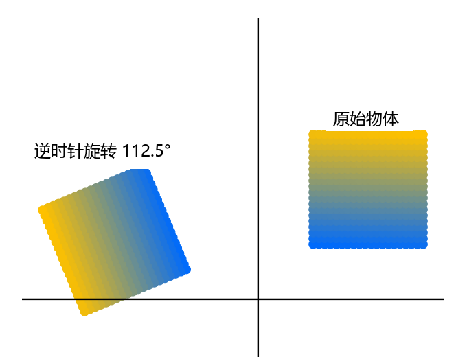
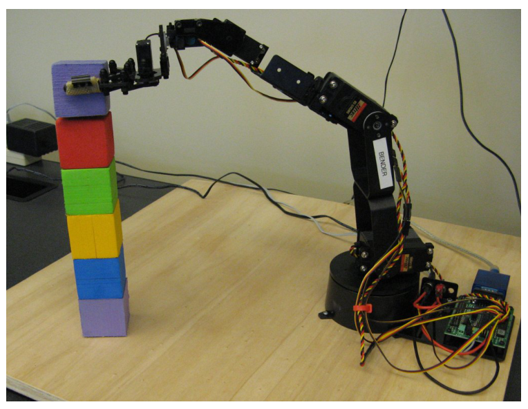
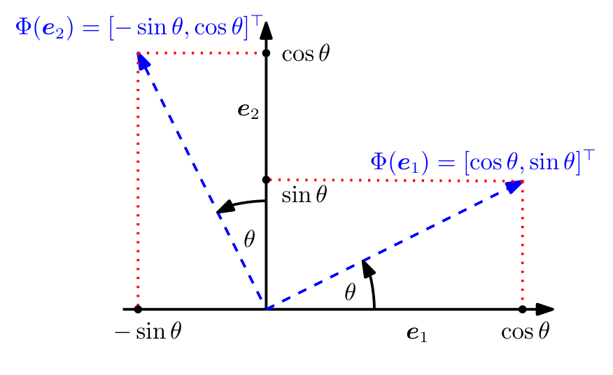
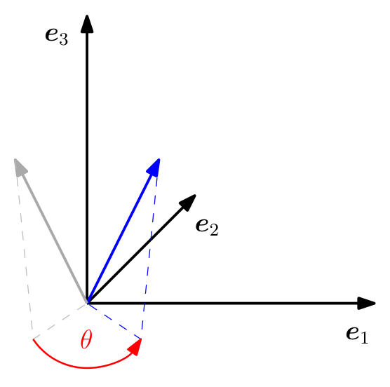

# 3.9 旋转（Rotations）

## 本节导学

**学习目标**

1. 掌握 $\mathbb{R}^2$ 中旋转矩阵的推导（从三角学出发）；
2. 记住 $\mathbb{R}^3$ 中绕三个坐标轴的旋转矩阵，理解"从轴端正看逆时针"的约定；
3. 知道吉文斯旋转是 $n$ 维旋转的基本构件；
4. 掌握旋转的核心性质（保距、保角、一般不可交换）。

**预备知识**：3.4 节（正交矩阵）、2.7 节（变换矩阵的列构造法）、高中三角学。

**符号速查表**：

| 符号 | 读法 | 含义 |
| --- | --- | --- |
| $\boldsymbol R(\theta)$ | 旋转矩阵 | 把平面旋转角度 $\theta$ 的矩阵 |
| $\theta$ | theta | 旋转角；正值按逆时针方向 |
| $\boldsymbol R_{ij}(\theta)$ | 吉文斯旋转 | 只在 $i$-$j$ 平面内旋转的 $n$ 维矩阵 |

---

## 3.9.1 什么是旋转

3.4 节说过：保持长度和夹角不变的线性变换由正交矩阵描述，其几何形态就是**旋转**（可能伴随翻转）。**旋转（rotation）**的严格定义：欧氏向量空间的自同构，把平面绕**原点**旋转角度 $\theta$——原点是**不动点**。约定 $\theta > 0$ 时按**逆时针**方向旋转。图 3.14 是一个例子（$\cos\theta \approx -0.38$，$\sin\theta \approx 0.92$，对应 $\theta \approx 112^\circ$）：

$$
\boldsymbol R = \begin{bmatrix} -0.38 & -0.92 \\ 0.92 & -0.38 \end{bmatrix} \tag{3.74}
$$

   
  <b>图 3.14 旋转将平面内的物体绕原点旋转。如果旋转角为正，则按逆时针方向旋转。</b> 

旋转的重要应用领域包括计算机图形学和机器人学——例如机械臂需要旋转关节来抓取物体（图 3.15）。

   
  <b>图 3.15 机械臂需要旋转其关节以便抓取或准确定位物体。图引自 (Deisenroth et al., 2015)。</b> 

## 3.9.2 $\mathbb{R}^2$ 中的旋转

目标是推出旋转矩阵。按 2.7 节的方法：**旋转后的基向量长什么样，按列排好就是矩阵**。把标准基 $\boldsymbol e_1 = (1,0)^\top$、$\boldsymbol e_2 = (0,1)^\top$ 旋转 $\theta$（图 3.16）：

- $\boldsymbol e_1$ 旋转 $\theta$ 后落在单位圆上，坐标为 $(\cos\theta, \sin\theta)^\top$；
- $\boldsymbol e_2$ 比 $\boldsymbol e_1$ 超前 $90^\circ$，坐标为 $(-\sin\theta, \cos\theta)^\top$。

于是

$$
\Phi(\boldsymbol e_1) = \begin{bmatrix} \cos\theta \\ \sin\theta \end{bmatrix}, \quad \Phi(\boldsymbol e_2) = \begin{bmatrix} -\sin\theta \\ \cos\theta \end{bmatrix} \tag{3.75}
$$

$$
\boldsymbol R(\theta) = \begin{bmatrix} \Phi(\boldsymbol e_1) & \Phi(\boldsymbol e_2) \end{bmatrix} = \begin{bmatrix} \cos\theta & -\sin\theta \\ \sin\theta & \cos\theta \end{bmatrix} \tag{3.76}
$$

**验证 (3.74)**：$\cos\theta = -0.38$、$\sin\theta = 0.92$ 代入 (3.76) 正好得到 (3.74) ✓。

**验证正交性**（应然）：$\boldsymbol R^\top \boldsymbol R = \begin{bmatrix} \cos\theta & \sin\theta \\ -\sin\theta & \cos\theta \end{bmatrix}\begin{bmatrix} \cos\theta & -\sin\theta \\ \sin\theta & \cos\theta \end{bmatrix} = \begin{bmatrix} \cos^2 + \sin^2 & 0 \\ 0 & \cos^2 + \sin^2 \end{bmatrix} = \boldsymbol I$ ✓（用了 $\cos^2\theta + \sin^2\theta = 1$）。每列确实是单位向量且两列正交——旋转必为正交矩阵。

旋转后的向量仍线性无关，仍是基——**旋转执行了一次基变换**（2.7.3 节）。

   
  <b>图 3.16 R² 中的标准基旋转角度 θ。</b> 

## 3.9.3 $\mathbb{R}^3$ 中的旋转

三维与二维的本质区别：旋转必须绕**一条轴**进行——任意二维平面绕一维轴旋转。构造方法：规定"逆时针"的含义，然后照旧把标准基的像按列排列。

**约定**：绕某轴的"逆时针"= 从该轴**末端（尖端）朝原点看**时的逆时针。

绕 $\boldsymbol e_1$ 轴（图 3.17 思想）：$\boldsymbol e_1$ 不动，$\boldsymbol e_2\boldsymbol e_3$ 平面内逆时针转：

$$
\boldsymbol R_1(\theta) = \begin{bmatrix} 1 & 0 & 0 \\ 0 & \cos\theta & -\sin\theta \\ 0 & \sin\theta & \cos\theta \end{bmatrix} \tag{3.77}
$$

绕 $\boldsymbol e_2$ 轴：$\boldsymbol e_2$ 不动；注意从 $\boldsymbol e_2$ 尖端看向原点时，$\boldsymbol e_1$ 轴朝右、$\boldsymbol e_3$ 轴朝上，逆时针是 $\boldsymbol e_1 \to \boldsymbol e_3$ 方向，所以 $\boldsymbol e_1$ 转向 $\boldsymbol e_3$（正弦项的位置与 (3.77) 不同）：

$$
\boldsymbol R_2(\theta) = \begin{bmatrix} \cos\theta & 0 & \sin\theta \\ 0 & 1 & 0 \\ -\sin\theta & 0 & \cos\theta \end{bmatrix} \tag{3.78}
$$

绕 $\boldsymbol e_3$ 轴：$\boldsymbol e_1\boldsymbol e_2$ 平面内逆时针（图 3.17）：

$$
\boldsymbol R_3(\theta) = \begin{bmatrix} \cos\theta & -\sin\theta & 0 \\ \sin\theta & \cos\theta & 0 \\ 0 & 0 & 1 \end{bmatrix} \tag{3.79}
$$

   
  <b>图 3.17 R³ 中的向量（灰色）绕 e₃ 轴旋转角度 θ。旋转后的向量显示为蓝色。</b> 

三个矩阵共同规律：轴对应的坐标行/列保持 $(0, \ldots, 1, \ldots, 0)$，其余部分是二维旋转块 $\begin{bmatrix} \cos\theta & \mp\sin\theta \\ \pm\sin\theta & \cos\theta \end{bmatrix}$，符号由"从轴端看逆时针"的约定决定。

## 3.9.4 $n$ 维空间中的旋转：吉文斯旋转

推广到 $n$ 维很直观：**固定 $n - 2$ 个维度，只在某个二维平面内旋转**。

**定义 3.11**（吉文斯旋转）。设 $V$ 是 $n$ 维欧氏向量空间，$1 \leqslant i < j \leqslant n$，$\theta \in \mathbb{R}$。矩阵

$$
\boldsymbol R_{ij}(\theta) := \begin{bmatrix} \boldsymbol I_{i-1} & \mathbf{0} & \cdots & \mathbf{0} \\ \mathbf{0} & \cos\theta & -\sin\theta & \mathbf{0} \\ \mathbf{0} & \mathbf{0} & \boldsymbol I_{j-i-1} & \mathbf{0} \\ \mathbf{0} & \sin\theta & \cos\theta & \mathbf{0} \\ \mathbf{0} & \cdots & \cdots & \boldsymbol I_{n-j} \end{bmatrix} \in \mathbb{R}^{n \times n} \tag{3.80}
$$

称为**吉文斯旋转（Givens rotation）**。

本质：它就是把单位矩阵的四个位置 $(i,i)$、$(i,j)$、$(j,i)$、$(j,j)$ 换成

$$
r_{ii} = \cos\theta, \quad r_{ij} = -\sin\theta, \quad r_{ji} = \sin\theta, \quad r_{jj} = \cos\theta \tag{3.81}
$$

其余保持单位矩阵。$n = 2$ 时 (3.80) 退化为 (3.76)。任意高维旋转都可以分解为若干吉文斯旋转的乘积——它是数值线性代数中" QR 分解"的基本构件。

## 3.9.5 旋转的性质

把旋转看作正交矩阵（定义 3.8），性质可一一推出：

- **保距**：$\|\boldsymbol R \boldsymbol x - \boldsymbol R \boldsymbol y\| = \|\boldsymbol R(\boldsymbol x - \boldsymbol y)\| = \|\boldsymbol x - \boldsymbol y\|$（用 (3.31)：正交矩阵保范数）。任意两点间距离不变；
- **保角**：$\boldsymbol{Rx}$ 与 $\boldsymbol{Ry}$ 的夹角 = $\boldsymbol x$ 与 $\boldsymbol y$ 的夹角（(3.32)）；
- **一般不可交换**：三维及以上，旋转顺序 matters——先绕 $x$ 轴转 $90^\circ$ 再绕 $z$ 轴转 $90^\circ$，与先绕 $z$ 再绕 $x$，结果不同。（动手试试 $\boldsymbol R_1(\frac{\pi}{2})$ 与 $\boldsymbol R_3(\frac{\pi}{2})$ 分别左右乘 $\boldsymbol e_1 = (1,0,0)^\top$：$\boldsymbol R_3(\frac{\pi}{2})\boldsymbol e_1 = (0,1,0)^\top$ 再绕 $x$ 转得 $(0,0,1)^\top$；而 $\boldsymbol R_1(\frac{\pi}{2})\boldsymbol e_1 = (1,0,0)^\top$ 再绕 $z$ 转得 $(0,1,0)^\top$——两个结果不同！）这是机器人学中"关节顺序"必须明确的原因。
- **二维例外**：平面旋转都可交换，$\boldsymbol R(\phi)\boldsymbol R(\theta) = \boldsymbol R(\theta)\boldsymbol R(\phi) = \boldsymbol R(\theta + \phi)$（矩阵乘开后用正弦加法公式即得）。绕同一点的所有二维旋转构成**阿贝尔群**（2.4 节群概念的回归）。

---

## 本节小结

| 维度 | 旋转矩阵 | 要点 |
| --- | --- | --- |
| $\mathbb{R}^2$ | (3.76) | 基向量旋转后的坐标按列排列 |
| $\mathbb{R}^3$ | (3.77)–(3.79) | 绕哪个轴，哪行哪列不动；符号由"轴端看逆时针"决定 |
| $\mathbb{R}^n$ | 吉文斯旋转 (3.80) | 只在一个二维平面内转 |
| 性质 | 保距、保角、$\boldsymbol R^\top \boldsymbol R = \boldsymbol I$ | 高维不可交换，二维可交换 |

**与其他章节的关系**：旋转矩阵是机器人学姿态表示的基础；吉文斯旋转是 QR 分解的数值工具；保距保角的性质使正交矩阵成为特征分解（4.4 节）和 SVD（4.5 节）中的"黄金矩阵"。
