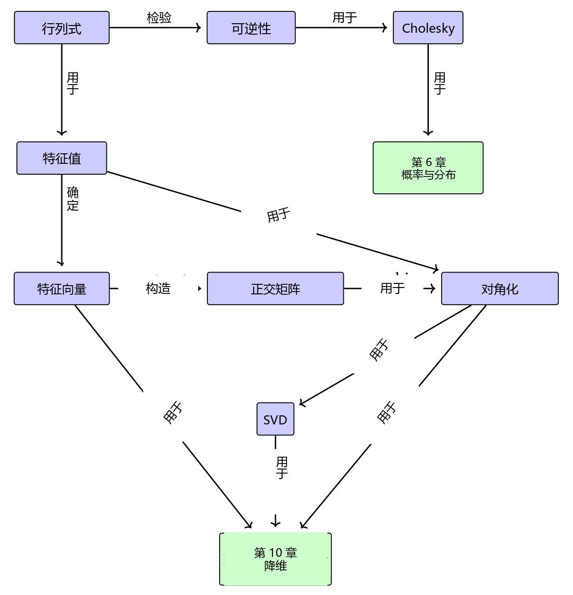

# 第 4 章 矩阵分解（Matrix Decompositions）

## 本章导学

**学习目标**：知道本章回答三个问题——**如何概括矩阵**（用少数特征数字）、**如何分解矩阵**（把矩阵写成更简单矩阵的乘积）、**如何用分解做矩阵近似**（有损压缩）。

**本章的逻辑主线**：

1. **概括（4.1–4.2 节）**：对方阵，两个特征数字——**行列式**（可逆性、有向体积）和**特征值**（矩阵的"固有缩放因子"）——就能告诉我们矩阵的大量性质；
2. **分解（4.3–4.5 节）**：类比整数的因数分解（$21 = 7 \times 3$），矩阵也有"因子分解"：
   - **Cholesky 分解**（4.3 节）：对称正定矩阵的"开平方" $\boldsymbol A = \boldsymbol L \boldsymbol L^\top$；
   - **特征分解 / 对角化**（4.4 节）：选对了基，线性映射就是对角缩放 $\boldsymbol A = \boldsymbol P \boldsymbol D \boldsymbol P^{-1}$；
   - **奇异值分解 SVD**（4.5 节）：推广到任意矩阵，"线性代数的基本定理"；
3. **近似（4.6 节）**：用 SVD 的前 $k$ 项逼近原矩阵——**低秩近似**，Eckart-Young 定理保证其最优性；图像压缩、降维（PCA）、推荐系统都建立在这上面；
4. **谱系（4.7 节）**：一张图总结各类矩阵之间的包含关系。

**预备知识**：第 2 章（线性代数基础）、第 3 章（内积、正交、投影）。本章是 Part I 的制高点，也是第 10 章（PCA）、第 11 章（密度估计）的直接基础。

本章概念之间的关系见图 4.1。

   
  <b>图 4.1 本章介绍的概念的思维导图，以及它们在本书其他部分中的应用场景。</b> 

