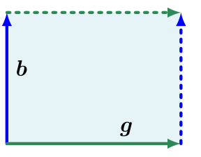
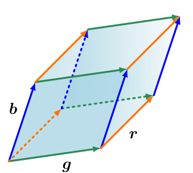

# 4.1 行列式与迹（Determinant and Trace）

## 本节导学

**学习目标**

1. 知道行列式只对**方阵**有定义，会算 $1 \times 1$、$2 \times 2$、$3 \times 3$ 矩阵的行列式（萨鲁斯法则）；
2. 会用拉普拉斯展开计算一般 $n \times n$ 矩阵的行列式；
3. 理解行列式的几何意义：**有向体积**，并会用 $\det(\boldsymbol A) \neq 0 \iff \boldsymbol A$ 可逆 判断可逆性；
4. 掌握迹的定义与循环性质；
5. 知道特征多项式是什么，为 4.2 节的特征值做准备。

**预备知识**：2.2 节（矩阵、逆）、2.3 节（高斯消元）、3.1 节（范数直觉）。

**符号速查表**：

| 符号 | 读法 | 含义 |
| --- | --- | --- |
| $\det(\boldsymbol A)$ 或 $|\boldsymbol A|$ | "A 的行列式" | 把方阵映成一个实数的函数（$|\boldsymbol A|$ 勿与绝对值混淆） |
| $\begin{vmatrix} a & b \\ c & d \end{vmatrix}$ | 行列式记号 | 竖线包围的方阵 |
| $\boldsymbol A_{k,j}$ | 子矩阵 | 划去第 $k$ 行第 $j$ 列后剩下的 $(n-1) \times (n-1)$ 矩阵 |
| $(-1)^{k+j}$ | 符号因子 | 棋盘式正负号：$k+j$ 为偶取 $+1$，奇取 $-1$ |
| $\operatorname{tr}(\boldsymbol A)$ | "A 的迹" | 主对角线元素之和 |
| $\prod_{i=1}^n$ | 连乘 | $T_{11} \times T_{22} \times \cdots \times T_{nn}$ |

---

## 4.1.1 行列式：从可逆性说起

行列式是线性代数中的重要概念，最初产生于线性方程组的求解。它只对**方阵** $\boldsymbol A \in \mathbb{R}^{n \times n}$ 有定义，记作 $\det(\boldsymbol A)$ 或 $|\boldsymbol A|$：

$$
\det(\boldsymbol A) = \begin{vmatrix} a_{11} & a_{12} & \cdots & a_{1n} \\ a_{21} & a_{22} & \cdots & a_{2n} \\ \vdots & \vdots & \ddots & \vdots \\ a_{n1} & a_{n2} & \cdots & a_{nn} \end{vmatrix} \tag{4.1}
$$

> 注意：$|\boldsymbol A|$ 这个记号切勿与绝对值混淆。♦

**例 4.1（检验可逆性：从低维看规律）**

- $1 \times 1$ 矩阵就是标量：$\boldsymbol A = a \implies \boldsymbol A^{-1} = \frac{1}{a}$，存在当且仅当 $a \neq 0$；
- $2 \times 2$ 矩阵：由 (2.24)，逆矩阵是

$$
\boldsymbol A^{-1} = \frac{1}{a_{11}a_{22} - a_{12}a_{21}} \begin{bmatrix} a_{22} & -a_{12} \\ -a_{21} & a_{11} \end{bmatrix} \tag{4.2}
$$

分母不能为零，所以 $\boldsymbol A$ 可逆当且仅当 $a_{11}a_{22} - a_{12}a_{21} \neq 0$（(4.3)）。这个量就是 $2 \times 2$ 矩阵的**行列式**：

$$
\det(\boldsymbol A) = \begin{vmatrix} a_{11} & a_{12} \\ a_{21} & a_{22} \end{vmatrix} = a_{11}a_{22} - a_{12}a_{21} \tag{4.4}
$$

例 4.1 已经透露了行列式与可逆性的联系。**定理 4.1** 将其推广到一般方阵：

> **$\boldsymbol A \in \mathbb{R}^{n \times n}$ 可逆 ⟺ $\det(\boldsymbol A) \neq 0$。**

**小矩阵的显式公式**：

$$
n = 1: \quad \det(a_{11}) = a_{11} \tag{4.5}
$$

$$
n = 2: \quad \det(\boldsymbol A) = a_{11}a_{22} - a_{12}a_{21} \tag{4.6}
$$

$n = 3$：**萨鲁斯法则（Sarrus' rule）**——把第 1、2 列复制到矩阵右侧，三条"主对角线"（左上→右下）的乘积相加，减去三条"副对角线"（左下→右上）的乘积：

$$
\begin{vmatrix} a_{11} & a_{12} & a_{13} \\ a_{21} & a_{22} & a_{23} \\ a_{31} & a_{32} & a_{33} \end{vmatrix} = a_{11}a_{22}a_{33} + a_{21}a_{32}a_{13} + a_{31}a_{12}a_{23} - a_{31}a_{22}a_{13} - a_{11}a_{32}a_{23} - a_{21}a_{12}a_{33} \tag{4.7}
$$

（记忆辅助：把各项的列下标写出来——正项是 $(1,2,3)$ 的循环移位，负项是逆序。）

**三角矩阵的行列式特别简单**：若 $\boldsymbol T$ 是上三角（$i > j$ 时 $T_{ij} = 0$）或下三角矩阵，

$$
\det(\boldsymbol T) = \prod_{i=1}^n T_{ii} \tag{4.8}
$$

即**对角线元素连乘**。这和高斯消元配合，就能算任意矩阵的行列式（见性质部分）。

## 4.1.2 行列式的几何意义：有向体积

**例 4.2（行列式 = 有向体积）**。把 $\det(\boldsymbol A)$ 看成"由 $\boldsymbol A$ 的 $n$ 个列向量张成的 $n$ 维几何体的有向体积（signed volume）"，概念就非常自然。

- **$n = 2$**（图 4.2）：列向量 $\boldsymbol b, \boldsymbol g$ 张成平行四边形。$|\det(\boldsymbol A)|$ = 以 $\boldsymbol 0, \boldsymbol b, \boldsymbol g, \boldsymbol b + \boldsymbol g$ 为顶点的平行四边形面积。

  - 若 $\boldsymbol b, \boldsymbol g$ **线性相关**（$\boldsymbol b = \lambda \boldsymbol g$），平行四边形塌成一条线，面积 = 0 —— 与定理 4.1 呼应：$\det = 0$ 恰好对应列相关（不可逆）；
  - 若 $\boldsymbol b = (b, 0)^\top$、$\boldsymbol g = (0, g)^\top$（轴向矩形），$\det = bg$，即"底 × 高"；
  - **符号 = 定向（orientation）**：交换两列，阴影区域"翻面"，行列式变号。

- **$n = 3$**（图 4.3）：三个向量张成平行六面体，$|\det|$ = 体积。

**亲手算一个体积**。取向量

$$
\boldsymbol r = \begin{bmatrix} 2 \\ 0 \\ -8 \end{bmatrix}, \quad \boldsymbol g = \begin{bmatrix} 6 \\ 1 \\ 0 \end{bmatrix}, \quad \boldsymbol b = \begin{bmatrix} 1 \\ 4 \\ -1 \end{bmatrix} \tag{4.9}
$$

按列拼成矩阵并用拉普拉斯展开（沿第 2 行，含一个零，省事）：

$$
\boldsymbol A = [\boldsymbol r, \boldsymbol g, \boldsymbol b] = \begin{bmatrix} 2 & 6 & 1 \\ 0 & 1 & 4 \\ -8 & 0 & -1 \end{bmatrix} \tag{4.10}
$$

$$
\det(\boldsymbol A) = (-1)^{2+2} \cdot 1 \cdot \begin{vmatrix} 2 & 1 \\ -8 & -1 \end{vmatrix} + (-1)^{2+3} \cdot 4 \cdot \begin{vmatrix} 2 & 6 \\ -8 & 0 \end{vmatrix} = 1 \cdot (-2 + 8) - 4 \cdot (0 + 48) = 6 - 192 = -186
$$

所以体积 $V = |\det(\boldsymbol A)| = 186$ ✓（与 (4.11) 一致；符号为负只表示定向与标准基相反）。

   
  <b>图 4.2 由向量 b 和 g 张成的平行四边形（阴影区域）面积为 |det([b, g])|。</b> 

   
  <b>图 4.3 由向量 r, b, g 张成的平行六面体（阴影体积）体积为 |det([r, b, g])|。</b> 

## 4.1.3 拉普拉斯展开：递归降维

$n > 3$ 时萨鲁斯法则失效（它没有高维版本），需要一般算法。**定理 4.2**（拉普拉斯展开 / Laplace expansion）把 $n \times n$ 的行列式归结为 $(n-1) \times (n-1)$ 的——递归下去直到 $2 \times 2$。

> **定理 4.2**。对 $\boldsymbol A \in \mathbb{R}^{n \times n}$ 和任意 $j = 1, \ldots, n$：
>
> 1. **沿第 $j$ 列展开**：$\det(\boldsymbol A) = \sum_{k=1}^n (-1)^{k+j} a_{kj} \det(\boldsymbol A_{k,j})$（(4.12)）
> 2. **沿第 $j$ 行展开**：$\det(\boldsymbol A) = \sum_{k=1}^n (-1)^{k+j} a_{jk} \det(\boldsymbol A_{j,k})$（(4.13)）
>
> 其中 $\boldsymbol A_{k,j}$ 是划去第 $k$ 行、第 $j$ 列后的**子矩阵（minor）**；$(-1)^{k+j}\det(\boldsymbol A_{k,j})$ 称为**代数余子式（cofactor）**。

**记忆要点**：符号 $(-1)^{k+j}$ 呈棋盘式 $+-+-\ldots$ 交替；展开式是"元素 × 其代数余子式"的求和。

**例 4.3（拉普拉斯展开实战）**。计算

$$
\boldsymbol A = \begin{bmatrix} 1 & 2 & 3 \\ 3 & 1 & 2 \\ 0 & 0 & 1 \end{bmatrix} \tag{4.14}
$$

沿第 1 行展开：

$$
\begin{vmatrix} 1 & 2 & 3 \\ 3 & 1 & 2 \\ 0 & 0 & 1 \end{vmatrix} = \underbrace{(-1)^{1+1}}_{+1} \cdot 1 \begin{vmatrix} 1 & 2 \\ 0 & 1 \end{vmatrix} + \underbrace{(-1)^{1+2}}_{-1} \cdot 2 \begin{vmatrix} 3 & 2 \\ 0 & 1 \end{vmatrix} + \underbrace{(-1)^{1+3}}_{+1} \cdot 3 \begin{vmatrix} 3 & 1 \\ 0 & 0 \end{vmatrix} \tag{4.15}
$$

三个 $2 \times 2$ 行列式各算各的：

$$
\det(\boldsymbol A) = 1 \cdot (1 - 0) - 2 \cdot (3 - 0) + 3 \cdot (0 - 0) = 1 - 6 = -5 \tag{4.16}
$$

**交叉验证（萨鲁斯法则 (4.7)）**：

$$
\det(\boldsymbol A) = 1 \cdot 1 \cdot 1 + 3 \cdot 0 \cdot 3 + 0 \cdot 2 \cdot 2 - 0 \cdot 1 \cdot 3 - 1 \cdot 0 \cdot 2 - 3 \cdot 2 \cdot 1 = 1 - 6 = -5 \ \checkmark \tag{4.17}
$$

两种方法一致，计算可靠。

**行列式的重要性质**（每条都值得理解，最后三条直接服务高斯消元法）：

1. $\det(\boldsymbol{AB}) = \det(\boldsymbol A)\det(\boldsymbol B)$（乘积的行列式 = 行列式的乘积）；
2. $\det(\boldsymbol A) = \det(\boldsymbol A^\top)$（转置不变）；
3. $\boldsymbol A$ 可逆 ⟹ $\det(\boldsymbol A^{-1}) = \frac{1}{\det(\boldsymbol A)}$（由性质 1：$\det(\boldsymbol A)\det(\boldsymbol A^{-1}) = \det(\boldsymbol I) = 1$）；
4. **相似矩阵行列式相同**：$\det(\boldsymbol S^{-1} \boldsymbol A \boldsymbol S) = \det(\boldsymbol A)$。所以线性映射的行列式与基的选择无关；
5. **某行/列的倍数加到另一行/列，行列式不变**（这正是高斯消元的行变换！）；
6. **某行/列乘 $\lambda$，行列式乘 $\lambda$**；特别地 $\det(\lambda \boldsymbol A) = \lambda^n \det(\boldsymbol A)$；
7. **交换两行/列，行列式变号**。

**用高斯消元算行列式**：性质 5–7 允许我们把 $\boldsymbol A$ 消成上三角，再按 (4.8) 把对角元连乘——每次交换行记一次变号、每次行乘 $\lambda$ 记一个因子。这与 2.3 节的高斯消元是同一套操作。

**定理 4.3**。$\det(\boldsymbol A) \neq 0 \iff \operatorname{rk}(\boldsymbol A) = n$。即：**可逆 ⟺ 满秩 ⟺ 行列式非零**——三个说法完全等价（回想 2.6.2 秩的性质第 4 条，此处合拢）。

**现代视角**：手算时代行列式是分析可逆性的主力；现代机器学习用直接的数值方法（如高斯消元）替代显式行列式计算。但行列式作为**理论工具**仍然无可替代——4.2 节的特征值就要通过它定义。

## 4.1.4 迹

**定义 4.4**（迹）。方阵 $\boldsymbol A \in \mathbb{R}^{n \times n}$ 的**迹（trace）**是主对角线元素之和：

$$
\operatorname{tr}(\boldsymbol A) := \sum_{i=1}^n a_{ii} \tag{4.18}
$$

迹的四条性质（可以证明：同时满足这四条的函数**唯一**，就是迹（Gohberg et al., 2012））：

- $\operatorname{tr}(\boldsymbol A + \boldsymbol B) = \operatorname{tr}(\boldsymbol A) + \operatorname{tr}(\boldsymbol B)$（可加）；
- $\operatorname{tr}(\alpha \boldsymbol A) = \alpha \operatorname{tr}(\boldsymbol A)$（齐次）；
- $\operatorname{tr}(\boldsymbol I_n) = n$；
- **$\operatorname{tr}(\boldsymbol{AB}) = \operatorname{tr}(\boldsymbol{BA})$**，其中 $\boldsymbol A \in \mathbb{R}^{n \times k}$，$\boldsymbol B \in \mathbb{R}^{k \times n}$（维度不必相同！）。

最后一条可推广为**循环不变性**：迹在循环排列下不变，

$$
\operatorname{tr}(\boldsymbol A \boldsymbol K \boldsymbol L) = \operatorname{tr}(\boldsymbol K \boldsymbol L \boldsymbol A) \tag{4.19}
$$

（把首尾矩阵顺次换到后面，迹不变；但对任意重排不成立！）特例：两个向量 $\boldsymbol x, \boldsymbol y \in \mathbb{R}^n$，

$$
\operatorname{tr}(\boldsymbol x \boldsymbol y^\top) = \operatorname{tr}(\boldsymbol y^\top \boldsymbol x) = \boldsymbol y^\top \boldsymbol x \in \mathbb{R} \tag{4.20}
$$

——"外积的迹 = 内积"。

**迹与基变换无关**。设 $\Phi : V \to V$ 在两组基下的矩阵分别为 $\boldsymbol A$ 和 $\boldsymbol B = \boldsymbol S^{-1}\boldsymbol A\boldsymbol S$，则

$$
\operatorname{tr}(\boldsymbol B) = \operatorname{tr}(\boldsymbol S^{-1}\boldsymbol A\boldsymbol S) = \operatorname{tr}(\boldsymbol A \boldsymbol S \boldsymbol S^{-1}) = \operatorname{tr}(\boldsymbol A) \tag{4.21}
$$

（关键一步是迹的循环性质 $\operatorname{tr}(\boldsymbol S^{-1}(\boldsymbol{AS})) = \operatorname{tr}((\boldsymbol{AS})\boldsymbol S^{-1})$。）所以迹与行列式一样是**线性映射的内在特征**，不依赖坐标系。

## 4.1.5 特征多项式

综合行列式与迹，可以给每个方阵配一个多项式：

**定义 4.5**（特征多项式）。对 $\lambda \in \mathbb{R}$ 和 $\boldsymbol A \in \mathbb{R}^{n \times n}$，

$$
p_{\boldsymbol A}(\lambda) := \det(\boldsymbol A - \lambda \boldsymbol I) \tag{4.22a}
$$

$$
= c_0 + c_1\lambda + c_2\lambda^2 + \cdots + c_{n-1}\lambda^{n-1} + (-1)^n\lambda^n \tag{4.22b}
$$

称为 $\boldsymbol A$ 的**特征多项式（characteristic polynomial）**。两个系数的意义（本书直接使用）：

$$
c_0 = \det(\boldsymbol A) \tag{4.23}
$$

$$
c_{n-1} = (-1)^{n-1}\operatorname{tr}(\boldsymbol A) \tag{4.24}
$$

**验证（$n = 2$ 情形）**：$p(\lambda) = (a_{11}-\lambda)(a_{22}-\lambda) - a_{12}a_{21} = \lambda^2 - (a_{11}+a_{22})\lambda + (a_{11}a_{22} - a_{12}a_{21})$。最高次系数 $(-1)^2 = 1$ ✓；$c_1 = -(a_{11}+a_{22}) = -\operatorname{tr}(\boldsymbol A)$，与 $(-1)^{2-1}\operatorname{tr}(\boldsymbol A) = -\operatorname{tr}(\boldsymbol A)$ ✓；$c_0 = \det(\boldsymbol A)$ ✓。

特征多项式是下一节计算特征值和特征向量的桥梁。

---

## 本节小结

| 概念 | 一句话 |
| --- | --- |
| 行列式 | 方阵 → 实数；可逆 ⟺ 非零；绝对值 = 列向量张成的有向体积 |
| 拉普拉斯展开 | 沿一行/列递归降维，直到 $2 \times 2$ |
| 高斯消元算行列式 | 消成上三角，对角元连乘，记录行变换的影响 |
| 迹 | 对角元之和；循环不变 $\operatorname{tr}(\boldsymbol{AB}) = \operatorname{tr}(\boldsymbol{BA})$；与基无关 |
| 特征多项式 | $p(\boldsymbol \lambda) = \det(\boldsymbol A - \lambda \boldsymbol I)$；$c_0 = \det$，$c_{n-1} = (-1)^{n-1}\operatorname{tr}$ |

**与其他章节的关系**：特征多项式直通 4.2 节特征值；"$\det$ = 体积"的几何直觉将在 4.2 节特征值的几何解释中继续；迹是 5.4 节矩阵梯度和第 9 章回归推导的常用工具。
