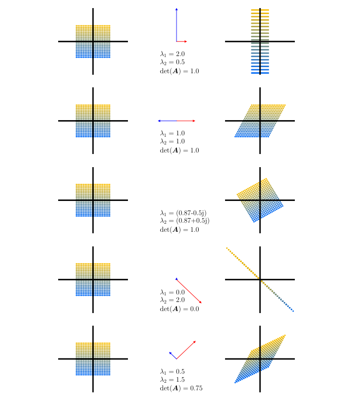
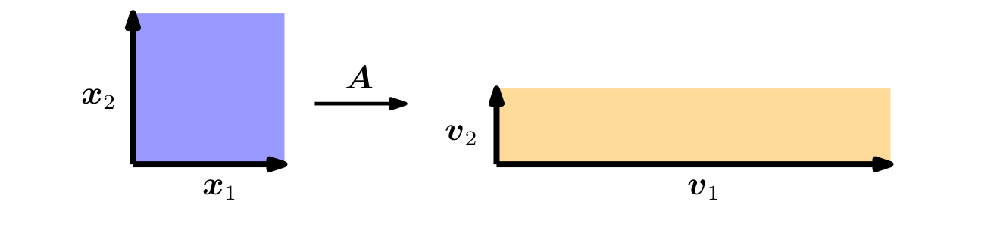

# 4.2 特征值与特征向量（Eigenvalues and Eigenvectors）

## 本节导学

**学习目标**

1. 说出特征值与特征向量的定义，理解"特征向量是被线性映射只拉伸、不旋转的方向"；
2. 会完整计算一个 $2 \times 2$ 矩阵的特征值、特征向量与特征空间（例 4.5 的流程）；
3. 分清代数重数与几何重数，知道亏损矩阵的含义；
4. 掌握谱定理（对称矩阵可正交对角化），会用格拉姆-施密特把重特征值的特征向量正交化；
5. 会用 $\det(\boldsymbol A) = \prod \lambda_i$ 和 $\operatorname{tr}(\boldsymbol A) = \sum \lambda_i$ 检验特征值计算。

**预备知识**：4.1 节（行列式、迹、特征多项式）、2.7 节（线性映射、核）、2.6 节（基）、3.5/3.8 节（正交基与格拉姆-施密特）。

**符号速查表**：

| 符号 | 读法 | 含义 |
| --- | --- | --- |
| $\boldsymbol A \boldsymbol x = \lambda \boldsymbol x$ | 特征值方程 | "x 被 A 变换后，方向不变，只缩放 $\lambda$ 倍" |
| $E_\lambda$ | 特征空间 | 对应于 $\lambda$ 的全部特征向量 + 零向量，张成的子空间 |
| 代数重数 | algebraic multiplicity | $\lambda$ 作为特征多项式**根**的次数 |
| 几何重数 | geometric multiplicity | 特征空间 $E_\lambda$ 的维数（线性无关特征向量的个数） |
| 谱（spectrum） | spectrum | 所有特征值的集合 |
| 亏损矩阵 | defective matrix | 线性无关特征向量不足 $n$ 个、无法对角化的方阵 |
| 谱定理 | spectral theorem | 对称矩阵 ⟹ 实特征值 + 特征向量可取成标准正交基 |

---

## 4.2.1 定义：只被拉伸的方向

回顾 2.7.1 节：给定基，每个线性映射都有唯一的变换矩阵。如何**解读**这个矩阵？特征分析（"eigen"是德语词，意为"自身的/特有的"）给出了一个漂亮的答案：找出那些被映射**只拉伸、不扭转**的特殊方向。

**定义 4.6**（特征值与特征向量）。设 $\boldsymbol A \in \mathbb{R}^{n \times n}$ 为方阵。若

$$
\boldsymbol A \boldsymbol x = \lambda \boldsymbol x \tag{4.25}
$$

则称 $\lambda \in \mathbb{R}$ 为 $\boldsymbol A$ 的**特征值（eigenvalue）**，非零向量 $\boldsymbol x \in \mathbb{R}^n \setminus \{\boldsymbol 0\}$ 为对应于 $\lambda$ 的**特征向量（eigenvector）**。式 (4.25) 称为**特征值方程**。

**逐字解读**：普通向量被 $\boldsymbol A$ 变换后，方向和长度都会乱变；而特征向量被变换后**仍落在原来的直线上**——只是乘了个倍数 $\lambda$。$\lambda > 1$ 拉伸，$0 < \lambda < 1$ 压缩，$\lambda < 0$ 反向。

**四个等价命题**（判断 $\lambda$ 是否为特征值的工具箱）：

1. $\lambda$ 是 $\boldsymbol A$ 的特征值；
2. $(\boldsymbol A - \lambda \boldsymbol I_n)\boldsymbol x = \boldsymbol 0$ 有非平凡解（$\boldsymbol x \neq \boldsymbol 0$）；
3. $\operatorname{rk}(\boldsymbol A - \lambda \boldsymbol I_n) < n$（矩阵不满秩）；
4. $\det(\boldsymbol A - \lambda \boldsymbol I_n) = 0$（行列式为零）。

**$2 \Rightarrow 3 \Rightarrow 4$ 的推理链**：有非零解 ⟹ 核非平凡 ⟹ 不满秩（2.7.4 节）⟹ 不可逆 ⟹ 行列式为零（定理 4.1）。第 4 条正是"特征多项式在 $\lambda$ 处取零"，即**定理 4.8**：$\lambda$ 是特征值 ⟺ $\lambda$ 是特征多项式 $p_{\boldsymbol A}$ 的根。

**两个基础概念**（定义 4.7）：指向相同的两个向量叫**同向（codirected）**；指向相同或相反方向的叫**共线（collinear）**。

> **备注**（特征向量的非唯一性）：若 $\boldsymbol x$ 是特征向量，则任意非零倍数 $c\boldsymbol x$ 也是（对应同一特征值）：

$$
\boldsymbol A(c\boldsymbol x) = c\boldsymbol A\boldsymbol x = c\lambda\boldsymbol x = \lambda(c\boldsymbol x) \tag{4.26}
$$

所以特征向量实际上指**一条方向**（特征空间里的任意非零向量）。♦

**定义 4.9**（代数重数）。特征值 $\lambda_i$ 在特征多项式中作为根出现的次数，称为其**代数重数**。

**定义 4.10**（特征空间与谱）。对应于 $\lambda$ 的所有特征向量（加上 $\boldsymbol 0$）张成的子空间

$$
E_\lambda := \{\boldsymbol x : (\boldsymbol A - \lambda \boldsymbol I)\boldsymbol x = \boldsymbol 0\} = \ker(\boldsymbol A - \lambda \boldsymbol I)
$$

称为**特征空间**；$\boldsymbol A$ 的所有特征值的集合称为**谱（spectrum）**。

几何上：非零特征值对应的特征向量指向"被线性映射拉伸的方向"，特征值就是**拉伸的比例因子**；负特征值 = 拉伸 + 方向反转。

**例 4.4（单位矩阵）**。$p_{\boldsymbol I}(\lambda) = (1-\lambda)^n$，唯一特征值 $\lambda = 1$（代数重数 $n$）。对所有 $\boldsymbol x \neq \boldsymbol 0$ 都有 $\boldsymbol I\boldsymbol x = \boldsymbol x$，所以 $E_1 = \mathbb{R}^n$——单位矩阵"不拉伸任何方向"，一切都保持原样。

**常用性质**（前两条已在本节解释，后两条是预告）：

- $\boldsymbol A$ 与 $\boldsymbol A^\top$ 特征值相同，但特征向量未必相同；
- $E_\lambda = \ker(\boldsymbol A - \lambda \boldsymbol I)$（由 (4.27a)(4.27b) 移项即得）——**特征空间 = 求核**（2.7.3 节的工具直接可用）；
- **相似矩阵特征值相同**：$\boldsymbol B = \boldsymbol S^{-1}\boldsymbol A\boldsymbol S \Rightarrow p_{\boldsymbol B}(\lambda) = \det(\boldsymbol S^{-1}(\boldsymbol A - \lambda \boldsymbol I)\boldsymbol S) = \det(\boldsymbol A - \lambda \boldsymbol I) = p_{\boldsymbol A}(\lambda)$。所以特征值与行列式、迹一样，是**线性映射的内在特征**，与基的选择无关；
- **对称正定矩阵的特征值全为正实数**（3.2.3 节正定的矩阵版表述）。

## 4.2.2 完整计算流程（例 4.5，零基础友好版）

求 $\boldsymbol A = \begin{bmatrix} 4 & 2 \\ 1 & 3 \end{bmatrix}$ 的特征值与特征向量。

**步骤 1：特征多项式**。由等价命题 4，解 $\det(\boldsymbol A - \lambda \boldsymbol I) = 0$：

$$
p_{\boldsymbol A}(\lambda) = \det\begin{bmatrix} 4 - \lambda & 2 \\ 1 & 3 - \lambda \end{bmatrix} = (4 - \lambda)(3 - \lambda) - 2 \tag{4.29}
$$

**步骤 2：求特征值（解二次方程）**：

$$
p(\lambda) = \lambda^2 - 7\lambda + 10 = (\lambda - 2)(\lambda - 5) = 0 \implies \lambda_1 = 2,\ \lambda_2 = 5 \tag{4.30}
$$

**快速检验**：$\lambda_1 + \lambda_2 = 7 = \operatorname{tr}(\boldsymbol A) = 4 + 3$ ✓；$\lambda_1 \lambda_2 = 10 = \det(\boldsymbol A) = 12 - 2$ ✓。（定理 4.16/4.17 的 $n = 2$ 特例，养成习惯！）

**步骤 3：对每个 $\lambda$ 求特征空间**。即解齐次方程组 $(\boldsymbol A - \lambda \boldsymbol I)\boldsymbol x = \boldsymbol 0$。

**$\lambda = 5$**：

$$
\begin{bmatrix} -1 & 2 \\ 1 & -2 \end{bmatrix}\begin{bmatrix} x_1 \\ x_2 \end{bmatrix} = \boldsymbol 0 \implies -x_1 + 2x_2 = 0 \implies x_1 = 2x_2 \tag{4.32}
$$

取 $x_2 = 1$，得特征向量 $(2, 1)^\top$：

$$
E_5 = \operatorname{span}\left[\begin{bmatrix} 2 \\ 1 \end{bmatrix}\right] \tag{4.33}
$$

**验证**：$\boldsymbol A(2,1)^\top = (8 + 2, 2 + 3)^\top = (10, 5)^\top = 5 \times (2,1)^\top$ ✓。

**$\lambda = 2$**：

$$
\begin{bmatrix} 2 & 2 \\ 1 & 1 \end{bmatrix}\boldsymbol x = \boldsymbol 0 \implies x_2 = -x_1 \implies E_2 = \operatorname{span}\left[\begin{bmatrix} 1 \\ -1 \end{bmatrix}\right] \tag{4.34, 4.35}
$$

**验证**：$\boldsymbol A(1,-1)^\top = (4 - 2, 1 - 3)^\top = (2, -2)^\top = 2 \times (1,-1)^\top$ ✓。

两个特征空间都是一维的（各由单个向量张成）。注意 $E_5 \perp E_2$（$(2,1)\cdot(1,-1) = 1 \neq 0$——这两个碰巧不正交；一般矩阵的特征向量不必正交，**对称矩阵才必然正交**，见谱定理）。

## 4.2.3 代数重数 vs 几何重数；亏损矩阵

**定义 4.11**（几何重数）。$\lambda_i$ 的**几何重数** = 对应于 $\lambda_i$ 的线性无关特征向量个数 = $\dim E_{\lambda_i}$。

**关键不等式**：$1 \leqslant$ 几何重数 $\leqslant$ 代数重数。**几何重数可以小于代数重数**——这正是亏损矩阵的来源。

**例 4.6（几何重数 < 代数重数）**。

$$
\boldsymbol A = \begin{bmatrix} 2 & 1 \\ 0 & 2 \end{bmatrix}, \qquad p(\lambda) = (2 - \lambda)^2
$$

$\lambda = 2$ 的代数重数为 2。但 $(\boldsymbol A - 2\boldsymbol I)\boldsymbol x = \begin{bmatrix} 0 & 1 \\ 0 & 0 \end{bmatrix}\boldsymbol x = \boldsymbol 0$ 迫使 $x_2 = 0$，解空间只有 $\operatorname{span}[(1, 0)^\top]$——几何重数 = 1。这个矩阵是**剪切**变换（对比图 4.4 中的 $\boldsymbol A_2$）：只有一个方向被保持，另一个方向被"推着走"。

**定义 4.13**（亏损矩阵）。线性无关特征向量**少于 $n$ 个**的方阵称为**亏损矩阵（defective matrix）**。

等价说法：各特征空间维数之和 $< n$，即至少有一个代数重数 $m > 1$ 的特征值，其几何重数 $< m$。亏损矩阵无法对角化（4.4 节）。（由定理 4.12：$n$ 个互不相同特征值的特征向量必线性无关，所以**亏损矩阵不可能有 $n$ 个互异特征值**。）

## 4.2.4 二维几何直觉（图 4.4）

五个 $2 \times 2$ 变换对正方形网格的作用（图 4.4 把 400 个彩色点逐一映射）：

| 矩阵 | 类型 | 特征值/特征向量 | 行列式 |
| --- | --- | --- | --- |
| $\boldsymbol A_1 = \begin{bmatrix} 1/2 & 0 \\ 0 & 2 \end{bmatrix}$ | 沿坐标轴拉伸/压缩 | $\lambda_1 = 2$（纵轴），$\lambda_2 = 1/2$（横轴） | $1$（保面积） |
| $\boldsymbol A_2 = \begin{bmatrix} 1 & 1/2 \\ 0 & 1 \end{bmatrix}$ | **剪切**（卡瓦列里等面积原理） | $\lambda = 1$ 重根，只有一个特征方向（水平轴） | $1$（保面积） |
| $\boldsymbol A_3 = \frac{1}{2}\begin{bmatrix} \sqrt{3} & -1 \\ 1 & \sqrt{3} \end{bmatrix}$ | 旋转 $30^\circ$ | **只有复特征值**（旋转不保持任何实方向） | $1$ |
| $\boldsymbol A_4 = \begin{bmatrix} 1 & -1 \\ -1 & 1 \end{bmatrix}$ | 压缩降维到一维 | $\lambda_1 = 0$（该方向坍缩），$\lambda_2 = 2$ | $0$（像的面积为 0） |
| $\boldsymbol A_5 = \begin{bmatrix} 1 & 1/2 \\ 1/2 & 1 \end{bmatrix}$ | 剪切 + 拉伸 | $\lambda_1 = 3/2$（拉伸），$\lambda_2 = 1/2$（压缩），两方向正交 | $3/4$（面积缩为 75%） |

**这张表的启示**：行列式 = 面积缩放倍数（4.1.2 节的二维版），特征值告诉你**沿哪些方向、各缩放多少**，特征向量给出这些方向。

**例 4.7（应用：生物神经网络的特征谱）**。把秀丽隐杆线虫（*C. elegans*）的 277 个神经元间的连接写成邻接矩阵 $\boldsymbol A \in \mathbb{R}^{277 \times 277}$（$a_{ij} = 1$ 表示神经元 $i$ 连接到 $j$）。$\boldsymbol A$ 不对称，特征值可能是复数，故用对称化版本 $\boldsymbol A_{\text{sym}} = \boldsymbol A + \boldsymbol A^\top$。$\boldsymbol A_{\text{sym}}$ 的特征谱（特征值按降序排列的曲线）呈典型 S 形（图 4.5）——这种谱形状是许多生物网络的共同特征，其成因是神经科学的活跃研究课题。**这就是特征分析的实际力量：用一张谱曲线概括 277×277 矩阵的结构。**

   
  <b>图 4.4 行列式与特征空间。五种线性映射及其对应的变换矩阵 Aᵢ ∈ R²ˣ² 的总览，将 400 个以颜色编码的点 x ∈ R²（左列）投射到目标点 Aᵢx（右列）。中间列描绘了由其对应的特征值 λ₁ 拉伸的第一个特征向量，以及由其特征值 λ₂ 拉伸的第二个特征向量。</b> 

## 4.2.5 谱定理：对称矩阵的"特权"

**定理 4.14**（对称化的法宝）。对任意 $\boldsymbol A \in \mathbb{R}^{m \times n}$，$\boldsymbol S := \boldsymbol A^\top \boldsymbol A \in \mathbb{R}^{n \times n}$ 总是**对称半正定**的。

**证明**（每步都可验证）：

- **对称**：$\boldsymbol S^\top = (\boldsymbol A^\top \boldsymbol A)^\top = \boldsymbol A^\top (\boldsymbol A^\top)^\top = \boldsymbol A^\top \boldsymbol A = \boldsymbol S$（用 (2.31) 转置反序）；
- **半正定**：$\boldsymbol x^\top \boldsymbol S \boldsymbol x = \boldsymbol x^\top \boldsymbol A^\top \boldsymbol A \boldsymbol x = (\boldsymbol A\boldsymbol x)^\top (\boldsymbol A \boldsymbol x) = \|\boldsymbol A \boldsymbol x\|^2 \geqslant 0$（平方和非负）。$\blacksquare$

（若 $\operatorname{rk}(\boldsymbol A) = n$，则 $\boldsymbol{Ax} \neq \boldsymbol 0$ 当 $\boldsymbol x \neq \boldsymbol 0$，不等号严格成立，$\boldsymbol S$ **正定**。）定理 4.14 是 SVD（4.5 节）的构造基石——**任意矩阵都能通过 $\boldsymbol A^\top\boldsymbol A$ 变成可完美对角化的对称矩阵**。

**定理 4.15**（谱定理 / Spectral Theorem）。若 $\boldsymbol A \in \mathbb{R}^{n \times n}$ **对称**，则：
1. 所有特征值都是**实数**；
2. 存在由 $\boldsymbol A$ 的特征向量构成的**标准正交基**（ONB）。

**直接推论**：对称矩阵的特征分解形如 $\boldsymbol A = \boldsymbol P \boldsymbol D \boldsymbol P^\top$（注意是 $\boldsymbol P^\top$ 而非 $\boldsymbol P^{-1}$——$\boldsymbol P$ 是正交矩阵！），$\boldsymbol D$ 为实对角矩阵。（4.4 节展开。）

**例 4.8（重特征值 + 格拉姆-施密特救场）**。考虑

$$
\boldsymbol A = \begin{bmatrix} 3 & 2 & 2 \\ 2 & 3 & 2 \\ 2 & 2 & 3 \end{bmatrix} \tag{4.37}
$$

（可以写成 $\boldsymbol A = \boldsymbol I + 2\boldsymbol J$，其中 $\boldsymbol J$ 是全 1 矩阵——这个观察让计算事半功倍：$\boldsymbol J$ 的特征值是 3（特征向量 $(1,1,1)^\top$）和 0（重数 2），所以 $\boldsymbol A$ 的特征值是 $1 + 2\times3 = 7$ 和 $1 + 2\times 0 = 1$（重数 2）。特征多项式：

$$
p_{\boldsymbol A}(\lambda) = -(\lambda - 1)^2(\lambda - 7) \tag{4.38}
$$

**检验**：$\operatorname{tr} = 9 = 1 + 1 + 7$ ✓；$\det = 7 = 1 \times 1 \times 7$ ✓。

标准步骤解出特征空间：

$$
E_1 = \operatorname{span}\left[\underbrace{\begin{bmatrix} -1 \\ 1 \\ 0 \end{bmatrix}}_{\boldsymbol x_1}, \ \underbrace{\begin{bmatrix} -1 \\ 0 \\ 1 \end{bmatrix}}_{\boldsymbol x_2}\right], \quad E_7 = \operatorname{span}\left[\underbrace{\begin{bmatrix} 1 \\ 1 \\ 1 \end{bmatrix}}_{\boldsymbol x_3}\right] \tag{4.39}
$$

**问题**：谱定理承诺有**正交**特征基，但 $\boldsymbol x_1^\top \boldsymbol x_2 = 1 \neq 0$——这组基不正交！怎么办？

**救场**：属于**同一特征值**的特征向量的任意线性组合仍是该特征值的特征向量——验证：对任意 $\alpha, \beta$，

$$
\boldsymbol A(\alpha \boldsymbol x_1 + \beta \boldsymbol x_2) = \alpha \boldsymbol A\boldsymbol x_1 + \beta \boldsymbol A\boldsymbol x_2 = \lambda(\alpha \boldsymbol x_1 + \beta \boldsymbol x_2) \tag{4.40}
$$

所以可以在 $E_1$ 内部自由"搅拌"。用格拉姆-施密特（3.8.3 节）把 $\boldsymbol x_1, \boldsymbol x_2$ 正交化：取 $\boldsymbol x_1' = \boldsymbol x_1$；把 $\boldsymbol x_2$ 减去它在 $\boldsymbol x_1$ 上的投影：

$$
\boldsymbol x_2' = \boldsymbol x_2 - \frac{\boldsymbol x_2^\top \boldsymbol x_1}{\|\boldsymbol x_1\|^2}\boldsymbol x_1 = \begin{bmatrix} -1 \\ 0 \\ 1 \end{bmatrix} - \frac{1}{2}\begin{bmatrix} -1 \\ 1 \\ 0 \end{bmatrix} = \frac{1}{2}\begin{bmatrix} -1 \\ -1 \\ 2 \end{bmatrix} \tag{4.41}
$$

**验证**：$\boldsymbol x_1'^\top \boldsymbol x_2' = \frac{1}{2}(1 - 1 + 0) = 0$ ✓ 正交；$\boldsymbol x_1'^\top \boldsymbol x_3 = 0$、$\boldsymbol x_2'^\top \boldsymbol x_3 = \frac{1}{2}(-1 -1 + 2) = 0$ ✓。三个向量两两正交，且都是 $\lambda = 1$ 或 $7$ 的特征向量——谱定理承诺的 ONB 到手。（$\boldsymbol x_2'$ 仍是特征向量：$\boldsymbol x_2' \in E_1$，因为它是 $\boldsymbol x_1, \boldsymbol x_2$ 的线性组合。）

## 4.2.6 特征值 ↔ 行列式 ↔ 迹

**定理 4.16**。$\det(\boldsymbol A) = \prod_{i=1}^n \lambda_i$（特征值之积，计入重数）。

**定理 4.17**。$\operatorname{tr}(\boldsymbol A) = \sum_{i=1}^n \lambda_i$（特征值之和，计入重数）。

**几何直觉**（图 4.6）：设 $\boldsymbol A \in \mathbb{R}^{2 \times 2}$ 有两个正交单位特征向量 $\boldsymbol x_1, \boldsymbol x_2$（张成单位正方形）。

- **面积**：$\boldsymbol A$ 把 $\boldsymbol x_i$ 映成 $\lambda_i \boldsymbol x_i$，单位正方形变成 $|\lambda_1| \times |\lambda_2|$ 的矩形，面积缩放 $|\lambda_1 \lambda_2| = |\det(\boldsymbol A)|$ ✓（4.1.2 节体积直觉的再现）；
- **周长**：原周长 $2(1+1) = 4$，像的矩形周长 $2(|\lambda_1| + |\lambda_2|)$——特征值绝对值之和刻画周长变化。

   
  <b>图 4.6 特征值的几何解释。A 的特征向量被对应的特征值拉伸。单位正方形的面积改变了 |λ₁λ₂| 倍，周长改变了 2(|λ₁| + |λ₂|) 倍。</b> 

**例 4.9（应用：PageRank——作为特征向量的网页）**。谷歌的核心算法：把网页间的链接建成巨大有向图，用户随机点击的行为由**转移矩阵** $\boldsymbol A$ 建模（$a_{ij}$ = 从网页 $j$ 点击到网页 $i$ 的概率）。对任意初始重要性向量 $\boldsymbol x$，序列 $\boldsymbol x, \boldsymbol{Ax}, \boldsymbol A^2\boldsymbol x, \ldots$ 收敛到 $\boldsymbol x^*$，满足

$$
\boldsymbol A \boldsymbol x^* = \boldsymbol x^*
$$

——**$\boldsymbol x^*$ 正是特征值 1 对应的特征向量**（归一化 $\|\boldsymbol x^*\| = 1$ 后各分量即网页的重要性概率）。搜索引擎排序 = 求一个特征向量！（Page et al., 1999。）

---

## 本节小结

| 概念 | 一句话 |
| --- | --- |
| 特征值/特征向量 | $\boldsymbol{Ax} = \lambda\boldsymbol x$：只被拉伸、不被扭转的方向及其缩放倍数 |
| 计算流程 | 特征多项式求根 → 对每个根解 $(\boldsymbol A - \lambda\boldsymbol I)\boldsymbol x = \boldsymbol 0$ → 特征空间 |
| 重数 | 几何重数 ≤ 代数重数；不等 ⟹ 亏损（不可对角化） |
| 谱定理 | 对称 ⟹ 实特征值 + 特征向量可正交化 |
| 检验工具 | $\sum \lambda_i = \operatorname{tr}$，$\prod \lambda_i = \det$ |

**核心技能**：给一个 $2 \times 2$ 或 $3 \times 3$ 矩阵，会完整走完"行列式 → 特征多项式 → 根 → 齐次方程组 → 特征空间 → 迹/行列式检验"全流程。

**与其他章节的关系**：特征分解是 4.4 节对角化和 4.5 节 SVD 的发动机；谱定理是 PCA（第 10 章）的理论基石；PageRank 展示特征向量作为"稳态/重要性"的物理意义。
