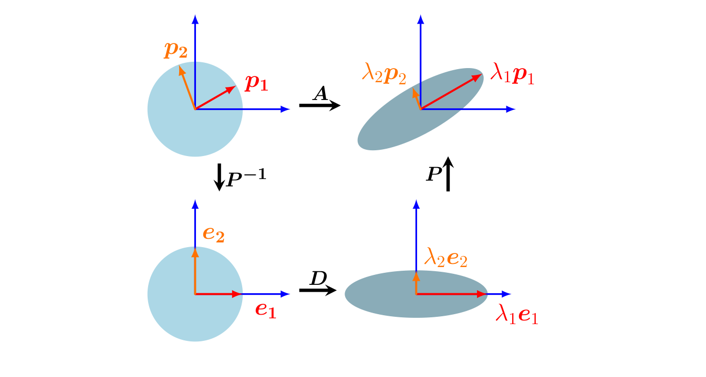

# 4.4 特征分解与对角化（Eigendecomposition and Diagonalization）

## 本节导学

**学习目标**

1. 知道对角矩阵为何"好用"（行列式、幂、逆都只需对对角元操作）；
2. 掌握核心等式 $\boldsymbol A \boldsymbol P = \boldsymbol P \boldsymbol D$ 的含义与证明；
3. 会用特征向量构造 $\boldsymbol P$ 完成对角化，并验证 $\boldsymbol P^{-1}\boldsymbol A\boldsymbol P = \boldsymbol D$；
4. 会用对角化快速计算矩阵幂和行列式；
5. 知道哪些矩阵可对角化（非亏损 / 对称），亏损矩阵怎么办（若尔当标准形，超出本书）。

**预备知识**：4.2 节（特征值与特征向量、谱定理）、2.7.3 节（相似变换 $\boldsymbol S^{-1}\boldsymbol A\boldsymbol S$）、3.4 节（正交矩阵）。

**符号速查表**：

| 符号 | 读法 | 含义 |
| --- | --- | --- |
| $\boldsymbol D$ | 对角矩阵 | 非对角元全为 0，$\boldsymbol D = \operatorname{diag}(c_1, \ldots, c_n)$ |
| $\boldsymbol A \sim \boldsymbol D$ | A 相似于 D | $\boldsymbol D = \boldsymbol P^{-1}\boldsymbol A\boldsymbol P$（同一映射换基，2.7.3 节） |
| 可对角化 | diagonalizable | 存在上述分解 |
| $\boldsymbol A^k$ | A 的 k 次幂 | $\boldsymbol A \boldsymbol A \cdots \boldsymbol A$（k 个相乘） |

---

## 4.4.1 为什么想要对角形式

**对角矩阵**（所有非对角元为零，(4.49)）是最好算的矩阵：

$$
\boldsymbol D = \begin{bmatrix} c_1 & & 0 \\ & \ddots & \\ 0 & & c_n \end{bmatrix} \tag{4.49}
$$

- $\det(\boldsymbol D) = \prod_i c_i$（4.8 节）；
- $\boldsymbol D^k = \operatorname{diag}(c_1^k, \ldots, c_n^k)$（幂只需对每个对角元取幂）；
- 对角元全非零时 $\boldsymbol D^{-1} = \operatorname{diag}(1/c_1, \ldots, 1/c_n)$。

本节的问题：给定一般方阵 $\boldsymbol A$，能否找到一组基，使 $\boldsymbol A$ 在这组基下变成对角矩阵？这正是 2.7.3 节基变换问题的特化，也是 4.2 节特征向量的主战场。

**定义 4.19**（可对角化）。若存在**可逆**矩阵 $\boldsymbol P \in \mathbb{R}^{n \times n}$ 使

$$
\boldsymbol D = \boldsymbol P^{-1} \boldsymbol A \boldsymbol P
$$

（$\boldsymbol D$ 为对角矩阵），则称 $\boldsymbol A$ **可对角化（diagonalizable）**。

## 4.4.2 核心等式 $\boldsymbol A \boldsymbol P = \boldsymbol P \boldsymbol D$

设 $\boldsymbol P = [\boldsymbol p_1, \ldots, \boldsymbol p_n]$（按列拼好），$\boldsymbol D = \operatorname{diag}(\lambda_1, \ldots, \lambda_n)$。我们证明：

> **$\boldsymbol A \boldsymbol P = \boldsymbol P \boldsymbol D$ ⟺ $\lambda_i$ 是 $\boldsymbol A$ 的特征值、$\boldsymbol p_i$ 是对应的特征向量。**

**证明**（逐列观察）：

$$
\boldsymbol A \boldsymbol P = \boldsymbol A [\boldsymbol p_1, \ldots, \boldsymbol p_n] = [\boldsymbol A \boldsymbol p_1, \ldots, \boldsymbol A \boldsymbol p_n] \tag{4.51}
$$

$$
\boldsymbol P \boldsymbol D = [\boldsymbol p_1, \ldots, \boldsymbol p_n] \begin{bmatrix} \lambda_1 & & 0 \\ & \ddots & \\ 0 & & \lambda_n \end{bmatrix} = [\lambda_1 \boldsymbol p_1, \ldots, \lambda_n \boldsymbol p_n] \tag{4.52}
$$

（第二行：矩阵乘对角矩阵 = 各列分别缩放——把 $\boldsymbol D$ 的列结构作用到 $\boldsymbol P$ 的每一列上。）两矩阵相等 ⟺ 每一列相等：

$$
\boldsymbol A \boldsymbol p_1 = \lambda_1 \boldsymbol p_1, \quad \ldots, \quad \boldsymbol A \boldsymbol p_n = \lambda_n \boldsymbol p_n \tag{4.53, 4.54}
$$

——这正是特征值方程 (4.25)。$\blacksquare$

**对角化还要求 $\boldsymbol P$ 可逆**，即 $n$ 个特征向量**线性无关**、构成 $\mathbb{R}^n$ 的基。由此得到：

**定理 4.20**（特征分解）。$\boldsymbol A$ 可分解为

$$
\boldsymbol A = \boldsymbol P \boldsymbol D \boldsymbol P^{-1} \tag{4.55}
$$

**当且仅当** $\boldsymbol A$ 的特征向量构成 $\mathbb{R}^n$ 的一组基。

**推论**：只有**非亏损**矩阵（4.2.3 节）才可对角化；$n$ 个互异特征值必可对角化（定理 4.12）。对称矩阵更幸运：

**定理 4.21**。对称矩阵 $\boldsymbol S$ 总是可对角化的。

这是谱定理（定理 4.15）的直接推论。而且对称矩阵有由特征向量构成的**标准正交基**，$\boldsymbol P$ 是**正交矩阵**（$\boldsymbol P^{-1} = \boldsymbol P^\top$，3.4 节），所以

$$
\boldsymbol D = \boldsymbol P^\top \boldsymbol A \boldsymbol P, \qquad \boldsymbol A = \boldsymbol P \boldsymbol D \boldsymbol P^\top
$$

——连求逆都省了。（亏损矩阵的"替补"是若尔当标准形（Jordan normal form，Lang, 1987），超出本书范围。）

## 4.4.3 几何直观（图 4.7）

特征分解 = 三个变换的接力（图 4.7）：

1. $\boldsymbol P^{-1}$：基变换——把特征向量 $\boldsymbol p_i$ 对齐到标准基 $\boldsymbol e_i$（在特征基下"摆正坐标系"）；
2. $\boldsymbol D$：沿各坐标轴按 $\lambda_i$ 缩放（圆被拉伸成椭圆）；
3. $\boldsymbol P$：基变换的逆——把缩放后的向量翻译回标准坐标系，得到 $\lambda_i \boldsymbol p_i$。

一句话：**先转到"只被拉伸的坐标系"，拉伸，再转回来。**

   
  <b>图 4.7 将特征分解理解为一系列连续变换的几何直观。左上到左下：P⁻¹ 执行基变换，将特征向量映射到标准基。左下到右下：D 沿着重新映射的正交特征向量进行缩放，由圆拉伸为椭圆来表示。右下到右上：P 撤销基变换并恢复原始坐标系。</b> 

## 4.4.4 完整示例（例 4.11，含逐步验证）

计算 $\boldsymbol A = \begin{bmatrix} 2 & 1 \\ 1 & 2 \end{bmatrix}$ 的特征分解。

**步骤 1：特征值与特征向量**。

$$
\det(\boldsymbol A - \lambda \boldsymbol I) = (2 - \lambda)^2 - 1 = \lambda^2 - 4\lambda + 3 = (\lambda - 1)(\lambda - 3) \tag{4.56}
$$

$\lambda_1 = 1$，$\lambda_2 = 3$。解 $(\boldsymbol A - \lambda \boldsymbol I)\boldsymbol p = \boldsymbol 0$ 并归一化（4.2.2 节流程）：

$$
\boldsymbol p_1 = \frac{1}{\sqrt{2}} \begin{bmatrix} 1 \\ -1 \end{bmatrix} \ (\lambda_1 = 1), \qquad \boldsymbol p_2 = \frac{1}{\sqrt{2}} \begin{bmatrix} 1 \\ 1 \end{bmatrix} \ (\lambda_2 = 3) \tag{4.57, 4.58}
$$

**验证**：$\boldsymbol A \boldsymbol p_1 = \frac{1}{\sqrt{2}}(2-1, 1-2)^\top = \frac{1}{\sqrt{2}}(1, -1)^\top = 1 \cdot \boldsymbol p_1$ ✓；$\boldsymbol A \boldsymbol p_2 = \frac{1}{\sqrt{2}}(3, 3)^\top = 3\boldsymbol p_2$ ✓。

**步骤 2：检验存在性**。$\boldsymbol p_1, \boldsymbol p_2$ 线性无关（不成倍数）→ 是 $\mathbb{R}^2$ 的基 → $\boldsymbol A$ 可对角化。（其实 $\boldsymbol p_1^\top \boldsymbol p_2 = 0$，还是正交的——对称矩阵的谱定理保证。）

**步骤 3：组装并验证**。

$$
\boldsymbol P = \frac{1}{\sqrt{2}} \begin{bmatrix} 1 & 1 \\ -1 & 1 \end{bmatrix} \tag{4.59}
$$

逐列验算 $\boldsymbol A \boldsymbol P = \boldsymbol P \boldsymbol D$：

$$
\boldsymbol A \boldsymbol P = \frac{1}{\sqrt{2}}\begin{bmatrix} 2 & 1 \\ 1 & 2 \end{bmatrix}\begin{bmatrix} 1 & 1 \\ -1 & 1 \end{bmatrix} = \frac{1}{\sqrt{2}}\begin{bmatrix} 1 & 3 \\ -1 & 3 \end{bmatrix}, \qquad
\boldsymbol P \boldsymbol D = \frac{1}{\sqrt{2}}\begin{bmatrix} 1 & 1 \\ -1 & 1 \end{bmatrix}\begin{bmatrix} 1 & 0 \\ 0 & 3 \end{bmatrix} = \frac{1}{\sqrt{2}}\begin{bmatrix} 1 & 3 \\ -1 & 3 \end{bmatrix} \ \checkmark
$$

再验 $\boldsymbol P^{-1} \boldsymbol A \boldsymbol P = \boldsymbol D$。由于列正交归一，$\boldsymbol P$ 是正交矩阵：$\boldsymbol P^{-1} = \boldsymbol P^\top = \frac{1}{\sqrt{2}}\begin{bmatrix} 1 & -1 \\ 1 & 1 \end{bmatrix}$（验证 $\boldsymbol P^\top \boldsymbol P = \frac{1}{2}\begin{bmatrix} 2 & 0 \\ 0 & 2 \end{bmatrix} = \boldsymbol I$ ✓）。于是

$$
\boldsymbol P^\top \boldsymbol A \boldsymbol P = \frac{1}{2}\begin{bmatrix} 1 & -1 \\ 1 & 1 \end{bmatrix}\begin{bmatrix} 1 & 3 \\ -1 & 3 \end{bmatrix} = \frac{1}{2}\begin{bmatrix} 2 & 0 \\ 0 & 6 \end{bmatrix} = \begin{bmatrix} 1 & 0 \\ 0 & 3 \end{bmatrix} = \boldsymbol D \tag{4.60} \ \checkmark
$$

即

$$
\underbrace{\begin{bmatrix} 2 & 1 \\ 1 & 2 \end{bmatrix}}_{\boldsymbol A} = \underbrace{\frac{1}{\sqrt{2}} \begin{bmatrix} 1 & 1 \\ -1 & 1 \end{bmatrix}}_{\boldsymbol P} \underbrace{\begin{bmatrix} 1 & 0 \\ 0 & 3 \end{bmatrix}}_{\boldsymbol D} \underbrace{\frac{1}{\sqrt{2}} \begin{bmatrix} 1 & -1 \\ 1 & 1 \end{bmatrix}}_{\boldsymbol P^\top} \tag{4.61}
$$

（回顾 2.7.3 节的例 2.23：同一矩阵在新基 $B = ((1,1),(1,-1))$ 下变成了对角阵——现在你知道为什么了：那两个"新基向量"正是 $\boldsymbol A$ 的特征向量！）

## 4.4.5 对角化的两大应用

**1. 快速求幂**。若 $\boldsymbol A = \boldsymbol P \boldsymbol D \boldsymbol P^{-1}$，则

$$
\boldsymbol A^k = (\boldsymbol P \boldsymbol D \boldsymbol P^{-1})^k = \underbrace{\boldsymbol P \boldsymbol D \boldsymbol P^{-1} \boldsymbol P \boldsymbol D \boldsymbol P^{-1} \cdots \boldsymbol P \boldsymbol D \boldsymbol P^{-1}}_{k \text{ 组}} = \boldsymbol P \boldsymbol D^k \boldsymbol P^{-1} \tag{4.62}
$$

（中间的 $\boldsymbol P^{-1}\boldsymbol P$ 全部消成 $\boldsymbol I$！）而 $\boldsymbol D^k$ 只需对每个对角元取 $k$ 次幂——$n \times n$ 矩阵的幂变成 $n$ 个标量的幂。这是 PageRank（例 4.9）收敛分析、图神经网络、马尔可夫链的共同工具。

**2. 快速行列式**。由乘积性质和相似不变性：

$$
\det(\boldsymbol A) = \det(\boldsymbol P)\det(\boldsymbol D)\det(\boldsymbol P^{-1}) = \det(\boldsymbol D) = \prod_{i=1}^n d_{ii} \tag{4.63}
$$

即**行列式 = 特征值之积**（定理 4.16 的推导版）。

**特征分解的局限**：它要求**方阵**且**非亏损**。对一般矩阵（尤其非方阵数据表）怎么办？下一节的奇异值分解把这一切推广出去。

---

## 本节小结

| 要点 | 内容 |
| --- | --- |
| $\boldsymbol A\boldsymbol P = \boldsymbol P\boldsymbol D$ | 逐列看就是特征值方程；$\boldsymbol P$ 可逆 ⟺ 特征向量是基 |
| 定理 4.20 | $\boldsymbol A = \boldsymbol P\boldsymbol D\boldsymbol P^{-1}$ ⟺ 非亏损 |
| 定理 4.21 | 对称 ⟹ 可对角化且 $\boldsymbol P$ 正交：$\boldsymbol A = \boldsymbol P\boldsymbol D\boldsymbol P^\top$ |
| 应用 | $\boldsymbol A^k = \boldsymbol P\boldsymbol D^k\boldsymbol P^{-1}$；$\det(\boldsymbol A) = \prod \lambda_i$ |

**与其他章节的关系**：例 2.23 的"神秘对角化"在此揭晓；SVD（4.5 节）是特征分解对任意矩阵的推广；谱分解 $\boldsymbol P\boldsymbol D\boldsymbol P^\top$ 是 PCA（第 10 章）的数学形态。
