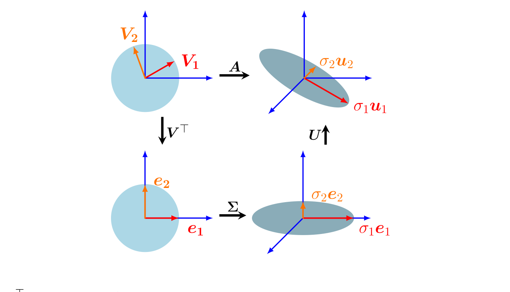
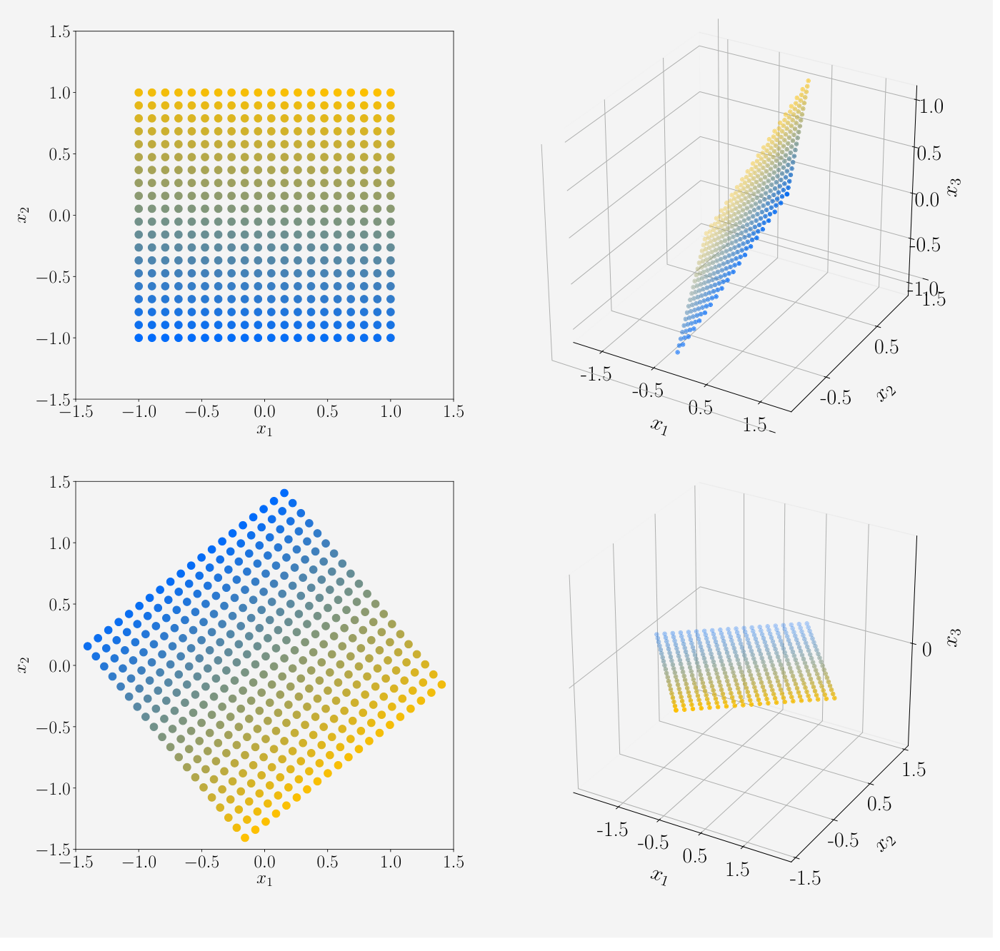
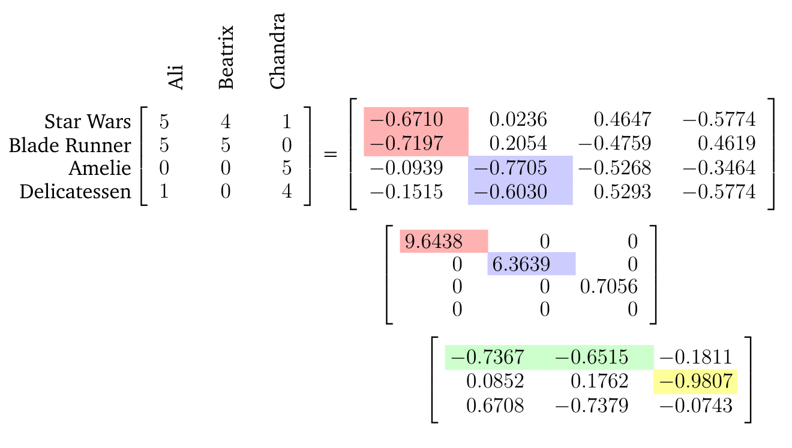

# 4.5 奇异值分解（Singular Value Decomposition, SVD）

## 本节导学

**学习目标**

1. 记住 SVD 定理：任意矩阵 $\boldsymbol A = \boldsymbol U \boldsymbol \Sigma \boldsymbol V^\top$，$\boldsymbol U, \boldsymbol V$ 正交、$\Sigma$ 非负对角；
2. 理解 SVD 的几何意义：定义域旋转 → 缩放（±升降维）→ 到达域旋转；
3. 掌握构造 SVD 的三步算法（$\boldsymbol A^\top\boldsymbol A$ 特征分解 → 奇异值 → 归一化像），并完整算完一个 $2 \times 3$ 实例；
4. 会比较 SVD 与特征分解的异同；
5. 知道完全 SVD / 简约 SVD / 截断 SVD 的区别。

**预备知识**：4.2 节（特征值、谱定理）、4.4 节（特征分解）、3.4 节（正交矩阵）、2.7.3 节（基变换）。

**符号速查表**：

| 符号 | 读法 | 含义 |
| --- | --- | --- |
| SVD | 奇异值分解 | Singular Value Decomposition |
| $\sigma_i$ | 奇异值 | $\Sigma$ 的对角元，$\sigma_1 \geqslant \sigma_2 \geqslant \cdots \geqslant 0$ |
| $\boldsymbol u_i$ / $\boldsymbol v_j$ | 左 / 右奇异向量 | $\boldsymbol U$ / $\boldsymbol V$ 的列 |
| $\boldsymbol \Sigma$ | 奇异值矩阵 | 与 $\boldsymbol A$ 同尺寸的长方"对角"矩阵 |
| $r$ | 秩 | $\boldsymbol A$ 的非零奇异值个数 $= \operatorname{rk}(\boldsymbol A)$ |
| 奇异值方程 | singular value equation | $\boldsymbol A \boldsymbol v_i = \sigma_i \boldsymbol u_i$ |

---

## 4.5.1 SVD 定理

**奇异值分解（SVD）**被称为"线性代数的基本定理"（Strang, 1993），因为与特征分解不同，它**对任意矩阵（含非方阵）总存在**。更深层的意义：它量化了线性映射 $\Phi : V \to W$ 两端向量空间几何之间的变化。

**定理 4.22**（SVD 定理）。设 $\boldsymbol A \in \mathbb{R}^{m \times n}$ 是秩为 $r$ 的任意矩阵，则

$$
\underbrace{\boldsymbol A}_{m \times n} = \underbrace{\boldsymbol U}_{m \times m} \ \underbrace{\boldsymbol \Sigma}_{m \times n} \ \underbrace{\boldsymbol V^\top}_{n \times n} \tag{4.64}
$$

其中：

- $\boldsymbol U \in \mathbb{R}^{m \times m}$：正交矩阵，列 $\boldsymbol u_1, \ldots, \boldsymbol u_m$ 叫**左奇异向量**；
- $\boldsymbol V \in \mathbb{R}^{n \times n}$：正交矩阵，列 $\boldsymbol v_1, \ldots, \boldsymbol v_n$ 叫**右奇异向量**；
- $\boldsymbol \Sigma \in \mathbb{R}^{m \times n}$：与 $\boldsymbol A$ 同尺寸，$\Sigma_{ii} = \sigma_i \geqslant 0$，非对角元全为 0。**奇异值**按降序排列 $\sigma_1 \geqslant \cdots \geqslant \sigma_r > 0$，$\sigma_{r+1} = \cdots = 0$。

**$\boldsymbol \Sigma$ 的形状**（关键细节）：$m > n$（高瘦）时，前 $n$ 行是对角结构，下面 $m - n$ 行填零 (4.65)；$m < n$（矮宽）时，前 $m$ 列是对角结构，右侧填零 (4.66)。只有 $r$ 个非零奇异值，且 $r = \operatorname{rk}(\boldsymbol A)$。

> **备注**：SVD 对任意 $\boldsymbol A \in \mathbb{R}^{m \times n}$ 都存在。♦

   
  <b>图 4.8 将矩阵 A ∈ R³ˣ² 的 SVD 理解为一系列连续变换的几何直观。左上到左下：Vᵀ 在 R² 中执行基变换。左下到右下：Σ 进行缩放并从 R² 映射到 R³。右下到右上：U 在 R³ 内部执行基变换。</b> 

### 几何直观（图 4.8）

SVD 把 $\Phi : \mathbb{R}^n \to \mathbb{R}^m$ 拆成三步接力（对照图 4.8，温习 2.7.3 节基变换与 3.4 节正交矩阵）：

1. $\boldsymbol V^\top = \boldsymbol V^{-1}$：**定义域内的基变换**——把右奇异向量 $\boldsymbol v_i$（图 4.8 左上的红/橙向量）对接到标准基上（正交矩阵 ⟹ 纯旋转/翻转）；
2. $\boldsymbol \Sigma$：**缩放 + 升降维**——在新坐标下按 $\sigma_i$ 拉伸各轴，并把 $\mathbb{R}^n$ 嵌入（或投影到）$\mathbb{R}^m$（图 4.8 右下：圆被拉成椭圆盘，躺在 $\boldsymbol e_1$-$\boldsymbol e_2$ 平面上）；
3. $\boldsymbol U$：**到达域内的基变换**——在 $\mathbb{R}^m$ 中再做一次旋转，把椭圆盘转到最终位置（图 4.8 右上）。

**与特征分解的本质区别**：特征分解在**同一个空间**里"转进去、拉伸、转回来"（$\boldsymbol P$ 与 $\boldsymbol P^{-1}$ 互为逆）；SVD 允许**定义域和到达域是两个不同维度、不同几何的空间**，$\boldsymbol U$ 与 $\boldsymbol V$ 一般互不为逆，由 $\boldsymbol \Sigma$ 把它们联系起来。

**例 4.12（向量与 SVD，数值示例）**。对 $2 \times 2$ 正方形网格点集 $\mathcal X$（图 4.9 左上），用

$$
\boldsymbol A = \begin{bmatrix} 1 & -0.8 \\ 0 & 1 \\ 1 & 0 \end{bmatrix} = \underbrace{\begin{bmatrix} -0.79 & 0 & -0.62 \\ 0.38 & -0.78 & -0.49 \\ -0.48 & -0.62 & 0.62 \end{bmatrix}}_{\boldsymbol U} \underbrace{\begin{bmatrix} 1.62 & 0 \\ 0 & 1.0 \\ 0 & 0 \end{bmatrix}}_{\boldsymbol \Sigma} \underbrace{\begin{bmatrix} -0.78 & 0.62 \\ -0.62 & -0.78 \end{bmatrix}}_{\boldsymbol V^\top} \tag{4.67}
$$

逐阶段观察：① $\boldsymbol V^\top$ 旋转 $\mathcal X$（图 4.9 左下）；② $\boldsymbol \Sigma$ 拉伸（$\sigma_1 = 1.62$ 为主）并把平面嵌入 $\mathbb{R}^3$——所有点落在 $x_1$-$x_2$ 平面、第三坐标为 0（图 4.9 右下）；③ $\boldsymbol U$ 在 $\mathbb{R}^3$ 内旋转——点云脱离坐标平面，但仍躺在**同一个平面**上（图 4.9 右上）。一个 $3 \times 2$ 矩阵的全部几何，就是"旋转 → 拉伸 → 嵌入 → 旋转"。

   
  <b>图 4.9 SVD 与向量的映射（用圆点表示）。各子图遵循与图 4.8 相同的逆时针结构。</b> 

## 4.5.2 SVD 的构造：为什么它总是存在

构造思路：SPD 矩阵的特征分解就是 SVD 的特例——若 $\boldsymbol S$ 对称正定，$\boldsymbol S = \boldsymbol P\boldsymbol D\boldsymbol P^\top$ 与 $\boldsymbol S = \boldsymbol U\boldsymbol\Sigma\boldsymbol V^\top$ 重合（取 $\boldsymbol U = \boldsymbol V = \boldsymbol P$，$\boldsymbol\Sigma = \boldsymbol D$，(4.68)–(4.70)）。一般矩阵怎么办？**用 $\boldsymbol A^\top\boldsymbol A$ 对称化**（定理 4.14）：

**第 1 步：右奇异向量来自 $\boldsymbol A^\top\boldsymbol A$ 的特征分解**。

$\boldsymbol A^\top \boldsymbol A \in \mathbb{R}^{n \times n}$ 对称半正定，由谱定理可正交对角化：

$$
\boldsymbol A^\top \boldsymbol A = \boldsymbol P \boldsymbol D \boldsymbol P^\top, \qquad \lambda_i \geqslant 0 \tag{4.71}
$$

假设 SVD 存在（$\boldsymbol A = \boldsymbol U\boldsymbol\Sigma\boldsymbol V^\top$），代入看看：

$$
\boldsymbol A^\top \boldsymbol A = (\boldsymbol U \boldsymbol \Sigma \boldsymbol V^\top)^\top (\boldsymbol U \boldsymbol \Sigma \boldsymbol V^\top) = \boldsymbol V \boldsymbol \Sigma^\top \underbrace{\boldsymbol U^\top \boldsymbol U}_{=\,\boldsymbol I} \boldsymbol \Sigma \boldsymbol V^\top = \boldsymbol V \operatorname{diag}(\sigma_1^2, \ldots, \sigma_r^2, 0, \ldots) \boldsymbol V^\top \tag{4.72, 4.73}
$$

与 (4.71) 逐项对比（谱分解唯一）：

$$
\boldsymbol V = \boldsymbol P, \qquad \sigma_i^2 = \lambda_i \tag{4.74, 4.75}
$$

——**$\boldsymbol A^\top\boldsymbol A$ 的特征向量就是右奇异向量，特征值的平方根就是奇异值。**

**第 2 步：左奇异向量来自 $\boldsymbol A\boldsymbol A^\top$ 的对称推导**。

$$
\boldsymbol A \boldsymbol A^\top = \boldsymbol U \boldsymbol \Sigma \boldsymbol V^\top \boldsymbol V \boldsymbol \Sigma^\top \boldsymbol U^\top = \boldsymbol U \operatorname{diag}(\sigma_1^2, \ldots) \boldsymbol U^\top \tag{4.76}
$$

所以 $\boldsymbol A\boldsymbol A^\top$ 的标准正交特征向量就是左奇异向量 $\boldsymbol U$。（且 $\boldsymbol A\boldsymbol A^\top$ 与 $\boldsymbol A^\top\boldsymbol A$ 的**非零特征值相同**——所以两边的 $\sigma_i$ 必然一致，$\boldsymbol \Sigma$ 的结构自然合拢。）

**第 3 步：把两边接起来——奇异值方程**。

关键观察：右奇异向量的**像** $\boldsymbol A\boldsymbol v_i$ 两两正交——对 $i \neq j$，

$$
(\boldsymbol A \boldsymbol v_i)^\top (\boldsymbol A \boldsymbol v_j) = \boldsymbol v_i^\top (\boldsymbol A^\top \boldsymbol A) \boldsymbol v_j = \lambda_j\, \boldsymbol v_i^\top \boldsymbol v_j = 0 \tag{4.77}
$$

（用了 $\boldsymbol v_j$ 是 $\boldsymbol A^\top\boldsymbol A$ 的特征向量 + 特征向量间正交。）把像归一化：

$$
\boldsymbol u_i := \frac{\boldsymbol A \boldsymbol v_i}{\|\boldsymbol A \boldsymbol v_i\|} = \frac{1}{\sqrt{\lambda_i}} \boldsymbol A \boldsymbol v_i = \frac{1}{\sigma_i} \boldsymbol A \boldsymbol v_i \tag{4.78}
$$

整理即**奇异值方程**：

$$
\boxed{\ \boldsymbol A \boldsymbol v_i = \sigma_i \boldsymbol u_i, \quad i = 1, \ldots, r\ } \tag{4.79}
$$

——与特征值方程 $\boldsymbol A\boldsymbol x = \lambda \boldsymbol x$ 神似，但左右是**不同的向量**（分属两个空间）。把 $i > r$ 的零空间方向补齐为正交集，按列拼接：$\boldsymbol A \boldsymbol V = \boldsymbol U \boldsymbol \Sigma$（(4.80)），右乘 $\boldsymbol V^\top$ 即得 $\boldsymbol A = \boldsymbol U\boldsymbol\Sigma\boldsymbol V^\top$。$\blacksquare$

**额外收获**：$i > r$ 的 $\boldsymbol v_i$ 满足 $\boldsymbol A\boldsymbol v_i = \boldsymbol 0$——**SVD 免费给出 $\boldsymbol A$ 的核的一组标准正交基**（2.7.3 节）。

**例 4.13（完整计算 SVD）**。求

$$
\boldsymbol A = \begin{bmatrix} 1 & 0 & 1 \\ -2 & 1 & 0 \end{bmatrix} \tag{4.81}
$$

的奇异值分解。

**步骤 1：算 $\boldsymbol A^\top \boldsymbol A$**（3×3）：

$$
\boldsymbol A^\top \boldsymbol A = \begin{bmatrix} 1 & -2 \\ 0 & 1 \\ 1 & 0 \end{bmatrix} \begin{bmatrix} 1 & 0 & 1 \\ -2 & 1 & 0 \end{bmatrix} = \begin{bmatrix} 5 & -2 & 1 \\ -2 & 1 & 0 \\ 1 & 0 & 1 \end{bmatrix} \tag{4.82}
$$

（逐项"行乘列"：如 $(1,1)$ 元素 $= 1\times1 + (-2)\times(-2) = 5$。）

**步骤 2：特征分解 $\boldsymbol A^\top\boldsymbol A = \boldsymbol P\boldsymbol D\boldsymbol P^\top$**（特征值 6, 1, 0——检验：迹 $= 5+1+1 = 7 = 6+1+0$ ✓；行列式为 0 ✓）：

$$
\boldsymbol P = \begin{bmatrix} \frac{5}{\sqrt{30}} & 0 & -\frac{1}{\sqrt{6}} \\ -\frac{2}{\sqrt{30}} & \frac{1}{\sqrt{5}} & -\frac{2}{\sqrt{6}} \\ \frac{1}{\sqrt{30}} & \frac{2}{\sqrt{5}} & \frac{1}{\sqrt{6}} \end{bmatrix}, \qquad \boldsymbol V := \boldsymbol P \tag{4.83, 4.84}
$$

抽查 $\boldsymbol v_1 = \frac{1}{\sqrt{30}}(5, -2, 1)^\top$ 确实是 $\lambda = 6$ 的特征向量：$(\boldsymbol A^\top\boldsymbol A)\boldsymbol v_1$ 的第一分量 $= \frac{1}{\sqrt{30}}(25 + 4 + 1) = \frac{30}{\sqrt{30}} = \sqrt{30}$，而 $6 \times \frac{5}{\sqrt{30}} = \frac{30}{\sqrt{30}} = \sqrt{30}$ ✓。

**步骤 3：奇异值矩阵**。

$$
\sigma_1 = \sqrt{6}, \quad \sigma_2 = \sqrt{1} = 1, \quad \operatorname{rk}(\boldsymbol A) = 2 \implies
\boldsymbol \Sigma = \begin{bmatrix} \sqrt{6} & 0 & 0 \\ 0 & 1 & 0 \end{bmatrix} \tag{4.85}
$$

（$\boldsymbol \Sigma$ 与 $\boldsymbol A$ 同尺寸 $2 \times 3$：对角块 + 一列零。）

**步骤 4：左奇异向量 = 归一化的像**（按 (4.78) 逐个算）：

$$
\boldsymbol u_1 = \frac{1}{\sqrt{6}} \boldsymbol A \boldsymbol v_1 = \frac{1}{\sqrt{6}} \cdot \frac{1}{\sqrt{30}} \begin{bmatrix} 1 & 0 & 1 \\ -2 & 1 & 0 \end{bmatrix} \begin{bmatrix} 5 \\ -2 \\ 1 \end{bmatrix} = \frac{1}{\sqrt{180}} \begin{bmatrix} 6 \\ -12 \end{bmatrix} = \frac{1}{\sqrt{5}}\begin{bmatrix} 1 \\ -2 \end{bmatrix} \tag{4.86}
$$

（中间：$\boldsymbol A(5,-2,1)^\top = (5+1,\ -10-2)^\top = (6,-12)^\top$；$\sqrt{6}\cdot\sqrt{30} = \sqrt{180} = 6\sqrt{5}$。）

$$
\boldsymbol u_2 = \boldsymbol A \boldsymbol v_2 = \frac{1}{\sqrt{5}} \begin{bmatrix} 1 & 0 & 1 \\ -2 & 1 & 0 \end{bmatrix} \begin{bmatrix} 0 \\ 1 \\ 2 \end{bmatrix} = \frac{1}{\sqrt{5}} \begin{bmatrix} 2 \\ 1 \end{bmatrix}, \qquad
\boldsymbol U = \frac{1}{\sqrt{5}} \begin{bmatrix} 1 & 2 \\ -2 & 1 \end{bmatrix} \tag{4.87, 4.88}
$$

**验证 $\boldsymbol U$ 正交**：两列点积 $= \frac{1}{5}(2 - 2) = 0$ ✓，各自范数 1 ✓。

**最终验证**（好习惯，抽查一个元素）：$(\boldsymbol U\boldsymbol\Sigma\boldsymbol V^\top)_{11} = \sum_k U_{1k}\Sigma_{kk}V_{1k} = \frac{1}{\sqrt{5}}\cdot\sqrt{6}\cdot\frac{5}{\sqrt{30}} + \frac{2}{\sqrt{5}}\cdot 1 \cdot 0 = \frac{\sqrt{6}}{\sqrt{5}} \cdot \frac{5}{\sqrt{30}} = \frac{5\sqrt{6}}{\sqrt{150}} = \frac{5\sqrt{6}}{5\sqrt{6}} = 1$ ✓（恰好等于 $A_{11}$）。

> **数值注记**：教科书方法（经 $\boldsymbol A^\top\boldsymbol A$）在计算机上数值稳定性差——平方会放大舍入误差。实际软件用专门算法**直接**对 $\boldsymbol A$ 做 SVD，不经 $\boldsymbol A^\top\boldsymbol A$。手算理解原理，编程交给 `numpy.linalg.svd`。

## 4.5.3 SVD 与特征分解的对比

| | 特征分解 $\boldsymbol A = \boldsymbol P\boldsymbol D\boldsymbol P^{-1}$ | SVD $\boldsymbol A = \boldsymbol U\boldsymbol\Sigma\boldsymbol V^\top$ |
| --- | --- | --- |
| 适用范围 | 仅方阵；且需非亏损 | **任意** $m \times n$ 矩阵，总存在 |
| 基向量正交性 | $\boldsymbol P$ 的列一般**不正交** | $\boldsymbol U, \boldsymbol V$ 都**标准正交**（纯旋转） |
| 三步结构 | 基变换 → 缩放 → 逆基变换（同空间） | 基变换 → 缩放升降维 → 基变换（**可跨空间**） |
| 左右矩阵关系 | $\boldsymbol P^{-1}$ 与 $\boldsymbol P$ 互逆 | $\boldsymbol U$ 与 $\boldsymbol V$ 一般互不为逆（不同空间） |
| 对角元 | 特征值（可为负、复数） | 奇异值（**非负实数**） |
| 与投影的关系 | — | 左奇异向量 = $\boldsymbol A\boldsymbol A^\top$ 的特征向量；右奇异向量 = $\boldsymbol A^\top\boldsymbol A$ 的特征向量；非零奇异值 = 两侧非零特征值的平方根 |
| 对称矩阵情形 | 两者**完全相同**（谱定理） | 同左 |

## 4.5.4 术语与约定：完全 / 简约 / 截断 SVD

文献中 SVD 有三种常见形式，数学本质相同，只是矩阵尺寸约定不同：

1. **完全 SVD（full SVD）**（本书定义 (4.64)）：$\boldsymbol U$、$\boldsymbol V$ 都是方阵，$\boldsymbol \Sigma$ 与 $\boldsymbol A$ 同尺寸（含零行/列）；
2. **简约 SVD（reduced SVD）**：只保留非零部分。对 $m \geqslant n$：$\boldsymbol A = \boldsymbol U_{m\times n}\,\boldsymbol\Sigma_{n\times n}\,\boldsymbol V^\top_{n\times n}$，$\boldsymbol\Sigma$ 是**方阵对角矩阵**（Datta, 2010; Press et al., 2007）；
3. **秩 $r$ 形式**：$\boldsymbol U$ 取 $m \times r$、$\boldsymbol \Sigma$ 取 $r \times r$、$\boldsymbol V$ 取 $r \times n$——只保留 $r$ 个非零奇异值对应的列。**截断 SVD（truncated SVD）**（4.6 节）则是在此基础上再砍到 $k < r$ 项做近似。

**例 4.14（应用：电影评分中的结构发现）**。三位观众对四部电影的评分构成数据矩阵 $\boldsymbol A \in \mathbb{R}^{4 \imes 3}$（图 4.10，行 = 电影，列 = 观众）。对 $\boldsymbol A$ 做 SVD，把**左奇异向量 $\boldsymbol u_i$ 解释为"典型电影"**、**右奇异向量 $\boldsymbol v_j$ 解释为"典型观众"**：具体观众的口味 = 典型观众的线性组合，具体电影的风格 = 典型电影的线性组合。

结果解读：$\boldsymbol u_1$ 在两部科幻片上分量很大（红色阴影）+ $\boldsymbol v_1$ 在 Ali、Beatrix 上分量很大（绿色阴影）→ $\boldsymbol v_1$ 捕捉了"**科幻影迷**"这个概念；$\boldsymbol u_2$ 捕捉法国艺术片主题，$\boldsymbol v_2$ 指向 Chandra。奇异值矩阵 $\boldsymbol\Sigma$ 的对角结构对应"科幻影迷只给科幻片打分"的纯粹性假设。**一个没有监督、没有标签的数据表，经 SVD 自动拆出了两组'潜主题'**——这就是推荐系统和主题建模的雏形。

   
  <b>图 4.10 三个人对四部电影的评分及其对应的 SVD 分解。</b> 

**SVD 在机器学习中的地位**：从曲线拟合的最小二乘到解线性方程组，它无处不在；数值上，它让计算对舍入误差稳健；更重要的是，它为"用简单矩阵近似复杂矩阵"提供了原则性工具——降维（PCA）、主题建模、数据压缩、聚类的大门由此打开（下一节）。

---

## 本节小结

| 要点 | 内容 |
| --- | --- |
| 定理 4.22 | 任意 $\boldsymbol A = \boldsymbol U\boldsymbol\Sigma\boldsymbol V^\top$；$\sigma_1 \geqslant \cdots \geqslant \sigma_r > 0$；$r = \operatorname{rk}(\boldsymbol A)$ |
| 构造三步 | $\boldsymbol A^\top\boldsymbol A$ 特征分解 → $\sigma_i = \sqrt{\lambda_i}$、$\boldsymbol V = \boldsymbol P$ → $\boldsymbol u_i = \boldsymbol A\boldsymbol v_i / \sigma_i$ |
| 奇异值方程 | $\boldsymbol A\boldsymbol v_i = \sigma_i \boldsymbol u_i$（左右异空间的"特征方程"） |
| 对比 | SVD 总存在、基正交、奇异值非负、跨空间；特征分解仅方阵非亏损 |
| 免费赠品 | 零奇异值对应的 $\boldsymbol v_i$ 给出 $\ker(\boldsymbol A)$ 的标准正交基 |

**核心技能**：给一个具体小矩阵，会走完全部四步并抽查验证；会对称矩阵说明其 SVD = 特征分解。

**与其他章节的关系**：低秩近似（4.6 节）与 PCA（10.3 节）直接建立在截断 SVD 上；伪逆（9.4 节回归）由 SVD 给出；谱方法家族（4.8 节）都源于此。
