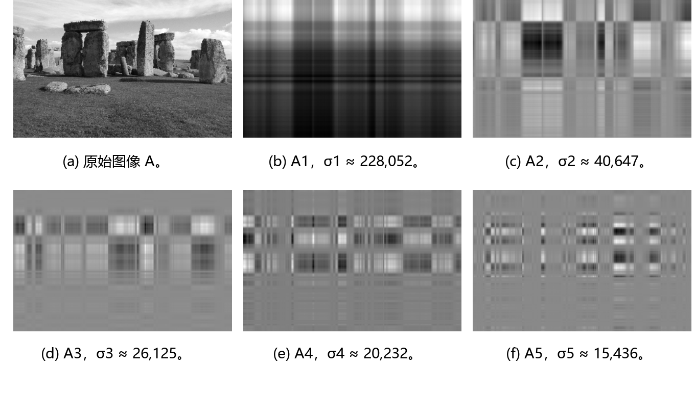
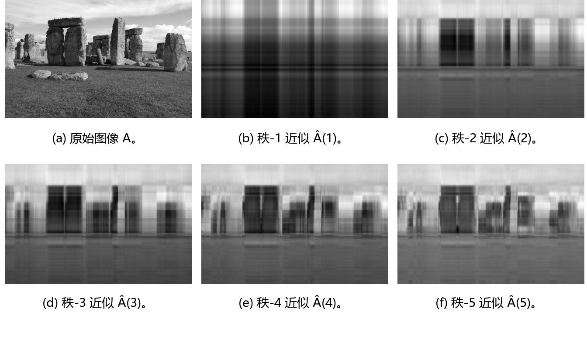

# 4.6 矩阵近似（Matrix Approximation）

## 本节导学

**学习目标**

1. 会把 SVD 重写为秩 1 矩阵之和：$\boldsymbol A = \sum_i \sigma_i \boldsymbol u_i \boldsymbol v_i^\top$；
2. 理解低秩近似 $\widehat{\boldsymbol A}(k)$ 与有损压缩（图像只需存 $0.6\%$ 的数据）；
3. 知道谱范数的定义和定理 4.24（谱范数 = 最大奇异值）；
4. 理解 Eckart-Young 定理：截断 SVD 是所有秩 $k$ 近似中**最优**的，误差 = $\sigma_{k+1}$。

**预备知识**：4.5 节（SVD）、3.1 节（范数）、2.6 节（秩）。

**符号速查表**：

| 符号 | 读法 | 含义 |
| --- | --- | --- |
| $\boldsymbol A_i = \boldsymbol u_i \boldsymbol v_i^\top$ | 秩 1 矩阵 | 左奇异向量与右奇异向量的外积 |
| $\widehat{\boldsymbol A}(k)$ | 秩 k 近似 | 前 $k$ 个秩 1 矩阵的加权和 |
| $\|\boldsymbol A\|_2$ | 谱范数 | "放大向量长度的最大倍数"（矩阵版最大伸缩率） |
| $\arg\min$ | 使……最小化的那个 | $\arg\min_{\boldsymbol B} f(\boldsymbol B)$ = 让 $f$ 最小的 $\boldsymbol B$ |

---

## 4.6.1 从 SVD 到秩 1 展开

SVD（4.5 节）把 $\boldsymbol A$ 拆成三个矩阵的乘积；换一个角度看，它把 $\boldsymbol A$ **加性展开**为一批简单的秩 1 矩阵。定义

$$
\boldsymbol A_i := \boldsymbol u_i \boldsymbol v_i^\top \tag{4.90}
$$

——左奇异向量（$m$ 维列）与右奇异向量（$n$ 维行）的**外积**，得到一个 $m \times n$ 的秩 1 矩阵。图 4.11 用巨石阵照片演示：原始图像是一个 $1432 \times 1910$ 的矩阵（灰度 0 到 1），每个 $\boldsymbol A_i$ 呈现"横向条纹 × 纵向条纹"的网格结构（外积的形状），各自被 $\sigma_i$ 加权。

由于 $\boldsymbol \Sigma$ 的对角结构，$\boldsymbol U\boldsymbol\Sigma\boldsymbol V^\top$ 的展开中所有"错配项" $\boldsymbol u_i \boldsymbol v_j^\top$（$i \neq j$）系数为零、所有 $i > r$ 的项系数为零，于是

$$
\boldsymbol A = \sum_{i=1}^r \sigma_i\, \boldsymbol u_i \boldsymbol v_i^\top = \sum_{i=1}^r \sigma_i \boldsymbol A_i \tag{4.91}
$$

——秩 $r$ 矩阵 = $r$ 个加权秩 1 矩阵之和。奇异值从大到小排列，意味着**越靠前的 $\boldsymbol A_i$ 携带越多的信息**。

   
  <b>图 4.11 使用 SVD 进行图像处理。(a) 原始灰度图像是一个取值在 0（黑）到 1（白）之间的 1432 × 1910 矩阵。(b)–(f) 秩 1 矩阵 A₁ 至 A₅ 及其对应的奇异值 σ₁ 至 σ₅。每个秩 1 矩阵的网格状结构是由左奇异向量与右奇异向量的外积决定的。</b> 

## 4.6.2 低秩近似与有损压缩

(4.91) 只取前 $k < r$ 项，得到**秩 $k$ 近似**：

$$
\widehat{\boldsymbol A}(k) := \sum_{i=1}^k \sigma_i\, \boldsymbol u_i \boldsymbol v_i^\top, \qquad \operatorname{rk}(\widehat{\boldsymbol A}(k)) = k \tag{4.92}
$$

**压缩账（图 4.12）**：巨石阵图像需存 $1432 \times 1910 = 2{,}735{,}120$ 个数；秩 5 近似只需存 5 个奇异值 + 5 个左奇异向量（1432 维）+ 5 个右奇异向量（1910 维）：

$$
5 \times (1432 + 1910 + 1) = 16{,}715 \approx \text{原始数据的 } 0.6\%
$$

而秩 5 的重建图像中巨石已经清晰可辨（图 4.12）。**SVD 把"重要信息"集中在最前面少数几项上**——这就是低秩近似的威力。

   
  <b>图 4.12 使用 SVD 进行图像重构。(a) 原始图像。(b)–(f) 使用 SVD 的低秩近似进行图像重构，其中秩 k 近似由 Â(k) = ∑_{i=1}^k σᵢ Aᵢ 给出。</b> 

## 4.6.3 谱范数与 Eckart-Young 定理

要衡量近似误差，需要矩阵版"长度"——矩阵范数。

**定义 4.23**（矩阵的谱范数）。

$$
\|\boldsymbol A\|_2 := \max_{\boldsymbol x \neq \boldsymbol 0} \frac{\|\boldsymbol A \boldsymbol x\|_2}{\|\boldsymbol x\|_2} \tag{4.93}
$$

——**$\boldsymbol A$ 能把向量长度最多放大多少倍**（最大的伸缩率）。注意下标 2：左端是矩阵范数，右端的 $\|\cdot\|_2$ 是向量欧几里得范数。

**定理 4.24**。$\|\boldsymbol A\|_2 = \sigma_1$（最大奇异值）。

**证明思路**（完整证明留作练习 4.12，这里给出关键两步）：由 SVD，$\|\boldsymbol{Ax}\| = \|\boldsymbol U\boldsymbol\Sigma\boldsymbol V^\top\boldsymbol x\| = \|\boldsymbol\Sigma(\boldsymbol V^\top\boldsymbol x)\|$（$\boldsymbol U$ 正交保范数，(3.31)）；令 $\boldsymbol y = \boldsymbol V^\top\boldsymbol x$（$\|\boldsymbol y\| = \|\boldsymbol x\|$，$\boldsymbol V^\top$ 也正交），问题化归为对角矩阵：$\max_{\boldsymbol y} \|\boldsymbol\Sigma\boldsymbol y\|/\|\boldsymbol y\| = \max_i \sigma_i = \sigma_1$（$\boldsymbol\Sigma$ 只把第 $i$ 个分量乘 $\sigma_i$，取 $\sigma_i$ 最大的方向即达到上界）。$\blacksquare$

**定理 4.25**（Eckart-Young 定理，1936）。设 $\operatorname{rk}(\boldsymbol A) = r$，$\widehat{\boldsymbol A}(k) = \sum_{i=1}^k \sigma_i \boldsymbol u_i \boldsymbol v_i^\top$，则对任意 $k \leqslant r$：

$$
\widehat{\boldsymbol A}(k) = \arg\min_{\operatorname{rk}(\boldsymbol B) = k} \|\boldsymbol A - \boldsymbol B\|_2 \quad (\text{最优性}) \tag{4.94}
$$

$$
\|\boldsymbol A - \widehat{\boldsymbol A}(k)\|_2 = \sigma_{k+1} \quad (\text{误差恰好等于下一个奇异值}) \tag{4.95}
$$

**解读**：在所有可能的秩 $k$ 矩阵中，**截断 SVD 的近似误差最小**；误差大小一目了然——就是被砍掉的第一个奇异值 $\sigma_{k+1}$。可以把秩 $k$ 近似看成"把满秩矩阵投影到秩 $\leqslant k$ 矩阵构成的低维空间上"，而 SVD 让这个投影最优。

**(4.95) 为什么成立（误差部分）**：残差矩阵正好是剩下的秩 1 项之和

$$
\boldsymbol A - \widehat{\boldsymbol A}(k) = \sum_{i=k+1}^r \sigma_i \boldsymbol u_i \boldsymbol v_i^\top \tag{4.96}
$$

——这正是 $\boldsymbol A$ 的"从第 $k+1$ 项开始的 SVD"，其最大奇异值为 $\sigma_{k+1}$；由定理 4.24，谱范数 $= \sigma_{k+1}$。✓

**(4.94) 为什么成立（反证梗概）**：假设存在秩 $\leqslant k$ 的 $\boldsymbol B$ 误差更小：$\|\boldsymbol A - \boldsymbol B\|_2 < \sigma_{k+1}$ (4.97)。$\boldsymbol B$ 的零空间 $Z$ 维数 $\geqslant n - k$（秩-零化度，定理 2.24），在 $Z$ 上 $\boldsymbol B\boldsymbol x = \boldsymbol 0$，故

$$
\|\boldsymbol{Ax}\|_2 = \|(\boldsymbol A - \boldsymbol B)\boldsymbol x\|_2 \leqslant \|\boldsymbol A - \boldsymbol B\|_2 \|\boldsymbol x\|_2 < \sigma_{k+1}\|\boldsymbol x\|_2 \tag{4.98, 4.99}
$$

（第一步用了范数的次乘性 $\|\boldsymbol{My}\| \leqslant \|\boldsymbol M\|\|\boldsymbol y\|$。）但另一方面，前 $k+1$ 个右奇异向量张成一个 $(k+1)$ 维子空间，在其上 $\|\boldsymbol{Ax}\|_2 \geqslant \sigma_{k+1}\|\boldsymbol x\|_2$（$\boldsymbol A\boldsymbol v_i = \sigma_i\boldsymbol u_i$）。两个子空间维数之和 $(n-k) + (k+1) = n+1 > n$，必有一个**非零公共向量**（$\mathbb{R}^n$ 容不下两个完全错开的这么大子空间）——对该向量，两个不等式矛盾。$\blacksquare$

**意义**：Eckart-Young 给了我们**有原则、可度量、最优**的降秩工具。低秩近似因此广泛用于图像处理、噪声滤波、病态问题正则化，以及第 10 章的 PCA 降维。

**例 4.15（电影评分的秩近似，续例 4.14）**。回到三位观众、四部电影的评分矩阵。秩 1 近似 $\boldsymbol A_1 = \boldsymbol u_1 \boldsymbol v_1^\top$（(4.100)）预测的评分矩阵中，Ali 和 Beatrix 的科幻片得分 > 4（正确！），但完全没刻画 Chandra——因为第二个主题"法国艺术片"不在第一项里。秩 1 近似 $\boldsymbol A_2$（(4.101)）正好相反。组合成秩 2 近似 $\widehat{\boldsymbol A}(2) = \sigma_1\boldsymbol A_1 + \sigma_2\boldsymbol A_2$（(4.102)）：

$$
\widehat{\boldsymbol A}(2) = \begin{bmatrix} 4.78 & 4.24 & 1.02 \\ 5.23 & 4.75 & -0.03 \\ 0.25 & -0.27 & 4.97 \\ 0.75 & 0.28 & 4.03 \end{bmatrix} \approx \boldsymbol A = \begin{bmatrix} 5 & 4 & 1 \\ 5 & 5 & 0 \\ 0 & 0 & 5 \\ 1 & 0 & 4 \end{bmatrix} \tag{4.102, 4.103}
$$

与原始评分高度吻合。**结论：数据中的"电影主题/观众类型"空间本质上是二维的**（科幻 + 法国艺术片）——第三种主题没有证据。这就是低秩近似的解释力：既压缩数据，又揭示潜结构。

---

## 本节小结

| 要点 | 内容 |
| --- | --- |
| 秩 1 展开 | $\boldsymbol A = \sum_{i=1}^r \sigma_i \boldsymbol u_i\boldsymbol v_i^\top$，前项携带主要信息 |
| 低秩近似 | $\widehat{\boldsymbol A}(k)$ 只用 $k(n+m+1)$ 个存储量 |
| 谱范数 | $\|\boldsymbol A\|_2 = \max_{\boldsymbol x}\|\boldsymbol{Ax}\|/\|\boldsymbol x\| = \sigma_1$ |
| Eckart-Young | 截断 SVD 最优，误差 $= \sigma_{k+1}$（可反证） |

**与其他章节的关系**：PCA（10.3 节）= 对数据协方差矩阵做截断特征分解；主题建模与推荐系统（本节例 4.14/4.15）；正则化与噪声滤波（第 9 章岭回归的矩阵版直觉）。
