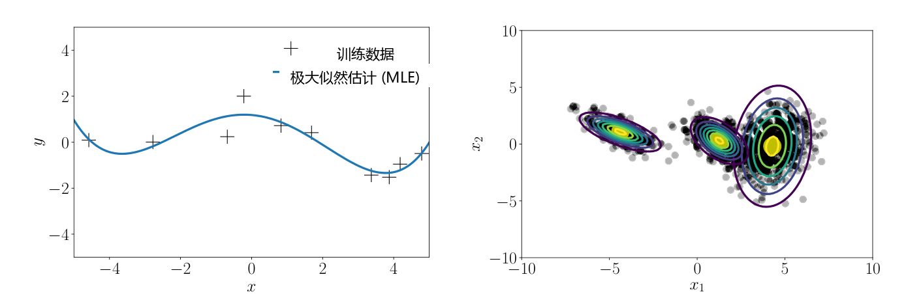
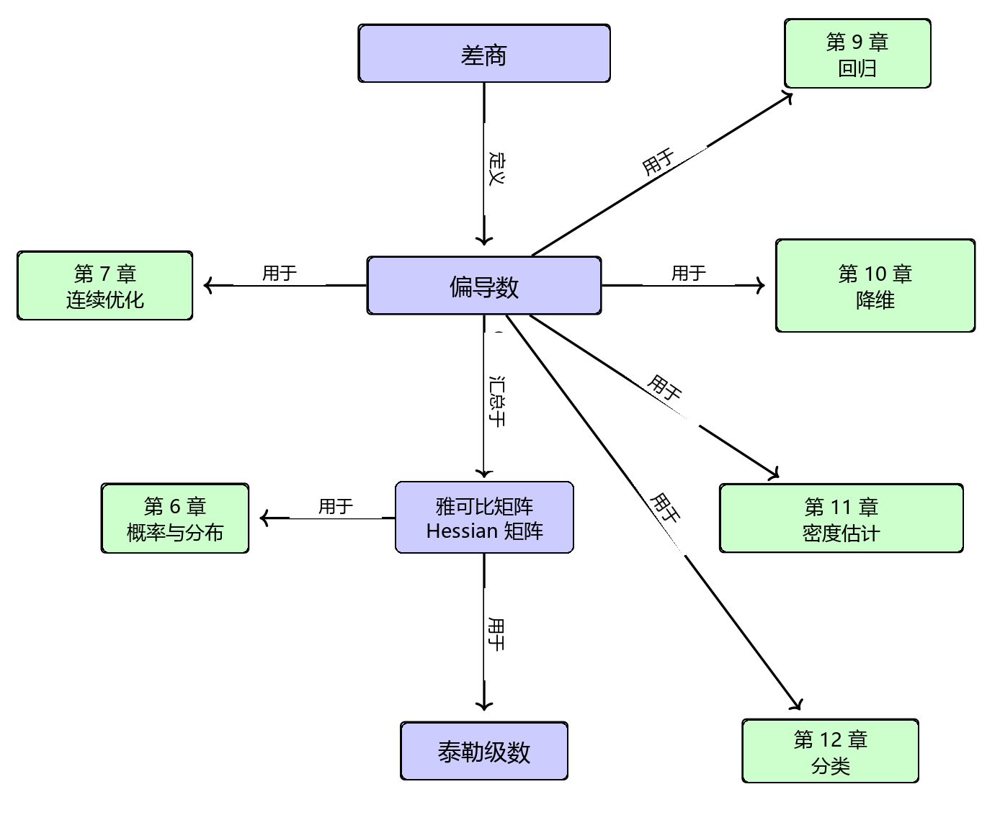

# 第 5 章 向量微积分（Vector Calculus）

## 本章导学

**学习目标**：知道本章解决的核心问题——**如何计算函数的梯度**。机器学习中的大多数算法都通过"优化目标函数"来学习模型参数：寻找好参数 = 解一个优化问题（第 7、8 章），而优化的"导航信号"就是梯度。梯度指向函数**最陡上升**的方向。

**本章的三个动机例子**：

1. **线性回归**（第 9 章）：优化线性权重，最大化似然；
2. **神经网络自编码器**：每层都有权重和偏置，通过反复应用链式法则最小化重构误差；
3. **高斯混合模型**（第 11 章）：优化每个分量的位置与形状参数，最大化似然。

图 5.1 示意了回归与密度估计中的梯度应用。这些问题的共同点是：用**带梯度信息的优化算法**（7.1 节）求解。

**函数记号的正式约定**：本章的核心对象是函数——把输入 $\boldsymbol x \in \mathbb{R}^D$（定义域）映到目标值 $f(\boldsymbol x)$（到达域）的规则，默认实值：

$$
f : \mathbb{R}^D \to \mathbb{R} \tag{5.1a}
$$

$$
\boldsymbol x \mapsto f(\boldsymbol x) \tag{5.1b}
$$

(5.1a) 指明"从 $\mathbb{R}^D$ 到 $\mathbb{R}$ 的映射"，(5.1b) 指明具体的对应规则。函数为每个输入分配**唯一**的输出。

> **例 5.1**：点积的特例——$f(\boldsymbol x) = \boldsymbol x^\top \boldsymbol x$（$\boldsymbol x \in \mathbb{R}^2$）写成：

$$
f : \mathbb{R}^2 \to \mathbb{R}, \qquad \boldsymbol x \mapsto x_1^2 + x_2^2 \tag{5.2}
$$

   
  <b>图 5.1 向量微积分在 (a) 回归（曲线拟合）和 (b) 密度估计（即数据分布建模）中起着核心作用。</b> 

**本章路线**（图 5.2）：单变量导数（5.1）→ 偏导数与梯度（5.2）→ 向量值函数的雅可比矩阵（5.3）→ 矩阵与张量的梯度（5.4）→ 常用恒等式（5.5）→ 反向传播与自动微分（5.6，深度学习的引擎）→ 高阶导数与黑塞矩阵（5.7）→ 多元泰勒级数与线性化（5.8）。

**假设声明**：本章假设所有函数都是**可微**的（对仅在个别点不可微的函数，借助次微分（subdifferential）可推广大部分内容，本书不展开）。第 7 章将处理带约束的情形。

   
  <b>图 5.2 本章介绍的概念的思维导图，以及它们在本书其他部分中的应用场景。</b> 

