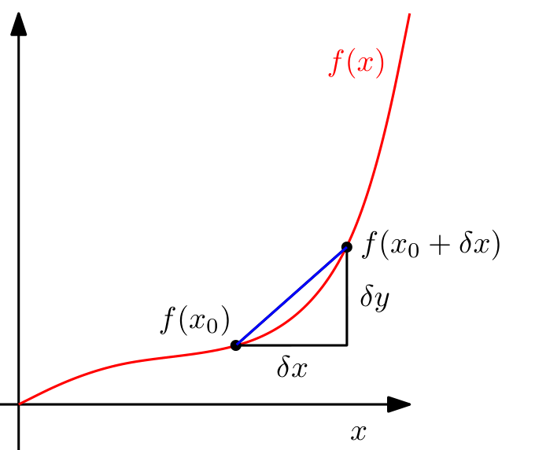
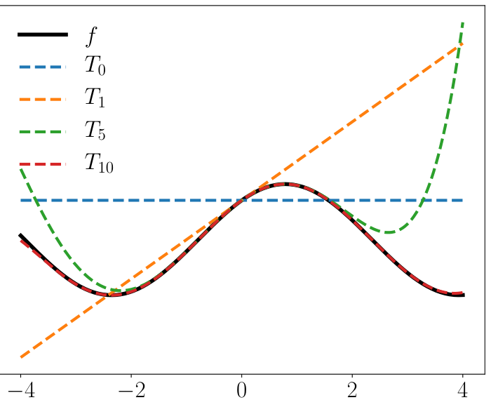

# 5.1 单变量函数微分（Differentiation of Univariate Functions）

## 本节导学

**学习目标**

1. 从差商极限的角度真正理解导数（不只是背公式）；
2. 会从导数定义出发推导基本求导公式（如 $(x^n)' = nx^{n-1}$）；
3. 掌握泰勒多项式与泰勒级数，知道"用多项式逼近函数"的思想；
4. 熟练运用乘积、商、求和、链式四条微分法则。

**预备知识**：高中数学的函数与极限直觉。

**符号速查表**：

| 符号 | 读法 | 含义 |
| --- | --- | --- |
| $\frac{\delta y}{\delta x}$ | 差商 | 割线斜率（平均变化率） |
| $\frac{\mathrm{d}f}{\mathrm{d}x}$ / $f'(x)$ | 导数 | 切线斜率（瞬时变化率） |
| $\lim_{h \to 0}$ | 极限 | h 无限趋近 0 时式子的趋向 |
| $\binom{n}{i}$ | 二项式系数 | "n 选 i"，$\frac{n!}{i!(n-i)!}$ |
| $f^{(k)}$ | f 的 k 阶导数 | 导 k 次的结果；$f^{(0)} = f$ |
| $k!$ | k 的阶乘 | $k \times (k-1) \times \cdots \times 1$ |
| $C^\infty$ | "C 无穷" | 无穷次连续可微的函数类 |

---

## 5.1.1 从割线到切线：导数的定义

**定义 5.1**（差商）。

$$
\frac{\delta y}{\delta x} := \frac{f(x + \delta x) - f(x)}{\delta x} \tag{5.3}
$$

几何意义：经过 $f$ 图像上两点 $(x_0, f(x_0))$ 和 $(x_0 + \delta x, f(x_0 + \delta x))$ 的**割线**斜率（图 5.3）——即 $f$ 在区间 $[x_0, x_0 + \delta x]$ 上的**平均**倾斜度。

   
  <b>图 5.3 函数 f 在 x₀ 与 x₀ + δx 之间的平均倾斜度是通过 f(x₀) 和 f(x₀ + δx) 的割线（蓝色）的斜率，由 δy/δx 给出。</b> 

**定义 5.2**（导数）。让 $\delta x$ 缩成 $h \to 0$，若极限存在，割线收敛为**切线**：

$$
\frac{\mathrm{d}f}{\mathrm{d}x} := \lim_{h \to 0} \frac{f(x + h) - f(x)}{h} \tag{5.4}
$$

——$f$ 在 $x$ 处的**导数** = 切线斜率 = 瞬时变化率。**导数指向 $f$ 最陡上升的方向**（这正是机器学习用梯度导航的原因）。

**例 5.2（用定义推导 $(x^n)' = nx^{n-1}$）**。已知答案，但看看它如何从极限中"长"出来：

$$
\frac{\mathrm{d}f}{\mathrm{d}x} = \lim_{h \to 0} \frac{(x + h)^n - x^n}{h} \tag{5.5a, 5.5b}
$$

用二项式定理展开 $(x + h)^n = \sum_{i=0}^n \binom{n}{i} x^{n-i} h^i$（5.5c）。注意 $i = 0$ 那一项就是 $x^n$，与分子的 $-x^n$ **相消**：

$$
= \lim_{h \to 0} \frac{\sum_{i=1}^n \binom{n}{i} x^{n-i} h^i}{h} = \lim_{h \to 0} \sum_{i=1}^n \binom{n}{i} x^{n-i} h^{i-1} \tag{5.6a, 5.6b}
$$

把 $i = 1$ 项单独提出（它是唯一不含 $h$ 的项）：

$$
= \lim_{h \to 0} \left[ \binom{n}{1} x^{n-1} + \sum_{i=2}^n \binom{n}{i} x^{n-i} h^{i-1} \right] \tag{5.6c}
$$

$h \to 0$ 时第二项整体趋于 0，只剩

$$
\frac{\mathrm{d}f}{\mathrm{d}x} = \binom{n}{1} x^{n-1} = \frac{n!}{1!(n-1)!} x^{n-1} = n x^{n-1} \tag{5.6d}
$$

**推导的灵魂**：消去常数项 → 约掉一个 $h$ → 只留下不含 $h$ 的项。所有"求导公式"本质上都是这个极限在不同函数上的具体化。

## 5.1.2 泰勒级数：用多项式逼近函数

**泰勒级数**把函数表示为无限多项之和，各项由 $f$ 在展开点 $x_0$ 处的各阶导数决定。

**定义 5.3**（泰勒多项式）。

$$
T_n(x) := \sum_{k=0}^n \frac{f^{(k)}(x_0)}{k!} (x - x_0)^k \tag{5.7}
$$

$f^{(k)}(x_0)$ 是 $k$ 阶导数在 $x_0$ 的值，$\frac{f^{(k)}(x_0)}{k!}$ 是系数。约定 $t^0 := 1$（对所有 $t$）。

**定义 5.4**（泰勒级数）。对光滑函数 $f \in C^\infty$（无穷次连续可微），

$$
T_\infty(x) = \sum_{k=0}^\infty \frac{f^{(k)}(x_0)}{k!} (x - x_0)^k \tag{5.8}
$$

$x_0 = 0$ 时称为**麦克劳林级数**。若 $f(x) = T_\infty(x)$ 处处成立，称 $f$ 是**解析的**。

**怎么理解？** $n$ 阶泰勒多项式是一个"知道 $f$ 在 $x_0$ 处函数值、斜率、弯曲程度……直到 $n$ 阶弯曲"的最匹配多项式——它在 $x_0$ 附近与 $f$ 长得最像。对次数 $\leqslant n$ 的多项式 $f$，$T_n$ **精确等于** $f$（更高阶导数全为零，备注见原书）。

**例 5.3（泰勒多项式 = 精确还原）**。$f(x) = x^4$，在 $x_0 = 1$ 处展开 $T_6$。各阶导数在 1 处的值：

$$
f(1) = 1,\ f'(1) = 4,\ f''(1) = 12,\ f^{(3)}(1) = 24,\ f^{(4)}(1) = 24,\ f^{(5)}(1) = f^{(6)}(1) = 0 \tag{5.10–5.16}
$$

代入 (5.7)（注意 $k!$ 的除法）：

$$
T_6(x) = 1 + \frac{4}{1!}(x-1) + \frac{12}{2!}(x-1)^2 + \frac{24}{3!}(x-1)^3 + \frac{24}{4!}(x-1)^4 = 1 + 4(x-1) + 6(x-1)^2 + 4(x-1)^3 + (x-1)^4 \tag{5.17}
$$

展开并整理（5.18a 按 $x$ 的幂归类）：

$$
T_6(x) = (1 - 4 + 6 - 4 + 1) + x(4 - 12 + 12 - 4) + x^2(6 - 12 + 6) + x^3(4 - 4) + x^4 = x^4 = f(x) \tag{5.18}
$$

——四次多项式被四次泰勒多项式精确还原（高阶项系数为 0），与备注的预言一致。系数 $(1, 4, 6, 4, 1)$ 正是二项式展开 $(x-1+1)^4$ 的帕斯卡三角。

**例 5.4（$\sin + \cos$ 的麦克劳林级数）**。$f(x) = \sin x + \cos x$，在 $x_0 = 0$ 处（图 5.4）：

$$
f(0) = 1,\ f'(0) = 1,\ f''(0) = -1,\ f^{(3)}(0) = -1,\ f^{(4)}(0) = 1, \ldots \tag{5.20–5.24}
$$

导数以 4 为周期循环（$f^{(k+4)}(0) = f^{(k)}(0)$），系数只有 $\pm 1$（因为 $\sin 0 = 0$ 消掉了一半）。代入：

$$
T_\infty(x) = 1 + x - \frac{x^2}{2!} - \frac{x^3}{3!} + \frac{x^4}{4!} + \frac{x^5}{5!} - \cdots = \sum_k \frac{(-1)^k}{(2k)!}x^{2k} + \sum_k \frac{(-1)^k}{(2k+1)!}x^{2k+1} = \cos x + \sin x \tag{5.25}
$$

（用了幂级数 $\cos x = \sum \frac{(-1)^k}{(2k)!}x^{2k}$、$\sin x = \sum \frac{(-1)^k}{(2k+1)!}x^{2k+1}$，(5.26)(5.27)。）图 5.4 显示 $T_{10}$ 在 $[-4, 4]$ 上已与 $f$ 高度吻合——**阶数越高，逼近的全局范围越大**。

   
  <b>图 5.4 泰勒多项式。原函数 f(x) = sin(x) + cos(x)（黑色实线）在 x₀ = 0 处由各阶泰勒多项式（虚线）逼近。高阶泰勒多项式能更好地在更大全局范围内逼近函数 f。T₁₀ 在 [-4, 4] 区间内已经与 f 高度吻合。</b> 

**备注**：泰勒级数是**幂级数** $f(x) = \sum_k a_k (x - c)^k$（(5.28)）的特例——泰勒展开给出了系数 $a_k = \frac{f^{(k)}(c)}{k!}$ 的具体形式。♦

## 5.1.3 微分法则

记 $f'$ 为 $f$ 的导数：

- **乘积法则**：$(fg)' = f'g + fg'$（(5.29)）；
- **商法则**：$(f/g)' = \frac{f'g - fg'}{g^2}$（(5.30)）；
- **求和法则**：$(f + g)' = f' + g'$（(5.31)）；
- **链式法则**：$(g \circ f)'(x) = g'(f(x))\, f'(x)$（(5.32)）——复合函数 $x \mapsto f(x) \mapsto g(f(x))$ 的导数 = 外函数在内函数处的导数 × 内函数的导数。**这条是全章最重要的法则**（5.6 节反向传播的基础）。

**例 5.5（链式法则实战）**。$h(x) = (2x+1)^4$。拆成两层：

$$
f(x) = 2x + 1 \ (\text{内}), \qquad g(f) = f^4 \ (\text{外})
$$

各层求导：$f'(x) = 2$；$g'(f) = 4f^3$。链式法则：

$$
h'(x) = g'(f)\, f'(x) = 4f^3 \cdot 2 = 8(2x+1)^3 \tag{5.33–5.38}
$$

（最后一步代回 $f = 2x+1$。）**套路**：复合函数求导 = 识别内外层 → 各自求导 → 相乘 → 代回。

---

## 本节小结

| 要点 | 内容 |
| --- | --- |
| 导数 | 差商的极限：割线 → 切线，瞬时变化率，指向最陡上升方向 |
| 泰勒级数 | 用各阶导数把函数展开成多项式；阶数越高逼近范围越大 |
| 链式法则 | 复合函数导数 = 外导 × 内导（反向传播的思想种子） |

**与其他章节的关系**：单变量微分是 5.2 节偏导数的基础；泰勒级数在 5.8 节推广到多元（线性化与黑塞矩阵），并支撑第 6 章的拉普拉斯近似；链式法则在 5.6 节长成反向传播。
