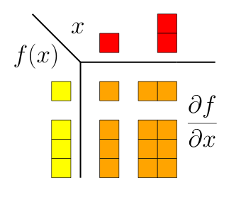
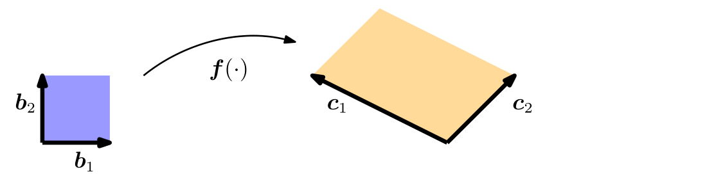

# 5.3 向量值函数的梯度（Gradients of Vector-Valued Functions）

## 本节导学

**学习目标**

1. 掌握雅可比矩阵的定义：$\boldsymbol J(i,j) = \partial f_i / \partial x_j$，维度 $m \times n$（分子布局）；
2. 理解雅可比行列式 = 局部体积缩放因子（为 6.7 节变量替换做准备）；
3. 会用"先定维度、再逐分量求偏导"的流程计算具体梯度（含链式法则复合）。

**预备知识**：5.2 节（偏导数、行向量梯度）、4.1 节（行列式 = 体积）、2.7 节（线性映射）。

**符号速查表**：

| 符号 | 读法 | 含义 |
| --- | --- | --- |
| $\boldsymbol f : \mathbb{R}^n \to \mathbb{R}^m$ | 向量值函数 / 向量场 | 输出是 $m$ 维向量的函数 |
| $\boldsymbol J$ / $\nabla_{\boldsymbol x}\boldsymbol f$ | 雅可比矩阵 | $m \times n$ 的全偏导数矩阵 |
| $\boldsymbol J(i, j) = \frac{\partial f_i}{\partial x_j}$ | 雅可比元素 | 第 $i$ 个输出对第 $j$ 个输入的偏导 |
| $|\det(\boldsymbol J)|$ | 雅可比行列式绝对值 | 变换的局部面积/体积缩放因子 |
| 分子布局 | numerator layout | 输出定义**行**、输入定义**列**（本书约定） |

---

## 5.3.1 雅可比矩阵

之前讨论的是映到实数的函数 $f : \mathbb{R}^n \to \mathbb{R}$；现在推广到**向量值函数（向量场）** $\boldsymbol f : \mathbb{R}^n \to \mathbb{R}^m$（$m > 1$）：

$$
\boldsymbol f(\boldsymbol x) = \begin{bmatrix} f_1(\boldsymbol x) \\ \vdots \\ f_m(\boldsymbol x) \end{bmatrix} \in \mathbb{R}^m, \qquad \boldsymbol x = [x_1, \ldots, x_n]^\top \in \mathbb{R}^n \tag{5.54}
$$

关键技巧：**把向量值函数看成标量函数的组合向量**——每个分量 $f_i : \mathbb{R}^n \to \mathbb{R}$ 都可以套用 5.2 节的全部法则。每个分量对 $x_i$ 的偏导数是 $m$ 维列向量（5.55)；把所有偏导数按列收集，得到梯度：

$$
\frac{\mathrm{d}\boldsymbol f(\boldsymbol x)}{\mathrm{d}\boldsymbol x} = \begin{bmatrix} \frac{\partial \boldsymbol f(\boldsymbol x)}{\partial x_1} & \cdots & \frac{\partial \boldsymbol f(\boldsymbol x)}{\partial x_n} \end{bmatrix} = \begin{bmatrix} \frac{\partial f_1}{\partial x_1} & \cdots & \frac{\partial f_1}{\partial x_n} \\ \vdots & & \vdots \\ \frac{\partial f_m}{\partial x_1} & \cdots & \frac{\partial f_m}{\partial x_n} \end{bmatrix} \in \mathbb{R}^{m \times n} \tag{5.56}
$$

**定义 5.6**（雅可比矩阵）。向量值函数的所有一阶偏导数构成的 $m \times n$ 矩阵：

$$
\boldsymbol J = \nabla_{\boldsymbol x} \boldsymbol f = \frac{\mathrm{d}\boldsymbol f(\boldsymbol x)}{\mathrm{d}\boldsymbol x}, \qquad \boldsymbol J(i, j) = \frac{\partial f_i}{\partial x_j} \tag{5.57–5.59}
$$

**记忆口诀**：**行 = 输出行（$f_i$），列 = 输入列（$x_j$）**——分子布局（numerator layout）。$m = 1$ 时退化为 5.2 节的行向量梯度 (5.40)。（也存在分母布局 = 分子布局的转置；本书统一用分子布局。）

**维度的完整图景**（图 5.6）：

| 函数类型 | 梯度维度 |
| --- | --- |
| $f : \mathbb{R} \to \mathbb{R}$ | 标量 |
| $f : \mathbb{R}^D \to \mathbb{R}$ | $1 \times D$ 行向量 |
| $\boldsymbol f : \mathbb{R} \to \mathbb{R}^E$ | $E \times 1$ 列向量 |
| $\boldsymbol f : \mathbb{R}^D \to \mathbb{R}^E$ | $E \times D$ 矩阵 |

   
  <b>图 5.6 （偏）导数的维度总结。</b> 

## 5.3.2 雅可比行列式：局部体积缩放

雅可比矩阵的一个核心用途：**变量替换时的体积缩放**。第 6.7 节变换概率分布时会大量使用。

**问题设定**：单位正方形的边 $\boldsymbol b_1 = (1,0)^\top$、$\boldsymbol b_2 = (0,1)^\top$（面积 1，(5.60)）；平行四边形的边 $\boldsymbol c_1 = (-2,1)^\top$、$\boldsymbol c_2 = (1,1)^\top$。由 4.1 节，面积 $= |\det[\boldsymbol c_1, \boldsymbol c_2]| = |-2 - 1| = 3$ (5.61)——恰好是单位正方形面积的 3 倍（图 5.5）。**这个 3 就是"从 $\boldsymbol b$ 坐标到 $\boldsymbol c$ 坐标的映射"的缩放因子**。两种求法：

   
  <b>图 5.5 f 的雅可比行列式可用于计算蓝色区域与橙色区域之间的放大倍数。</b> 

**方法 1（线性代数）**：找把 $\boldsymbol b_i$ 映到 $\boldsymbol c_i$ 的变换矩阵 $\boldsymbol J$。由于 $\boldsymbol b_i$ 是标准基，$\boldsymbol J$ 的列就是 $\boldsymbol c_i$：

$$
\boldsymbol J = \begin{bmatrix} -2 & 1 \\ 1 & 1 \end{bmatrix}, \qquad |\det(\boldsymbol J)| = |-3| = 3 \tag{5.62}
$$

**方法 2（偏导数，对非线性变换也适用）**：把坐标变换写成显式函数

$$
y_1 = -2x_1 + x_2, \qquad y_2 = x_1 + x_2 \tag{5.63, 5.64}
$$

逐对求偏导并组装雅可比：

$$
\boldsymbol J = \begin{bmatrix} \frac{\partial y_1}{\partial x_1} & \frac{\partial y_1}{\partial x_2} \\ \frac{\partial y_2}{\partial x_1} & \frac{\partial y_2}{\partial x_2} \end{bmatrix} = \begin{bmatrix} -2 & 1 \\ 1 & 1 \end{bmatrix}, \qquad |\det(\boldsymbol J)| = 3 \tag{5.65, 5.66}
$$

**结论**：**雅可比行列式 $|\det(\boldsymbol J)|$ = 坐标变换下的局部面积/体积缩放因子**。线性变换时两种方法完全一致（本例都给出 3）；**非线性变换**时，雅可比矩阵在局部用线性变换逼近非线性变换，$|\det(\boldsymbol J)|$ 给出**每一点附近的**局部缩放。这是 6.7 节"变量替换改变概率密度"的数学基础，也是深度学习中**重参数化技巧**的基础。

## 5.3.3 计算实例

**例 5.9（线性映射的梯度）**。$\boldsymbol f(\boldsymbol x) = \boldsymbol A\boldsymbol x$，$\boldsymbol A \in \mathbb{R}^{M \times N}$，$\boldsymbol x \in \mathbb{R}^N$。

**第一步定维度**：$\boldsymbol f : \mathbb{R}^N \to \mathbb{R}^M$ ⟹ $\frac{\mathrm{d}\boldsymbol f}{\mathrm{d}\boldsymbol x} \in \mathbb{R}^{M \times N}$。

**第二步逐分量**：$f_i(\boldsymbol x) = \sum_{j=1}^N A_{ij} x_j$，对 $x_j$ 求偏导时只有第 $j$ 项存活：

$$
\frac{\partial f_i}{\partial x_j} = A_{ij} \tag{5.67}
$$

**第三步组装**：雅可比矩阵恰是 $\boldsymbol A$ 本身：

$$
\frac{\mathrm{d}\boldsymbol f}{\mathrm{d}\boldsymbol x} = \boldsymbol A \tag{5.68}
$$

——**线性映射的导数就是它自己的矩阵**！（这正是"导数 = 最佳线性逼近"在已线性时的必然结果。）

**例 5.10（链式法则：标量 ∘ 向量）**。$h(t) = (f \circ \boldsymbol g)(t)$，其中 $f(\boldsymbol x) = \exp(x_1 x_2^2)$，$\boldsymbol g(t) = (t\cos t,\ t\sin t)^\top$。

**定维度**：$\frac{\partial f}{\partial \boldsymbol x} \in \mathbb{R}^{1 \times 2}$，$\frac{\partial \boldsymbol g}{\partial t} \in \mathbb{R}^{2 \times 1}$ ⟹ $\frac{\mathrm{d}h}{\mathrm{d}t}$ 是标量。

**链式法则**（内层导数是列向量）：

$$
\frac{\mathrm{d}h}{\mathrm{d}t} = \begin{bmatrix} \exp(x_1x_2^2)\, x_2^2 & 2\exp(x_1x_2^2)\, x_1 x_2 \end{bmatrix} \begin{bmatrix} \cos t - t\sin t \\ \sin t + t\cos t \end{bmatrix} \tag{5.74}
$$

$$
= \exp(x_1 x_2^2)\big( x_2^2(\cos t - t \sin t) + 2x_1 x_2(\sin t + t \cos t) \big) \tag{5.74c}
$$

其中 $x_1 = t\cos t$、$x_2 = t\sin t$ 最后代回。维度检查：$1 \times 2$ 乘 $2 \times 1$ = 标量 ✓。

**例 5.11（最小二乘损失的梯度——回归的雏形）**。线性模型 $\boldsymbol y = \boldsymbol\Phi\boldsymbol\theta$（$\boldsymbol\theta \in \mathbb{R}^D$ 参数，$\boldsymbol\Phi \in \mathbb{R}^{N \times D}$ 特征，$\boldsymbol y \in \mathbb{R}^N$ 观测——第 9 章回归的完整版）。定义平方损失

$$
L(\boldsymbol e) = \|\boldsymbol e\|^2, \qquad \boldsymbol e(\boldsymbol\theta) = \boldsymbol y - \boldsymbol\Phi\boldsymbol\theta \tag{5.76, 5.77}
$$

求 $\frac{\partial L}{\partial \boldsymbol\theta}$（第 9 章需要它找最优参数）。

**定维度**：$L$ 标量、$\boldsymbol\theta$ 有 $D$ 个分量 ⟹ $\frac{\partial L}{\partial \boldsymbol\theta} \in \mathbb{R}^{1 \times D}$。

**链式法则分解**：$\frac{\partial L}{\partial \boldsymbol\theta} = \frac{\partial L}{\partial \boldsymbol e}\, \frac{\partial \boldsymbol e}{\partial \boldsymbol\theta}$，其中第 $d$ 个元素为 $\sum_n \frac{\partial L}{\partial e_n}\frac{\partial e_n}{\partial \theta_d}$（Python 中 `dLdtheta = np.einsum('n,nd', dLde, dedtheta)`）。

**逐段计算**：

- $\|\boldsymbol e\|^2 = \boldsymbol e^\top \boldsymbol e$（3.2 节），逐分量求导：$\frac{\partial L}{\partial \boldsymbol e} = 2\boldsymbol e^\top \in \mathbb{R}^{1 \times N}$（(5.81)）；
- $\boldsymbol e = \boldsymbol y - \boldsymbol\Phi\boldsymbol\theta$ 关于 $\boldsymbol\theta$ 线性：$\frac{\partial \boldsymbol e}{\partial \boldsymbol\theta} = -\boldsymbol\Phi \in \mathbb{R}^{N \times D}$（用例 5.9 的结论 + 常数项导数为零）。

**合并**：

$$
\frac{\partial L}{\partial \boldsymbol\theta} = 2\boldsymbol e^\top \cdot (-\boldsymbol\Phi) = -2\boldsymbol e^\top \boldsymbol\Phi \stackrel{(5.77)}{=} -2(\boldsymbol y^\top - \boldsymbol\theta^\top \boldsymbol\Phi^\top)\boldsymbol\Phi \in \mathbb{R}^{1 \times D} \tag{5.83}
$$

（维度核对：$1 \times N$ 乘 $N \times D$ → $1 \times D$ ✓。）

**备注**：不用链式法则、直接展开 $L_2(\boldsymbol\theta) = (\boldsymbol y - \boldsymbol\Phi\boldsymbol\theta)^\top(\boldsymbol y - \boldsymbol\Phi\boldsymbol\theta)$ 也能得到同样结果；对这么简单的函数直接法尚可，但对深层复合函数（5.6 节的神经网络）链式分解是唯一可行的路。♦

---

## 本节小结

| 要点 | 内容 |
| --- | --- |
| 雅可比矩阵 | $m \times n$，$\boldsymbol J(i,j) = \partial f_i / \partial x_j$；分子布局：行=输出、列=输入 |
| 计算套路 | 先定维度 → 逐分量求偏导 → 按行=输出、列=输入组装 |
| 雅可比行列式 | $|\det \boldsymbol J|$ = 局部体积缩放因子（变量替换的钥匙） |
| 线性映射 | $\frac{\mathrm{d}(\boldsymbol{Ax})}{\mathrm{d}\boldsymbol x} = \boldsymbol A$ |

**与其他章节的关系**：例 5.11 是第 9 章线性回归求导的预演；雅可比行列式直通 6.7 节变量替换（概率密度变换）；反向传播（5.6 节）是雅可比的链式乘积。
