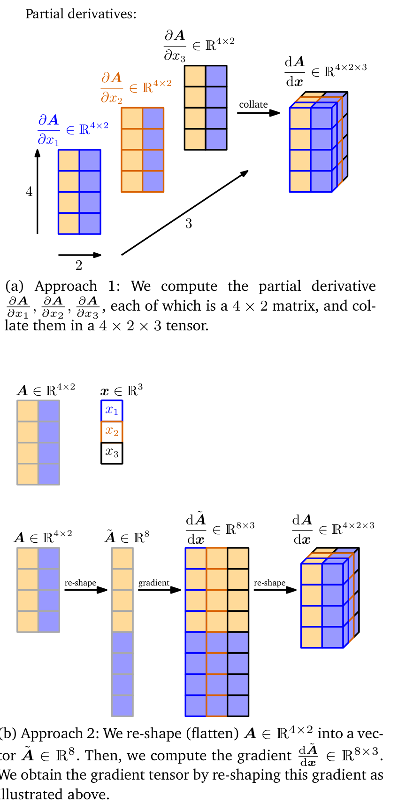

# 5.4 矩阵的梯度（Gradients of Matrices）

## 本节导学

**学习目标**

1. 知道"矩阵关于矩阵求导"会产生**四维张量**，以及两种处理方式（张量 vs 向量化）；
2. 掌握"先定维度 → 显式写出分量 → 逐个求偏导"的张量梯度计算套路（例 5.12、5.13）；
3. 理解为什么实践中更推荐把矩阵**展平成向量**再求雅可比矩阵。

**预备知识**：5.3 节（雅可比矩阵）、4.1 节（迹）、2.7 节（向量空间同构）。

**符号速查表**：

| 符号 | 读法 | 含义 |
| --- | --- | --- |
| 张量（tensor） | 多维数组 | 带 $k$ 个索引的数组；矩阵是 2 阶张量 |
| $J_{ijkl} = \partial A_{ij} / \partial B_{kl}$ | 张量元素 | 输出的 $(i,j)$ 元素对输入的 $(k,l)$ 元素的偏导 |
| 展平 / 向量化 | flatten / vec | 把矩阵按列堆叠成长向量 |
| $\boldsymbol A_{i,:}$ | A 的第 i 行 | 行切片记号 |

---

## 5.4.1 张量与向量化

当函数的自变量或值是**矩阵**时，梯度会变成**张量**（多维数组）。例如 $m \times n$ 矩阵 $\boldsymbol A$ 关于 $p \times q$ 矩阵 $\boldsymbol B$ 求导，得到 $(m \times n) \times (p \times q)$ 的**四维张量** $\boldsymbol J$，元素为

$$
J_{ijkl} = \frac{\partial A_{ij}}{\partial B_{kl}}.
$$

**两条处理路线**（图 5.7 可视化）：

- **(a) 张量路线**：把偏导数直接整理成雅可比张量。维度迅速膨胀，链式法则需要对"哪些维度求和"格外小心；
- **(b) 向量化路线**（实践中更常用）：利用 $\mathbb{R}^{m \times n}$ 与 $\mathbb{R}^{mn}$ 之间的**向量空间同构**（线性可逆映射，2.7 节定理 2.17 的实例）——把矩阵**展平**（按列堆叠）成长度 $mn$ 和 $pq$ 的向量，再对向量求导，得到普通的 $mn \times pq$ **雅可比矩阵**。链式法则 (5.48) 简化为普通矩阵乘法。

   
  <b>图 5.7 矩阵关于向量的梯度计算可视化。我们关注计算矩阵 A ∈ ℝ⁴ˣ² 关于向量 x ∈ ℝ³ 的梯度。已知梯度 dA/dx ∈ ℝ⁴ˣ²ˣ³。我们采用两种等价方法得出结果：(a) 将偏导数整理为雅可比张量；(b) 将矩阵展平为向量，计算雅可比矩阵，再重塑为雅可比张量。</b> 

## 5.4.2 例 5.12：向量关于矩阵的梯度

$$
\boldsymbol f = \boldsymbol A \boldsymbol x, \qquad \boldsymbol f \in \mathbb{R}^M,\ \boldsymbol A \in \mathbb{R}^{M \times N},\ \boldsymbol x \in \mathbb{R}^N \tag{5.85}
$$

求 $\frac{\mathrm{d}\boldsymbol f}{\mathrm{d}\boldsymbol A}$。

**第 1 步：定维度**。$\boldsymbol f$ 有 $M$ 个分量、$\boldsymbol A$ 有 $M \times N$ 个元素：

$$
\frac{\mathrm{d}\boldsymbol f}{\mathrm{d}\boldsymbol A} \in \mathbb{R}^{M \times (M \times N)} \tag{5.86}
$$

——一个三阶张量。按定义把每个分量的梯度竖着堆：

$$
\frac{\mathrm{d}\boldsymbol f}{\mathrm{d}\boldsymbol A} = \begin{bmatrix} \frac{\partial f_1}{\partial \boldsymbol A} \\ \vdots \\ \frac{\partial f_M}{\partial \boldsymbol A} \end{bmatrix}, \qquad \frac{\partial f_i}{\partial \boldsymbol A} \in \mathbb{R}^{1 \times (M \times N)} \tag{5.87}
$$

**第 2 步：显式写分量**。矩阵-向量乘法的分量形式：

$$
f_i = \sum_{j=1}^N A_{ij} x_j \tag{5.88}
$$

**第 3 步：逐个求偏导**。$f_i$ 只依赖 $\boldsymbol A$ 的**第 $i$ 行**：对行内元素

$$
\frac{\partial f_i}{\partial A_{iq}} = x_q \tag{5.89}
$$

即"第 $i$ 行对第 $i$ 行的偏导是 $\boldsymbol x^\top$"；对其他行的偏导是零：

$$
\frac{\partial f_i}{\partial \boldsymbol A_{i,:}} = \boldsymbol x^\top \in \mathbb{R}^{1 \times 1 \times N}, \qquad \frac{\partial f_i}{\partial \boldsymbol A_{k \neq i, :}} = \boldsymbol 0^\top \tag{5.90, 5.91}
$$

**第 4 步：组装**。把 (5.91) 的各行堆进 (5.87) 的"第 $i$ 块"：

$$
\frac{\partial f_i}{\partial \boldsymbol A} = \begin{bmatrix} \boldsymbol 0^\top \\ \vdots \\ \boldsymbol x^\top \ (\text{第 } i \text{ 行}) \\ \vdots \\ \boldsymbol 0^\top \end{bmatrix} \in \mathbb{R}^{1 \times (M \times N)} \tag{5.92}
$$

——只有第 $i$ 行位置是非零的 $\boldsymbol x^\top$。**直觉**：$f_i$ 是 $\boldsymbol A$ 第 $i$ 行与 $\boldsymbol x$ 的点积，所以它对其他行的变化"无感"。

## 5.4.3 例 5.13：矩阵关于矩阵的梯度

$$
\boldsymbol f(\boldsymbol R) = \boldsymbol R^\top \boldsymbol R =: \boldsymbol K \in \mathbb{R}^{N \times N}, \qquad \boldsymbol R \in \mathbb{R}^{M \times N} \tag{5.93}
$$

求 $\frac{\mathrm{d}\boldsymbol K}{\mathrm{d}\boldsymbol R}$。

**第 1 步：定维度**。

$$
\frac{\mathrm{d}\boldsymbol K}{\mathrm{d}\boldsymbol R} \in \mathbb{R}^{(N \times N) \times (M \times N)} \tag{5.94}
$$

四维张量；对每个 $p, q$：$\frac{\mathrm{d}K_{pq}}{\mathrm{d}\boldsymbol R} \in \mathbb{R}^{1 \times M \times N}$（5.95）。

**第 2 步：写分量**。记 $\boldsymbol R$ 的第 $i$ 列为 $\boldsymbol r_i$，则 $\boldsymbol K$ 的元素是列之间的点积：

$$
K_{pq} = \boldsymbol r_p^\top \boldsymbol r_q = \sum_{m=1}^M R_{mp} R_{mq} \tag{5.96}
$$

**第 3 步：求偏导**。

$$
\frac{\partial K_{pq}}{\partial R_{ij}} = \sum_{m=1}^M \frac{\partial}{\partial R_{ij}}(R_{mp} R_{mq}) =: \partial_{pqij} \tag{5.97}
$$

逐项分析：$R_{mp}R_{mq}$ 中含有 $R_{ij}$ 只有当 ($m = i$ 且 $p = j$) 或 ($m = i$ 且 $q = j$)。求和后：

$$
\partial_{pqij} = \begin{cases} R_{iq} & j = p,\ p \neq q \\ R_{ip} & j = q,\ p \neq q \\ 2R_{iq} & j = p,\ p = q \\ 0 & \text{其他} \end{cases} \tag{5.98}
$$

**直觉解读**：$K_{pq}$ 是"第 $p$ 列与第 $q$ 列的点积"——
- 改第 $p$ 列的第 $i$ 个分量（$j = p$），两个因子各贡献一次：$p \neq q$ 时得 $R_{iq}$，$p = q$ 时是平方项导数得 $2R_{iq}$；
- 改第 $q$ 列同理（$j = q$）：得 $R_{ip}$；
- 改其他任何列：$K_{pq}$ 无感，偏导为 0。

张量的每个元素都由 (5.98) 给出，其中 $p, q, j = 1, \ldots, N$，$i = 1, \ldots, M$。

**备注（张量上的迹与转置）**：导数是高阶张量时，通常的迹和转置没有定义。$D \times D \times E \times F$ 维张量的"迹"是一个 $E \times F$ 矩阵（**张量缩并** tensor contraction 的特例）；对张量"转置"指对换前两个维度。式 (5.99)–(5.102)（5.5 节）在多元函数情形需要这类张量运算——除非选择向量化。♦
