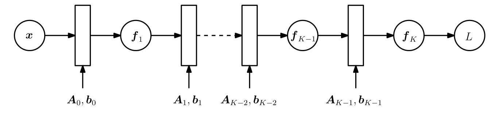
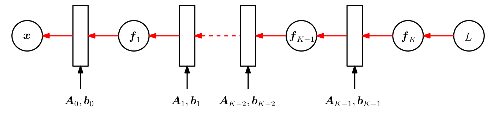
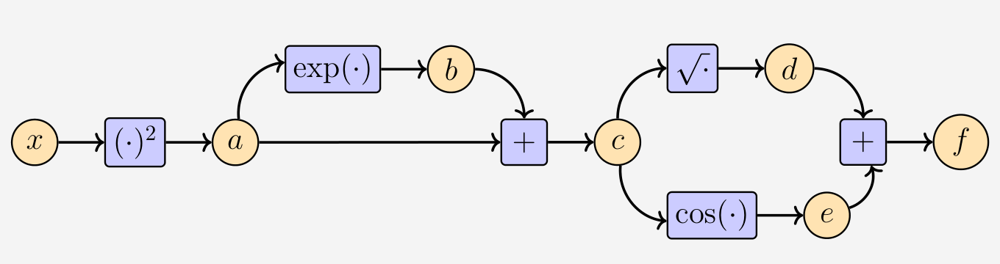

# 5.6 反向传播与自动微分（Backpropagation and Automatic Differentiation）

## 本节导学

**学习目标**

1. 理解为什么显式写出梯度表达式在深度网络中不可行；
2. 掌握反向传播的思想：链式法则 + **中间结果的复用**；
3. 会用"中间变量 + 计算图"手工完成一次反向传播（例 5.14）；
4. 知道前向模式与反向模式自动微分的区别，以及为什么神经网络选反向模式。

**预备知识**：5.2 节（链式法则）、5.3 节（雅可比矩阵）、5.1 节微分法则。

**符号速查表**：

| 符号 | 读法 | 含义 |
| --- | --- | --- |
| 反向传播 | backpropagation | 从输出往输入逐层传梯度的算法 |
| 自动微分 | automatic differentiation | 在数值上（非符号）精确求导的通用技术 |
| 前向 / 反向模式 | forward / reverse mode | 梯度沿数据流向 / 逆数据流向传播 |
| 中间变量 | intermediate variables | 为分解复合函数引入的辅助变量 |
| $\mathrm{Pa}(x_i)$ | x_i 的父节点 | 计算图中直接指向 $x_i$ 的变量集合 |

---

## 5.6.0 动机：显式梯度的崩溃

许多机器学习应用通过**梯度下降**（7.1 节）寻找模型参数，前提是能计算目标函数对参数的梯度。链式法则（5.2.2 节）原则上总能给出梯度，但看一个例子就知道"显式展开"为什么行不通：

$$
f(x) = \sqrt{x^2 + \exp(x^2)} + \cos(x^2 + \exp(x^2)) \tag{5.109}
$$

硬用链式法则（求和法则 + 微分线性性）：

$$
\frac{\mathrm{d}f}{\mathrm{d}x} = \frac{2x + 2x\exp(x^2)}{2\sqrt{x^2 + \exp(x^2)}} - \sin(x^2 + \exp(x^2))\,(2x + 2x\exp(x^2)) \tag{5.110}
$$

——已经又长又容易写错；注意其中 $\boldsymbol x^2 + \exp(x^2)$ 和 $2x + 2x\exp(x^2)$ **各出现了两次**。网络更深时，表达式长度爆炸，梯度实现的计算开销可能远超函数本身。深度网络的解决方案是**反向传播**（Kelley, 1960; Bryson, 1961; Dreyfus, 1962; Rumelhart et al., 1986）。

> 备注：关于反向传播与链式法则的讨论，亦可参阅 Tim Vieira 的博文（tinyurl.com/ycfm2yrw）。♦

## 5.6.1 深度网络中的梯度

深度学习的函数值是**多层复合**：

$$
\boldsymbol y = (f_K \circ f_{K-1} \circ \cdots \circ f_1)(\boldsymbol x) = f_K(f_{K-1}(\cdots(f_1(\boldsymbol x))\cdots)) \tag{5.111}
$$

$\boldsymbol x$ 是输入（如图像），$\boldsymbol y$ 是输出（如类别标签），每层 $f_i$ 有自己的参数。典型的一层：

$$
f_i(\boldsymbol x_{i-1}) = \sigma(\boldsymbol A_{i-1}\boldsymbol x_{i-1} + \boldsymbol b_{i-1}) \tag{5.113}
$$

$\sigma$ 是**激活函数**（如逻辑 sigmoid $\frac{1}{1+e^{-x}}$、$\tanh$、ReLU）。递归定义

$$
\boldsymbol f_0 := \boldsymbol x, \qquad \boldsymbol f_i := \sigma_i(\boldsymbol A_{i-1}\boldsymbol f_{i-1} + \boldsymbol b_{i-1}),\quad i = 1, \ldots, K \tag{5.112, 5.113}
$$

（图 5.8 前向传播示意。）训练目标：最小化平方损失

$$
L(\boldsymbol \theta) = \|\boldsymbol y - \boldsymbol f_K(\boldsymbol\theta, \boldsymbol x)\|^2, \qquad \boldsymbol\theta = \{\boldsymbol A_0, \boldsymbol b_0, \ldots, \boldsymbol A_{K-1}, \boldsymbol b_{K-1}\} \tag{5.114}
$$

   
  <b>图 5.8 多层神经网络中的前向传播，用于将损失 L 计算为输入 x 和参数 Aᵢ, bᵢ 的函数。</b> 

**链式法则逐层展开**。对每层参数 $\boldsymbol\theta_i = \{\boldsymbol A_i, \boldsymbol b_i\}$：

$$
\frac{\partial L}{\partial \boldsymbol \theta_{K-1}} = \frac{\partial L}{\partial \boldsymbol f_K}\ {\color{blue}\frac{\partial \boldsymbol f_K}{\partial \boldsymbol\theta_{K-1}}} \tag{5.115}
$$

$$
\frac{\partial L}{\partial \boldsymbol \theta_{K-2}} = \frac{\partial L}{\partial \boldsymbol f_K}\ {\color{orange}\frac{\partial \boldsymbol f_K}{\partial \boldsymbol f_{K-1}}}\ \boxed{{\color{orange}\frac{\partial \boldsymbol f_{K-1}}{\partial \boldsymbol f_{K-2}}}\ {\color{blue}\frac{\partial \boldsymbol f_{K-2}}{\partial \boldsymbol\theta_{K-2}}}} \tag{5.116}
$$

$$
\frac{\partial L}{\partial \boldsymbol \theta_{K-3}} = \frac{\partial L}{\partial \boldsymbol f_K}\ {\color{orange}\frac{\partial \boldsymbol f_K}{\partial \boldsymbol f_{K-1}}}\ \boxed{{\color{orange}\frac{\partial \boldsymbol f_{K-1}}{\partial \boldsymbol f_{K-2}}}\ {\color{blue}\frac{\partial \boldsymbol f_{K-2}}{\partial \boldsymbol\theta_{K-3}}}} \tag{5.117}
$$

$$
\frac{\partial L}{\partial \boldsymbol \theta_i} = \frac{\partial L}{\partial \boldsymbol f_K}\ {\color{orange}\frac{\partial \boldsymbol f_K}{\partial \boldsymbol f_{K-1}}}\ \cdots\ \boxed{{\color{orange}\frac{\partial \boldsymbol f_{i+2}}{\partial \boldsymbol f_{i+1}}}\ {\color{blue}\frac{\partial \boldsymbol f_{i+1}}{\partial \boldsymbol\theta_i}}} \tag{5.118}
$$

（橙色 = 层输出对层输入的偏导；蓝色 = 层输出对层参数的偏导；方框 = 每往深层走一层**新增**的项。）

**反向传播的精髓：复用**。比较相邻两层的式子：算完 $\frac{\partial L}{\partial \boldsymbol\theta_{i+1}}$ 后，大部分乘积项**原封不动**出现在 $\frac{\partial L}{\partial \boldsymbol\theta_i}$ 里——只需把方框内的新因子乘进去。梯度像接力棒一样从输出层往输入层传，每层只多做一次局部乘法。图 5.9 展示了这个反向传递过程。

   
  <b>图 5.9 多层神经网络中的反向传播，用于计算损失函数的梯度。</b> 

> 备注：神经网络梯度的深入讨论见 Justin Domke 的讲义（tinyurl.com/yalcxgtv）。♦

## 5.6.2 自动微分与前向/反向模式

反向传播其实是数值分析中**自动微分（automatic differentiation）**的特例：对由基本算术运算和初等函数（$\sin, \cos, \exp, \log$）组成的计算图，**在数值上**（不是符号推导）求出达到机器精度的精确梯度（Baydin et al., 2018 综述）。它不同于符号微分，也不同于有限差分那样的数值近似。

**计算图与两种模式**。图 5.10：数据经中间变量 $a, b$ 从 $x$ 流向 $y$。链式法则：

$$
\frac{\mathrm{d}y}{\mathrm{d}x} = \frac{\mathrm{d}y}{\mathrm{d}b}\frac{\mathrm{d}b}{\mathrm{d}a}\frac{\mathrm{d}a}{\mathrm{d}x} \tag{5.119}
$$

矩阵乘法有结合律，乘积顺序两种选法：

$$
\text{反向模式: } \frac{\mathrm{d}y}{\mathrm{d}x} = \left( \frac{\mathrm{d}y}{\mathrm{d}b}\frac{\mathrm{d}b}{\mathrm{d}a} \right) \frac{\mathrm{d}a}{\mathrm{d}x} \qquad\qquad \text{前向模式: } \frac{\mathrm{d}y}{\mathrm{d}x} = \frac{\mathrm{d}y}{\mathrm{d}b}\left( \frac{\mathrm{d}b}{\mathrm{d}a}\frac{\mathrm{d}a}{\mathrm{d}x} \right) \tag{5.120, 5.121}
$$

- **反向模式（reverse mode）**：梯度从输出端**逆着数据流**往回传——反向传播；
- **前向模式（forward mode）**：梯度随数据**从左到右**流经计算图。

**神经网络为什么选反向模式？** 输入维度（如图像百万像素）远高于输出维度（标签几个数）。反向模式一次反向传递就能算出**所有输入/参数**的梯度；前向模式则需要每个输入方向各传一次。**输出少、参数多 ⟹ 反向模式省得多**。

**例 5.14（手工反向传播，完整演示）**。回到 (5.109) 的函数，引入**中间变量**：

$$
a = x^2, \quad b = \exp(a), \quad c = a + b, \quad d = \sqrt{c}, \quad e = \cos(c), \quad f = d + e \tag{5.123–5.128}
$$

（图 5.11 的计算图。注意：这个方程组比直接实现 $f(x)$ **运算更少**——$x^2 + \exp(x^2)$ 只算了一次，这就是"复用"在前向阶段已经在发生。）

   
  <b>图 5.11 包含输入 x、函数值 f 以及中间变量 a, b, c, d, e 的计算图。</b> 

**第 1 步：各边的局部导数**（都是初等函数，直接查表）：

$$
\frac{\partial a}{\partial x} = 2x,\quad \frac{\partial b}{\partial a} = \exp(a),\quad \frac{\partial c}{\partial a} = 1 = \frac{\partial c}{\partial b},\quad \frac{\partial d}{\partial c} = \frac{1}{2\sqrt{c}},\quad \frac{\partial e}{\partial c} = -\sin(c),\quad \frac{\partial f}{\partial d} = 1 = \frac{\partial f}{\partial e} \tag{5.129–5.134}
$$

**第 2 步：从输出端往回传**（多父节点的变量要把各路贡献**相加**——这正是链式法则对多变量函数的矩阵形式）：

$$
\frac{\partial f}{\partial c} = \frac{\partial f}{\partial d}\frac{\partial d}{\partial c} + \frac{\partial f}{\partial e}\frac{\partial e}{\partial c} = \frac{1}{2\sqrt{c}} - \sin(c) \tag{5.135, 5.139}
$$

$$
\frac{\partial f}{\partial b} = \frac{\partial f}{\partial c}\frac{\partial c}{\partial b} = \frac{\partial f}{\partial c} \cdot 1 \tag{5.136, 5.140}
$$

$$
\frac{\partial f}{\partial a} = \frac{\partial f}{\partial b}\frac{\partial b}{\partial a} + \frac{\partial f}{\partial c}\frac{\partial c}{\partial a} = \frac{\partial f}{\partial c}\exp(a) + \frac{\partial f}{\partial c} \cdot 1 \tag{5.137, 5.141}
$$

$$
\frac{\partial f}{\partial x} = \frac{\partial f}{\partial a}\frac{\partial a}{\partial x} = \frac{\partial f}{\partial a}\cdot 2x \tag{5.138, 5.142}
$$

**第 3 步：与显式公式对照**。代回 $c = x^2 + \exp(x^2)$，$\frac{\partial f}{\partial x} = 2x\left(\frac{1}{2\sqrt{c}} - \sin c\right)(1 + \exp(a))$——与 (5.110) 完全一致 ✓。**而且没有写过一次长表达式**。

**令人震惊的事实**：每个"梯度变量" $\frac{\partial f}{\partial \cdot}$ 的计算量与对应函数变量相当——**求梯度的成本 ≈ 求函数值的成本**（常数倍）。反观 (5.110) 的数学表达式比 (5.109) 复杂得多——**表达式的复杂度和计算的复杂度是两回事**，计算图让后者始终保持线性。

**一般形式**。设输入 $x_1, \ldots, x_d$，中间变量 $x_{d+1}, \ldots, x_{D-1}$，输出 $x_D = f$。计算图：

$$
x_i = g_i(\boldsymbol x_{\mathrm{Pa}(x_i)}), \qquad i = d+1, \ldots, D \tag{5.143}
$$

$g_i$ 是初等函数，$\mathrm{Pa}(x_i)$ 是 $x_i$ 的父节点。反向传播从 $\frac{\partial f}{\partial x_D} = 1$（5.144）出发，对每个变量累加来自所有子节点的贡献：

$$
\frac{\partial f}{\partial x_i} = \sum_{x_j:\, x_i \in \mathrm{Pa}(x_j)} \frac{\partial f}{\partial x_j}\frac{\partial x_j}{\partial x_i} = \sum_{x_j:\, x_i \in \mathrm{Pa}(x_j)} \frac{\partial f}{\partial x_j}\frac{\partial g_j}{\partial x_i} \tag{5.145}
$$

(5.143) 是**前向传播**（算函数值），(5.145) 是**反向传播**（算梯度）——神经网络训练中，我们反向传播的是**预测相对于标签的误差**。

**适用范围与限制**：任何能表示为初等函数可微计算图的函数都行——甚至不必是纯数学函数，可以是计算机程序。但注意：并非所有程序都可自动微分（找不到可微初等函数时不行；for 循环、if 分支需要小心处理）。

---

## 本节小结

| 要点 | 内容 |
| --- | --- |
| 反向传播 | 链式法则 + 中间结果复用；梯度从输出往输入接力 |
| 计算图 | 函数 = 初等函数节点的有向图；多父节点梯度求和 |
| 前向/反向模式 | 梯度顺/逆数据流传播；神经网络"参数多输出少" ⟹ 反向模式 |
| 成本 | 梯度计算量 ≈ 函数值计算量（常数倍） |

**与其他章节的关系**：7.1 节梯度下降消费反向传播的输出；第 9 章回归和深度自编码器是典型用户；练习 5.9 的变分推断梯度（ELBO）是反向传播在概率模型中的延伸。
