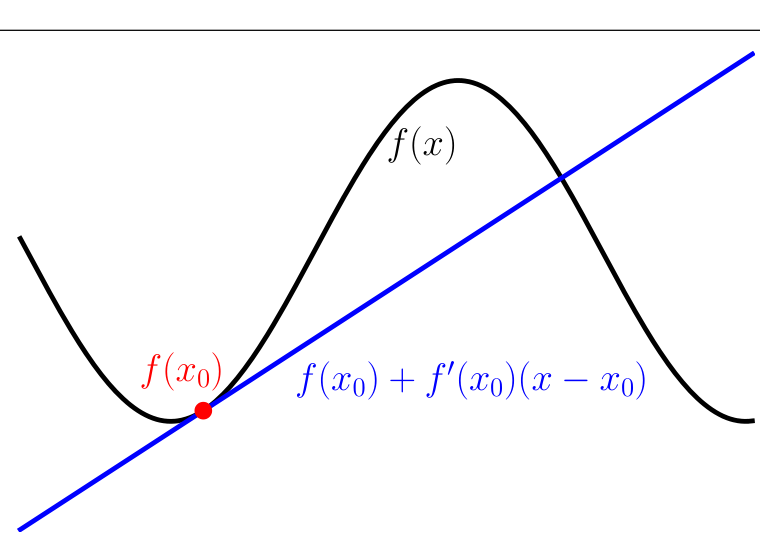
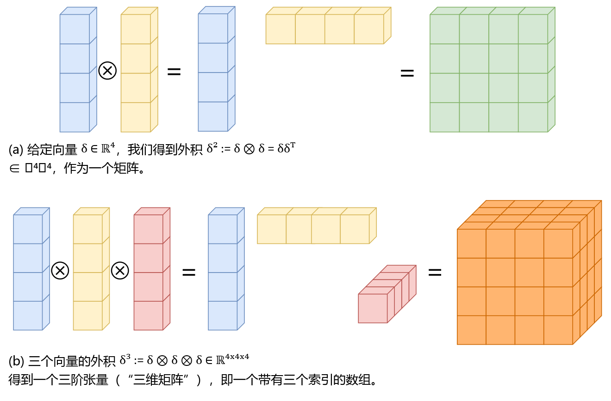

# 5.8 线性化与多元泰勒级数（Linearization and Multivariate Taylor Series）

## 本节导学

**学习目标**

1. 掌握一阶（线性）逼近公式 $f(\boldsymbol x) \approx f(\boldsymbol x_0) + \nabla f(\boldsymbol x_0)(\boldsymbol x - \boldsymbol x_0)$；
2. 理解多元泰勒级数中 $\boldsymbol\delta^k$ 的含义（$k$ 重外积的张量）；
3. 会写出 $k = 0, 1, 2, 3$ 各项的显式形式（二次项 = $\boldsymbol\delta^\top \boldsymbol H \boldsymbol\delta$）；
4. 完整走完一个二元函数的泰勒展开算例（例 5.15）。

**预备知识**：5.1.1 节（单变量泰勒级数）、5.2 节（梯度）、5.7 节（黑塞矩阵）。

**符号速查表**：

| 符号 | 读法 | 含义 |
| --- | --- | --- |
| $\boldsymbol\delta := \boldsymbol x - \boldsymbol x_0$ | delta | 展开点与自变量的差向量 |
| $D_{\boldsymbol x}^k f(\boldsymbol x_0)$ | k 阶全导数 | $k = 1$ 是梯度（行向量），$k = 2$ 是黑塞矩阵，$k \geqslant 3$ 是高阶张量 |
| $\boldsymbol\delta^k = \boldsymbol\delta^{\otimes k}$ | k 重外积 | $k$ 维数组，元素 $\delta[i_1]\cdots\delta[i_k]$ |
| $\otimes$ | 外积 / 张量积 | 两个向量外积得矩阵，三个得三阶张量…… |

---

## 5.8.1 线性化

梯度最常见的用途：**在 $\boldsymbol x_0$ 附近把 $f$ 局部替换成线性函数**（图 5.12）：

$$
f(\boldsymbol x) \approx f(\boldsymbol x_0) + (\nabla_{\boldsymbol x} f)(\boldsymbol x_0)\,(\boldsymbol x - \boldsymbol x_0) \tag{5.148}
$$

$(\nabla_{\boldsymbol x}f)(\boldsymbol x_0)$ 是梯度在 $\boldsymbol x_0$ 处的取值（$1 \times D$ 行向量），乘差向量（$D \times 1$）得标量。几何上：用**切平面**（多元情形的"切线"）代替曲面。**局部精确、远离 $\boldsymbol x_0$ 时变差**——这是多元泰勒级数只取前两项的特例。扩展卡尔曼滤波（5.9 节）就建立在这条公式上。

   
  <b>图 5.12 函数的线性逼近。原函数 f 在 x₀ = -2 处使用一阶泰勒级数展开进行线性化。</b> 

## 5.8.2 多元泰勒级数

**定义 5.7**（多元泰勒级数）。设 $f : \mathbb{R}^D \to \mathbb{R}$ 在 $\boldsymbol x_0$ 处光滑，$\boldsymbol\delta := \boldsymbol x - \boldsymbol x_0$：

$$
f(\boldsymbol x) = \sum_{k=0}^\infty \frac{D_{\boldsymbol x}^k f(\boldsymbol x_0)}{k!}\, \boldsymbol\delta^k \tag{5.151}
$$

$D_{\boldsymbol x}^k f(\boldsymbol x_0)$ 是 $k$ 阶全导数在 $\boldsymbol x_0$ 处的取值。**定义 5.8**（泰勒多项式）：取前 $n+1$ 项得 $T_n$（5.152）。

**$\boldsymbol\delta^k$ 是什么？** 对 $D > 1$、$k > 1$，$\boldsymbol\delta^k$ 本没有定义——它是 $\boldsymbol\delta$ 的 **$k$ 重外积**（图 5.13）：$k$ 阶张量（$k$ 维数组），元素为各分量乘积：

$$
\boldsymbol\delta^2 := \boldsymbol\delta \otimes \boldsymbol\delta = \boldsymbol\delta \boldsymbol\delta^\top, \qquad \boldsymbol\delta^2[i, j] = \delta[i]\,\delta[j] \tag{5.153}
$$

$$
\boldsymbol\delta^3 := \boldsymbol\delta \otimes \boldsymbol\delta \otimes \boldsymbol\delta, \qquad \boldsymbol\delta^3[i, j, k] = \delta[i]\,\delta[j]\,\delta[k] \tag{5.154}
$$

一般项是两个张量的"缩并"（对所有索引求和）：

$$
D_{\boldsymbol x}^k f(\boldsymbol x_0)\, \boldsymbol\delta^k = \sum_{i_1=1}^D \cdots \sum_{i_k=1}^D D_{\boldsymbol x}^k f(\boldsymbol x_0)[i_1, \ldots, i_k]\, \delta[i_1] \cdots \delta[i_k] \tag{5.155}
$$

——$k$ 次多项式。NumPy 实现：`np.einsum('i,i', Df1, d)`、`np.einsum('ij,i,j', Df2, d, d)`、`np.einsum('ijk,i,j,k', Df3, d, d, d)`。

   
  <b>图 5.13 外积的可视化。向量的外积使数组的维度每项增加 1。(a) 两个向量的外积得到一个矩阵；(b) 三个向量的外积产生一个三阶张量。</b> 

**前四项的显式形式**（$\boldsymbol\delta := \boldsymbol x - \boldsymbol x_0$）：

$$
k = 0: \quad D^0 f\, \boldsymbol\delta^0 = f(\boldsymbol x_0) \in \mathbb{R} \tag{5.156}
$$

$$
k = 1: \quad D^1 f\, \boldsymbol\delta^1 = \underbrace{\nabla f(\boldsymbol x_0)}_{1 \times D}\ \underbrace{\boldsymbol\delta}_{D \times 1} = \sum_{i=1}^D \nabla f[i]\, \delta[i] \in \mathbb{R} \tag{5.157}
$$

$$
k = 2: \quad D^2 f\, \boldsymbol\delta^2 = \operatorname{tr}\big( \underbrace{\boldsymbol H(\boldsymbol x_0)}_{D \times D}\, \underbrace{\boldsymbol\delta}_{D \times 1}\, \underbrace{\boldsymbol\delta^\top}_{1 \times D} \big) = \boldsymbol\delta^\top \boldsymbol H(\boldsymbol x_0)\, \boldsymbol\delta = \sum_{i,j} H[i,j]\,\delta[i]\delta[j] \tag{5.158, 5.159}
$$

（用迹的循环性质 (4.19)：$\operatorname{tr}(\boldsymbol H \boldsymbol\delta\boldsymbol\delta^\top) = \boldsymbol\delta^\top \boldsymbol H \boldsymbol\delta$。）

$$
k = 3: \quad D^3 f\, \boldsymbol\delta^3 = \sum_{i,j,k} D^3 f[i,j,k]\, \delta[i]\delta[j]\delta[k] \in \mathbb{R} \tag{5.160}
$$

**结构规律**：第 $k$ 项是 $k$ 次齐次多项式；一阶项靠梯度、二阶项靠黑塞、三阶项靠三阶张量。

## 5.8.3 完整算例（例 5.15）

$$
f(x, y) = x^2 + 2xy + y^3 \tag{5.161}
$$

在 $(x_0, y_0) = (1, 2)$ 处展开。**预判**：$f$ 是三次多项式，泰勒级数（多项式的线性组合）到三阶为止就应精确还原——只需算前四项。

**零阶（常数项）与一阶梯度**：

$$
f(1,2) = 1 + 4 + 8 = 13 \tag{5.162}
$$

$$
\frac{\partial f}{\partial x} = 2x + 2y \implies f_x(1,2) = 6; \qquad \frac{\partial f}{\partial y} = 2x + 3y^2 \implies f_y(1,2) = 14 \tag{5.163, 5.164}
$$

$$
\nabla f(1,2) = \begin{bmatrix} 6 & 14 \end{bmatrix}, \qquad \frac{D^1 f}{1!}\boldsymbol\delta = 6(x-1) + 14(y-2) \tag{5.165, 5.166}
$$

**二阶（黑塞）**：

$$
f_{xx} = 2, \quad f_{yy} = 6y \implies f_{yy}(1,2) = 12, \quad f_{xy} = f_{yx} = 2 \tag{5.167–5.170}
$$

$$
\boldsymbol H(1,2) = \begin{bmatrix} 2 & 2 \\ 2 & 12 \end{bmatrix} \tag{5.172}
$$

$$
\frac{D^2 f}{2!}\boldsymbol\delta^2 = \frac{1}{2}\begin{bmatrix} x-1 \\ y-2 \end{bmatrix}^\top \begin{bmatrix} 2 & 2 \\ 2 & 12 \end{bmatrix} \begin{bmatrix} x-1 \\ y-2 \end{bmatrix} = (x-1)^2 + 2(x-1)(y-2) + 6(y-2)^2 \tag{5.173}
$$

（逐步验算：$\boldsymbol H\boldsymbol\delta = (2(x-1) + 2(y-2),\ 2(x-1) + 12(y-2))^\top$；点乘 $\boldsymbol\delta$ 得 $2(x-1)^2 + 4(x-1)(y-2) + 12(y-2)^2$；乘 $\frac{1}{2}$ 得 (5.173c)。）

**三阶**：黑塞的各元素大多是常数，唯一非零的三阶导数是 $f_{yyy} = 6$。三阶张量只有 $[:, :, 2]$ 切片的右下角非零：

$$
D^3 f[:, :, 1] = \begin{bmatrix} 0 & 0 \\ 0 & 0 \end{bmatrix}, \qquad D^3 f[:, :, 2] = \begin{bmatrix} 0 & 0 \\ 0 & 6 \end{bmatrix} \implies \frac{D^3 f}{3!}\boldsymbol\delta^3 = (y-2)^3 \tag{5.174–5.179}
$$

**合并（精确展开）**：

$$
f(\boldsymbol x) = 13 + 6(x-1) + 14(y-2) + \big[(x-1)^2 + 6(y-2)^2 + 2(x-1)(y-2)\big] + (y-2)^3 \tag{5.180}
$$

**验证**：把 $x = 1 + u$、$y = 2 + v$ 代回原函数——$(1+u)^2 + 2(1+u)(2+v) + (2+v)^3 = (1 + 2u + u^2) + (4 + 2v + 4u + 2uv) + (8 + 12v + 6v^2 + v^3) = 13 + 6u + 14v + u^2 + 2uv + 6v^2 + v^3$——与 (5.180) 逐项一致 ✓。三次多项式被三阶泰勒级数精确还原，与预判吻合。

---

## 本节小结

| 要点 | 内容 |
| --- | --- |
| 线性化 | 切平面逼近：$f(\boldsymbol x_0) + \nabla f(\boldsymbol x_0)\boldsymbol\delta$ |
| 多元泰勒 | $k$ 阶项 = $k$ 阶导数张量与 $\boldsymbol\delta$ 的 $k$ 重外积缩并 ÷ $k!$ |
| 关键特例 | 二阶项 $= \frac{1}{2}\boldsymbol\delta^\top \boldsymbol H \boldsymbol\delta$（牛顿法的基石） |
| 多项式精确性 | $n$ 次多项式的 $n$ 阶泰勒展开 = 恒等还原 |

**与其他章节的关系**：二阶泰勒展开是 7.3 节凸优化和 9.4 节最小二乘几何（二次损失）的语言；线性化支撑 5.9 节的扩展卡尔曼滤波；拉普拉斯近似（6.5/9 章）用二阶展开做分布逼近。
