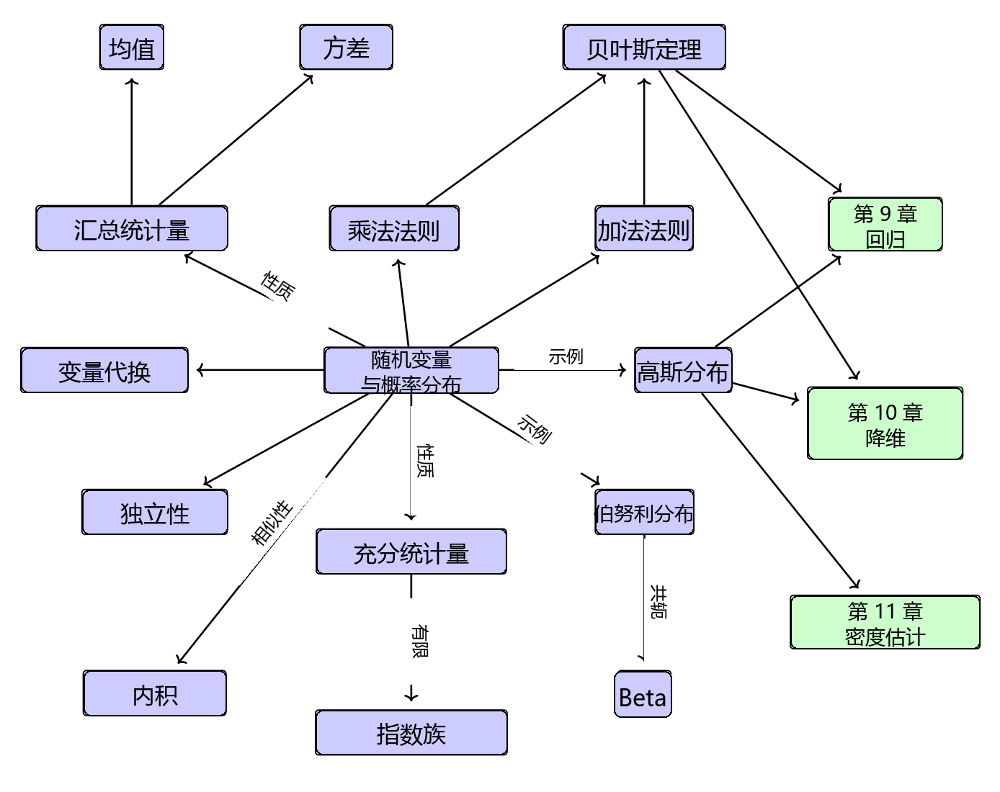

# 第 6 章 概率与分布（Probability and Distributions）

## 本章导学

**学习目标**：掌握量化**不确定性**的数学语言——这是机器学习的另一半基础。前几章给了我们对数据"做什么操作"的代数与几何工具；本章回答"数据本身长什么样、我们的知识有多不确定"。

**本章路线**（图 6.1）：

1. **打地基（6.1–6.2 节）**：概率空间三要素（样本空间、事件空间、概率）+ 随机变量；离散变量用**概率质量函数（pmf）**，连续变量用**概率密度函数（pdf）**与**累积分布函数（cdf）**；
2. **两条基本法则（6.3 节）**：加法法则（边际化）+ 乘法法则 ⟹ **贝叶斯定理**——机器学习推断的引擎；
3. **概括与比较（6.4 节）**：均值、方差、协方差、独立性，以及随机变量的几何（内积 = 协方差！）；
4. **最重要的分布（6.5 节）**：高斯分布——边缘/条件分布的闭式表达式、线性变换封闭、采样技巧；
5. **分布的组织原则（6.6 节）**：共轭先验与指数族——为什么有些分布"好用"；
6. **变换分布（6.7 节）**：随机变量经函数变换后的分布怎么算（变量替换法）。

**预备知识**：第 2–5 章的线性代数与微积分基础，尤其 3.2 节（内积）、4.1 节（行列式）、5.3 节（雅可比矩阵）。

**通俗理解**：概率既可以看作事件发生的**频率比例**（大量重复实验中事件出现的比例），也可以看作对某事件的**置信程度**（"她迟到是因为堵车"有多可信）。我们用概率来度量实验中事情发生的可能性，进而量化数据、模型与预测中的不确定性。

   
  <b>图 6.1 本章所描述的与随机变量和概率分布相关的概念思维导图。</b> 

