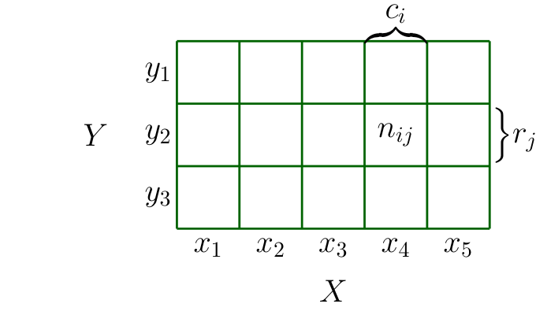
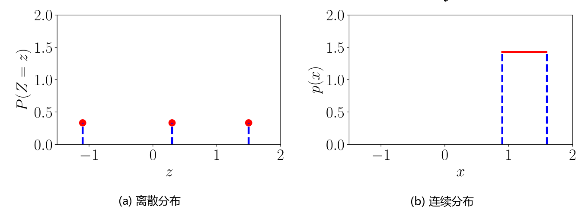

# 6.2 离散与连续概率（Discrete and Continuous Probabilities）

## 本节导学

**学习目标**

1. 分清三种"概率对象"：pmf（离散单点概率）、pdf（连续密度）、cdf（累积概率）；
2. 会算离散联合分布的边缘概率与条件概率（表格法）；
3. 理解连续情形的关键反直觉事实：**单点概率恒为零**、**pdf 值可以大于 1**；
4. 知道单变量分布与多元分布的区别（粗体 $\boldsymbol x$ 记号）。

**预备知识**：6.1 节（概率空间、随机变量）、定积分的基本直觉。

**符号速查表**：

| 符号 | 读法 | 含义 |
| --- | --- | --- |
| $P(X = x)$ | "X 等于 x 的概率" | 离散：概率质量函数（pmf） |
| $p(x, y)$ | 联合概率 | $X=x$ 且 $Y=y$ 的概率 |
| $p(x)$ | 边缘概率 | 不管 $Y$ 取什么，$X=x$ 的概率 |
| $p(y \mid x)$ | 条件概率 | 已知 $X=x$ 时 $Y=y$ 的概率 |
| $f(\boldsymbol x)$ | 概率密度（pdf） | 连续：非负、积分为 1 的函数 |
| $F_{\boldsymbol X}(\boldsymbol x)$ | 累积分布（cdf） | $P(X_1 \le x_1, \ldots, X_D \le x_D)$ |
| $X \sim p(x)$ | "X 服从分布 p" | 声明随机变量的分布 |

---

## 6.2.1 描述概率的方式

目标空间离散时，可以直接指定 $P(X = x)$——**概率质量函数（pmf）**；目标空间连续时（如实数线），更自然的是指定区间概率或 $P(X \leqslant x)$——**累积分布函数（cdf）**。

> **备注**：单个随机变量的分布叫**单变量分布**（状态用非粗体 $x$）；多个随机变量的联合分布叫**多元分布**（状态用粗体 $\boldsymbol x$）。♦

## 6.2.2 离散概率：表格思维

把多个随机变量的联合分布想象成**填满数字的多维数组**（图 6.2）。联合概率的定义（频率解释）：

$$
P(X = x_i, Y = y_j) = \frac{n_{ij}}{N} \tag{6.9}
$$

$n_{ij}$ = 同时处于状态 $(x_i, y_j)$ 的事件数，$N$ = 事件总数。记号约定：

- $p(x, y)$：联合概率（两个事件**交集**的概率）；
- $p(x)$：**边缘概率**——不管 $Y$ 取什么，$X = x$ 的概率；
- $p(y \mid x)$：**条件概率**——只在 $X = x$ 的样本里，$Y = y$ 所占比例；
- $X \sim p(x)$："$X$ 服从分布 $p$"。

   
  <b>图 6.2 随机变量 X 和 Y 的离散二元概率质量函数的可视化。</b> 

> **例 6.2（表格法的完整套路）**。$X$ 有 5 个状态，$Y$ 有 3 个状态。记 $n_{ij}$ 为格子计数，$c_i = \sum_{j=1}^3 n_{ij}$（第 $i$ **列**和），$r_j = \sum_{i=1}^5 n_{ij}$（第 $j$ **行**和），$N$ 为总数。
>
> **边缘概率 = 按行/列归一**：
> $$ P(X = x_i) = \frac{c_i}{N} = \frac{\sum_j n_{ij}}{N}, \qquad P(Y = y_j) = \frac{r_j}{N} = \frac{\sum_i n_{ij}}{N} \tag{6.10, 6.11} $$
>
> **归一化检验**：$\sum_{i=1}^5 P(X=x_i) = 1$ 且 $\sum_{j=1}^3 P(Y=y_j) = 1$（(6.12)）。
>
> **条件概率 = 格子 ÷ 行/列和**：
> $$ P(Y = y_j \mid X = x_i) = \frac{n_{ij}}{c_i}, \qquad P(X = x_i \mid Y = y_j) = \frac{n_{ij}}{r_j} \tag{6.13, 6.14} $$
>
> （直观：条件概率就是"在某一列内部看各格子的占比"。）

**用途**：离散分布对**类别变量**建模（类别特征如大学专业、类别标签如手写字母），也用于构建混合多个连续分布的概率模型（第 11 章高斯混合模型）。

## 6.2.3 连续概率：密度思维

现在目标空间是实数线上的区间。直觉上可以把连续变量当"状态无限密集的离散变量"来操作，但有两处必须小心（本书只在需要时提示，不展开测度论）：

- 事件空间不能再用幂集（太大、性质不好），需用 **Borel $\sigma$-代数**（对补/并/交封闭的集合族）；
- "集合大小"（测度）不再靠计数：离散集的势、区间长度、区域体积都是测度。

**定义 6.1**（概率密度函数 pdf）。$f : \mathbb{R}^D \to \mathbb{R}$ 满足：

1. 非负：$\forall \boldsymbol x: f(\boldsymbol x) \geqslant 0$；
2. 归一：$\int_{\mathbb{R}^D} f(\boldsymbol x)\,\mathrm{d}\boldsymbol x = 1$（(6.15)；离散情形的对应是求和 (6.12)）。

pdf 与随机变量的关联通过**区间概率**给出：

$$
P(a \leqslant X \leqslant b) = \int_a^b f(x)\,\mathrm{d}x \tag{6.16}
$$

**两条反直觉的重要事实**：

- **单点概率恒为零**：$P(X = x) = 0$（相当于 (6.16) 取 $a = b$）。所以连续情形下谈"$X$ 恰好等于某值"的概率没有意义——只有区间概率有意义；
- **pdf 的值可以大于 1**：归一化约束的是**积分**而非函数值本身（见例 6.3）。

**定义 6.2**（累积分布函数 cdf）。对 $\boldsymbol x \in \mathbb{R}^D$：

$$
F_{\boldsymbol X}(\boldsymbol x) = P(X_1 \leqslant x_1, \ldots, X_D \leqslant x_D) \tag{6.17}
$$

也就是 pdf 的"从负无穷积到这里"的多重积分：

$$
F_{\boldsymbol X}(\boldsymbol x) = \int_{-\infty}^{x_1} \cdots \int_{-\infty}^{x_D} f(z_1, \ldots, z_D)\,\mathrm{d}z_1 \cdots \mathrm{d}z_D \tag{6.18}
$$

（提示：也存在没有对应 pdf 的 cdf——本书不深究。）

## 6.2.4 离散 vs 连续：对比与术语规范

**例 6.3（pdf 为什么可以大于 1）**。两个均匀分布对比：

- **离散均匀**：$Z \in \{-1.1, 0.3, 1.5\}$，每个状态概率 $\frac{1}{3}$——每个点的"概率高度"都不超过 1；
- **连续均匀**：$X \in [0.9, 1.6]$，密度是区间长度的倒数：$p(x) = \frac{1}{1.6 - 0.9} = \frac{1}{0.7} \approx 1.43 > 1$！但积分归一：$\int_{0.9}^{1.6} p(x)\,\mathrm{d}x = \frac{1}{0.7} \times 0.7 = 1$ ✓（(6.19)）。

区间越窄，密度越高——**pdf 的高度衡量"单位长度内的概率"，不是概率本身**。

   
  <b>图 6.3 (a) 离散与 (b) 连续均匀分布的示例。</b> 

**术语规范表**（表 6.1）——"分布"一词在文献中的三种含义：

| 类型 | "单点概率" | "区间概率" |
| :---: | :---: | :---: |
| **离散** | $P(X = x)$，pmf | 不适用 |
| **连续** | $p(x)$，pdf | $P(X \leqslant x)$，cdf |

> **备注**：本书跟随机器学习文献惯例，对 pmf 和 pdf 统称"概率分布"，请按上下文分辨。另外，离散状态原则上无序（红/绿/蓝），但取数值时（如 $z_1 = -1.1$）可以排序并计算期望（6.4.1 节）。♦

---

## 本节小结

| 对象 | 离散 | 连续 |
| --- | --- | --- |
| 单点描述 | pmf：$P(X=x) \in [0,1]$ | pdf：$f(x)$ 可 $>1$，但 $\int f = 1$ |
| 区间描述 | 直接求和 | $\int_a^b f(x)\mathrm{d}x$；cdf = 累积积分 |
| 条件概率 | 格子 ÷ 行/列和 | （6.3 节给出一般法则） |

**与其他章节的关系**：6.3 节的两条法则对离散（求和）与连续（积分）形式完全平行；6.5 节高斯分布是连续分布的主角；第 11 章混合模型把离散（分量指示）与连续（分量密度）结合在一起。
