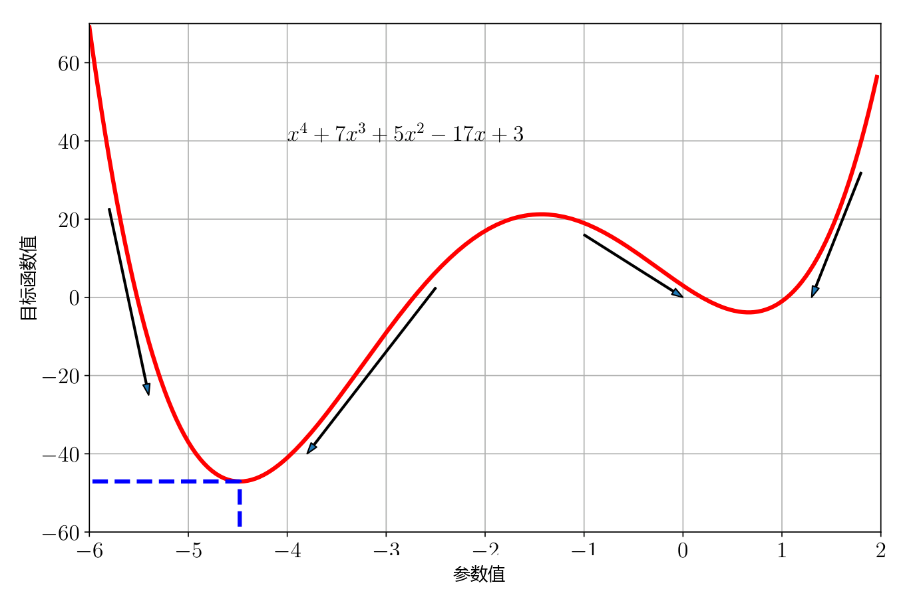
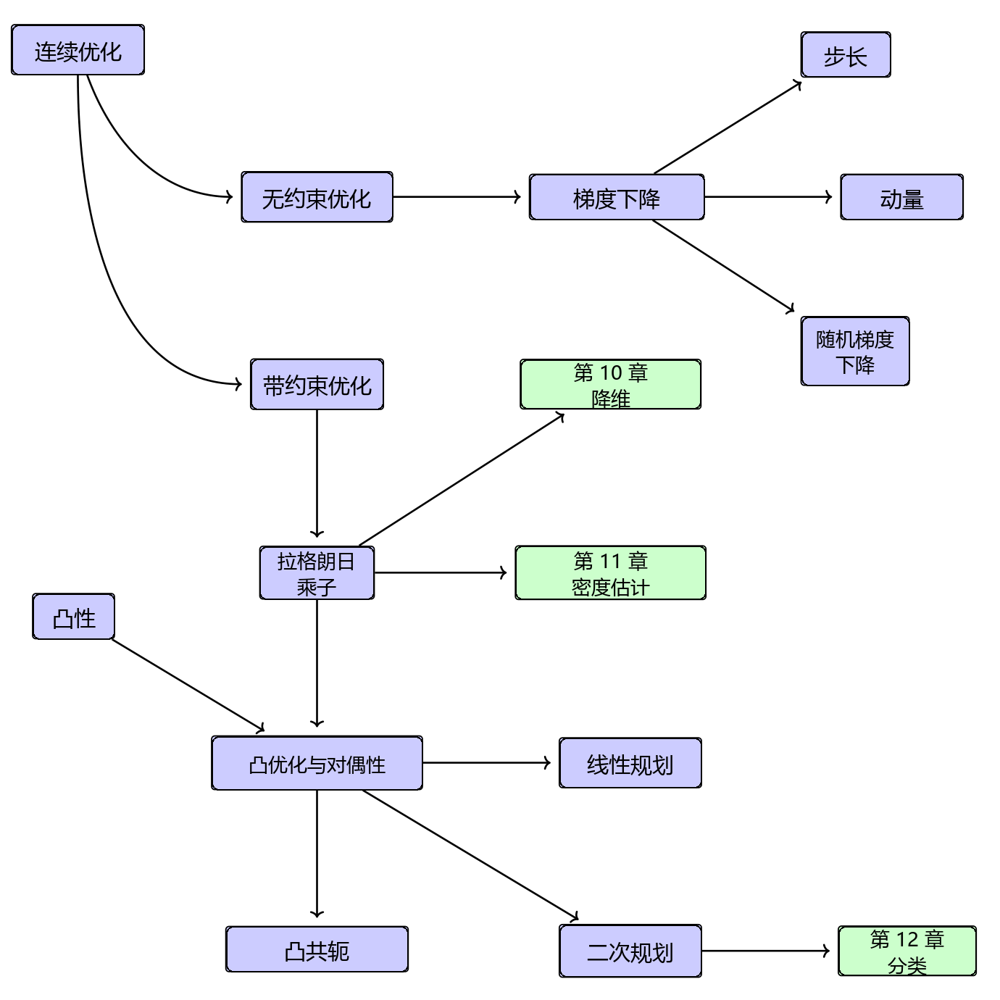

# 第 7 章 连续优化（Continuous Optimization）

## 本章导学

**学习目标**：机器学习模型的"训练"最终都化为数值优化——给定目标函数，用优化算法找最优参数。本章给出训练模型的基本数值方法，分两大分支（图 7.1）：

1. **无约束优化（7.1 节）**：核心概念只有一个——沿**负梯度方向**（下坡）走，但涉及步长、动量、随机梯度三个设计选择；
2. **带约束优化（7.2 节）**：引入**拉格朗日乘子**与对偶问题；
3. **凸优化（7.3 节）**：特殊而强大的一类——凸函数的所有局部极小值都是全局最小值，可以**保证**找到全局最优解（强对偶性）。

**预备知识**：第 5 章（梯度、链式法则）、6.4 节（期望）、2.6 节（秩与线性方程组）。

**符号速查表**：

| 符号 | 含义 |
| --- | --- |
| $\min_{\boldsymbol x} f(\boldsymbol x)$ | 寻找使 $f$ 最小的 $\boldsymbol x$（机器学习默认最小化） |
| $\nabla f(\boldsymbol x)$ | 梯度（行向量，5.2 节约定），指向最陡**上升**方向 |
| 驻点 | 梯度为零的点（可能是极小、极大或鞍点） |
| 条件数 $\kappa$ | 最大奇异值/最小奇异值——"狭长山谷"的弯曲程度 |

---

## 7.0.1 优化问题长什么样

数据和模型都在 $\mathbb R^D$ 中，所以是**连续优化**（区别于离散变量的组合优化）。几何直觉：**寻找目标函数的"谷底"**，梯度总是指向上坡。

**一维热身**（图 7.2）：

$$
\ell(x) = x^4 + 7x^3 + 5x^2 - 17x + 3 \tag{7.1}
$$

梯度（一阶导数）：

$$
\frac{\mathrm{d}\ell(x)}{\mathrm{d}x} = 4x^3 + 21x^2 + 10x - 17 \tag{7.2}
$$

令其为零得驻点。三次方程有三个实根：约 $x = -4.5$、$-1.4$、$0.7$——前、后两个是**极小值**，中间是**极大值**。用二阶导数判别：

$$
\frac{\mathrm{d}^2\ell(x)}{\mathrm{d}x^2} = 12x^2 + 42x + 10 \tag{7.3}
$$

在 $-1.4$ 处为负（极大），在 $-4.5$ 和 $0.7$ 处为正（极小）。

**为什么需要迭代算法？** 理论上可以解析求解，但：(1) 阿贝尔-鲁菲尼定理——5 次及以上多项式一般**没有代数解**（Abel, 1826）；(2) 高维问题更没有闭式解。所以实际做法是从初始值（如 $x_0 = -6$）出发**沿负梯度迭代**。但注意图 7.2 的教训：从右侧 $x_0 = 0$ 出发会收敛到较差的**局部极小值**（$x \approx 0.7$），负梯度只指方向、不管全局。**凸函数**（7.3 节）没有这种烦恼——所有局部极小都是全局最小。

   
  <b>图 7.2 目标函数示例。负梯度方向由箭头指示，全局最小值由蓝色虚线指示。</b> 

**高维预告**：一维的直觉全部推广——梯度（行向量）、等高线、负梯度方向、局部极小，只是看不见图像，靠代数运算。

   
  <b>图 7.1 本章介绍的与优化相关概念的思维导图。包含两大核心思想：梯度下降与凸优化。</b> 

