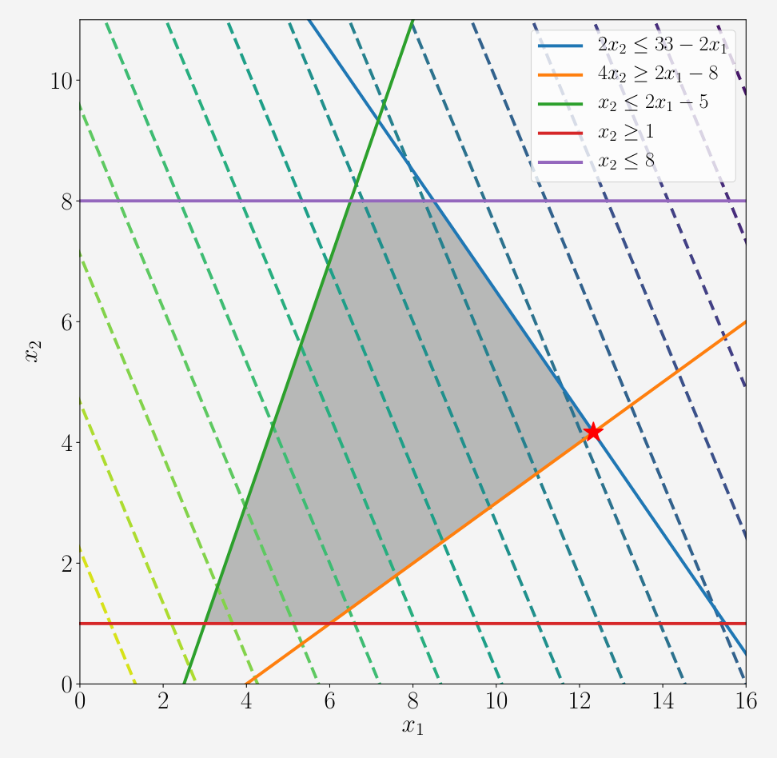

# 7.3 凸优化（Convex Optimization）

## 本节导学

**学习目标**

1. 掌握凸集与凸函数的定义（定义 7.2、7.3）及三个等价刻画（定义式/切线式/黑塞式）；
2. 会用保持凸性的运算（非负加权和、逐点最大值）判断凸性；
3. 完整推导线性规划与二次规划的对偶问题；
4. 理解凸共轭（勒让德–芬歇尔变换）的几何意义，会算二次函数与可分损失之和的共轭。

**预备知识**：7.2 节（拉格朗日对偶）、5.7 节（黑塞矩阵）、3.2.3 节（半正定）、5.5 节（二次型求导）。

**符号速查表**：

| 符号 | 含义 |
| --- | --- |
| $\theta \boldsymbol x + (1-\theta)\boldsymbol y$ | 两点的凸组合（线段，$0 \le \theta \le 1$） |
| $\nabla^2 f(\boldsymbol x) \succeq \boldsymbol 0$ | 黑塞半正定 ⟺ $f$ 凸 |
| $f^*(\boldsymbol s) = \sup_{\boldsymbol x}(\langle \boldsymbol s, \boldsymbol x\rangle - f(\boldsymbol x))$ | 凸共轭 |
| LP / QP | 线性规划 / 二次规划 |
| 上图（epigraph） | $\{(\boldsymbol x, t) : t \ge f(\boldsymbol x)\}$——凸函数的"碗" |

---

## 7.3.1 凸集与凸函数

当 $f$ 凸、约束集凸时，我们得到**凸优化问题**——可以**保证找到全局最优解**（所有局部极小都是全局最小），且拥有**强对偶性**（对偶间隙为零）。

**定义 7.2**（凸集）。$C$ 是凸集 ⟺ 任意 $\boldsymbol x, \boldsymbol y \in C$ 与 $0 \le \theta \le 1$：

$$
\theta \boldsymbol x + (1 - \theta)\boldsymbol y \in C \tag{7.29}
$$

——连接集合内任意两点的**线段整个落在集合内**（图 7.5 凸、图 7.6 非凸：月牙形两点的连线会跑出集合）。

**定义 7.3**（凸函数）。定义域为凸集，且对定义域内任意 $\boldsymbol x, \boldsymbol y$、$0 \le \theta \le 1$：

$$
f(\theta \boldsymbol x + (1 - \theta)\boldsymbol y) \leqslant \theta f(\boldsymbol x) + (1 - \theta) f(\boldsymbol y) \tag{7.30}
$$

——图像上任意两点的**弦**位于**图像上方**（"碗状"；图 7.2 非凸、图 7.3/7.7 凸）。（凹函数 = 凸函数的相反数；(7.30) 也称作**琴生不等式**。）

**凸性的两个等价刻画**：

- **一阶（切线式）**：可微 $f$ 凸 ⟺ 任意两点处**切线是图像的下界**：

$$
f(\boldsymbol y) \geqslant f(\boldsymbol x) + \nabla f(\boldsymbol x)^\top (\boldsymbol y - \boldsymbol x) \tag{7.31}
$$

- **二阶（曲率式）**：二阶可微 $f$ 凸 ⟺ 黑塞处处**半正定**：

$$
\nabla^2 f(\boldsymbol x) \succeq \boldsymbol 0 \quad (\text{所有特征值} \ge 0)
$$

——"碗"处处向上弯。这是检验凸性最实用的判据。

**凸集与凸函数的桥梁——上图（epigraph）**：向凸函数的"碗"里注水得到的集合 $\{(\boldsymbol x, t) : t \ge f(\boldsymbol x)\}$ 是凸集。

> **例 7.3（负熵的凸性验算）**。$f(x) = x\log_2 x$（$x > 0$，图 7.8）。
>
> **定义式抽查**（注意：抽查两点不能证明凸性，正式验证要查全部点；$\theta = 0.5$）：左端 $f(3) = 3\log_2 3 \approx 4.75$；右端 $\frac{1}{2}f(2) + \frac{1}{2}f(4) = \frac{1}{2}(2) + \frac{1}{2}(8) = 5$；$4.75 \le 5$ ✓。
>
> **切线式抽查**：$f'(x) = \log_2 x + \frac{1}{\ln 2}$（(7.32)，乘积法则：$(x\log_2 x)' = \log_2 x + x \cdot \frac{1}{x\ln 2}$）。取 $x = 2$、$y = 4$：左端 $f(4) = 8$；右端 $f(2) + f'(2)(4-2) = 2 + (1 + \frac{1}{\ln 2}) \cdot 2 \approx 2 + 2 \times 2.44 = 6.9$；$8 \ge 6.9$ ✓——切线在图像下方。

> **例 7.4（保持凸性的运算：非负加权和）**。证明分两步：
>
> **数乘**：$f$ 凸、$\alpha \ge 0$ ⟹ $\alpha f$ 凸——(7.30) 两边乘 $\alpha$（非负不改变不等号方向）。
>
> **求和**：$f_1, f_2$ 凸 ⟹ 把两个不等式 (7.34)(7.35) 相加：
>
> $$
> f_1(\theta \boldsymbol x + (1-\theta)\boldsymbol y) + f_2(\theta \boldsymbol x + (1-\theta)\boldsymbol y) \le \theta\big(f_1(\boldsymbol x) + f_2(\boldsymbol x)\big) + (1-\theta)\big(f_1(\boldsymbol y) + f_2(\boldsymbol y)\big) \tag{7.36, 7.37}
> $$
>
> ——正是 $f_1 + f_2$ 的凸性定义。合起来：$\alpha f_1 + \beta f_2$（$\alpha,\beta \ge 0$）凸；推广到任意有限项。$\blacksquare$（练习 7.4 继续考察：差、积、逐点最大值。）

## 7.3.1 线性规划（LP）与对偶

**线性规划**：目标与约束全部线性（(7.39)，$d$ 个变量、$m$ 个约束；工业界应用最广的优化方法之一）：

$$
\min_{\boldsymbol x} \boldsymbol c^\top \boldsymbol x \quad \text{s.t.} \quad \boldsymbol A \boldsymbol x \le \boldsymbol b \tag{7.39}
$$

**对偶推导**（完整三步）：

$$
L(\boldsymbol x, \boldsymbol\lambda) = \boldsymbol c^\top \boldsymbol x + \boldsymbol\lambda^\top(\boldsymbol A\boldsymbol x - \boldsymbol b) = (\boldsymbol c + \boldsymbol A^\top \boldsymbol\lambda)^\top \boldsymbol x - \boldsymbol\lambda^\top \boldsymbol b \tag{7.40, 7.41}
$$

**第 1 步**：对 $\boldsymbol x$ 求导（线性函数梯度即系数行）：$\boldsymbol c + \boldsymbol A^\top \boldsymbol\lambda = \boldsymbol 0$（(7.42)）——注意这个等式**本身成为对偶问题的约束**。

**第 2 步**：代回得对偶目标 $D(\boldsymbol\lambda) = -\boldsymbol\lambda^\top \boldsymbol b$。

**第 3 步**：外层对 $\boldsymbol\lambda$ 极大化 + 约束 $\boldsymbol\lambda \ge \boldsymbol 0$ 与 (7.42)：

$$
\max_{\boldsymbol\lambda} -\boldsymbol b^\top \boldsymbol\lambda \quad \text{s.t.} \quad \boldsymbol c + \boldsymbol A^\top \boldsymbol\lambda = \boldsymbol 0,\ \boldsymbol\lambda \ge \boldsymbol 0 \tag{7.43}
$$

——仍是线性规划，但有 $m$ 个变量。**$m$ 与 $d$ 孰大就选哪个**（约束多于变量时解对偶更划算）。

> **例 7.5**：两变量 LP (7.44)，五个线性约束；目标等高线是平行直线，最优值在可行域（阴影）的顶点处（图 7.9 星号）。

   
  <b>图 7.9 线性规划示意图。无约束问题（由等高线指示）在右侧具有极小值。满足约束条件的最优值由星号指示。</b> 

## 7.3.2 二次规划（QP）与对偶

**二次规划**：凸二次目标 + 仿射约束（$\boldsymbol Q$ 正定保证凸性）：

$$
\min_{\boldsymbol x} \frac{1}{2}\boldsymbol x^\top \boldsymbol Q \boldsymbol x + \boldsymbol c^\top \boldsymbol x \quad \text{s.t.} \quad \boldsymbol A \boldsymbol x \le \boldsymbol b \tag{7.45}
$$

**对偶推导**（完整四步）：

$$
L(\boldsymbol x, \boldsymbol\lambda) = \frac{1}{2}\boldsymbol x^\top \boldsymbol Q \boldsymbol x + (\boldsymbol c + \boldsymbol A^\top \boldsymbol\lambda)^\top \boldsymbol x - \boldsymbol\lambda^\top \boldsymbol b \tag{7.48}
$$

**第 1 步**：对 $\boldsymbol x$ 求导（二次型求导公式 (5.107) + 线性项）：$\boldsymbol Q \boldsymbol x + (\boldsymbol c + \boldsymbol A^\top \boldsymbol\lambda) = \boldsymbol 0$（(7.49)）。

**第 2 步**：解出极小点：$\boldsymbol x = -\boldsymbol Q^{-1}(\boldsymbol c + \boldsymbol A^\top \boldsymbol\lambda)$（(7.50)）。

**第 3 步**：代回 $L$（逐项验算：二次项 $\frac{1}{2}\boldsymbol x^\top\boldsymbol Q\boldsymbol x = \frac{1}{2}(\boldsymbol c + \boldsymbol A^\top\boldsymbol\lambda)^\top \boldsymbol Q^{-1}(\boldsymbol c + \boldsymbol A^\top\boldsymbol\lambda)$，线性项 $(\boldsymbol c + \boldsymbol A^\top\boldsymbol\lambda)^\top \boldsymbol x = -(\boldsymbol c + \boldsymbol A^\top\boldsymbol\lambda)^\top \boldsymbol Q^{-1}(\boldsymbol c + \boldsymbol A^\top\boldsymbol\lambda)$，合并后）：

$$
D(\boldsymbol\lambda) = -\frac{1}{2}(\boldsymbol c + \boldsymbol A^\top \boldsymbol\lambda)^\top \boldsymbol Q^{-1} (\boldsymbol c + \boldsymbol A^\top \boldsymbol\lambda) - \boldsymbol\lambda^\top \boldsymbol b \tag{7.51}
$$

**第 4 步**：外层极大化：

$$
\max_{\boldsymbol\lambda} -\frac{1}{2}(\boldsymbol c + \boldsymbol A^\top \boldsymbol\lambda)^\top \boldsymbol Q^{-1} (\boldsymbol c + \boldsymbol A^\top \boldsymbol\lambda) - \boldsymbol\lambda^\top \boldsymbol b \quad \text{s.t.} \quad \boldsymbol\lambda \ge \boldsymbol 0 \tag{7.52}
$$

第 12 章 SVM 正是这个结构（核技巧 = 对偶形式里只出现 $\boldsymbol A \boldsymbol Q^{-1} \boldsymbol A^\top$ 的内积矩阵）。

> **例 7.6**：两变量 QP（(7.46)(7.47)），$\boldsymbol Q = \begin{bmatrix} 2 & 1 \\ 1 & 4 \end{bmatrix}$ 正定（特征值 $3 \pm \sqrt{2} > 0$）✓；等高线是椭圆；四个约束围出方形可行域（图 7.4）。

## 7.3.3 勒让德–芬歇尔变换与凸共轭

**动机**：凸集可以等价地由其**支撑超平面**描述；凸函数"填满"得上图（凸集），所以凸函数可以等价地由**其切线（梯度）的函数**描述。勒让德变换把这一直觉形式化（物理系学生经典力学里见过：拉格朗日量 ⟷ 哈密顿量）。

**定义 7.4**（凸共轭）。注意：**不需要 $f$ 凸或光滑**：

$$
f^*(\boldsymbol s) = \sup_{\boldsymbol x \in \mathbb R^D} \big( \langle \boldsymbol s, \boldsymbol x \rangle - f(\boldsymbol x) \big) \tag{7.53}
$$

**几何解释**（以 $f(x) = x^2$ 为例，边画图边理解）：考虑斜率为 $s$ 的直线 $y = sx + c$。对每个 $x_0$，过 $(x_0, f(x_0))$ 的 $s$-直线 (7.54) 的截距为 $-s x_0 + f(x_0)$。"直线恰好接触图像" ⟺ 截距取**极小**：

$$
\inf_{x_0}\big(-s x_0 + f(x_0)\big) \quad \xrightarrow{\text{取相反数（惯例）}} \quad f^*(s)
$$

**凸可微特例（第一性原理）**：切线在切点处与图像相接：$f(x_0) = s x_0 + c$（(7.56)），其中 $s = \nabla f(x_0)$。整理得 $-c = s x_0 - f(x_0)$，它随 $s$ 变化：

$$
f^*(s) := s\,x_0 - f(x_0) \tag{7.58}
$$

——(7.53) 的无 sup 特例（切点唯一，无需取上确界）。对称之美：**$f^*$ 的斜率是 $\boldsymbol x$**——共轭再共轭回到原函数。

> **例 7.7（二次函数的共轭）**。$f(\boldsymbol y) = \frac{\lambda}{2}\boldsymbol y^\top \boldsymbol K^{-1} \boldsymbol y$（$\boldsymbol K$ 正定，(7.59)）。目标函数可微，直接求导找最优：

$$
\frac{\partial}{\partial \boldsymbol y}\big(\boldsymbol\alpha^\top \boldsymbol y - \tfrac{\lambda}{2}\boldsymbol y^\top \boldsymbol K^{-1} \boldsymbol y\big) = (\boldsymbol\alpha - \lambda \boldsymbol K^{-1}\boldsymbol y)^\top = 0 \implies \boldsymbol y = \frac{1}{\lambda}\boldsymbol K \boldsymbol\alpha \tag{7.61}
$$

代回（逐项：$\boldsymbol\alpha^\top \boldsymbol y = \frac{1}{\lambda}\boldsymbol\alpha^\top \boldsymbol K\boldsymbol\alpha$；二次项 $\frac{\lambda}{2}\boldsymbol y^\top \boldsymbol K^{-1}\boldsymbol y = \frac{\lambda}{2}\cdot\frac{1}{\lambda^2}\boldsymbol\alpha^\top\boldsymbol K\boldsymbol\alpha = \frac{1}{2\lambda}\boldsymbol\alpha^\top\boldsymbol K\boldsymbol\alpha$；相减）：

$$
f^*(\boldsymbol\alpha) = \frac{1}{2\lambda}\boldsymbol\alpha^\top \boldsymbol K \boldsymbol\alpha \tag{7.62}
$$

——$\boldsymbol K^{-1}$ 变成 $\boldsymbol K$、$\lambda$ 变倒数：共轭"翻转"二次型的曲率。

> **例 7.8（可分损失之和的共轭 = 各分量共轭之和）**。$L(\boldsymbol t) = \sum_i \ell_i(t_i)$：

$$
L^*(\boldsymbol z) = \sup_{\boldsymbol t}\Big(\sum_i z_i t_i - \ell_i(t_i)\Big) = \sum_i \sup_{t_i}\big(z_i t_i - \ell_i(t_i)\big) = \sum_i \ell_i^*(z_i) \tag{7.63}
$$

（sup 可以逐坐标分开取——**无耦合，就可以拆开**。）

**例 7.9（拉格朗日对偶 = 凸共轭对偶，统一视角）**。凸问题 $\min_{\boldsymbol x} f(\boldsymbol A\boldsymbol x) + g(\boldsymbol x)$ 引入等式约束 $\boldsymbol A\boldsymbol x = \boldsymbol y$ 与乘子 $\boldsymbol u$：

$$
\min_{\boldsymbol x} f(\boldsymbol A\boldsymbol x) + g(\boldsymbol x) = \min_{\boldsymbol x, \boldsymbol y} \max_{\boldsymbol u}\big(f(\boldsymbol y) + g(\boldsymbol x) + (\boldsymbol A\boldsymbol x - \boldsymbol y)^\top \boldsymbol u\big) = \max_{\boldsymbol u} \min_{\boldsymbol x, \boldsymbol y}(\ldots) \tag{7.64, 7.65}
$$

（交换 max/min 合法——$f, g$ 凸，强对偶成立。）按 $\boldsymbol x$、$\boldsymbol y$ 分别归组、用 $(\boldsymbol A\boldsymbol x)^\top\boldsymbol u = \boldsymbol x^\top \boldsymbol A^\top \boldsymbol u$（(7.66)），对照共轭定义 (7.53)（$\min_{\boldsymbol y}(-\boldsymbol y^\top\boldsymbol u + f(\boldsymbol y)) = -\sup_{\boldsymbol y}(\boldsymbol y^\top\boldsymbol u - f(\boldsymbol y)) = -f^*(\boldsymbol u)$，同理第二项 $= -g^*(-\boldsymbol A^\top \boldsymbol u)$）：

$$
\min_{\boldsymbol x} f(\boldsymbol A \boldsymbol x) + g(\boldsymbol x) = \max_{\boldsymbol u}\big(-f^*(\boldsymbol u) - g^*(-\boldsymbol A^\top \boldsymbol u)\big) \tag{7.68}
$$

——**两种对偶殊途同归**。机器学习中的应用：逐样本凸损失的对偶问题（共轭损失）是推导出高效对偶算法的捷径。

---

## 本节小结

| 要点 | 内容 |
| --- | --- |
| 凸函数三刻画 | 弦在图像上 (7.30)；切线在图像下 (7.31)；黑塞半正定 |
| LP 对偶 | $D(\boldsymbol\lambda) = -\boldsymbol b^\top\boldsymbol\lambda$，约束 $\boldsymbol c + \boldsymbol A^\top\boldsymbol\lambda = \boldsymbol 0$ |
| QP 对偶 | $D(\boldsymbol\lambda) = -\frac{1}{2}(\boldsymbol c + \boldsymbol A^\top\boldsymbol\lambda)^\top\boldsymbol Q^{-1}(\cdot) - \boldsymbol\lambda^\top\boldsymbol b$ |
| 凸共轭 | $f^*(\boldsymbol s) = \sup_{\boldsymbol x}(\boldsymbol s^\top\boldsymbol x - f(\boldsymbol x))$；切线族描述；$f^{**} = f$ |

**与其他章节的关系**：第 12 章 SVM = QP + 对偶 + 核技巧（7.3.2 的直接应用）；共轭损失用于对偶坐标下降；练习 7.8–7.11 覆盖本节全部计算技能。
