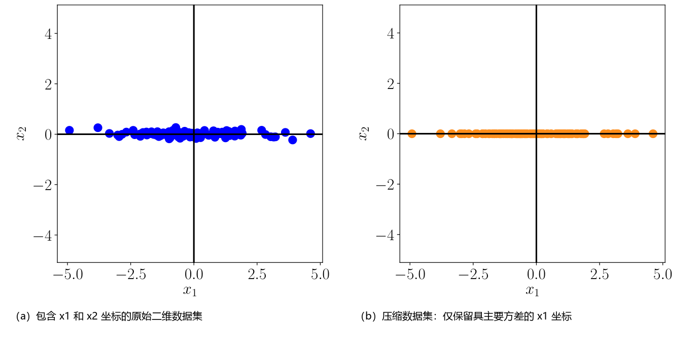

# 第 10 章 主成分分析降维（Dimensionality Reduction with PCA）

## 本章导学

**学习目标**：掌握**线性降维**的经典算法 PCA——从高维数据中提取低维表示，像 JPEG/MP3 压缩一样"近乎无损"地压缩数据。

**动机**：高维数据（如 $640\times480$ 彩色图像 ≈ 百万维向量）极难分析、无法可视化、存储昂贵。但高维数据通常**过完备**（维度冗余）且**强相关**（内在低维流形）——降维正是利用这种结构（图 10.1：$x_2$ 方向方差微弱，用 $x_1$ 一维即可近乎无损表示）。

**本章路线**（PCA 由 Pearson 1901 与 Hotelling 1933 提出，信号处理中又称 K-L 变换）：

- 10.1 问题设置：编码 $\boldsymbol z = \boldsymbol B^\top\boldsymbol x$ 与"编码器-解码器"视角；
- 10.2 **最大方差视角**：找保留最多方差的子空间（拉格朗日乘子 → 特征值问题）；
- 10.3 **投影视角**：最小化重构误差（正交投影 → 与 10.2 严格等价）；
- 10.4 计算：SVD 与低秩近似（Eckart-Young）；
- 10.5 高维技巧：$N \ll D$ 时把 $D \times D$ 特征分解降为 $N \times N$（特征脸算法）；
- 10.6 实践六步流程；
- 10.7 **概率 PCA（PPCA）**：生成模型、边缘似然、后验分布；
- 10.8 延伸阅读。

**数学工具全景**：基与基变换（2.6.1、2.7.2）、正交投影（3.8）、特征值分解（4.2/4.4）、SVD（4.5）、高斯分布（6.5）、约束优化（7.2）——本章是 Part I 概念应用密度最高的一章。

**贯穿示例**：MNIST 手写数字（$28\times28$ = 784 维向量，图 10.3）。

  
  
<b>图 10.1</b> 降维示意：(a) 原始数据在 x₂ 方向变化微弱；(b) 仅用 x₁ 坐标即可近乎无损表示。

