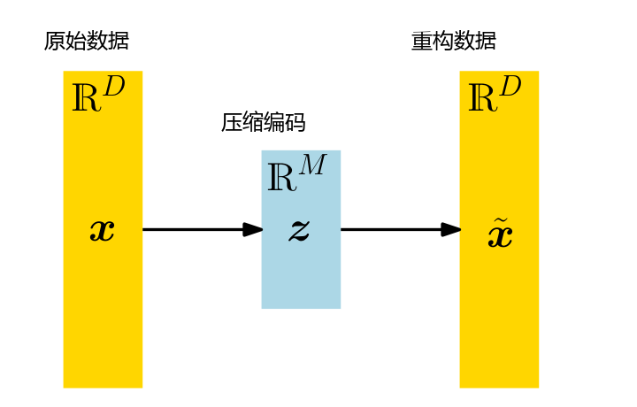

# 10.1 问题设置（Problem Setting）

## 本节导学

**学习目标**

1. 掌握 PCA 的核心记号：数据协方差矩阵 $\boldsymbol S$、投影矩阵 $\boldsymbol B$、编码 $\boldsymbol z_n$；
2. 理解"编码器-解码器"架构（图 10.2）——PCA 是最优**线性自动编码器**；
3. 知道本章的矩阵约定：**数据按列排**（$\boldsymbol X \in \mathbb R^{D \times N}$），与数据库惯例（行 = 样本）互为转置。

**预备知识**：6.4.2 节（经验协方差）、3.5 节（标准正交基）、2.5 节（基的坐标表示）。

**符号速查表**：

| 符号 | 含义 |
| --- | --- |
| $\boldsymbol S = \frac{1}{N}\sum_n \boldsymbol x_n\boldsymbol x_n^\top = \frac{1}{N}\boldsymbol X\boldsymbol X^\top$ | 样本协方差矩阵（中心化数据，(10.1)） |
| $\boldsymbol B = [\boldsymbol b_1, \ldots, \boldsymbol b_M] \in \mathbb R^{D \times M}$ | 投影矩阵（列 = 标准正交基，(10.3)） |
| $\boldsymbol z_n = \boldsymbol B^\top\boldsymbol x_n \in \mathbb R^M$ | 低维编码（code，(10.2)） |
| $\tilde{\boldsymbol x}_n = \boldsymbol B\boldsymbol z_n \in U$ | 重构点（投影回原始空间） |
| $U = \operatorname{span}[\boldsymbol b_1, \ldots, \boldsymbol b_M]$ | $M$ 维主子空间 |
| $\boldsymbol X = [\boldsymbol x_1, \ldots, \boldsymbol x_N] \in \mathbb R^{D \times N}$ | 数据矩阵（**列 = 样本**，本章约定） |

---

## 10.1.1 形式化目标

给定**均值为零**的 i.i.d. 数据集 $\mathcal X = \{\boldsymbol x_1, \ldots, \boldsymbol x_N\}$（$\boldsymbol x_n \in \mathbb R^D$），样本协方差矩阵 (10.1)。寻找：

1. 一个 $M$ 维子空间 $U \subseteq \mathbb R^D$（$M < D$）及其标准正交基 $\boldsymbol b_1, \ldots, \boldsymbol b_M$；
2. 每个数据点的**编码** $\boldsymbol z_n$（10.2）与**重构** $\tilde{\boldsymbol x}_n \in U$；

使 $\tilde{\boldsymbol x}_n$ 与 $\boldsymbol x_n$ **尽可能相似**，压缩信息损失最小。

> **例 10.1（坐标与编码， $\mathbb R^2$ 的直觉）**。$\boldsymbol x = [5, 3]^\top = 5\boldsymbol e_1 + 3\boldsymbol e_2$ 需要两个坐标；但形如 $\tilde{\boldsymbol x} = [0, z]^\top$ 的向量只需**一个编码** $z$——它们构成一维子空间 $U = \operatorname{span}[\boldsymbol e_2]$。降维 = 用 $M$ 个坐标代替 $D$ 个坐标。

## 10.1.2 编码器-解码器视角

图 10.2 的架构把 PCA 解释为**数据压缩**：

- **编码器** $\boldsymbol B^\top : \mathbb R^D \to \mathbb R^M$：高维数据 → 低维编码（"信息瓶颈"）；
- **解码器** $\boldsymbol B : \mathbb R^M \to \mathbb R^D$：低维编码 → 原始空间的近似重构。

两个方向都是线性的，且共享同一个矩阵 $\boldsymbol B$——这是"最优线性自动编码器"的约束结构（10.3 节证明它最优）。

> **备注（符号约定）**：本章 $\boldsymbol X$ 是 $D \times N$（列 = 样本），与 8.1.1 节数据库惯例（$N \times D$）互为转置。好处：代数流畅，无需反复转置或把向量重定义为左乘行向量。♦

  
  
<b>图 10.2</b> PCA 架构：x（高维）→ z（低维编码，信息瓶颈）→ x̃（重构，内在维度低）。

**接下来的两个视角**：10.2 节"让编码保留最多方差"（信息保留），10.3 节"让重构尽量接近原数据"（误差最小）——两者殊途同归（10.3.3 节证明等价）。

---

## 本节小结

| 要点 | 内容 |
| --- | --- |
| 数据模型 | 中心化 i.i.d. 数据 + 协方差矩阵 $\boldsymbol S$ |
| 压缩 | 编码 $\boldsymbol z_n = \boldsymbol B^\top\boldsymbol x_n$（$M$ 个数代替 $D$ 个数） |
| 矩阵约定 | $\boldsymbol X \in \mathbb R^{D \times N}$（列 = 样本） |
| 双重目标 | 方差最大 ⟺ 重构误差最小（待证） |

**与其他章节的关系**：10.2 节用 7.2 节拉格朗日乘子法把问题化为特征值问题；10.3 节用 3.8 节投影理论完成等价性证明。
