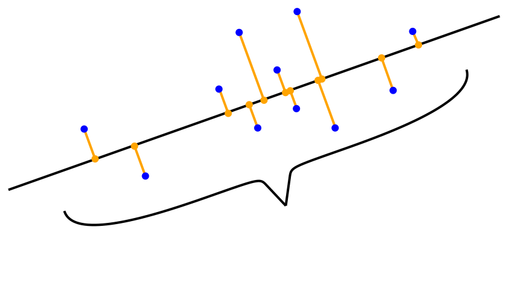
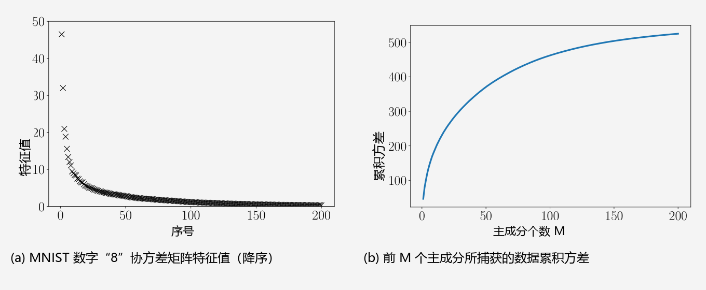

# 10.2 最大方差视角（Maximum Variance Perspective）

## 本节导学

**学习目标**

1. 理解"信息 = 方差"的量化思想，把 PCA 写成约束优化问题 (10.10)；
2. 用拉格朗日乘子法证明：第一主方向 = 协方差矩阵最大特征值的特征向量，投影方差 = 特征值；
3. 理解"剔除残差再求主成分"的 deflation 论证 (10.19)–(10.23)；
4. 会用解释方差比 $\frac{V_M}{V_D}$ 评估压缩质量。

**预备知识**：7.2 节（拉格朗日乘子）、4.2 节（特征值）、6.4 节（方差）、3.8 节（投影坐标）。

---

## 10.2.0 思想：方差即信息

图 10.1 的选择依据：忽略 $x_2$（方差小）损失少，忽略 $x_1$（方差大）损失大。把"信息量"解释为数据的"充盈程度"，方差（6.4.1 节）是天然度量——**PCA = 找投影后保留最大方差的子空间**（Hotelling, 1933；图 10.4）。

> **备注（中心化假设不失一般性）**。若真实样本均值为 $\boldsymbol\mu$，由方差的仿射不变性 (6.4.4 节)：$\mathbb V[\boldsymbol B^\top(\boldsymbol x - \boldsymbol\mu)] = \mathbb V[\boldsymbol B^\top\boldsymbol x]$——**编码方差与数据均值无关**，故全程假设数据已中心化（$\mathbb E[\boldsymbol x] = \boldsymbol 0$，编码均值亦为 $\boldsymbol 0$）。♦

  
  
<b>图 10.4</b> PCA 寻找能尽可能保持数据方差（分散程度）的低维子空间。

## 10.2.1 第一主成分：拉格朗日推导

**第 1 步：写出目标**。设第一主方向 $\boldsymbol b_1$，编码第一坐标 $z_{1n} = \boldsymbol b_1^\top\boldsymbol x_n$（这正是 $\boldsymbol x_n$ 在 $\operatorname{span}[\boldsymbol b_1]$ 上的正交投影坐标，3.8 节）。投影方差：

$$
V_1 = \frac{1}{N}\sum_{n=1}^N z_{1n}^2 = \frac{1}{N}\sum_n (\boldsymbol b_1^\top\boldsymbol x_n)^2 = \frac{1}{N}\sum_n \boldsymbol b_1^\top\boldsymbol x_n\boldsymbol x_n^\top\boldsymbol b_1 = \boldsymbol b_1^\top \boldsymbol S\,\boldsymbol b_1 \tag{10.9}
$$

（(10.9a) 用了内积对称性 $\boldsymbol b_1^\top\boldsymbol x_n = \boldsymbol x_n^\top\boldsymbol b_1$；(10.9b) 把与 $n$ 无关的 $\boldsymbol b_1$ 提出求和。）

**第 2 步：约束**。$\boldsymbol b_1$ 放大两倍，$V_1$ 变四倍——必须约束在单位球面 $\|\boldsymbol b_1\|^2 = 1$ 上，否则问题无意义：

$$
\max_{\boldsymbol b_1}\ \boldsymbol b_1^\top\boldsymbol S\boldsymbol b_1 \quad \text{s.t.}\quad \|\boldsymbol b_1\|^2 = 1 \tag{10.10}
$$

**第 3 步：拉格朗日函数**（7.2 节方法；等式约束，乘子 $\lambda_1$ 自由）：

$$
\mathcal L(\boldsymbol b_1, \lambda_1) = \boldsymbol b_1^\top\boldsymbol S\boldsymbol b_1 + \lambda_1\big(1 - \boldsymbol b_1^\top\boldsymbol b_1\big) \tag{10.11}
$$

**第 4 步：求导令零**（二次型求导公式 (5.107)）：

$$
\frac{\partial\mathcal L}{\partial\boldsymbol b_1} = 2\boldsymbol b_1^\top\boldsymbol S - 2\lambda_1\boldsymbol b_1^\top = \boldsymbol 0^\top, \qquad \frac{\partial\mathcal L}{\partial\lambda_1} = 1 - \boldsymbol b_1^\top\boldsymbol b_1 = 0 \tag{10.12}
$$

**第 5 步：读出结论**。(10.13) 即

$$
\boldsymbol S\boldsymbol b_1 = \lambda_1\boldsymbol b_1 \tag{10.13}
$$

——**$\boldsymbol b_1$ 是 $\boldsymbol S$ 的特征向量，$\lambda_1$ 是对应特征值**（4.2 节定义）！代入目标函数：

$$
V_1 = \boldsymbol b_1^\top\boldsymbol S\boldsymbol b_1 = \lambda_1\,\boldsymbol b_1^\top\boldsymbol b_1 = \lambda_1 \tag{10.15}
$$

——**投影方差 = 特征值**。故取**最大特征值**对应的特征向量 = **第一主成分（first principal component）**。$\sqrt{\lambda_1}$ 称载荷（loading），表示该方向解释的数据标准差。

**重构**（把坐标映回原始空间）：$\tilde{\boldsymbol x}_n = \boldsymbol b_1 z_{1n} = \boldsymbol b_1\boldsymbol b_1^\top\boldsymbol x_n$（(10.16)；$D$ 维向量，但只需标量坐标 $z_{1n}$ 即可表示。）

## 10.2.2 第 $m$ 个主成分：剔除法（deflation）

已求得 $\boldsymbol b_1, \ldots, \boldsymbol b_{m-1}$（谱定理保证正交）。构造**剔除残差**数据矩阵：

$$
\hat{\boldsymbol X} := \boldsymbol X - \sum_{i=1}^{m-1}\boldsymbol b_i\boldsymbol b_i^\top\boldsymbol X = (\boldsymbol I - \boldsymbol B_{m-1})\boldsymbol X, \qquad \boldsymbol B_{m-1} := \sum_{i=1}^{m-1}\boldsymbol b_i\boldsymbol b_i^\top \tag{10.17}
$$

$\boldsymbol B_{m-1}$ 是向已选子空间的投影矩阵；$\hat{\boldsymbol X}$ 是数据中**尚未被解释**的部分。在 $\hat{\boldsymbol S}$（$\hat{\boldsymbol X}$ 的协方差）上重复 10.2.1 的推导，得主成分 $\boldsymbol b_m$ 是 $\hat{\boldsymbol S}$ 最大特征值的特征向量。

**关键事实：$\boldsymbol b_m$ 也是 $\boldsymbol S$ 的特征向量**——$\boldsymbol S$ 与 $\hat{\boldsymbol S}$ 有完全相同的特征向量集。证明：对 $\boldsymbol S$ 的任意特征向量 $\boldsymbol b_i$（$\boldsymbol S\boldsymbol b_i = \lambda_i\boldsymbol b_i$）：

$$
\hat{\boldsymbol S}\boldsymbol b_i = \big(\boldsymbol S - \boldsymbol S\boldsymbol B_{m-1} - \boldsymbol B_{m-1}\boldsymbol S + \boldsymbol B_{m-1}\boldsymbol S\boldsymbol B_{m-1}\big)\boldsymbol b_i \tag{10.19}
$$

（展开 $\frac{1}{N}(\boldsymbol X - \boldsymbol B_{m-1}\boldsymbol X)(\boldsymbol X - \boldsymbol B_{m-1}\boldsymbol X)^\top$ 并用 $\boldsymbol B_{m-1}^\top = \boldsymbol B_{m-1}$。）分两种情形（标准正交性给出 (10.20)）：

$$
\boldsymbol B_{m-1}\boldsymbol b_i = \begin{cases} \boldsymbol b_i, & i < m \ (\boldsymbol b_i \text{ 在已选子空间中}) \\ \boldsymbol 0, & i \geqslant m \ (\boldsymbol b_i \text{ 与其正交}) \end{cases} \tag{10.20}
$$

- **$i \geqslant m$**：$\hat{\boldsymbol S}\boldsymbol b_i = (\boldsymbol S - \boldsymbol B_{m-1}\boldsymbol S)\boldsymbol b_i = \boldsymbol S\boldsymbol b_i = \lambda_i\boldsymbol b_i$——同特征值。特别地 $\hat{\boldsymbol S}\boldsymbol b_m = \lambda_m\boldsymbol b_m$（(10.21)）：**$\lambda_m$ 既是 $\hat{\boldsymbol S}$ 的最大特征值，也是 $\boldsymbol S$ 的第 $m$ 大特征值**；
- **$i < m$**：$\hat{\boldsymbol S}\boldsymbol b_i = \boldsymbol 0 = 0\cdot\boldsymbol b_i$（(10.22)）——已选方向全部坍缩进 $\hat{\boldsymbol S}$ 的零空间。

综上，**第 $m$ 个主成分 = $\boldsymbol S$ 的第 $m$ 大特征值的特征向量**，第 $m$ 个投影方差 $V_m = \lambda_m$（(10.23)）。

> **例 10.2（MNIST "8" 的特征谱）**。图 10.5(a)：最大 200 个特征值中仅少数显著非零，其余迅速衰减 → 图 10.5(b)：前少数几个主成分捕获绝大部分方差。**这正是高维数据可压缩的定量证据**。

  
  
<b>图 10.5</b> MNIST "8" 的统计特性：(a) 协方差矩阵前 200 个特征值；(b) 前 m 个主成分累积捕获的方差。

## 10.2.3 总方差与解释方差比

投影到 $M$ 维主子空间捕获的总方差与损失：

$$
V_M = \sum_{m=1}^M \lambda_m, \qquad J_M = \sum_{j=M+1}^D \lambda_j = V_D - V_M \tag{10.24, 10.25}
$$

**解释方差比（explained variance ratio）**：$\frac{V_M}{V_D}$；相对损失率：$1 - \frac{V_M}{V_D}$。选 $M$ 的常见标准：解释 90%–95% 方差，或看特征谱的"肘部"。

**PCA 的最终答案**：投影矩阵 $\boldsymbol B$ 的列 = 数据协方差矩阵对应**最大 $M$ 个特征值**的特征向量。

---

## 本节小结

| 结论 | 来源 |
| --- | --- |
| 第一主成分 = 最大特征值的特征向量 | 拉格朗日乘子 (10.10)–(10.13) |
| 投影方差 = 特征值 | (10.15) |
| 第 $m$ 个主成分 = 第 $m$ 大特征值的特征向量 | 剔除法 (10.17)–(10.23) |
| 损失 = 被丢弃特征值之和 | (10.25) |

**与其他章节的关系**：10.3 节用完全不同的目标（重构误差）得到同一答案并证明等价；10.4 节用 SVD 重写计算；10.7 节给整个模型配上概率外衣。
