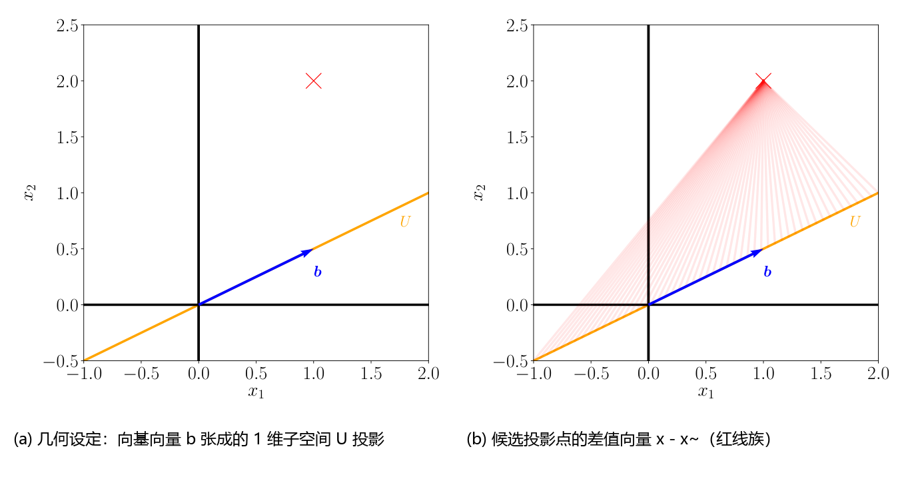
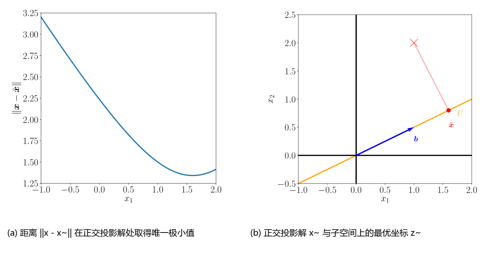
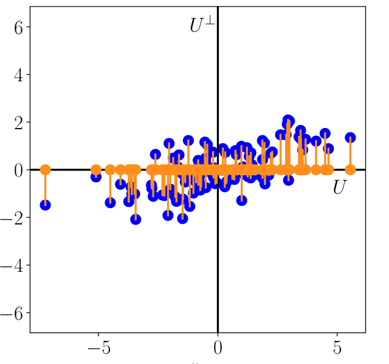
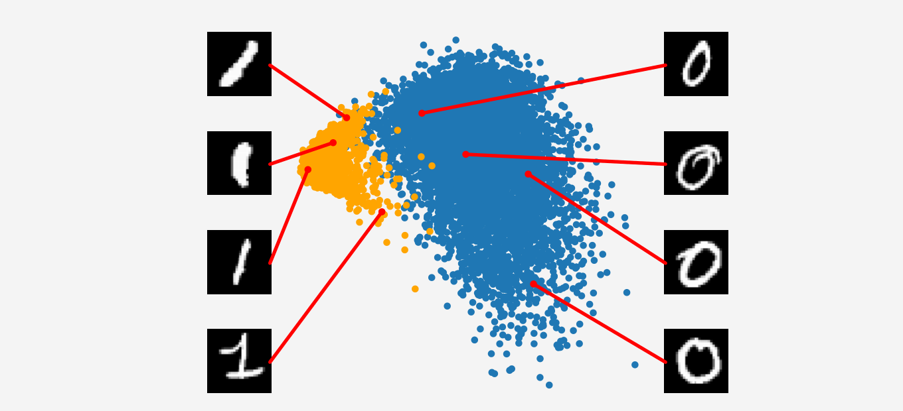

# 10.3 投影视角（Projection Perspective）

## 本节导学

**学习目标**

1. 把 PCA 推导为**最优线性自动编码器**：最小化平均平方重构误差 (10.29)；
2. 掌握两步优化：先求最优坐标（链式法则 → 正交投影），再求最优基（迹技巧 → 特征值问题）；
3. 理解**等价性证明**的核心：重构误差 = 被丢弃方向上的方差（(10.43)）；
4. 会识别投影矩阵 $\boldsymbol B\boldsymbol B^\top$ 及其正交补版本。

**预备知识**：3.8 节（正交投影公式 (3.46)(3.59)）、4.1 节（迹的循环性）、10.2 节。

---

## 10.3.1 设定与目标

设 $(\boldsymbol b_1, \ldots, \boldsymbol b_D)$ 是 $\mathbb R^D$ 的有序标准正交基（ONB），任意 $\boldsymbol x$ 唯一展开（2.5 节）：

$$
\boldsymbol x = \sum_{d=1}^D \zeta_d \boldsymbol b_d = \underbrace{\sum_{m=1}^M \zeta_m \boldsymbol b_m}_{\text{主子空间部分}} + \underbrace{\sum_{j=M+1}^D \zeta_j \boldsymbol b_j}_{\text{正交补部分}} \tag{10.26}
$$

找 $M$ 维主子空间 $U$（基 $\boldsymbol b_1, \ldots, \boldsymbol b_M$）中的 $\tilde{\boldsymbol x} = \sum_m z_m \boldsymbol b_m$（(10.27)；坐标 $z_m$ 暂视为未知量，不必等于 $\zeta_m$），最小化**平均平方重构误差**（Pearson, 1901）：

$$
J_M := \frac{1}{N}\sum_{n=1}^N \|\boldsymbol x_n - \tilde{\boldsymbol x}_n\|^2 \tag{10.29}
$$

**两步优化策略**：① 固定基，求最优坐标 $\boldsymbol z_n$；② 求最优基。（数据已中心化，不失一般性。）

## 10.3.2 最优坐标：正交投影的严格证明

固定基 $(\boldsymbol b_1, \ldots, \boldsymbol b_M)$。$J_M$ 对坐标分量 $z_{in}$ 的偏导（链式法则 (5.48)）：

$$
\frac{\partial J_M}{\partial z_{in}} = \frac{\partial J_M}{\partial \tilde{\boldsymbol x}_n}\,\frac{\partial \tilde{\boldsymbol x}_n}{\partial z_{in}}, \qquad \frac{\partial J_M}{\partial \tilde{\boldsymbol x}_n} = -\frac{2}{N}(\boldsymbol x_n - \tilde{\boldsymbol x}_n)^\top, \qquad \frac{\partial \tilde{\boldsymbol x}_n}{\partial z_{in}} = \boldsymbol b_i \tag{10.30}
$$

代入 $\tilde{\boldsymbol x}_n = \sum_m z_{mn}\boldsymbol b_m$，用 ONB 性质（$m \neq i$ 时 $\boldsymbol b_m^\top\boldsymbol b_i = 0$；$\boldsymbol b_i^\top\boldsymbol b_i = 1$）：

$$
\frac{\partial J_M}{\partial z_{in}} = -\frac{2}{N}\Big(\boldsymbol x_n - \sum_m z_{mn}\boldsymbol b_m\Big)^\top\boldsymbol b_i = -\frac{2}{N}\big(\boldsymbol x_n^\top\boldsymbol b_i - z_{in}\big) \tag{10.31}
$$

令零即得：

$$
z_{in} = \boldsymbol b_i^\top\boldsymbol x_n, \quad i = 1, \ldots, M \tag{10.32}
$$

**三条核心结论**：

1. **最优线性投影必然是正交投影**；
2. **最优坐标 = $\boldsymbol x_n$ 向主子空间正交投影所得的坐标**（与 3.8 节一致；图 10.8 的距离极小值几何）；
3. **均方误差目标下，正交投影是最优线性降维**。

> **备注（回顾 3.8 节）**。向一维 $\operatorname{span}[\boldsymbol b_j]$ 投影：$\tilde{\boldsymbol x} = \boldsymbol b_j(\boldsymbol b_j^\top\boldsymbol b_j)^{-1}\boldsymbol b_j^\top\boldsymbol x = \boldsymbol b_j\boldsymbol b_j^\top\boldsymbol x$，坐标 $z_j = \boldsymbol b_j^\top\boldsymbol x$（(10.33)）。向 $M$ 维子空间：$\tilde{\boldsymbol x} = \boldsymbol B(\boldsymbol B^\top\boldsymbol B)^{-1}\boldsymbol B^\top\boldsymbol x = \boldsymbol B\boldsymbol B^\top\boldsymbol x$（ONB 下 $\boldsymbol B^\top\boldsymbol B = \boldsymbol I$），坐标向量 $\boldsymbol z = \boldsymbol B^\top\boldsymbol x$（(10.34)）。♦

  
  
<b>图 10.7</b> 投影设定：(a) x ∈ R² 投影到 b 张成的一维子空间；(b) x 与候选重构点的差向量。

  
  
<b>图 10.8</b> 最佳投影 = 正交投影：(a) 距离在正交投影点取极小；(b) 投影坐标 z₁。

## 10.3.3 最优基：迹技巧与等价性

把 (10.32) 代回：$\tilde{\boldsymbol x}_n = \big(\sum_m \boldsymbol b_m\boldsymbol b_m^\top\big)\boldsymbol x_n$。完整展开 $\boldsymbol x_n = \big(\sum_d \boldsymbol b_d\boldsymbol b_d^\top\big)\boldsymbol x_n$ 并拆分，得**差值向量**：

$$
\boldsymbol x_n - \tilde{\boldsymbol x}_n = \Big(\sum_{j=M+1}^D \boldsymbol b_j\boldsymbol b_j^\top\Big)\boldsymbol x_n = \sum_{j=M+1}^D (\boldsymbol b_j^\top\boldsymbol x_n)\,\boldsymbol b_j \tag{10.38}
$$

——**重构误差向量 = $\boldsymbol x_n$ 在正交补 $U^\perp$ 上的投影**（图 10.9；$\sum_{j>M}\boldsymbol b_j\boldsymbol b_j^\top$ 是 $U^\perp$ 的投影矩阵）。

> **备注（低秩近似的联系）**。$\boldsymbol B\boldsymbol B^\top$ 是 $M$ 个秩一外积之和，秩恰为 $M$。于是 (10.40)：**找最优基 ⟺ 找单位阵 $\boldsymbol I$ 的最佳秩 $M$ 近似**——4.6 节 Eckart-Young 的 PCA 版（10.4 节展开）。♦

  
  
<b>图 10.9</b> 位移向量 x̃ₙ − xₙ 完全落在 U 的正交补 U⊥ 中。

**代入目标并用正交性展开**（$\boldsymbol b_j$ 相互正交 ⟹ 范数平方 = 坐标平方和）：

$$
J_M = \frac{1}{N}\sum_n\Big\|\sum_{j>M}(\boldsymbol b_j^\top\boldsymbol x_n)\boldsymbol b_j\Big\|^2 = \frac{1}{N}\sum_n\sum_{j>M}(\boldsymbol b_j^\top\boldsymbol x_n)^2 = \frac{1}{N}\sum_n\sum_{j>M}\boldsymbol b_j^\top\boldsymbol x_n\boldsymbol x_n^\top\boldsymbol b_j \tag{10.41, 10.42}
$$

**交换求和次序**（$\boldsymbol b_j$ 与 $n$ 无关，提出）：

$$
J_M = \sum_{j=M+1}^D \boldsymbol b_j^\top\Big(\frac{1}{N}\sum_n\boldsymbol x_n\boldsymbol x_n^\top\Big)\boldsymbol b_j = \sum_{j=M+1}^D \boldsymbol b_j^\top\boldsymbol S\,\boldsymbol b_j = \operatorname{tr}\Big(\Big(\sum_{j>M}\boldsymbol b_j\boldsymbol b_j^\top\Big)\boldsymbol S\Big) \tag{10.43}
$$

（末步用迹的线性与循环置换不变性 (4.19)。）

**对偶事实（等价性的核心）**：

$$
\textbf{平均平方重构误差} = \textbf{被丢弃方向上的方差之和}
$$

因此：**最小化重构误差 ⟺ 最小化 $U^\perp$ 中的方差 ⟺ 最大化主子空间保留的方差**——与 10.2 节严格等价。由 10.2 的结论：

$$
J_M = \sum_{j=M+1}^D \lambda_j \tag{10.44}
$$

**最小化 $J_M$ ⟹ $U^\perp$ 取最小 $D-M$ 个特征值对应的特征向量 ⟹ 主子空间 $\boldsymbol b_1, \ldots, \boldsymbol b_M$ 取最大 $M$ 个特征值对应的特征向量。** 两个视角殊途同归。

> **例 10.3（MNIST 二维嵌入）**。数字"0"（蓝）与"1"（橙）投影到前两个主成分：两类清晰分离，"0"的内部形态方差大于"1"（图 10.10）——**降维即可视化，可视化即发现结构**。

  
  
<b>图 10.10</b> MNIST 数字 0/1 嵌入二维主子空间；高亮点展示原始图像。

---

## 本节小结

| 步骤 | 结果 |
| --- | --- |
| 最优坐标 | $z_{in} = \boldsymbol b_i^\top\boldsymbol x_n$（正交投影，链式法则严格证明） |
| 误差向量 | $\boldsymbol x_n - \tilde{\boldsymbol x}_n$ = $U^\perp$ 上的投影 |
| 最优基 | 误差 = 丢弃特征值之和 ⟺ 取最大 $M$ 个特征值 |
| 等价性 | 最小重构误差 ⟺ 最大保留方差 |

**与其他章节的关系**：9.4 节回归的"投影"是把 $\boldsymbol y$ 投到 $\boldsymbol\Phi$ 的列空间；本节是把 $\boldsymbol x$ 投到主子空间——同一投影几何的两个应用；10.4 节把"特征向量"换成"SVD 截断"，Eckart-Young 定理给出最优性保证。
