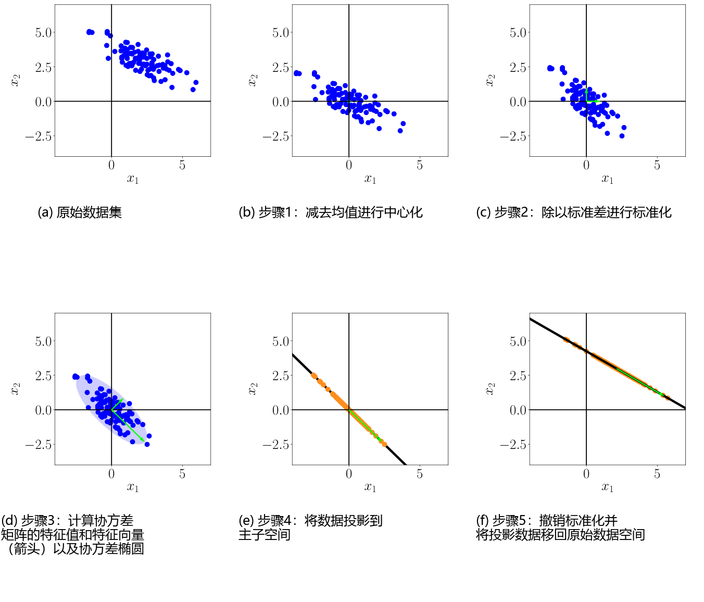
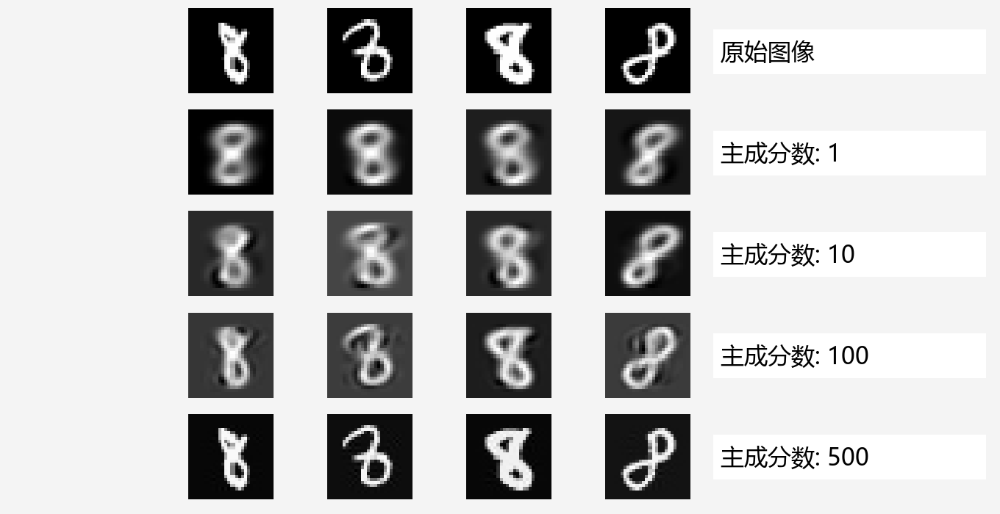
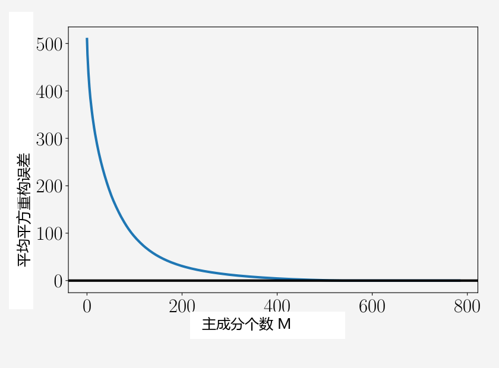

# 10.6 实践中 PCA 的关键步骤（Key Steps of PCA in Practice）

## 本节导学

**学习目标**：掌握工程上执行 PCA 的六步标准流程（图 10.11），尤其是**训练/测试必须用同一组均值与标准差**的细节，以及 PCA 的实际输出是**低维编码**而非高维重构。

**预备知识**：10.1–10.5 节全部。

---

## 10.6.1 六步流程

给定二维数据集（图 10.11(a)），目标是正交投影到一维主子空间：

**第 1 步：去均值中心化（mean subtraction）**。计算样本均值 $\boldsymbol\mu$，每个数据点减 $\boldsymbol\mu$（图 10.11(b)）。中心化后的样本均值严格为 $\boldsymbol 0$——降低数值病态与精度下溢风险（理论上非必需，实践上强烈建议）。

**第 2 步：方差标准化（standardization）**。每维 $d$ 除以样本标准差 $\sigma_d$——数据无量纲化，各坐标轴方差均为 1（图 10.11(c) 的等长箭头）。（若各维度量纲相同且量级相当，此步可省。）

**第 3 步：协方差矩阵特征分解**。对标准化数据算 $\boldsymbol S$、求特征值与特征向量。$\boldsymbol S$ 对称 ⟹ 谱定理（定理 4.15）保证标准正交特征基存在；图 10.11(d) 中特征向量按特征值缩放，较长的张成主子空间 $U$，椭圆是协方差等高线。

**第 4 步：正交投影**。对新数据点 $\boldsymbol x_*$，**先用训练数据的 $\mu_d, \sigma_d$ 做同样的标准化**（(10.58)——量纲必须与训练阶段一致！），再投影：

$$
\tilde{\boldsymbol x}_* = \boldsymbol B\boldsymbol B^\top \boldsymbol x_* \ (\text{重构}, 10.59), \qquad \boldsymbol z_* = \boldsymbol B^\top \boldsymbol x_* \ (\text{低维编码}, 10.60)
$$

$\boldsymbol B$ 的列 = 最大特征值对应的特征向量。**PCA 的最终输出是紧凑编码 $\boldsymbol z_*$（10.60）**，$\tilde{\boldsymbol x}_*$ 只是中间产物。

**第 5 步（撤销标准化）**：若要在原始数据空间展示重构，做逆变换（(10.61)）：

$$
\tilde x_*^{(d)} \leftarrow \tilde x_*^{(d)}\,\sigma_d + \mu_d
$$

图 10.11(f) 为映射回原始空间的最终结果。

  
  
<b>图 10.11</b> PCA 实践步骤：(a) 原始数据；(b) 去均值；(c) 方差标准化；(d) 特征分解；(e) 投影；(f) 撤销标准化映射回原始空间。

## 10.6.2 例 10.4（MNIST 图像重构）

MNIST 全部 60,000 张数字图像（$784$ 维）。取数字"8"的 5,389 张训练图像，按上述步骤学主子空间，重构测试图像（图 10.12）：

- **1 个主成分**：粗略但可辨识的轮廓；
- **10 / 100 / 500 个**：迅速锐化，笔画细节完整；
- **全部 784 个**：重构误差为零，100% 无损。

**误差曲线**（(10.62)，图 10.13）：

$$
\frac{1}{N}\sum_n \|\boldsymbol x_n - \tilde{\boldsymbol x}_n\|^2 = \sum_{i=M+1}^D \lambda_i
$$

——平均平方重构误差**精确等于**正交补中特征值之和（10.3 节的结论）。特征重要性指数级骤降；约 550 个主成分后误差基本归零（数字边缘像素在全部数据中方差本就为 0）。与图 10.5 互相印证：**绝大部分方差由少数主成分捕获**。

  
  
<b>图 10.12</b> 主成分个数对重构质量的影响：第一行原始图像；随后为 1、10、100、500 个主成分的重构。

  
  
<b>图 10.13</b> 平均平方重构误差随 M 的变化——精确等于正交补空间特征值之和。

---

## 本节小结

| 步骤 | 操作 | 关键提醒 |
| --- | --- | --- |
| 1 | 减均值 | 降数值病态 |
| 2 | 除标准差 | 测试点用**训练阶段**的 $\mu_d, \sigma_d$ |
| 3 | 特征分解 | 谱定理保证 ONB |
| 4 | 投影 | 输出**编码 $\boldsymbol z_*$**，不是 $\tilde{\boldsymbol x}_*$ |
| 5 | 撤销标准化 | 仅展示重构时需要 |

**与其他章节的关系**：8.6 节的模型选择（选 $M$）在此落地——看图 10.13 的肘部或用嵌套交叉验证；10.7 节给同一流程配上概率模型，用边缘似然自动选 $M$。
