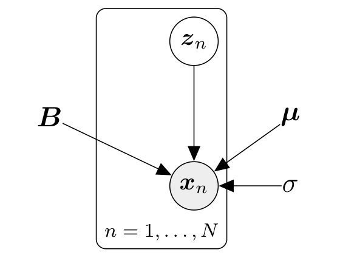
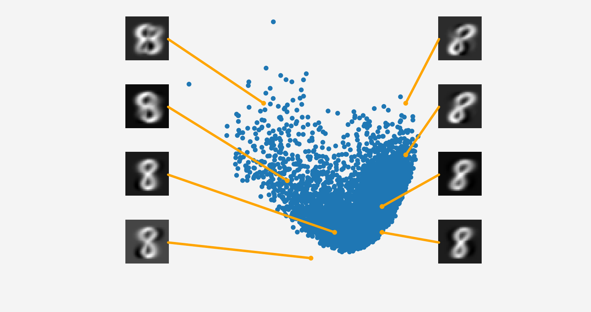

# 10.7 隐变量视角：概率 PCA（Latent Variable Perspective）

## 本节导学

**学习目标**

1. 理解为什么给 PCA 配概率模型（似然、模型选择、生成采样、缺失数据、异常检测等九大理由）；
2. 掌握 PPCA 的生成过程 (10.63)–(10.66)、边缘似然 (10.68) 与联合高斯分布 (10.72)；
3. 会用高斯条件公式 (6.66)(6.67) 求隐变量后验 (10.73)–(10.75)，并理解后验协方差与观测无关的意义。

**预备知识**：8.4.3 节（隐变量模型）、6.5 节（高斯边缘/条件）、9.3.5 节（边缘似然的两步推导）、8.5 节（图模型）。

**符号速查表**：

| 符号 | 含义 |
| --- | --- |
| $\boldsymbol z \in \mathbb R^M$ | 连续隐变量（潜编码），先验 $\mathcal N(\boldsymbol 0, \boldsymbol I)$ |
| $\boldsymbol B \in \mathbb R^{D \times M}$ | 线性映射（因子载荷矩阵，不再约束正交） |
| $\boldsymbol\mu \in \mathbb R^D$ | 均值参数 |
| $\sigma^2$ | 各向同性噪声方差 |
| PPCA | 概率主成分分析（Tipping and Bishop, 1999） |

---

## 10.7.0 为什么需要概率版 PCA

10.2/10.3 的几何推导优雅，但确定性框架有局限。概率模型（PPCA 解决了全部九点）：

1. 显式似然——原则性地处理带噪声观测；
2. 边缘似然——严格的贝叶斯模型选择与维度比较（8.6 节）；
3. **生成模型**——可采样合成新数据；
4. 与因子分析（FA）的经典桥梁；
5. 贝叶斯定理自然处理随机缺失维度；
6. 量化新颖度（异常检测）；
7. 原则性的拓展框架（高斯混合 PCA）；
8. **经典 PCA = 零噪声极限**的特例；
9. 参数边缘化积分的全贝叶斯推断。

## 10.7.1 生成过程与概率模型

**隐变量先验**：$\boldsymbol z \sim \mathcal N(\boldsymbol 0, \boldsymbol I)$。**仿射生成关系**：

$$
\boldsymbol x = \boldsymbol B\boldsymbol z + \boldsymbol\mu + \boldsymbol\epsilon, \qquad \boldsymbol\epsilon \sim \mathcal N(\boldsymbol 0, \sigma^2\boldsymbol I) \tag{10.63}
$$

条件似然：

$$
p(\boldsymbol x \mid \boldsymbol z, \boldsymbol B, \boldsymbol\mu, \sigma^2) = \mathcal N\big(\boldsymbol x \mid \boldsymbol B\boldsymbol z + \boldsymbol\mu,\ \sigma^2\boldsymbol I\big) \tag{10.64}
$$

**先祖采样（ancestral sampling）**：$\boldsymbol z_n \sim \mathcal N(\boldsymbol 0, \boldsymbol I)$（(10.65)）→ $\boldsymbol x_n \sim \mathcal N(\boldsymbol B\boldsymbol z_n + \boldsymbol\mu, \sigma^2\boldsymbol I)$（(10.66)）。联合分布 $p(\boldsymbol x, \boldsymbol z) = p(\boldsymbol x \mid \boldsymbol z)p(\boldsymbol z)$（(10.67)），图模型见图 10.14。

> **备注（箭头的因果方向）**：箭头 $\boldsymbol z \to \boldsymbol x$——**低维隐变量是产生高维观测的"潜在诱因"**。降维任务要反推 $\boldsymbol z$：用贝叶斯推断"翻转"箭头（10.7.3）。♦

> **例 10.5（生成新数字）**。MNIST"8"的二维隐空间（图 10.15）：隐空间中移动采样位置，生成图像平滑变化（形态、旋转、笔画粗细）；远离训练数据处出现伪影；**内在自由度严格只有 2 维**。

  
  
<b>图 10.14</b> PPCA 图模型：xₙ 显式依赖 zₙ；B、μ、σ 在所有样本间共享。

  
  
<b>图 10.15</b> 生成新 MNIST 图像：x̃ = Bz；离训练分布越近，生成越逼真。

## 10.7.2 似然与联合分布

**边缘似然**（对隐变量积分，8.4.3 节两步流程）：

$$
p(\boldsymbol x \mid \boldsymbol B, \boldsymbol\mu, \sigma^2) = \int \mathcal N(\boldsymbol x \mid \boldsymbol B\boldsymbol z + \boldsymbol\mu, \sigma^2\boldsymbol I)\,\mathcal N(\boldsymbol z \mid \boldsymbol 0, \boldsymbol I)\,\mathrm d\boldsymbol z \tag{10.68}
$$

**第 1 步（高斯性）**：被积函数是两个高斯的乘积 ⟹ 积分为高斯（6.5.2 节）。

**第 2 步（矩，仿射变换法则 (6.50)(6.51)）**：

$$
\mathbb E[\boldsymbol x] = \mathbb E[\boldsymbol B\boldsymbol z + \boldsymbol\mu] + \mathbb E[\boldsymbol\epsilon] = \boldsymbol\mu \tag{10.69}
$$

$$
\mathbb V[\boldsymbol x] = \boldsymbol B\,\mathbb V[\boldsymbol z]\,\boldsymbol B^\top + \sigma^2\boldsymbol I = \boldsymbol B\boldsymbol B^\top + \sigma^2\boldsymbol I \tag{10.70}
$$

——边缘似然 $\mathcal N(\boldsymbol x \mid \boldsymbol\mu, \boldsymbol B\boldsymbol B^\top + \sigma^2\boldsymbol I)$ 可用于 MLE/MAP。

> **备注**：不能用条件似然 (10.64) 直接估计参数——它仍含未知隐变量 $\boldsymbol z$；似然必须只是 $\boldsymbol x$ 与参数的函数（8.4.3 节的铁律）。♦

**联合高斯**：$\boldsymbol z$ 与其仿射变换 $\boldsymbol x$ 联合高斯。互协方差（(6.52)）：

$$
\operatorname{Cov}[\boldsymbol x, \boldsymbol z] = \operatorname{Cov}[\boldsymbol B\boldsymbol z + \boldsymbol\mu, \boldsymbol z] = \boldsymbol B\,\operatorname{Cov}[\boldsymbol z, \boldsymbol z] = \boldsymbol B \tag{10.71}
$$

拼成块矩阵（(10.72)）：

$$
p(\boldsymbol x, \boldsymbol z) = \mathcal N\left(\begin{bmatrix}\boldsymbol x \\ \boldsymbol z\end{bmatrix}\ \middle|\ \begin{bmatrix}\boldsymbol\mu \\ \boldsymbol 0\end{bmatrix},\ \begin{bmatrix}\boldsymbol B\boldsymbol B^\top + \sigma^2\boldsymbol I & \boldsymbol B \\ \boldsymbol B^\top & \boldsymbol I\end{bmatrix}\right) \tag{10.72}
$$

## 10.7.3 后验分布

对 (10.72) 用高斯条件公式 (6.66)(6.67)（$p(\boldsymbol z \mid \boldsymbol x)$：以 $\boldsymbol x$ 为条件的部分）：

$$
p(\boldsymbol z \mid \boldsymbol x) = \mathcal N(\boldsymbol z \mid \boldsymbol m, \boldsymbol C) \tag{10.73}
$$

$$
\boldsymbol m = \boldsymbol B^\top\big(\boldsymbol B\boldsymbol B^\top + \sigma^2\boldsymbol I\big)^{-1}(\boldsymbol x - \boldsymbol\mu) \tag{10.74}
$$

$$
\boldsymbol C = \boldsymbol I - \boldsymbol B^\top\big(\boldsymbol B\boldsymbol B^\top + \sigma^2\boldsymbol I\big)^{-1}\boldsymbol B \tag{10.75}
$$

（验证维度：$\boldsymbol B^\top(\boldsymbol B\boldsymbol B^\top + \sigma^2\boldsymbol I)^{-1}$ 是 $M \times D$ 乘 $D \times D$ 乘 $D$ → $M$；$\boldsymbol C$ 是 $M \times M$。）

**两个重要观察**：

1. **后验协方差 $\boldsymbol C$ 与具体观测 $\boldsymbol x$ 无关**——所有测试点共享同一个"嵌入置信度"矩阵；$\det(\boldsymbol C)$ 越小嵌入越确定；某点导出高方差后验 ⟹ 它可能是**异常离群点**（用途 6：新颖度检测）。
2. **生成后验下的合理数据**：从 $p(\boldsymbol z \mid \boldsymbol x_*)$ 采 $\boldsymbol z_*$ → 从 $p(\boldsymbol x \mid \boldsymbol z_*)$ 采 $\tilde{\boldsymbol x}_*$——得到符合后验置信的所有可能高维形态（去噪/补全的应用形态）。

---

## 本节小结

| 对象 | 结果 |
| --- | --- |
| 生成过程 | $\boldsymbol z \sim \mathcal N(\boldsymbol 0,\boldsymbol I)$ → $\boldsymbol x = \boldsymbol B\boldsymbol z + \boldsymbol\mu + \epsilon$ |
| 边缘似然 | $\mathcal N(\boldsymbol\mu,\ \boldsymbol B\boldsymbol B^\top + \sigma^2\boldsymbol I)$（高斯乘积 + 仿射矩） |
| 联合分布 | 块矩阵 (10.72)，互协方差 = $\boldsymbol B$ |
| 隐变量后验 | $\mathcal N(\boldsymbol m, \boldsymbol C)$（高斯条件公式）；$\boldsymbol C$ 与 $\boldsymbol x$ 无关 |

**与其他章节的关系**：9.3.5 节边缘似然两步法在此复用；6.5.1 节条件高斯公式是全部推导的引擎；10.8 节给出 MLE 闭式解（(10.77)–(10.79)）与零噪声极限证明——经典 PCA 是 PPCA 在 $\sigma \to 0$ 时的特例；第 11 章 GMM 把"隐变量 + EM"的组合用于密度估计。
