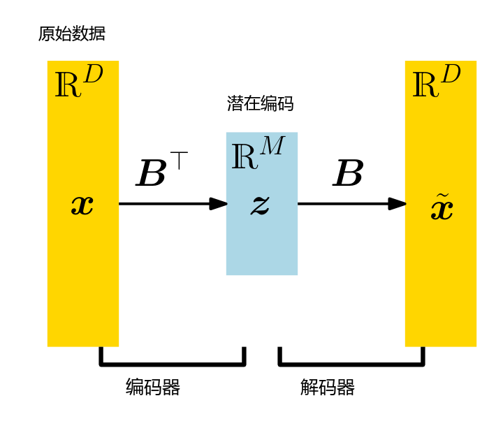

# 10.8 延伸阅读（Further Reading）

## 本节导学

**学习目标**：了解 PCA 的其他视角（自动编码器、信息论）与主要拓展（PPCA 参数估计与零噪声极限、贝叶斯 PCA、因子分析、ICA、核 PCA、GP-LVM）。

---

## 作为线性自动编码器的 PCA

图 10.16：编码器 $\boldsymbol z_n = \boldsymbol B^\top\boldsymbol x_n$ + 解码器 $\tilde{\boldsymbol x}_n = \boldsymbol B\boldsymbol z_n$，优化

$$
\frac{1}{N}\sum_n \|\boldsymbol x_n - \tilde{\boldsymbol x}_n\|^2 = \frac{1}{N}\sum_n \|\boldsymbol x_n - \boldsymbol B\boldsymbol B^\top\boldsymbol x_n\|^2 \tag{10.76}
$$

与 (10.29) 完全相同——**线性自编码器的最优解 = PCA**。把线性映射换成非线性（多层前馈网络）即得**深度自动编码器**；深度学习语境中编码器称识别/推断网络，解码器称生成器。

  
  
<b>图 10.16</b> PCA 作为线性自动编码器：解码重构 = 数据在 M 维主子空间上的正交投影。

## 信息论视角

编码是原始数据的有损压缩。要保留最多信息 = 最大化原始数据与低维编码之间的**互信息（mutual information）**；在高斯假设下，最优线性映射与 PCA 解完全一致（MacKay, 2003）。

## 概率 PCA 的参数估计与零噪声极限

10.7 节假设 $\boldsymbol B, \boldsymbol\mu, \sigma^2$ 已知。Tipping and Bishop (1999) 给出 MLE 闭式解：

$$
\boldsymbol\mu_{\text{ML}} = \frac{1}{N}\sum_n \boldsymbol x_n \tag{10.77}
$$

$$
\boldsymbol B_{\text{ML}} = \boldsymbol T\big(\boldsymbol\Lambda - \sigma^2\boldsymbol I\big)^{\frac{1}{2}}\boldsymbol R \tag{10.78}
$$

$$
\sigma_{\text{ML}}^2 = \frac{1}{D - M}\sum_{j=M+1}^D \lambda_j \tag{10.79}
$$

其中 $\boldsymbol T$ = 数据协方差的前 $M$ 个特征向量，$\boldsymbol\Lambda = \operatorname{diag}(\lambda_1, \ldots, \lambda_M)$，$\boldsymbol R$ 为任意正交旋转矩阵——**MLE 在旋转意义下唯一**（对应 SVD 的旋转自由度）。(10.79) 的含义深刻：**观测噪声方差 = 被丢弃特征值的算术平均**——PCA 捕获不了的剩余方差在概率模型中被一律视为各向同性白噪声。

**零噪声极限**（$\sigma \to 0$）：PPCA 协方差 $\boldsymbol B\boldsymbol B^\top + \sigma^2\boldsymbol I$ 必须等于 PCA 的协方差 $\boldsymbol S = \boldsymbol T\boldsymbol\Lambda\boldsymbol T^{-1}$（(10.80)），故 $\boldsymbol B = \boldsymbol T\boldsymbol\Lambda^{1/2}\boldsymbol R$（(10.81)）——**经典 PCA = PPCA 的无噪声极限 MLE**。流式数据可用 EM 估计（Roweis, 1998）。

**内在维度 $M$ 的选取**：Gavish and Donoho (2014) 的截断规则（噪声标准差 $\sigma$ 已知时，丢弃小于 $4\sigma\sqrt{D}/\sqrt{3}$ 的奇异值）；嵌套交叉验证（8.6.1）；贝叶斯证据（Minka, 2001b）。

## 贝叶斯 PCA、因子分析与独立成分分析

- **贝叶斯 PCA**（Bishop, 1999）：参数加先验再边缘化——避免点估计过拟合，贝叶斯奥卡姆剃刀**自动剪枝冗余主成分**（自动学 $M$）；
- **因子分析（FA）**（Spearman, 1904）：把 PPCA 的各向同性噪声 $\sigma^2\boldsymbol I$ 换成对角 $\operatorname{diag}(\sigma_1^2, \ldots, \sigma_D^2)$——尺度不变，但失去旋转不变性；
- **独立成分分析（ICA）**（Hyvärinen et al., 2001）：隐变量先验改为**非高斯**——盲源分离（鸡尾酒会问题），打破 PCA 的旋转不确定性，分离独立信号源。线性降维综述：Cunningham and Ghahramani (2015)。

## 核 PCA 与 GP-LVM

- **核 PCA**（Schölkopf et al., 1998）：核技巧把特征内积推广到无限维空间，挖掘非线性流形（Burges, 2010）；
- **GP-LVM**（Lawrence, 2005）：把 $\boldsymbol z \to \boldsymbol x$ 的线性映射换成非参数高斯过程；贝叶斯 GP-LVM（Titsias and Lawrence, 2010）用变分推断积分隐变量——现代非参数贝叶斯降维前沿。

---

## 本节小结

| 方向 | 代表 |
| --- | --- |
| 视角 | 线性/深度自动编码器、互信息 |
| 概率化 | PPCA MLE（(10.77)–(10.79)）、零噪声极限、贝叶斯 PCA |
| 近亲模型 | 因子分析（对角噪声）、ICA（非高斯先验） |
| 非线性化 | 核 PCA、GP-LVM |

**下一步**：第 11 章密度估计——高斯混合模型把"隐变量 + EM + 边缘似然"的三件套用于建模 $p(\boldsymbol x)$ 本身，10.7 节的 PPCA 是它的近亲。
