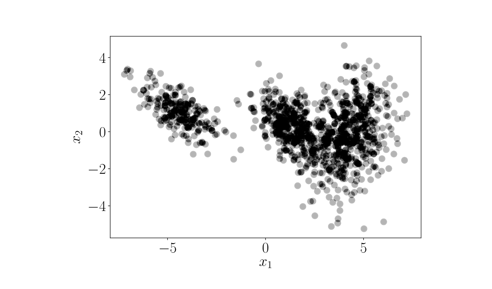

# 第 11 章 使用高斯混合模型进行密度估计（Density Estimation with Gaussian Mixture Models）

## 本章导学

**学习目标**：掌握机器学习的第三大支柱——**密度估计**：用参数化概率分布 $p(\boldsymbol x)$ 紧凑地表示数据，而不只是罗列数据点。本章主角是**高斯混合模型（GMM）**与训练它的**期望最大化（EM）算法**——这是全书概率工具（第 6 章）与优化工具（第 7 章）最深刻的一次联合作战。

**为什么需要混合模型？** 单一高斯（或任何简单单峰分布）表达能力有限——图 11.1 的多峰数据集用单高斯拟合极其糟糕。**混合模型**用 $K$ 个基分布的凸组合逼近复杂密度（(11.1)(11.2)）：

$$
p(\boldsymbol x) = \sum_{k=1}^K \pi_k\, p_k(\boldsymbol x), \qquad 0 \le \pi_k \le 1,\ \sum_k \pi_k = 1
$$

——能表示**多峰数据**（多个"簇"）。GMM 取 $p_k$ 为高斯。

**本章与前面模型的本质区别**：线性回归（9.2 节）与 PCA（10.2 节）的 MLE 都有**解析闭式解**；**GMM 的 MLE 没有闭式解**——求导导出一组相互耦合的联立非线性方程，只能靠 EM 迭代求解。核心难点：对数似然 (11.10) 中 $\log$ 在求和号**外面**，无法穿透。

**路线**：11.1 形式化 GMM → 11.2 求导得"责任度加权"的三大更新公式（看似闭式，实则互相耦合）→ 11.3 EM 算法（E 步算责任度、M 步更新参数）→ 11.4 隐变量视角（责任度 = 后验概率，EM = 边界优化）→ 11.5 延伸阅读。

**预备知识**：5.5 节（矩阵求导恒等式 (5.101)(5.106)）、6.5 节（高斯）、7.2 节（拉格朗日乘子）、8.3 节（MLE）、8.4.3 节（隐变量模型）、9.3.3 节（配方法）。

  
  
<b>图 11.1</b> 无法用单一高斯分布合理解释的复杂二维数据集。

