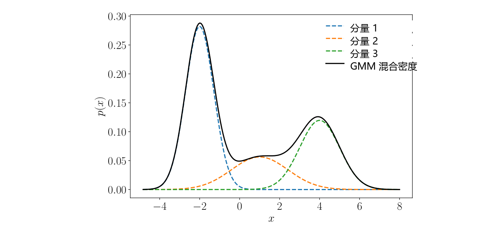

# 11.1 高斯混合模型（Gaussian Mixture Model）

## 本节导学

**学习目标**：写出 GMM 的密度公式 (11.3)，理解混合权重的概率约束，能读出一维混合密度的分量分解。

**预备知识**：6.5 节（高斯密度）、6.2 节（概率分布的基本概念）。

---

**高斯混合模型（GMM）** = $K$ 个高斯的凸组合：

$$
p(\boldsymbol x \mid \boldsymbol\theta) = \sum_{k=1}^K \pi_k\,\mathcal N\big(\boldsymbol x \mid \boldsymbol\mu_k, \boldsymbol\Sigma_k\big) \tag{11.3}
$$

$$
0 \le \pi_k \le 1, \qquad \sum_{k=1}^K \pi_k = 1 \tag{11.4}
$$

全部待估参数 $\boldsymbol\theta := \{\boldsymbol\mu_k, \boldsymbol\Sigma_k, \pi_k : k = 1, \ldots, K\}$。$K = 1$ 时退化为单一高斯。凸组合（权重非负、和为 1）保证 $p(\boldsymbol x \mid \boldsymbol\theta)$ 是合法密度（非负且积分为 1）。

  
  
<b>图 11.2</b> GMM 结构：整体混合分布（黑色实线）由三个加权高斯分量（彩色虚线）叠加构成。

图 11.2 的一维示例显式写出：

$$
p(x \mid \boldsymbol\theta) = 0.5\,\mathcal N(x \mid -2, 1) + 0.2\,\mathcal N(x \mid 1, 2) + 0.3\,\mathcal N(x \mid 4, 1) \tag{11.5}
$$

——三个高斯"驼峰"按权重叠加成多峰密度。**任务**：给定无监督观测数据，拟合 $\boldsymbol\theta$（下一节）。

---

## 本节小结

| 要点 | 内容 |
| --- | --- |
| 模型 | $K$ 个高斯的凸组合，权重 $\pi_k$ 非负归一 |
| 表达力 | 多峰密度（多簇数据）；$K=1$ 退化为单高斯 |
| 学习 | 无监督（无标签）MLE——下一节，无闭式解 |

**与其他章节的关系**：6.5.3 节定理 6.12（混合高斯的均值方差）是 GMM 矩计算的基础；11.4 节将给 (11.3) 配上离散隐变量解释。
