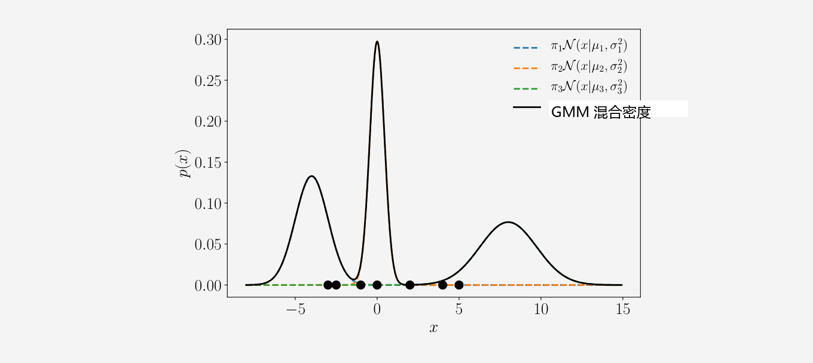
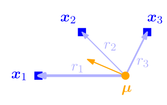

# 11.2 通过极大似然进行参数学习（Parameter Learning via Maximum Likelihood）

## 本节导学

**学习目标**

1. 写出 GMM 的对数似然 (11.10)，理解"$\log$ 无法穿透求和"为何导致无闭式解；
2. 掌握核心量**责任度** $r_{nk}$ (11.17) 的定义与"软归属"解释；
3. **完整推导三大更新公式**：均值 (11.20)、协方差 (11.30)、权重 (11.42)——每个证明都用链式法则 + 责任度替换；
4. 理解"更新公式看似闭式、实则耦合"——这正是需要 EM 迭代的原因。

**预备知识**：5.2 节（链式法则）、5.5 节（矩阵求导 (5.101)(5.106)）、7.2 节（拉格朗日乘子）、6.5 节（高斯密度对参数的导数）。

**符号速查表**：

| 符号 | 含义 |
| --- | --- |
| $r_{nk}$ | 责任度：分量 $k$ 对数据点 $n$ 的"承担比例"（(11.17)） |
| $N_k := \sum_n r_{nk}$ | 分量 $k$ 的有效总责任度（有效样本容量，(11.24)） |
| $\mathcal L$ | 对数似然 (11.10) |

---

## 11.2.0 设定与似然

**贯穿示例**：一维数据集 $\mathcal X = \{-3, -2.5, -1, 0, 2, 4, 5\}$，$K = 3$ 个分量，初始化

$$
p_1 = \mathcal N(-4, 1), \qquad p_2 = \mathcal N(0, 0.2), \qquad p_3 = \mathcal N(8, 3), \qquad \pi_k = \tfrac{1}{3} \tag{11.6–11.8}
$$

（图 11.3：初始密度离数据很远——参数估计就是要把它"拉"过来。）

  
  
<b>图 11.3</b> 初始设定：三个高斯分量（彩色虚线）、混合密度（黑色实线）与七个数据点（黑色圆盘）。

**似然与对数似然**（i.i.d. 因式分解）：

$$
p(\mathcal X \mid \boldsymbol\theta) = \prod_{n=1}^N p(\boldsymbol x_n \mid \boldsymbol\theta), \qquad \mathcal L := \log p(\mathcal X \mid \boldsymbol\theta) = \sum_{n=1}^N \log\Big(\sum_{k=1}^K \pi_k\,\mathcal N\big(\boldsymbol x_n \mid \boldsymbol\mu_k, \boldsymbol\Sigma_k\big)\Big) \tag{11.9, 11.10}
$$

**为什么无闭式解**：单高斯时 $\log$ 直接作用于高斯密度，得到 (11.11) 的二次型，可解析求解（8.3 节）。**GMM 的 $\log$ 在关于 $k$ 的求和之外**——对数无法穿透求和号，目标函数成为"对数和"的复杂非线性函数，常规"求导令零解方程"走不通。

**一阶必要条件**（第 7 章）：局部极值处三个偏导都为零 (11.12)–(11.14)。每个偏导都通过链式法则分解 (11.15)：

$$
\frac{\partial\log p(\boldsymbol x_n \mid \boldsymbol\theta)}{\partial\boldsymbol\theta} = \frac{1}{p(\boldsymbol x_n \mid \boldsymbol\theta)}\,\frac{\partial p(\boldsymbol x_n \mid \boldsymbol\theta)}{\partial\boldsymbol\theta}, \qquad \frac{1}{p(\boldsymbol x_n \mid \boldsymbol\theta)} = \frac{1}{\sum_j \pi_j\mathcal N(\boldsymbol x_n \mid \boldsymbol\mu_j, \boldsymbol\Sigma_j)} \tag{11.15, 11.16}
$$

——$1/p$ 这个因子正是"耦合"的来源。为驯服它，先定义本章的支柱量。

## 11.2.1 责任度

**定义**：

$$
r_{nk} := \frac{\pi_k\,\mathcal N\big(\boldsymbol x_n \mid \boldsymbol\mu_k, \boldsymbol\Sigma_k\big)}{\sum_{j=1}^K \pi_j\,\mathcal N\big(\boldsymbol x_n \mid \boldsymbol\mu_j, \boldsymbol\Sigma_j\big)} \tag{11.17}
$$

分子 = "分量 $k$ 生成 $\boldsymbol x_n$"的联合似然 (11.18)；分母 = $\boldsymbol x_n$ 的总似然。因此 $r_{nk}$ ∝ 联合似然，且 $\boldsymbol r_n = [r_{n1}, \ldots, r_{nK}]^\top$ 是**归一化概率向量**（$\sum_k r_{nk} = 1$）——数据点 $\boldsymbol x_n$ 对 $K$ 个分量的**软归属（soft assignment）**。11.4.3 节将证明它正是贝叶斯后验概率 $p(z_k = 1 \mid \boldsymbol x_n)$。

> **例 11.2（责任度矩阵）**。对本例算出的 $\boldsymbol R \in \mathbb R^{7 \times 3}$（(11.19)，每行行和 = 1）：分量 3 对前四个点责任度 ≈ 0、对后三个点 ≈ 1。**列和** $N_1 = 2.058$、$N_2 = 2.008$、$N_3 = 2.934$ = 各分量的有效责任度总量。

## 11.2.2 更新均值（定理 11.1）

$$
\boldsymbol\mu_k^{\text{new}} = \frac{\sum_n r_{nk}\boldsymbol x_n}{\sum_n r_{nk}} = \frac{1}{N_k}\sum_n r_{nk}\boldsymbol x_n \tag{11.20}
$$

**证明**（只第 $k$ 个分量依赖 $\boldsymbol\mu_k$，其余项求导为零）：

$$
\frac{\partial p(\boldsymbol x_n \mid \boldsymbol\theta)}{\partial\boldsymbol\mu_k} = \pi_k\,\frac{\partial\mathcal N(\boldsymbol x_n \mid \boldsymbol\mu_k, \boldsymbol\Sigma_k)}{\partial\boldsymbol\mu_k} = \pi_k\,(\boldsymbol x_n - \boldsymbol\mu_k)^\top\boldsymbol\Sigma_k^{-1}\,\mathcal N(\boldsymbol x_n \mid \boldsymbol\mu_k, \boldsymbol\Sigma_k) \tag{11.21}
$$

（高斯对均值的导数：指数项对 $\boldsymbol\mu_k$ 求导带出 $\boldsymbol\Sigma_k^{-1}(\boldsymbol x_n - \boldsymbol\mu_k)$，转置后置于左侧——行向量约定。）代入 (11.15)：

$$
\frac{\partial\mathcal L}{\partial\boldsymbol\mu_k} = \sum_n \frac{\pi_k\mathcal N(\boldsymbol x_n \mid \boldsymbol\mu_k, \boldsymbol\Sigma_k)}{\sum_j\pi_j\mathcal N(\boldsymbol x_n \mid \boldsymbol\mu_j, \boldsymbol\Sigma_j)}\,(\boldsymbol x_n - \boldsymbol\mu_k)^\top\boldsymbol\Sigma_k^{-1} = \sum_n r_{nk}(\boldsymbol x_n - \boldsymbol\mu_k)^\top\boldsymbol\Sigma_k^{-1} \tag{11.22}
$$

**令零、右乘 $\boldsymbol\Sigma_k$、移项**：

$$
\sum_n r_{nk}\boldsymbol x_n^\top = N_k\,\boldsymbol\mu_k^\top \iff \boldsymbol\mu_k^{\text{new}} = \frac{1}{N_k}\sum_n r_{nk}\boldsymbol x_n \quad \blacksquare
$$

**直觉**：均值 = **责任度加权的算术平均**——每个数据点以 $r_{nk}$ 为"拉力"把 $\boldsymbol\mu_k$ 拉向自己（图 11.4）。归一化责任度 $\boldsymbol r_k = [r_{1k}, \ldots, r_{Nk}]^\top/N_k$（(11.25)）下，更新即期望 $\boldsymbol\mu_k \leftarrow \mathbb E_{\boldsymbol r_k}[\boldsymbol X]$（(11.26)）。

> **备注（耦合的所在）**：$r_{nk}$ 依赖**所有**分量的参数——所以 (11.20) 不是真正的闭式解，只是"给定责任度时的最优解"。♦

> **例 11.3**。仅更新一次均值：$\mu_1: -4 \to -2.7$、$\mu_2: 0 \to -0.4$、$\mu_3: 8 \to 3.7$（(11.27)–(11.29)，图 11.5）——分量 1、3 迅速移向数据密集区。

  
  
<b>图 11.4</b> 均值更新：μₖ 被各数据点拉拽，拉力 = 责任度。

## 11.2.3 更新协方差（定理 11.2）

$$
\boldsymbol\Sigma_k^{\text{new}} = \frac{1}{N_k}\sum_n r_{nk}(\boldsymbol x_n - \boldsymbol\mu_k)(\boldsymbol x_n - \boldsymbol\mu_k)^\top \tag{11.30}
$$

**证明要点**：对 $\mathcal N$ 关于 $\boldsymbol\Sigma_k$ 求导（乘积法则拆行列式项与指数项），用两个矩阵恒等式 (11.33)(11.34)（5.5 节 (5.101)(5.106) 的实例）：

$$
\frac{\partial}{\partial\boldsymbol\Sigma_k}\det(\boldsymbol\Sigma_k)^{-\frac12} = -\frac12\det(\boldsymbol\Sigma_k)^{-\frac12}\boldsymbol\Sigma_k^{-1}, \qquad \frac{\partial}{\partial\boldsymbol\Sigma_k}\big[(\boldsymbol x_n - \boldsymbol\mu_k)^\top\boldsymbol\Sigma_k^{-1}(\boldsymbol x_n - \boldsymbol\mu_k)\big] = -\boldsymbol\Sigma_k^{-1}(\boldsymbol x_n - \boldsymbol\mu_k)(\boldsymbol x_n - \boldsymbol\mu_k)^\top\boldsymbol\Sigma_k^{-1}
$$

整理后代入 (11.15) 并用 $r_{nk}$ 替换（(11.36a)–(11.36d) 逐步：提取 $\pi_k\mathcal N$、除以总似然 ⟹ $r_{nk}$；把与 $n$ 无关的 $\boldsymbol\Sigma_k^{-1}$ 提出求和）：

$$
\frac{\partial\mathcal L}{\partial\boldsymbol\Sigma_k} = -\frac12\boldsymbol\Sigma_k^{-1}N_k + \frac12\boldsymbol\Sigma_k^{-1}\Big(\sum_n r_{nk}(\boldsymbol x_n - \boldsymbol\mu_k)(\boldsymbol x_n - \boldsymbol\mu_k)^\top\Big)\boldsymbol\Sigma_k^{-1}
$$

**令零**、两边左乘 $\boldsymbol\Sigma_k$、再右乘 $\boldsymbol\Sigma_k$（(11.37a)(11.37b)）：

$$
N_k\boldsymbol\Sigma_k^{-1} = \boldsymbol\Sigma_k^{-1}\Big(\sum_n r_{nk}(\boldsymbol x_n - \boldsymbol\mu_k)(\cdot)^\top\Big)\boldsymbol\Sigma_k^{-1} \implies N_k\boldsymbol I = \Big(\sum_n \cdots\Big)\boldsymbol\Sigma_k^{-1}
$$

解出 $\boldsymbol\Sigma_k$ 即得 (11.30)。$\blacksquare$ ——**责任度加权的经验协方差**（与 6.4.2 节经验协方差同构，权重换成 $r_{nk}$）。

> **例 11.4**。方差更新：$\sigma_1^2: 1 \to 0.14$、$\sigma_2^2: 0.2 \to 0.44$、$\sigma_3^2: 3 \to 1.53$（图 11.6）——分量 1、3 收缩变锐，峰贴合局部数据簇。

## 11.2.4 更新混合权重（定理 11.3）

$$
\pi_k^{\text{new}} = \frac{N_k}{N} \tag{11.42}
$$

**证明**（等式约束 $\sum_k\pi_k = 1$ ⟹ 拉格朗日乘子法，7.2 节）：

$$
\mathcal L_\pi = \mathcal L + \lambda\Big(\sum_k\pi_k - 1\Big) \tag{11.43}
$$

对 $\pi_k$ 求导（注意 $\partial\pi_k\mathcal N_k/\partial\pi_k = \mathcal N_k$；再凑出 $r_{nk}$：分子分母同乘 $\pi_k$）：

$$
\frac{\partial\mathcal L_\pi}{\partial\pi_k} = \sum_n \frac{\mathcal N(\boldsymbol x_n \mid \boldsymbol\mu_k, \boldsymbol\Sigma_k)}{\sum_j\pi_j\mathcal N(\boldsymbol x_n \mid \boldsymbol\mu_j, \boldsymbol\Sigma_j)} + \lambda = \frac{1}{\pi_k}\sum_n r_{nk} + \lambda = \frac{N_k}{\pi_k} + \lambda \tag{11.44}
$$

对 $\lambda$ 求导得约束本身。联立：

$$
\pi_k = -\frac{N_k}{\lambda} \ \xrightarrow{\ \sum_k\pi_k = 1\ }\ -\frac{N}{\lambda} = 1 \iff \lambda = -N \implies \pi_k^{\text{new}} = \frac{N_k}{N} \quad \blacksquare
$$

**直觉**：权重 = 该簇的总责任度占全部数据的比例（相对重要性）。

> **例 11.5**。权重从 $\frac13$ 更新为 $\pi_1 = 0.29$、$\pi_2 = 0.29$、$\pi_3 = 0.42$（图 11.7）——责任度最高的分量 3 获得最大权重。

## 11.2.5 小结：更新公式与它们的"陷阱"

| 参数 | 更新公式 | 结构 |
| --- | --- | --- |
| $\boldsymbol\mu_k$ | $\frac{1}{N_k}\sum_n r_{nk}\boldsymbol x_n$ | 责任度加权均值 |
| $\boldsymbol\Sigma_k$ | $\frac{1}{N_k}\sum_n r_{nk}(\boldsymbol x_n - \boldsymbol\mu_k)(\cdot)^\top$ | 责任度加权协方差 |
| $\pi_k$ | $N_k/N$ | 有效责任度占比 |

**关键认识**：三个公式在**给定 $r_{nk}$** 时是最优的，但 $r_{nk}$ 本身由当前参数算出——**互相耦合、没有闭式解**。出路：交替迭代——给定参数算责任度，给定责任度更新参数。这就是 11.3 节的 EM 算法。

---

## 本节小结

- 对数似然 (11.10) 的 $\log$-求和结构 ⟹ 无闭式解；
- 责任度 $r_{nk}$ (11.17) 把一切耦合收拢进一个量；
- 三大更新公式 = 责任度加权的均值/协方差/占比（证明链：高斯求导 → 链式法则 → $r_{nk}$ 替换 → 令零求解）。

**与其他章节的关系**：11.3 节把"交替迭代"组织成 EM 并给出单调性保证；11.4 节证明 $r_{nk}$ 是隐变量的后验、EM 是边缘似然的下界优化——6.6.1 节共轭、8.4.3 节隐变量框架在此全面兑现。
