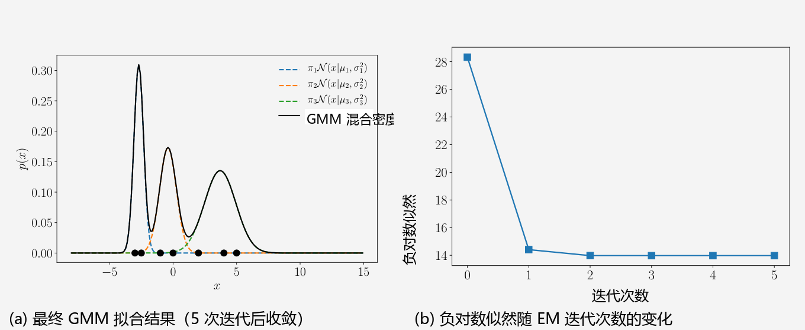
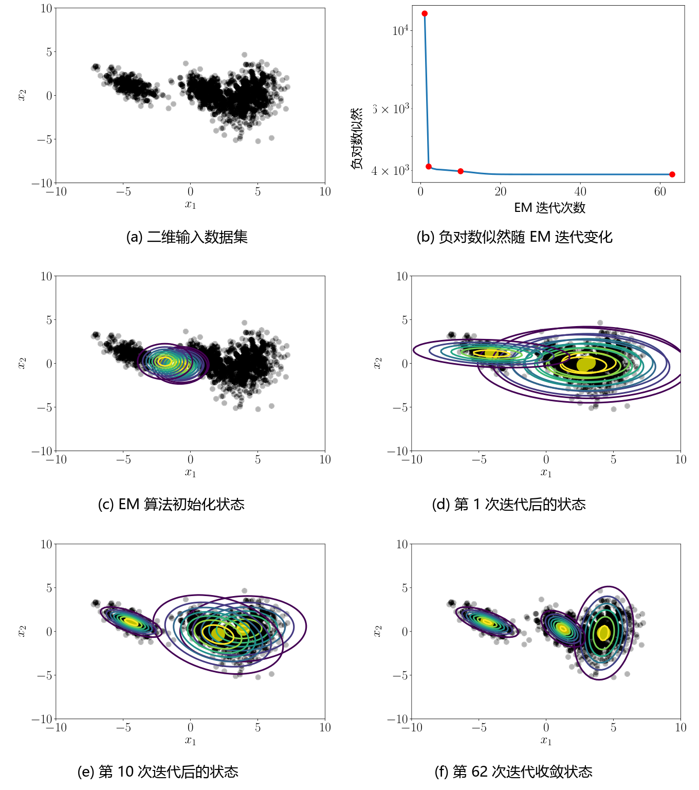
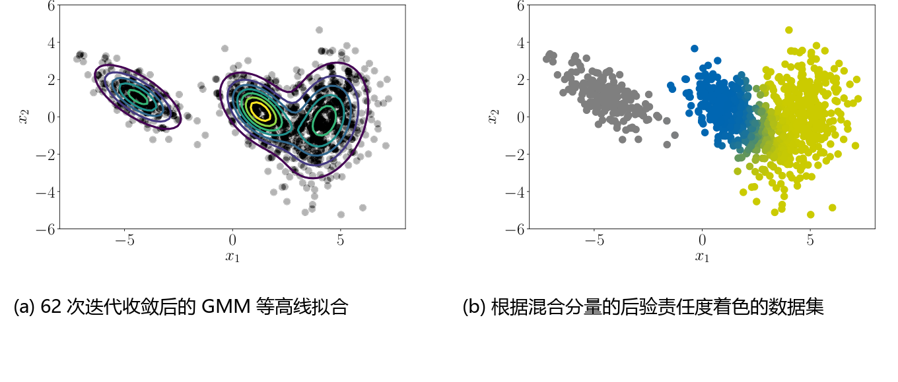

# 11.3 期望最大化算法（EM Algorithm）

## 本节导学

**学习目标**

1. 记住 EM 的两步结构（E 步算责任度、M 步更新参数）与完整执行流程；
2. 知道 EM 的单调性保证（Neal and Hinton, 1999）及其局限（不保证全局最优）；
3. 通过两个数值实例（一维 7 点、二维复杂数据）理解收敛行为与软聚类。

**预备知识**：11.2 节的三大更新公式。

---

## 11.3.1 EM 算法

**期望最大化（EM）**（Dempster et al., 1977）是含隐变量模型中 MLE/MAP 估计的通用迭代框架。在 GMM 中：初始化参数，交替执行：

- **E 步（Expectation）**：用当前参数评估所有数据点对各分量的**后验责任度** $r_{nk}$ (11.53)——"每个点有多大概率属于哪个簇"；
- **M 步（Maximization）**：用最新责任度更新参数 (11.54)–(11.56)——责任度加权的均值/协方差/占比。

**标准执行流程**：

1. **初始化**：$\boldsymbol\mu_k$（如 $K$-means 聚类中心）、$\boldsymbol\Sigma_k$（如样本全局协方差）、$\pi_k = 1/K$；
2. **E 步**：$r_{nk} = \dfrac{\pi_k\mathcal N(\boldsymbol x_n \mid \boldsymbol\mu_k, \boldsymbol\Sigma_k)}{\sum_j\pi_j\mathcal N(\boldsymbol x_n \mid \boldsymbol\mu_j, \boldsymbol\Sigma_j)}$ (11.53)；
3. **M 步**：$\boldsymbol\mu_k = \frac{1}{N_k}\sum_n r_{nk}\boldsymbol x_n$ (11.54)；$\boldsymbol\Sigma_k = \frac{1}{N_k}\sum_n r_{nk}(\boldsymbol x_n - \boldsymbol\mu_k)(\cdot)^\top$ (11.55)；$\pi_k = \frac{N_k}{N}$ (11.56)；其中 $N_k = \sum_n r_{nk}$；
4. **收敛检验**：对数似然增量 < 容差或达到最大迭代轮数则停，否则回第 2 步。

**理论保证**：EM 每轮迭代**单调非递减**对数似然（Neal and Hinton, 1999；11.4.5 节从隐变量视角解释为什么）。实践中监测 $\mathcal L$ 的增量或参数变化量判断收敛。**局限**：不保证全局最优——多随机初始化若干次，选最终对数似然最高的运行（Bishop, 2006; Rogers and Girolami, 2016）。

## 11.3.2 例 11.6（一维实例）

对图 11.3 的 7 点数据集运行 EM：**5 轮即收敛**。最终模型（(11.57)）：

$$
p(x) = 0.29\,\mathcal N(x \mid -2.75, 0.06) + 0.28\,\mathcal N(x \mid -0.50, 0.25) + 0.43\,\mathcal N(x \mid 3.64, 1.63)
$$

图 11.8(b)：负对数似然随迭代**单调平滑下降**——与理论保证一致。

  
  
<b>图 11.8</b> EM 拟合 GMM：(a) 最终拟合（5 次迭代收敛）；(b) 负对数似然单调下降曲线。

## 11.3.3 二维实例与软聚类

对图 11.1 的二维非高斯数据集，$K = 3$，图 11.9 展示完整演化：(c) 随机初始化 → (d) 第 1 轮 → (e) 第 10 轮 → (f) 第 62 轮收敛。负对数似然急剧下降后平稳。

  
  
<b>图 11.9</b> EM 在二维数据上拟合三成分 GMM 的演化：(a) 数据；(b) NLL 曲线；(c) 初始化；(d) 第 1 次；(e) 第 10 次；(f) 第 62 次收敛。

**软聚类**（图 11.10）：按收敛后的责任度 $r_{nk}$ 给数据点着色——左侧独立簇被单一分量以 ≈100% 确定性覆盖；右侧两个重叠簇交界处，样本的责任度平滑分布在 0.5 左右。**无法非黑即白硬划分**的样本正是概率模型价值所在。

  
  
<b>图 11.10</b> 收敛时的 GMM：(a) 等高线；(b) 按责任度软聚类着色。

---

## 本节小结

| 要点 | 内容 |
| --- | --- |
| E 步 | 责任度 = 后验归属概率 (11.53) |
| M 步 | 三大责任度加权更新 (11.54)–(11.56) |
| 保证 | 对数似然单调不减；收敛判断看 NLL 增量 |
| 局限 | 只保证局部最优；多随机初始化择优 |

**与其他章节的关系**：11.4 节把 EM 重构为隐变量后验下的期望最大化（$Q$ 函数 (11.73)），并解释单调性的理论来源；第 10.8 节提到 PPCA 也可用 EM——EM 是所有含隐变量高斯模型的通用引擎。
