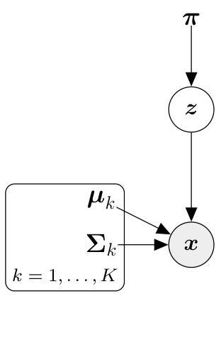
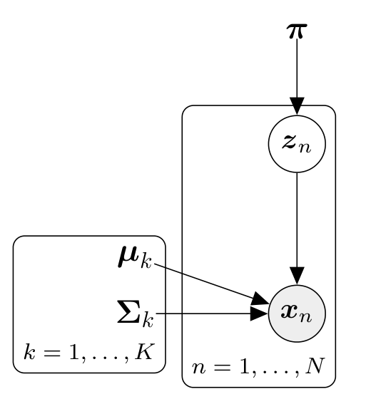

# 11.4 隐变量视角（Latent Variable Perspective）

## 本节导学

**学习目标**

1. 用**离散隐变量**（one-hot 指示向量 $\boldsymbol z$）重构 GMM：生成过程、联合分布、边缘似然；
2. 证明**责任度 = 隐变量的后验概率**（(11.69) = (11.17)）——11.2 节的"启发式权重"获得严格的贝叶斯解释；
3. 理解 EM 的 $Q$ 函数形式 (11.73)(11.74)：E 步 = 后验期望，M 步 = 最大化期望完全对数似然。

**预备知识**：8.4.3 节（隐变量模型两步流程）、8.5 节（图模型）、6.3 节（贝叶斯定理）、11.2–11.3 节。

**符号速查表**：

| 符号 | 含义 |
| --- | --- |
| $z_k \in \{0,1\}$ | 指示变量：$z_k = 1$ ⟺ 数据点由分量 $k$ 生成 |
| $\boldsymbol z \in \{0,1\}^K$ | 独热（one-hot）状态向量，$\sum_k z_k = 1$ |
| $p(\boldsymbol z) = \boldsymbol\pi$ | 隐变量先验（Multinoulli 分布，(11.59)） |
| $Q(\boldsymbol\theta \mid \boldsymbol\theta^{(t)})$ | E 步构造的期望完全对数似然 (11.73) |

---

## 11.4.1 生成过程与概率模型

与第 10 章 PPCA 的**连续**隐变量不同，GMM 的隐变量是**离散**的：每个数据点由恰好一个分量生成。引入二元指示变量（11.58）：

$$
p(\boldsymbol x \mid z_k = 1) = \mathcal N(\boldsymbol x \mid \boldsymbol\mu_k, \boldsymbol\Sigma_k)
$$

$\boldsymbol z = [z_1, \ldots, z_K]^\top$ 是 $K-1$ 个 0 加一个 1 的**独热向量**（$\sum_k z_k = 1$；$K = 3$ 时如 $[0,1,0]^\top$ 表选中分量 2）。隐变量先验（(11.59)(11.60)）：

$$
p(\boldsymbol z) = \boldsymbol\pi, \qquad \pi_k = p(z_k = 1) \quad \text{（分量 } k \text{ 的生成先验概率）}
$$

（$p(\boldsymbol z)$ 即 Multinoulli 分布——伯努利在多元类别变量上的推广，Murphy 2012。）

**先祖采样**（图 11.11 的图模型支持的两步生成）：

1. 按 $\boldsymbol\pi$ 抽分量索引 $k$（独热 $\boldsymbol z$）；
2. 从 $\mathcal N(\boldsymbol\mu_k, \boldsymbol\Sigma_k)$ 抽连续样本 $\boldsymbol x$。

丢弃隐变量标签后，$\{\boldsymbol x^{(i)}\}$ 就是 GMM 的**无偏样本**。

**联合分布**（8.4 节：概率模型由联合分布唯一确定，(11.61)(11.62)）：

$$
p(\boldsymbol x, z_k = 1) = p(\boldsymbol x \mid z_k = 1)\,p(z_k = 1) = \pi_k\,\mathcal N(\boldsymbol x \mid \boldsymbol\mu_k, \boldsymbol\Sigma_k)
$$

  
  
<b>图 11.11</b> 单个数据点的 GMM 概率图模型。

## 11.4.2 似然函数（边缘化隐变量）

8.4.3 节铁律：似然必须只是 $\boldsymbol x$ 与参数的函数 ⟹ 对隐变量边缘化。离散情形 = 对 $\boldsymbol z$ 的所有状态**求和**（(11.63)）。one-hot 只有 $K$ 种配置（(11.64)），故求和化为对 $k$ 的有限求和 (11.65)：

$$
p(\boldsymbol x \mid \boldsymbol\theta) = \sum_{\boldsymbol z} p(\boldsymbol x \mid \boldsymbol\theta, \boldsymbol z)\,p(\boldsymbol z \mid \boldsymbol\theta) = \sum_{k=1}^K p(\boldsymbol x \mid \boldsymbol\theta, z_k = 1)\,p(z_k = 1 \mid \boldsymbol\theta) = \sum_{k=1}^K \pi_k\,\mathcal N(\boldsymbol x \mid \boldsymbol\mu_k, \boldsymbol\Sigma_k)
$$

——**精确复现 GMM 密度 (11.3)**！完整数据集似然 (11.67) 与 11.2 节 (11.9) 完全一致。**带离散潜指示变量的模型是 GMM 的严格等价且更强大的统一视角**。

## 11.4.3 后验分布：责任度的真实身份

对 (11.68) 用贝叶斯定理，分母用边缘似然 (11.66)：

$$
p(z_k = 1 \mid \boldsymbol x) = \frac{p(z_k = 1)\,p(\boldsymbol x \mid z_k = 1)}{p(\boldsymbol x)} = \frac{\pi_k\,\mathcal N(\boldsymbol x \mid \boldsymbol\mu_k, \boldsymbol\Sigma_k)}{\sum_j \pi_j\,\mathcal N(\boldsymbol x \mid \boldsymbol\mu_j, \boldsymbol\Sigma_j)} \tag{11.69}
$$

**与 (11.17) 逐字相同**——责任度 $r_{nk}$ 就是"分量 $k$ 生成 $\boldsymbol x_n$"的**后验概率**。11.2 节引入的"启发式重要性加权"由此获得坚实的贝叶斯测度论基础。

## 11.4.4 完整数据集

每个 $\boldsymbol x_n$ 配专属隐变量 $\boldsymbol z_n$（(11.70)），共享先验 $\boldsymbol\pi$；图 11.12 为板块表示法。条件分布分解 (11.71) 与后验 (11.72)：

$$
p(z_{nk} = 1 \mid \boldsymbol x_n) = \frac{\pi_k\,\mathcal N(\boldsymbol x_n \mid \boldsymbol\mu_k, \boldsymbol\Sigma_k)}{\sum_j\pi_j\mathcal N(\boldsymbol x_n \mid \boldsymbol\mu_j, \boldsymbol\Sigma_j)} = r_{nk}
$$

——从第一性原理证明：**责任度 = 隐变量真实后验**。

  
  
<b>图 11.12</b> N 个数据点的 GMM 图模型（板块表示法）。

## 11.4.5 重访 EM：$Q$ 函数视角

隐变量视角下 EM 的理论形式（给定当前参数 $\boldsymbol\theta^{(t)}$）：

- **E 步**：计算**完全数据对数似然关于隐变量后验的期望**（(11.73)）：

$$
Q(\boldsymbol\theta \mid \boldsymbol\theta^{(t)}) = \mathbb E_{\boldsymbol z \mid \boldsymbol x, \boldsymbol\theta^{(t)}}\big[\log p(\boldsymbol x, \boldsymbol z \mid \boldsymbol\theta)\big] = \sum_{\boldsymbol z} p(\boldsymbol z \mid \boldsymbol x, \boldsymbol\theta^{(t)})\,\log p(\boldsymbol x, \boldsymbol z \mid \boldsymbol\theta)
$$

（离散 $\boldsymbol z$ ⟹ 期望 = 对后验的加权和，权重正是 $r_{nk}$。）

- **M 步**：最大化该期望目标 (11.74)：

$$
\boldsymbol\theta^{(t+1)} = \arg\max_{\boldsymbol\theta} Q(\boldsymbol\theta \mid \boldsymbol\theta^{(t)})
$$

对 $Q$ 展开求导，可以纯变分推断范式无缝推导出 11.2 节三大更新公式——**E/M 两步不是工程技巧，而是"在隐变量后验下优化完全数据似然的期望"这一原则性框架的展开**。这也解释了单调性：每轮迭代最大化的是原对数似然的一个下界（Jensen 不等式；完整讨论见 Bishop 2006 第 9 章）。

**局限重申**：EM 保证单调不减、不保证全局最优——实践中多次随机初始化择优。

---

## 本节小结

| 对象 | 结果 |
| --- | --- |
| 隐变量 | one-hot $\boldsymbol z$；先验 $\boldsymbol\pi$；$p(\boldsymbol x \mid z_k{=}1) = \mathcal N_k$ |
| 边缘似然 | 对 $K$ 个 one-hot 配置求和 ⟹ 恰好还原 GMM (11.3) |
| 责任度 | $= p(z_k = 1 \mid \boldsymbol x)$（贝叶斯后验，(11.69)） |
| EM | E = 后验下期望完全对数似然 $Q$；M = max $Q$ |

**与其他章节的关系**：8.4.3 节隐变量两步流程的离散版完整演示；6.6.1 节 Beta-二项共轭的"后验更新"直觉在此泛化为"责任度更新"；第 12 章之后，EM 仍是变分推断、HMM、主题模型的标准引擎（8.4.4 节延伸阅读）。
