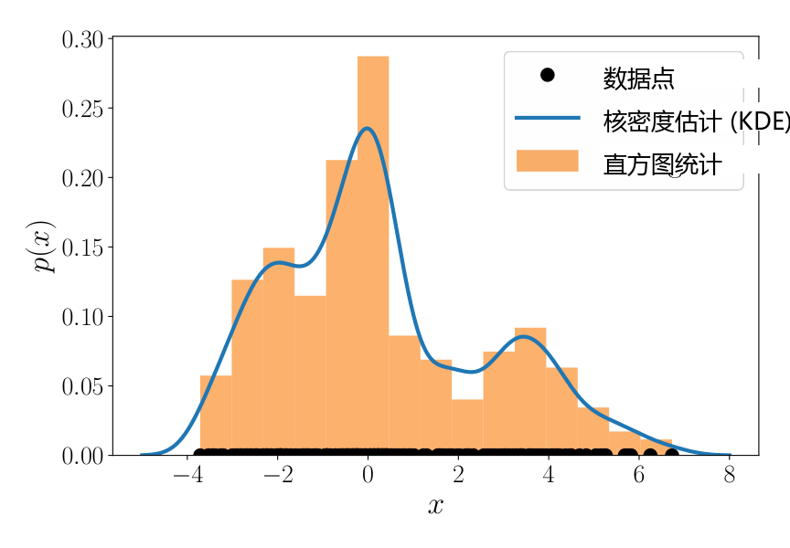

# 11.5 延伸阅读（Further Reading）

## 本节导学

**学习目标**：了解参数化混合模型之外的两大**非参数**密度估计方法——直方图与核密度估计（KDE），及其带宽超参数与拟合风险的权衡。

---

## 直方图（Histogram）

最经典的非参数密度表示（Pearson, 1895）：把空间划分为若干**区间箱（bins）**，统计每箱数据点数，按频数画矩形条。

**关键超参数：箱宽**。过大 → 欠拟合（过度平滑，抹杀局部细节）；过小 → 过拟合（杂乱阶梯尖刺）。**交叉验证**（8.2.4 节）可自适应选最优箱宽。

## 核密度估计（Kernel Density Estimation, KDE）

Rosenblatt (1956) 与 Parzen (1962) 独立提出：对每个样本点 $x_n$ 放置一个**固定形状的核** $k(\cdot)$（全域积分为 1 的非负光滑函数），叠加成密度：

$$
p(x) = \frac{1}{Nh}\sum_{n=1}^N k\Big(\frac{x - x_n}{h}\Big) \tag{11.74}
$$

$h > 0$ 是**带宽（bandwidth）**——作用类似直方图的箱宽。

**与 GMM 的本质区别**：GMM 用**固定的 $K$ 个**高斯、学它们的均值/权重；KDE 在**每一个数据点**处放一个固定形状的核。常用核：均匀核、Epanechnikov 核、**高斯核**——光滑核保证整体估计曲线**连续可微**（直方图做不到）。图 11.13 对比：250 个数据点上，KDE（蓝色平滑曲线） vs 直方图（橙色条柱）。

  
  
<b>图 11.13</b> 直方图（橙色）与高斯 KDE（蓝色平滑曲线）对比：KDE 给出光滑估计，直方图是离散计数。

---

## 本节小结

| 方法 | 参数化？ | 灵活性来源 | 关键超参数 |
| --- | --- | --- | --- |
| GMM | 参数化 | $K$ 个可学习分量 | $K$、初始化 |
| 直方图 | 非参数 | 箱的位置与宽度 | 箱宽 |
| KDE | 非参数 | 每个样本一个核 | 带宽 $h$ |

**下一步**：第 12 章分类——支持向量机把 7.3 节的二次规划对偶、3.6 节的超平面几何与 12.4 节的核技巧组合成四大支柱的收官之作。
