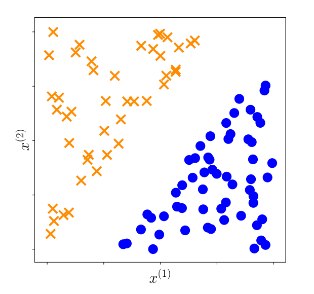

# 第 12 章 使用支持向量机分类（Classification with Support Vector Machines）

## 本章导学

**学习目标**：掌握四大支柱的收官之作——**二元分类**。预测离散标签 $\hat y \in \{+1, -1\}$（如垃圾邮件识别、天体分类），与第 9 章的连续值回归形成对照。

**本章方法**：**支持向量机（SVM）**。选择 SVM 讲分类的两个原因：

1. **几何直观的机器学习视角**：第 9 章从概率出发（MLE/贝叶斯），本章换一条路径——纯粹从**几何**（内积、投影、间隔）推演学习问题，与第 10 章 PCA 的投影几何一脉相承；
2. **带约束优化的综合实践**：SVM 无闭式解，是 7.2 节拉格朗日乘子法与对偶理论的完整练兵场（对比：回归/PCA 有闭式解）。

**与 MLE 视角的根本差异**：MLE 先对数据分布做概率假设、导出目标；SVM 直接按几何直观设计目标函数——遵循**经验风险最小化**（8.2 节），等价于设计一种特殊损失（合页损失）。

**路线**：

- 12.1 分隔超平面：几何基础（法向量、两侧判定、紧凑约束 (12.7)）；
- 12.2 原生 SVM：间隔最大化 → 硬间隔 QP (12.18) → 软间隔 (12.26) → 合页损失视角 (12.31)，定理 12.1 证明两条路径等价；
- 12.3 对偶 SVM：拉格朗日推导 → 表示定理 (12.38) → 盒约束 QP (12.41) → 凸包几何对偶；
- 12.4 核方法：把内积换成核函数，线性分类器变非线性；
- 12.5 数值求解：次梯度下降与标准 QP；
- 12.6 延伸阅读。

**预备知识**：3.2 节（内积）、3.8 节（正交投影与点到超平面距离）、7.2 节（拉格朗日对偶）、7.3 节（QP 与凸共轭）、8.2 节（ERM 与正则化）。

  
  
<b>图 12.1</b> 线性可分数据：红色十字与蓝色圆点可被一条直线（超平面）完全分开。

