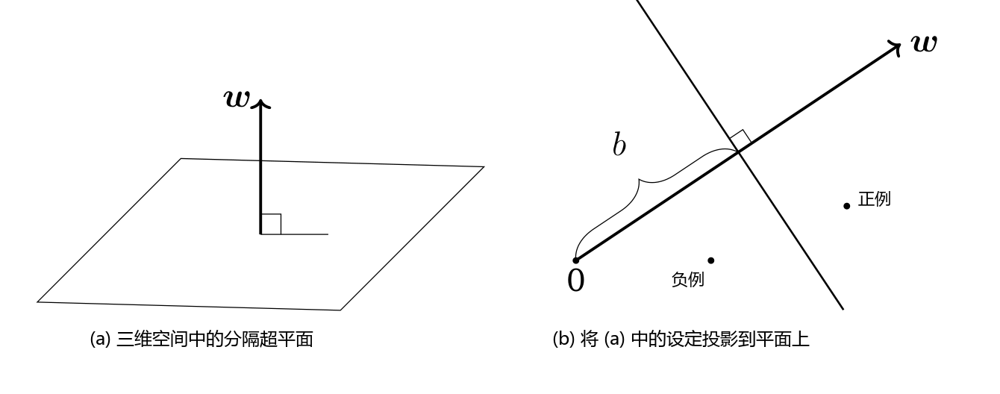

# 12.1 分隔超平面（Separating Hyperplanes）

## 本节导学

**学习目标**

1. 写出仿射分类函数 (12.2)，理解超平面 $f(\boldsymbol x) = 0$ 及其正负侧；
2. 掌握**法向量 $\boldsymbol w$ 的严格证明**（内积双线性 ⟹ 与平面内任意位移正交）；
3. 会把"正样本在正侧、负样本在负侧"合并成唯一的紧凑约束 (12.7)。

**预备知识**：3.2 节（内积与正交）、2.8 节（仿射子空间/超平面）。

**符号速查表**：

| 符号 | 含义 |
| --- | --- |
| $y_n \in \{+1, -1\}$ | 二元标签（正类/负类；$+1$ 无褒义，如癌症检测中患癌者为 $+1$） |
| $f(\boldsymbol x) = \langle\boldsymbol w, \boldsymbol x\rangle + b$ | 仿射评分函数 (12.2) |
| $\boldsymbol w$ | 超平面的法向量（几何方向箭头） |
| $b$ | 截距 |

---

## 12.1.1 超平面与其方向

分类的核心思想：把 $\mathbb R^D$ 划分成两个区域，使同类样本落在同一区域。最基础的划分工具是**超平面**（$D$ 维空间中的 $(D-1)$ 维仿射子空间，2.8 节）。定义评分函数 (12.2)，超平面是其零水平集 (12.3)：

$$
\{\boldsymbol x : f(\boldsymbol x) = 0\} = \{\boldsymbol x : \langle\boldsymbol w, \boldsymbol x\rangle + b = 0\}
$$

**$\boldsymbol w$ 是法向量——严格证明**。在超平面上任取两点 $\boldsymbol x_a, \boldsymbol x_b$（故 $f(\boldsymbol x_a) = f(\boldsymbol x_b) = 0$），用内积双线性 (3.2 节)：

$$
f(\boldsymbol x_a) - f(\boldsymbol x_b) = \langle\boldsymbol w, \boldsymbol x_a\rangle + b - \langle\boldsymbol w, \boldsymbol x_b\rangle - b = \langle\boldsymbol w, \boldsymbol x_a - \boldsymbol x_b\rangle = 0 \tag{12.4}
$$

——$\boldsymbol w$ 与超平面上**任意位移向量**正交，即 $\boldsymbol w$ 是法向量。$\blacksquare$

  
  
<b>图 12.2</b> 分隔超平面 (12.3)：(a) 三维标准几何；(b) 沿超平面边缘的二维正交截面。

> **说明（向量的双重理解）**。本章中 $\boldsymbol w$ 视作**几何向量**（方向箭头），$\boldsymbol x$ 视作**坐标向量**（数据点）——第 2 章"向量三种观点"的应用。♦

## 12.1.2 分类规则与紧凑约束

(12.3) 不仅定义超平面，还定义了**朝向**——正侧与负侧。测试样本的判定 (12.2c)：

$$
\hat y = \begin{cases} +1, & f(\boldsymbol x_{\text{test}}) \ge 0 \\ -1, & f(\boldsymbol x_{\text{test}}) < 0 \end{cases}
$$

训练要求：正样本在正侧 (12.5)、负样本在负侧 (12.6)。两式分别乘以 $y_n = +1$ / $-1$，立即合并为**唯一的样本判别约束**：

$$
\boxed{\ y_n\big(\langle\boldsymbol w, \boldsymbol x_n\rangle + b\big) \ge 0\ } \tag{12.7}
$$

（验证：$y_n = +1$ 时就是 (12.5)；$y_n = -1$ 时两边乘 $-1$ 不等号翻转，正是 (12.6)。）**乘积 $y_n f(\boldsymbol x_n)$ 是贯穿全章的核心量**——它同时编码"分类是否正确"与"离超平面多远"。

---

## 本节小结

| 要点 | 内容 |
| --- | --- |
| 超平面 | $f(\boldsymbol x) = \langle\boldsymbol w, \boldsymbol x\rangle + b = 0$；$\boldsymbol w$ = 法向量（(12.4) 严格证明） |
| 判定 | $f \ge 0$ 判 $+1$，$f < 0$ 判 $-1$ |
| 训练约束 | $y_n f(\boldsymbol x_n) \ge 0$（(12.7)，两条件合一） |

**与其他章节的关系**：$y f(\boldsymbol x)$ 是 12.2 节间隔与合页损失 (12.28) 的共同自变量；点到超平面的距离推导（12.2.1）直接调用 3.8 节投影工具。
