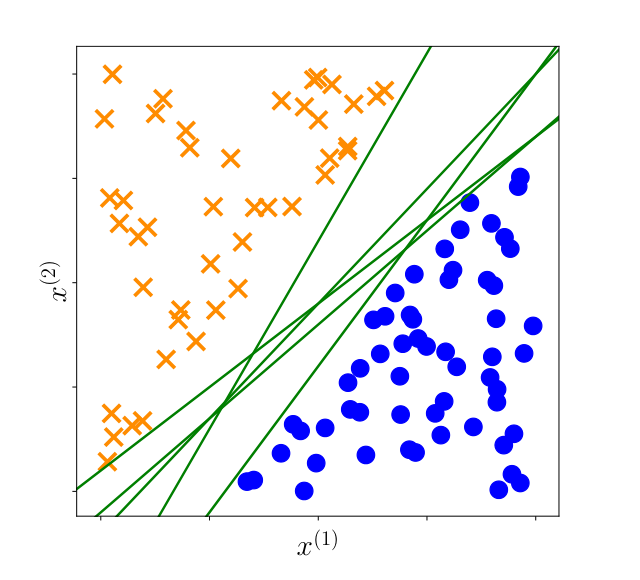
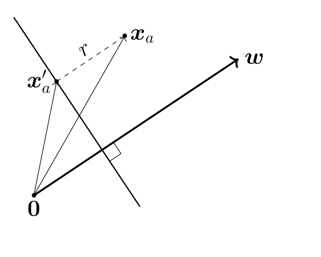
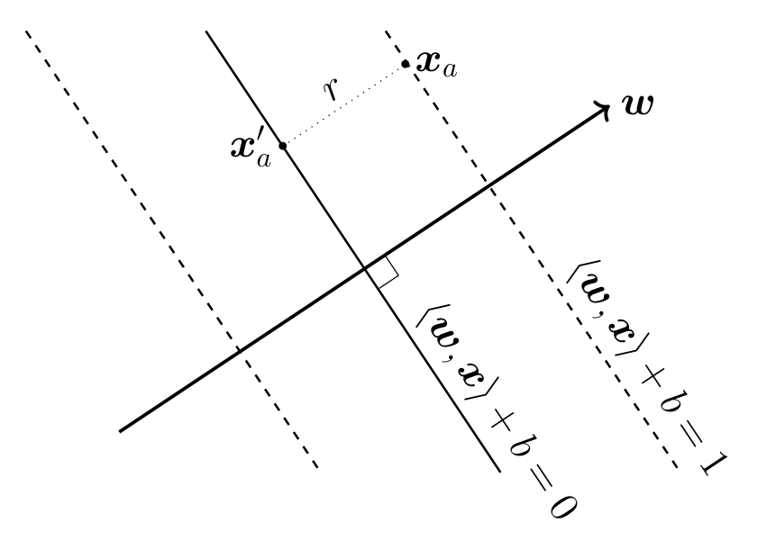
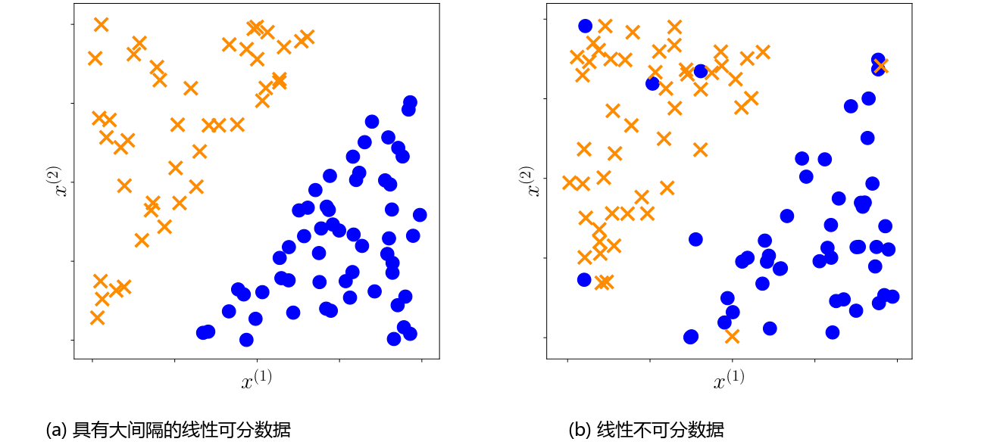
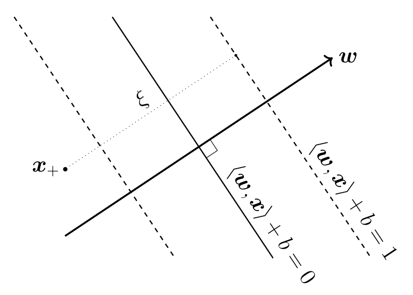
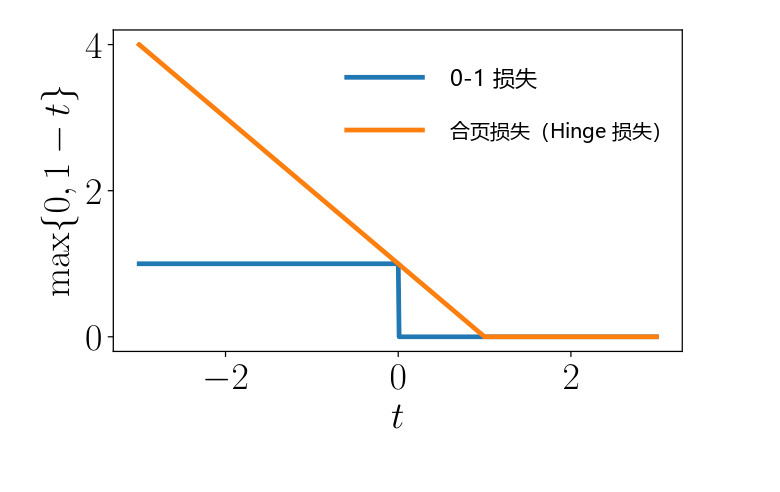

# 12.2 原生支持向量机（Primal Support Vector Machine）

## 本节导学

**学习目标**

1. 理解"间隔"的尺度问题，用向量加法 (12.8) 建立几何距离 $r$ 的严格表达；
2. 掌握传统推导的关键一步 $r = 1/\|\boldsymbol w\|$ (12.14)——最大化间隔 ⟺ 最小化 $\|\boldsymbol w\|$；
3. 理解**定理 12.1**："约束 $\|\boldsymbol w\| = 1$" 与 "固定函数间隔为 1" 两种表述严格等价（变量替换证明）；
4. 掌握软间隔 SVM (12.26) 与合页损失视角 (12.31) 的等价性（松弛变量 ⟺ 损失上界）。

**预备知识**：3.8 节（点到超平面的投影距离）、7.3 节（QP）、8.2 节（ERM 与正则化）、9.2.4 节（$\ell_2$ 正则 ⟺ 高斯先验）。

---

## 12.2.1 间隔的概念

线性可分数据有**无穷多个**合法分隔超平面（图 12.3）——要选**唯一最优**的那个，标准是：**正负样本之间的间隔最大化**。大间隔 ⟹ 好泛化（Vapnik-Chervonenkis 理论；间隔大 = 假设族容量低，Vapnik 2000; Steinwart and Christmann 2008）。

**尺度问题**：距离必须相对于**超平面方程本身**度量，否则换单位（米→毫米）数值就乱。设 $\boldsymbol x_a$ 在超平面正侧，$\boldsymbol x'_a$ 是其正交投影（3.8 节）。位移沿法向，用单位法向量 $\boldsymbol w/\|\boldsymbol w\|$ 表示（向量加法，图 12.4）：

$$
\boldsymbol x_a = \boldsymbol x'_a + r\,\frac{\boldsymbol w}{\|\boldsymbol w\|} \tag{12.8}
$$

$r$ = $\boldsymbol x_a - \boldsymbol x'_a$ 在 $\operatorname{span}[\boldsymbol w/\|\boldsymbol w\|]$ 中的坐标 = **到超平面的几何距离**。取 $\boldsymbol x_a$ 为最近样本点，$r$ 即**间隔**。"所有样本距离 ≥ $r$" 合并为（同 (12.7) 技巧）：

$$
y_n\big(\langle\boldsymbol w, \boldsymbol x_n\rangle + b\big) \ge r \tag{12.9}
$$

**约束 $\|\boldsymbol w\| = 1$**：超平面朝向只由 $\boldsymbol w$ 的方向决定，故归一化 $\|\boldsymbol w\| = 1$（3.1 节欧氏范数），使 $r$ 有直观几何意义。首个优化问题 (12.10)：

$$
\max_{\boldsymbol w, b, r}\ r \quad \text{s.t.}\quad y_n\big(\langle\boldsymbol w,\boldsymbol x_n\rangle + b\big) \ge r,\quad \|\boldsymbol w\| = 1,\quad r > 0 \tag{12.10}
$$

> **说明**：其他教材（Schölkopf and Smola, 2002）直接固定函数间隔为 1——12.2.3 节定理 12.1 严格证明两者等价。♦

  
  
<b>图 12.3</b> 候选分隔超平面有无穷多个（绿线），需要选择标准。

  
  
<b>图 12.4</b> 几何距离：xₐ = x′ₐ + r(w/‖w‖)。

## 12.2.2 间隔的传统推导：$r = 1/\|\boldsymbol w\|$

换一个尺度规范：不约束 $\|\boldsymbol w\|$，而是**缩放预测输出**，使最近样本 $\boldsymbol x_a$ 处 $f(\boldsymbol x_a) = 1$（图 12.5）。则 $\boldsymbol x'_a = \boldsymbol x_a - r\,\frac{\boldsymbol w}{\|\boldsymbol w\|}$ 满足 $\langle\boldsymbol w, \boldsymbol x'_a\rangle + b = 0$ (12.11)。代入并展开（双线性）：

$$
\Big\langle\boldsymbol w,\ \boldsymbol x_a - r\,\tfrac{\boldsymbol w}{\|\boldsymbol w\|}\Big\rangle + b = \underbrace{\langle\boldsymbol w, \boldsymbol x_a\rangle + b}_{=\,1} - r\,\frac{\langle\boldsymbol w,\boldsymbol w\rangle}{\|\boldsymbol w\|} = 1 - r\,\frac{\|\boldsymbol w\|^2}{\|\boldsymbol w\|} = 1 - r\|\boldsymbol w\| = 0 \tag{12.12–12.14}
$$

（用了 $\langle\boldsymbol w,\boldsymbol w\rangle = \|\boldsymbol w\|^2$ (3.16)。）于是得到**关键结论**：

$$
\boxed{\ r = \frac{1}{\|\boldsymbol w\|}\ } \tag{12.14}
$$

——几何间隔 = 法向量模长的倒数！（把 $r$ 视为辅助变量就毫不反直觉。）

**硬间隔 SVM**。样本约束变为 $y_n f(\boldsymbol x_n) \ge 1$ (12.15)；最大化 $1/\|\boldsymbol w\|$ ⟺ 最小化 $\frac12\|\boldsymbol w\|^2$（单调变换 + 求导整洁）：

$$
\min_{\boldsymbol w, b}\ \frac{1}{2}\|\boldsymbol w\|^2 \quad \text{s.t.}\quad y_n\big(\langle\boldsymbol w,\boldsymbol x_n\rangle + b\big) \ge 1,\ \ \forall n \tag{12.18, 12.19}
$$

——**凸二次规划**（7.3.2 节）。"硬" = 约束严格，不允许任何样本侵入间隔边界。

  
  
<b>图 12.5</b> 传统推导：缩放使边界样本满足 ⟨w, xₐ⟩ + b = 1，得 r = 1/‖w‖。

## 12.2.3 定理 12.1：两种间隔表述等价

**定理 12.1**。约束问题 (12.20)（$\|\boldsymbol w\| = 1$，最大化 $r$）与 QP (12.21)（固定函数间隔 1，最小化 $\frac12\|\boldsymbol w\|^2$）几何等价。

**证明**（变量替换三步走）：

1. **目标平方**：$r \ge 0$ 上平方严格单调，$\max r \equiv \max r^2$。用未归一化 $\boldsymbol w'$ 重参数化 $\boldsymbol w = \boldsymbol w'/\|\boldsymbol w'\|$（(12.22)）。
2. **约束除以 $r$**（$r > 0$，合法）：定义 $\boldsymbol w'' := \frac{\boldsymbol w'}{\|\boldsymbol w'\| r}$、$b'' := \frac{b}{r}$，约束变为 $y_n(\langle\boldsymbol w'',\boldsymbol x_n\rangle + b'') \ge 1$ (12.23)。
3. **范数关系**：$\|\boldsymbol w''\| = \frac{1}{r}\big\|\frac{\boldsymbol w'}{\|\boldsymbol w'\|}\big\| = \frac{1}{r}$（(12.24)）⟹ $r^2 = 1/\|\boldsymbol w''\|^2$。目标变为 $\max 1/\|\boldsymbol w''\|^2 \equiv \min \frac12\|\boldsymbol w''\|^2$。$\blacksquare$

## 12.2.4 软间隔 SVM：几何视角

现实数据**线性不可分**（图 12.6）。对策：引入**松弛变量** $\xi_n \ge 0$（图 12.7）——允许样本侵入间隔（$0 < \xi \le 1$）甚至越过超平面（$\xi > 1$），并在目标中惩罚松弛总量：

$$
\min_{\boldsymbol w, b, \boldsymbol\xi}\ \frac{1}{2}\|\boldsymbol w\|^2 + C\sum_{n=1}^N \xi_n \tag{12.26a}
$$

$$
\text{s.t.}\quad y_n\big(\langle\boldsymbol w,\boldsymbol x_n\rangle + b\big) \ge 1 - \xi_n, \qquad \xi_n \ge 0 \tag{12.26b, c}
$$

——**软间隔 SVM / $C$-SVM**。**正则化参数 $C > 0$** 权衡"最大间隔"与"最小违背"：$C$ 大 ⟹ 逼近硬间隔；$C$ 小 ⟹ 容忍更多误分换取大间隔与抗噪。（说明：$b$ 未正则化——理论上稍复杂、数值上稍昂贵，Fan et al. 2008。）

  
  
<b>图 12.6</b> (a) 大间隔线性可分；(b) 现实中线性不可分的交叠数据。

  
  
<b>图 12.7</b> 松弛变量 ξ 衡量越界样本到其间隔边界的违背距离。

## 12.2.5 软间隔 SVM：损失函数视角

ERM 框架（8.2 节）下重看 (12.26)：假设类 $f(\boldsymbol x) = \langle\boldsymbol w,\boldsymbol x\rangle + b$ (12.27)，损失是什么？

**0-1 损失**（直接数错分数）非连续、非凸、NP 难——不可用。**合页损失（hinge loss）**（(12.28)，$t = y f(\boldsymbol x)$）：

$$
\ell(t) = \max\{0, 1 - t\} = \begin{cases} 0, & t \ge 1 \\ 1 - t, & t < 1 \end{cases} \tag{12.28, 12.29}
$$

三段解读（图 12.8）：$t \ge 1$（正确且间隔外）损失 0；$0 < t < 1$（正确但侵入间隔）线性罚 $1-t$；$t \le 0$（错分）线性增长惩罚。**"离超平面不足间隔距离就要罚，哪怕分类正确"**——这正是大间隔思想在损失函数中的化身。（对照：硬间隔对应 $\ell_{\text{hard}}(t) = 0$ if $t\ge1$ else $\infty$ (12.30)。）

  
  
<b>图 12.8</b> 合页损失是 0-1 损失的凸上界。

**ERM 形式**：$\ell_2$ 正则 + 经验合页损失：

$$
\min_{\boldsymbol w, b}\ \underbrace{\frac{1}{2}\|\boldsymbol w\|^2}_{\text{正则化（= 间隔倒数）}} + C\sum_{n=1}^N \underbrace{\max\big\{0,\ 1 - y_n f(\boldsymbol x_n)\big\}}_{\text{合页损失}} \tag{12.31}
$$

——**最大化间隔 ⟺ $\ell_2$ 正则化**！与 9.2.4 节（高斯先验 ⟺ $\ell_2$）呼应但来源不同：那里是概率推断，这里是几何。

**与 (12.26) 的等价性**：单点损失 $\min_t\max\{0,1-t\}$ 引入辅助松弛标量 $\xi$ 可严格重写为（(12.33)）：

$$
\min_{\xi, t}\ \xi \quad \text{s.t.}\quad \xi \ge 0,\ \ \xi \ge 1 - t
$$

代入 (12.31)（$t_n = y_n f(\boldsymbol x_n)$，移项）即精确复原软间隔原生问题 (12.26a)。$\blacksquare$

> **说明（与回归对比）**：平方损失由高斯似然自然导出（9.2.1）；合页损失由大间隔几何目标驱动而生——损失函数的两种出生证明。♦

---

## 本节小结

| 版本 | 问题 | 关键等式 |
| --- | --- | --- |
| 硬间隔 | $\min \frac12\|\boldsymbol w\|^2$，s.t. $y_n f_n \ge 1$ | $r = 1/\|\boldsymbol w\|$ (12.14) |
| 软间隔 | 加 $C\sum\xi_n$，约束放宽为 $\ge 1 - \xi_n$ | (12.26) |
| ERM 形式 | $\min \frac12\|\boldsymbol w\|^2 + C\sum\max\{0, 1 - y_n f_n\}$ | 合页损失 (12.28) ⟺ 松弛 (12.33) |
| 等价性 | 定理 12.1（几何表述 ⟺ QP 表述）；松弛 ⟺ 合页 | 两个证明 |

**与其他章节的关系**：(12.26) 的拉格朗日对偶是 12.3 节的主角；合页损失的次梯度在 12.5.1 节用于数值求解；练习 7.11 已预告合页损失的凸共轭。
