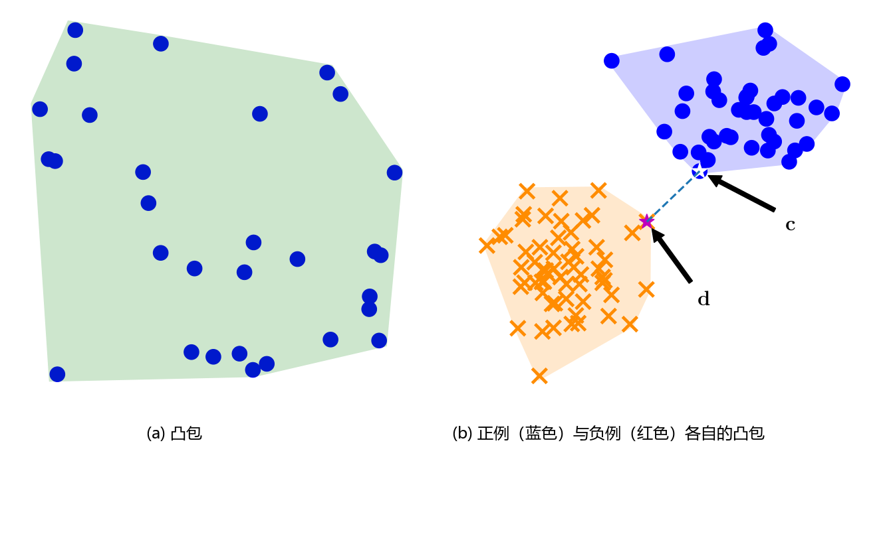

# 12.3 对偶支持向量机（Dual Support Vector Machine）

## 本节导学

**学习目标**

1. 掌握从软间隔原生问题到对偶 QP 的完整拉格朗日推导：拉格朗日函数 (12.34) → 三个偏导 (12.35)–(12.37) → **表示定理** $\boldsymbol w = \sum_n\alpha_n y_n\boldsymbol x_n$ (12.38) → 消元得对偶 (12.41)；
2. 理解盒约束 $0 \le \alpha_i \le C$ 的三个来源与 KKT 互补松弛的分类学意义；
3. 会用自由支持向量恢复截距 $b^*$ (12.42)；
4. 了解凸包最近距离视角（(12.43)–(12.51)）——硬间隔对偶的第三种等价诠释。

**预备知识**：7.2 节（拉格朗日对偶、弱对偶）、7.3 节（QP 对偶实例）、3.2 节（内积对称双线性）、12.2 节。

---

## 12.3.1 拉格朗日推导

**动机**：原生问题变量 $\boldsymbol w \in \mathbb R^D$ 随特征维度 $D$ 增长；**对偶问题变量 $\boldsymbol\alpha \in \mathbb R^N$ 随样本数 $N$ 增长**——$D \gg N$ 时（高维小样本）对偶极有效（对比 10.5 节 PCA 的同款思想），且为 12.4 节核方法铺路。

**拉格朗日函数**（软间隔 (12.26)；$\alpha_n \ge 0$ 对应分类约束，$\gamma_n \ge 0$ 对应 $\xi_n \ge 0$；SVM 文献惯例用 $\alpha,\gamma$ 而非 $\lambda$）：

$$
L(\boldsymbol w, b, \boldsymbol\xi, \boldsymbol\alpha, \boldsymbol\gamma) = \frac{1}{2}\|\boldsymbol w\|^2 + C\sum_n\xi_n - \sum_n\alpha_n\big(y_n(\langle\boldsymbol w,\boldsymbol x_n\rangle + b) - 1 + \xi_n\big) - \sum_n\gamma_n\xi_n \tag{12.34}
$$

**三个偏导并令零**：

$$
\frac{\partial L}{\partial\boldsymbol w} = \boldsymbol w^\top - \sum_n\alpha_n y_n\boldsymbol x_n^\top = \boldsymbol 0^\top, \qquad \frac{\partial L}{\partial b} = -\sum_n\alpha_n y_n = 0, \qquad \frac{\partial L}{\partial\xi_n} = C - \alpha_n - \gamma_n = 0 \tag{12.35–12.37}
$$

**表示定理（关键一步）**。由 (12.35)：

$$
\boxed{\ \boldsymbol w = \sum_{n=1}^N \alpha_n y_n \boldsymbol x_n\ } \tag{12.38}
$$

——最优法向量**完全由训练样本的线性组合表示**（解落在数据的张成空间内，2.6.1 节）！这是统计学习理论中**表示定理（Representer Theorem）**（Kimeldorf and Wahba, 1970）的实例，在 ERM 与核学习的一般框架下普遍成立（Hofmann et al., 2008）。

> **说明（"支持向量机"名称由来）**：$\alpha_n = 0$ 的样本对 $\boldsymbol w$ 毫无贡献；$\alpha_n > 0$ 的样本**支撑**着分隔超平面——**支持向量（support vectors）**。♦

**回代消元**。把 (12.38) 代入 (12.34)（(12.39) 逐步观察）：

1. $\boldsymbol w$ 消失：二次项展开、利用内积对称双线性，前两项合并为 $-\frac12\sum_{ij}y_iy_j\alpha_i\alpha_j\langle\boldsymbol x_i,\boldsymbol x_j\rangle$（(12.40)）；
2. $b$ 消失：等式约束 $\sum_n y_n\alpha_n = 0$（来自 (12.36)）使 $b\sum_i y_i\alpha_i = 0$；
3. $\boldsymbol\xi$ 消失：$C - \alpha_i - \gamma_i = 0$（来自 (12.37)）使 $\sum_i(C - \alpha_i - \gamma_i)\xi_i = 0$；
4. **盒约束**：$\gamma_i \ge 0$ + $C - \alpha_i - \gamma_i = 0$ ⟹ $\alpha_i \le C$；$\alpha_i \ge 0$ 来自乘子非负性（7.2 节）。

**对偶 QP**（最大化对偶目标 ⟺ 最小化负对偶函数）：

$$
\min_{\boldsymbol\alpha}\ \frac{1}{2}\sum_{i=1}^N\sum_{j=1}^N y_i y_j\,\alpha_i\alpha_j\langle\boldsymbol x_i,\boldsymbol x_j\rangle - \sum_{i=1}^N\alpha_i \tag{12.41}
$$

$$
\text{s.t.}\quad \sum_{i=1}^N y_i\alpha_i = 0, \qquad 0 \le \alpha_i \le C\ \ \forall i
$$

三个约束一一对应：等式 ← $b$ 的一阶条件；下界 ← 不等式乘子非负；上界 ← 松弛乘子非负。**盒约束（box constraints）**在数值求解器中可高效处理（Dostál, 2009）。

**KKT 互补松弛**（Schölkopf and Smola, 2002）——支持向量的三种类型：

| 样本位置 | 对偶变量 |
| --- | --- |
| 正确分类且在间隔外 | $\alpha_i = 0$（非支持向量） |
| 恰好落在间隔边界（自由支持向量） | $0 < \alpha_i < C$ |
| 侵入间隔或错分（受罚） | $\alpha_i = C$ |

**恢复原生解**：$\boldsymbol w^* = \sum_n\alpha_n^* y_n\boldsymbol x_n$（表示定理）。对自由支持向量 $\boldsymbol x_n$（$0 < \alpha_n^* < C$），它严格满足 $\langle\boldsymbol w^*,\boldsymbol x_n\rangle + b^* = y_n$，解出：

$$
b^* = y_n - \langle\boldsymbol w^*, \boldsymbol x_n\rangle \tag{12.42}
$$

（数值技巧：对所有自由支持向量分别算 $b$ 再取平均/中位数，抗舍入误差。）

## 12.3.2 凸包视角（几何对偶）

**凸包**（convex hull）：包含点集的最小凸集。凸组合（权重非负、和为 1）的几何意义：两点 → 线段；三点 → 三角形；更多点 → 部分点落入内部（图 12.9(a)）：

$$
\operatorname{conv}(\mathcal X) = \Big\{\sum_n\alpha_n\boldsymbol x_n \ \Big|\ \sum_n\alpha_n = 1,\ \alpha_n \ge 0\Big\} \tag{12.43}
$$

**线性可分 ⟺ 两类凸包互不重叠**（图 12.9(b)）。取 $\boldsymbol c \in \operatorname{conv}(\mathcal X_+)$、$\boldsymbol d \in \operatorname{conv}(\mathcal X_-)$ 使欧氏距离最近。令 $\boldsymbol w := \boldsymbol c - \boldsymbol d$ (12.44)：最近距离 ⟺ 最小化 $\frac12\|\boldsymbol w\|^2$ (12.45)。把凸组合展开 (12.46)(12.47) 代入 (12.48)：

$$
\min_{\boldsymbol\alpha}\ \frac{1}{2}\Big\|\sum_{n: y_n=+1}\alpha_n^+\boldsymbol x_n - \sum_{n: y_n=-1}\alpha_n^-\boldsymbol x_n\Big\|^2
$$

两个凸包系数和均为 1 (12.49)，展开即得约束 (12.50)：

$$
\sum_n y_n\alpha_n = \underbrace{\sum_{y_n=+1}\alpha_n^+}_{=\,1} - \underbrace{\sum_{y_n=-1}\alpha_n^-}_{=\,1} = 0 \tag{12.51}
$$

——与对偶 SVM 的核心约束完全一致！配上 $\boldsymbol\alpha \ge \boldsymbol 0$ 与内积二次型，**硬间隔对偶 = 两类凸包最近距离问题**（Bennett and Bredensteiner, 2000a）。

> **说明（软间隔 ⟺ 约化凸包）**：线性不可分时两类凸包重叠。给凸组合系数加上上限 $\alpha_n \le C$ 得**约化凸包（reduced hull）**——限制顶点权重、收缩凸包；收缩后不重叠时，两约化凸包的最近距离 = 软间隔对偶（Bennett and Bredensteiner, 2000b）。盒约束的上界 $C$ 由此获得几何意义！♦

  
  
<b>图 12.9</b> 凸包几何：(a) 内部点不影响凸包形状；(b) 两类凸包的最短距离 = ‖c − d‖。

---

## 本节小结

| 要点 | 内容 |
| --- | --- |
| 表示定理 | $\boldsymbol w = \sum_n\alpha_n y_n\boldsymbol x_n$（(12.38)，支持向量的来源） |
| 对偶 QP | 仅含 $\boldsymbol\alpha \in \mathbb R^N$、内积、盒约束 (12.41) |
| KKT | $\alpha$ 三态区分非支持向量/自由/受罚支持向量 |
| 凸包对偶 | 硬间隔 = 凸包最近距离；软间隔 = 约化凸包（$C$ 的几何意义） |

**与其他章节的关系**：7.2 节对偶理论的集大成应用；12.4 节将利用"目标只含样本间内积"这一结构引入核技巧；(12.41) 的标准矩阵形式在 12.5.2 节给出。
