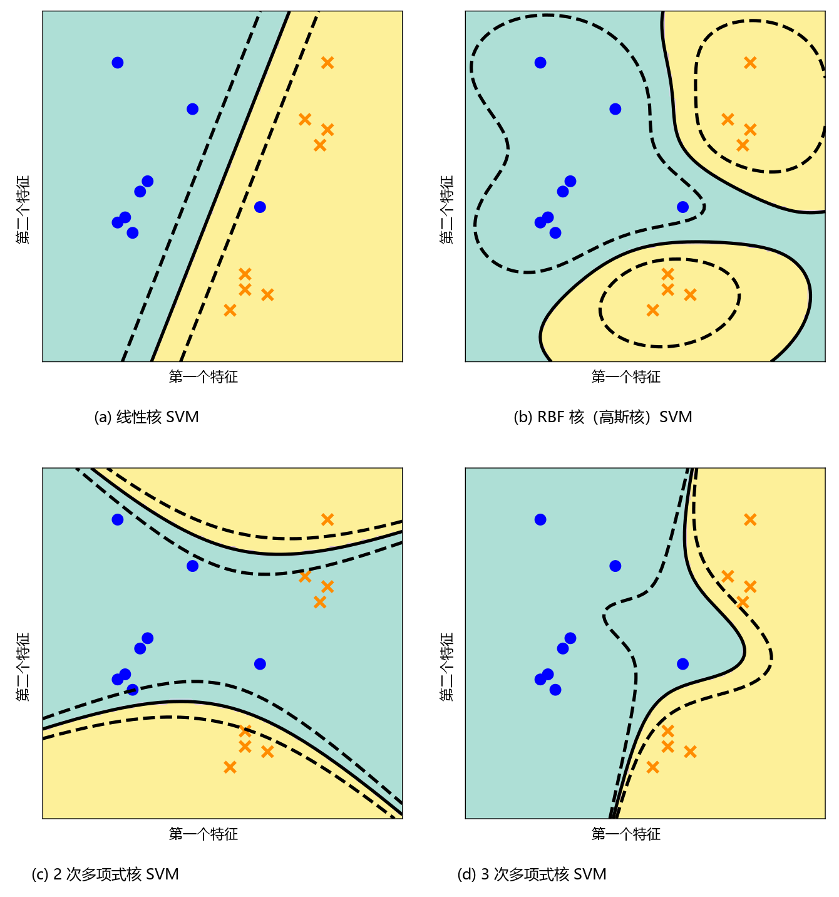

# 12.4 核方法（Kernels）

## 本节导学

**学习目标**

1. 抓住核技巧的前提：对偶 SVM 的目标**只含样本间的内积**——分类算法与特征表示完全解耦；
2. 理解核函数定义 (12.52) 与 RKHS 的存在唯一性、Gram/核矩阵的半正定性 (12.53)；
3. 记住三种经典核（多项式、高斯 RBF、有理二次）及高斯核的**无穷维**特性；
4. 分清"核"一词在三个数学语境中的不同含义。

**预备知识**：12.3 节（对偶 SVM）、3.2.3 节（半正定矩阵）、9.1 节（特征映射）。

---

## 12.4.1 核技巧的切入点

观察对偶目标 (12.41)：**内积只出现在样本对 $\boldsymbol x_i, \boldsymbol x_j$ 之间**，完全不涉及样本与参数的内积。因此若用特征变换 $\boldsymbol\phi(\boldsymbol x_i)$ 表示样本，唯一要做的就是把内积整体替换：

$$
\langle\boldsymbol x_i, \boldsymbol x_j\rangle \ \longrightarrow\ \langle\boldsymbol\phi(\boldsymbol x_i), \boldsymbol\phi(\boldsymbol x_j)\rangle
$$

——**分类方法（SVM 优化框架）与特征表示（$\boldsymbol\phi$ 的选择）完全分离**。线性 SVM 由此获得非线性决策边界（图 12.10）；这是处理线性不可分数据的第二条大道（第一条是软间隔）。这一特性被许多算法共享：**模型所需的全部数据信息可仅通过样本间内积表达**。

## 12.4.2 核函数与核技巧

与其显式构造高维/无限维映射 $\boldsymbol\phi$ 再算内积，不如**直接定义相似度函数**：

**定义（核函数）**。$k : \mathcal X \times \mathcal X \to \mathbb R$，若存在希尔伯特空间 $\mathcal H$ 与特征映射 $\boldsymbol\phi : \mathcal X \to \mathcal H$ 使

$$
k(\boldsymbol x_i, \boldsymbol x_j) = \langle\boldsymbol\phi(\boldsymbol x_i), \boldsymbol\phi(\boldsymbol x_j)\rangle_{\mathcal H} \tag{12.52}
$$

（输入空间 $\mathcal X$ 可任意——不必是 $\mathbb R^D$！）每个对称正定核 $k$ 相伴**唯一的再生核希尔伯特空间（RKHS）**（Aronszajn, 1950），典型特征映射 $\boldsymbol\phi(\boldsymbol x) = k(\cdot, \boldsymbol x)$。这个"隐式定义特征空间"的推广就是**核技巧**（kernel trick）。

**Gram / 核矩阵** $\boldsymbol K \in \mathbb R^{N \times N}$（$K_{ij} = k(\boldsymbol x_i, \boldsymbol x_j)$）必**对称半正定**（3.2.3 节）：

$$
\forall \boldsymbol z \in \mathbb R^N:\quad \boldsymbol z^\top\boldsymbol K\boldsymbol z \ge 0 \tag{12.53}
$$

——验证一个函数是否为合法核的实用判据。

**经典核**（$\boldsymbol x_i \in \mathbb R^D$）：

1. **多项式核**：$k(\boldsymbol x_i, \boldsymbol x_j) = (\boldsymbol x_i^\top\boldsymbol x_j + c)^d$；
2. **高斯 RBF 核**：$k(\boldsymbol x_i, \boldsymbol x_j) = \exp\big(-\frac{\|\boldsymbol x_i - \boldsymbol x_j\|^2}{2\sigma^2}\big)$；
3. **有理二次核**。

  
  
<b>图 12.10</b> 不同核函数的 SVM 决策面：输入空间中高度非线性的边界，本质是高维特征空间中的线性超平面。

## 12.4.3 为什么核函数比显式特征高效

- **多项式核**：显式展开的单项式项数随维度**指数爆炸**；核函数只需一次低维内积 + 一次标量幂；
- **高斯 RBF 核**：诱导的特征空间**无穷维**——显式存储无限维向量物理上不可能，但核函数只需一次距离 + 一次指数，就完成"无限维内积"！

**额外红利**：输入不必是实数向量——核可定义在**集合、序列、字符串、图、概率分布**等任意对象上（Ben-Hur et al., 2008; Gärtner, 2008 等）。核类型与超参数（如 $\sigma$）用**嵌套交叉验证**（8.6.1 节）选择。

> **说明（"核"的三种含义，勿混淆）**：① 本章的**再生核**（RKHS 中的对称正定函数）；② 2.7.3 节线性代数的**核 = 零空间**；③ 11.5 节密度估计的**平滑核**（积分为 1 的窗口函数）。♦

---

## 本节小结

| 要点 | 内容 |
| --- | --- |
| 切入点 | 对偶目标只含样本间内积 ⟹ 算法与特征解耦 |
| 核技巧 | 用 $k(\boldsymbol x_i,\boldsymbol x_j)$ 隐式替代 $\langle\boldsymbol\phi(\cdot),\boldsymbol\phi(\cdot)\rangle$，$\boldsymbol\phi$ 可无限维 |
| 合法性判据 | 核矩阵对称半正定 (12.53) |
| 常用核 | 多项式 $(\cdot + c)^d$；高斯 RBF（∞ 维特征空间）；有理二次 |

**与其他章节的关系**：9.1 节的特征映射 $\boldsymbol\phi$ 在此升级为"隐式无限维版"；10.8 节核 PCA 与 GP-LVM 是同一思想在降维的非线性延伸；12.5.2 节的核化 QP 直接以核矩阵为输入。
