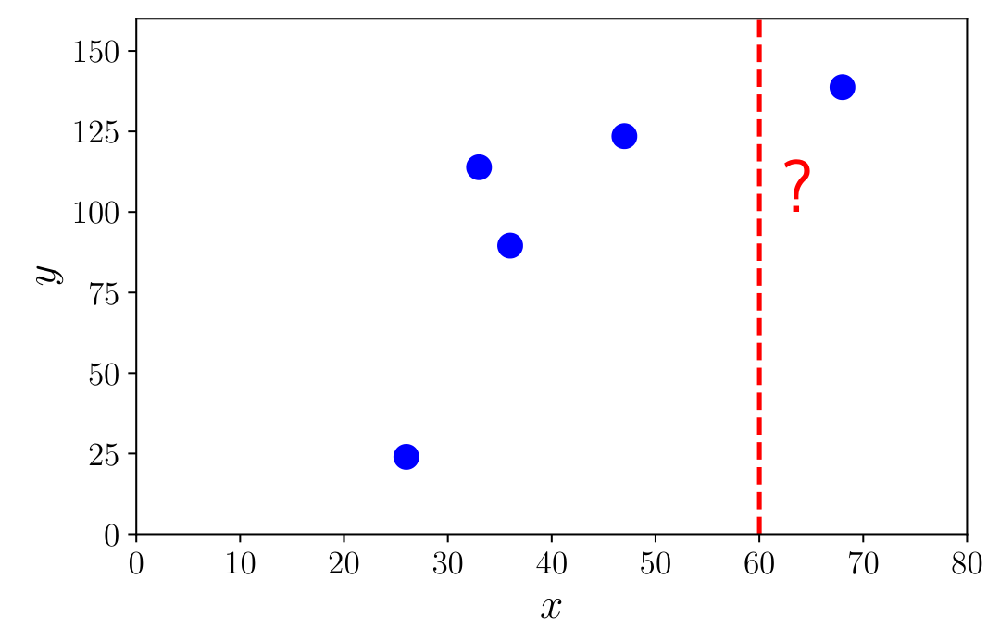
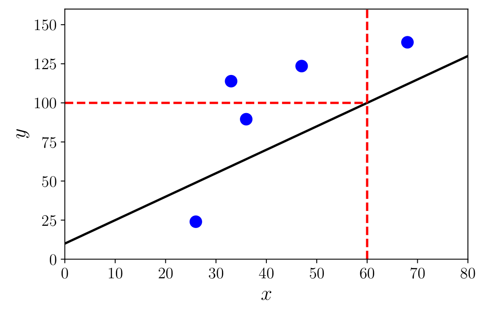
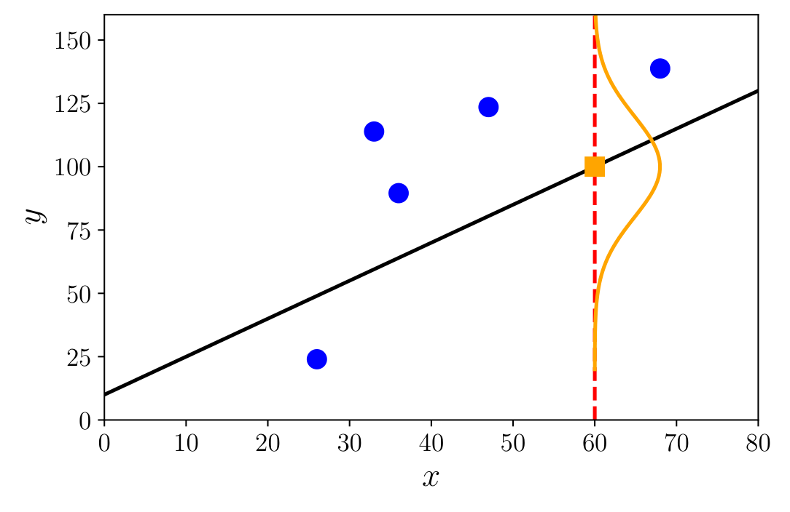

# 8.1 数据、模型与学习（Data, Models, and Learning）

## 本节导学

**学习目标**

1. 掌握机器学习的标准数据记号：$N$ 个样本、$D$ 个特征、样本矩阵 $\boldsymbol X$ 与标签向量 $\boldsymbol y$；
2. 理解"预测器"的两种视角：作为**函数**（8.1.2）与作为**概率分布**（8.1.3）；
3. 分清机器学习的三个算法阶段：预测/推断、训练/参数估计、超参数调优/模型选择。

**预备知识**：第 1 章（三大组件的初识）、第 2 章（向量与矩阵）。

**符号速查表**：

| 符号 | 含义 |
| --- | --- |
| $N$ | 数据集中的样本数量（下标 $n = 1, \ldots, N$） |
| $D$ | 每个样本的特征数量（下标 $d = 1, \ldots, D$） |
| $\boldsymbol x_n \in \mathbb R^D$ | 第 $n$ 个样本（特征向量） |
| $y_n$ | 第 $n$ 个样本的标签（也称目标/响应变量/标注） |
| $\boldsymbol X \in \mathbb R^{N \times D}$ | 样本矩阵：第 $n$ 行是 $\boldsymbol x_n^\top$ |
| $\boldsymbol y \in \mathbb R^N$ | 标签向量 |
| 监督学习 | 数据为"样本-标签"对 $\{(\boldsymbol x_n, y_n)\}$ |
| $f : \mathbb R^D \to \mathbb R$ | 预测器（函数视角，(8.1)） |

---

## 8.1.0 核心问题：什么是"好模型"？

机器学习的核心问题是"什么样的模型才算好模型？"。指导原则之一是：**优秀的模型应该在未见过的数据上表现良好**。为此需要定义性能指标（准确率、与真实值的距离等），并找出在这些指标下表现良好的方法。本节搭建讨论这一切所需的数学与统计语言。

如第 1 章所述，"机器学习算法"一词有训练与预测两种含义；本章描述这些概念以及**在不同模型之间进行选择**的思想。

## 8.1.1 作为向量的数据

**表格数据的标准视图**：每行 = 一个样本（实例），每列 = 一个特征（图 8.1）。机器学习也用于非表格数据（基因组序列、网页文本与图像、社交图谱），但本书假设数据已转换为数值格式——**特征工程**（选择优质特征）依赖领域知识，属于数据科学范畴（Stray, 2016; Adhikari and DeNero, 2018），本书不展开。

**数值化的设计选择**（表 8.1 → 表 8.2 的示例值得细看）：

- **类别变量编码**：性别 → 0/1 或 $-1$/$+1$；
- **领域知识注入**：学位（学士 < 硕士 < 博士）编码为序数；邮编不是字符串，而是编码了地理位置——转成经纬度两个数字；
- **缩放惯例**：无额外信息时，把所有列平移缩放到经验均值 0、经验方差 1；
- **删除无信息列**：表 8.2 去掉了"姓名"——标识符无信息量，且删除有助于数据匿名化。

**标准记号**：样本 $\boldsymbol x_n \in \mathbb R^D$（第 $n$ 个，共 $N$ 个；第 $d$ 个特征记 $x_n^{(d)}$）。样本拼接成 $\boldsymbol X = [\boldsymbol x_1, \ldots, \boldsymbol x_N]^\top \in \mathbb R^{N \times D}$，标签成 $\boldsymbol y = [y_1, \ldots, y_N]^\top \in \mathbb R^N$。注意这是**数据库惯例（行 = 样本）**；第 10 章 PCA 用列向量更方便时，会转置视角。

**监督学习**：每个样本关联标签 $y_n$，数据集写作 $\{(\boldsymbol x_1, y_1), \ldots, (\boldsymbol x_N, y_N)\}$。图 8.1 是"年龄预测年薪"的散点图——第 9 章回归任务的原始形态。

**两个方向的表示学习**：

- **低维**：找主成分，压缩原始特征（第 10 章；工具：第 4 章的特征分解/SVD）；
- **高维非线性**：显式特征映射 $\phi(\cdot)$，用 $\phi(\boldsymbol x_n)$ 表示输入（9.2 节），使线性不可分的问题变得容易；12.4 节的**核技巧**由此引出；
- （深度学习方法自动学习特征（Goodfellow et al., 2016），本书不展开，但其核心是 5.6 节的反向传播。）

  
  
<b>图 8.1</b> 用于线性回归的简单示例数据。训练数据为 (xₙ, yₙ) 数据对（x = 年龄，y = 薪资）。我们感兴趣的是 60 岁人员（红色虚线）的薪资——该点不属于训练数据。

## 8.1.2 作为函数的模型

预测器是**函数**：给定特征向量，输出一个实数（图 8.2）：

$$
f : \mathbb R^D \to \mathbb R \tag{8.1}
$$

本书不讨论一般函数（那需要泛函分析），只考虑**线性（仿射）函数**：

$$
f(\boldsymbol x) = \boldsymbol \theta^\top \boldsymbol x + \theta_0 \tag{8.2}
$$

$\boldsymbol\theta$（权重）与 $\theta_0$（偏置）是未知参数。这个限制让第 2、3 章的工具足以精确阐明非概率视角的预测器——在"可解决问题的广泛性"与"所需数学量"之间取得良好平衡。

## 8.1.3 作为概率分布的模型

数据常被视为对真实潜在效应的**带噪观测**，我们希望：(1) 量化噪声；(2) 量化预测的**置信度**（"我对这个预测有多确定？"）。概率论（第 6 章）提供这套语言：预测器不再是一条确定的线，而是**每个输入处的一个分布**（图 8.3 把预测不确定性画成高斯分布）。

更彻底的做法：把预测器视为**概率模型**——描述"可能函数的分布"的模型。本书限于**有限维参数**的分布，于是概率模型 = 多元概率分布（无需随机过程与随机测度）。8.4 节展开。

  
  
<b>图 8.2</b> 示例函数（黑色实线）及其在 x = 60 处的预测值 f(60) = 100。

  
  
<b>图 8.3</b> 示例函数及其在 x = 60 处的预测不确定性（绘制为高斯分布）。

## 8.1.4 学习即寻找参数

**学习的定义**：找到模型及其参数，使预测器在未见过数据上表现良好。**三个算法阶段**：

1. **预测 / 推断（prediction / inference）**：把训练好的预测器用于新数据。概率模型的预测阶段特称**推断**。（备注：术语不统一——"推断"有时指参数估计，偶尔也指非概率预测。）
2. **训练 / 参数估计（training / parameter estimation）**：根据训练数据调整参数。两条路线：
   - **点估计**：按某种质量度量找最佳参数——非概率模型用**经验风险最小化**（8.2 节），统计模型用**极大似然**（8.3 节）；
   - **贝叶斯推断**：参数本身也是随机变量，保留完整后验（8.4 节）。
3. **超参数调优 / 模型选择**：组件数量、分布类别等高层决策（**超参数**，8.6 节）。

**训练 = 爬山**（第 1 章的比喻）：用第 5 章的梯度找方向，用第 7 章的优化算法迈步。（提示：优化文献惯例是最小化，所以机器学习目标函数常带一个负号——例如"最大化似然"写成"最小化负对数似然"。）

**泛化与正则化**：只在训练数据上拟合良好 ≠ 好模型（可能只是记住了数据）。两个互补工具：**正则化**（8.2.3 节，ERM 世界）与**先验**（8.3.2 节，概率世界）。哲学上这既不是归纳也不是演绎，而是**溯因（abduction）**——"推向最佳解释的推断"（Douven, 2017，《斯坦福哲学百科全书》）。

**参数 vs 超参数**（备注）：界限有些随意——参数可以用数值优化直接得到，超参数需要搜索技术。另一视角：参数是模型的显式参数，超参数是"控制参数分布的参数"（例如先验的协方差）。

**三种学习风格预告**：经验风险最小化（8.2）→ 极大似然（8.3）→ 概率建模与贝叶斯推断（8.4）。

---

## 本节小结

| 组件 | 数学对象 | 对应章节 |
| --- | --- | --- |
| 数据 | 向量 $\boldsymbol x_n$、矩阵 $\boldsymbol X$ | 第 2 章 |
| 模型（函数视角） | $f(\boldsymbol x) = \boldsymbol\theta^\top\boldsymbol x + \theta_0$ | 8.2 |
| 模型（概率视角） | 条件分布 $p(y \mid \boldsymbol x, \boldsymbol\theta)$ | 8.3–8.4 |
| 学习 | 优化（点估计）或积分（贝叶斯推断） | 8.2–8.4 + 第 7 章 |
| 模型选择 | 交叉验证 / 贝叶斯因子 | 8.6 |

**与其他章节的关系**：8.2 节给出"损失 + 正则化"的非概率框架；8.3 节展示高斯似然下它与最小二乘的精确对应（例 8.5 预告了第 9 章）；8.4 节把参数提升为随机变量；8.5–8.6 节提供结构语言与选择方法。
